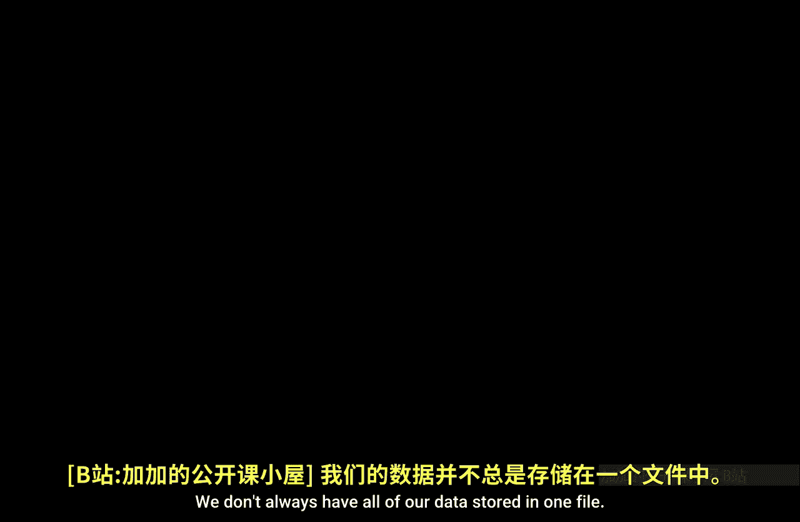

# 004： 跨文件数据合并与分析

在本节课中，我们将学习如何使用ChatGPT来合并和分析存储在多个独立文件中的数据。当数据分散在不同表格中时，手动整合会非常耗时。我们将看到ChatGPT如何帮助我们发现文件间的关联，并自动执行复杂的“连接”操作，从而构建出更完整的数据视图。

## 数据分散的挑战

我们并不总是将所有数据存储在一个文件中。因此，使用ChatGPT分析数据的一个核心能力是，它能帮助我们合并多个文件。本质上，它可以在多个文件之间“连接”数据。

上一节我们介绍了单一文件的分析，本节中我们来看看如何处理跨文件的数据。这在处理从数据库导出的数据时尤其有用，例如，每个文件可能代表数据库中的一个独立表，我们需要将这些分散在多个表中的数据连接起来，才能构建完整的数据图景。我们可以在ChatGPT中完成这类操作。

## 探索性分析：发现数据关联

我们的做法是，逐步寻找那些需要执行“连接”操作以引入数据的地方。我将继续使用职位数据集进行分析，我们会遇到一些挑战，因为数据似乎有缺失。准确地说，并非数据缺失，而是我们最初使用的文件中缺少某些信息。

例如，我最初的目标是回答几个问题，并生成一份精彩的LinkedIn帖子。ChatGPT生成了报告标题、选定的问题以及建议的分析方法。当我让它继续分析时，它确实生成了分析结果，但出现了一个有趣的情况：当我查看数据时，我看到的是按`job_id`（职位ID）统计的最高薪工作。然而，`job_id`只是一个唯一的标识符，对我们来说并不直观。我们更想知道的是“大学教授”这类可读的职位名称及其薪酬中位数等信息，但当前数据无法直接提供。

在这个数据集中，有多个独立的文件。我的直觉是，其中一个文件可能包含能与`job_id`关联起来的信息，从而找到我们需要的可读数据。

## 引导ChatGPT识别关联

因此，我将开始逐步为ChatGPT提供不同的数据部分，观察它是否能识别出可以进行关联的内容。请注意，我并没有告诉它具体怎么做。我将其作为一个探索性示例来展示。显然，如果你明确知道哪个文件有哪个ID以及它们之间的关系，你可以同时上传这两个文件并解释关系。但神奇之处在于，当你在多个文件间进行探索性分析时，ChatGPT可以帮助你识别出需要进行连接的地方。

我首先提供了一个文件（`job_industries.csv`），但它并不完全符合需求。ChatGPT注意到其中有`job_id`，但它关联的是行业信息，这对我来说还不够。我不仅想知道职位关联的行业。

于是，我返回去，将数据集中所有的文件一次性提供给了ChatGPT，并询问：“有了这些额外数据，我们能找出职位的名称吗？”

以下是ChatGPT对每个文件的分析：

*   `industries.csv`：包含`industry_id`（行业ID）。
*   `companies.csv`：包含`company_id`（公司ID）。
*   `benefits.csv`：包含`job_id`。
*   `job_skills.csv`：包含`job_id`和`skill_abbreviation`（技能缩写）。
*   `skills.csv`：包含`skill_abbreviation`和`skill_name`（技能名称）。

接着，它提出了后续步骤：我们可以使用`job_skills.csv`链接到`job_id`，然后将`skills.csv`中的技能缩写映射为技能名称。最后，我们可以将其与行业信息结合起来。这样虽然可能得不到确切的职位标题，但可以得到职位所需的技能和所属行业。

## 执行连接与结果解读

当我们运行这个分析后，得到了更有趣的结果：**最高薪工作（附带行业和技能）**。现在我们可以看到，例如“软件开发与销售”、“软件开发与市场营销”。这对我来说很有道理，我预计企业软件销售如果业绩出色，可能是一个非常赚钱的行业，从业者也能获得丰厚报酬。此外，列表中还有法律相关职位。这一切看起来都合理。

但请注意ChatGPT所做的事情：它基本上**跨越多个文件执行了连接操作**。它是如何做到的呢？

1.  **通过数据样本匹配**：它可以查看`job_id`的数据样本，并通过比对其他文件中的样本，发现相同的ID出现在多个地方，从而推断这很可能是一个唯一的标识符，而非随机数字。
2.  **通过一致的列名**：如果多个文件中都有名为`job_id`的列，它可以找到并链接它们。
3.  **通过多级关联**：在本例中，它实际上执行了更复杂和高级的操作：它将`job_id`链接到技能和行业，然后通过技能缩写进一步链接到具体的技能名称。这相当于执行了**多次“跳跃”**来完成这次连接。

## 验证与责任

ChatGPT告诉了我它将如何操作，这在它开始解释如何连接数据时非常重要。你需要审视这些解释，并确保其合理性。它可以帮助你发现跨文件的关联，即使你事先并不知道这些关联。它基本上可以**假设**可能的关系。

然而，**最终，你仍然需要进行跟进和验证**。仅仅因为看起来正确、列名相同或数值接近，并不意味着实际情况就是如此。ChatGPT可以帮助你推断可能性，但你需要通过查找数据的真实来源来确认这些关联是否确实如我们所想。你有责任跟进并确保这些被提议的关系在本质上是真实正确的，即使表面看起来合理。

## 核心方法与注意事项

关键方法是，你可以一次性在提示词中上传和附加多个文件，然后让ChatGPT开始探索并解释不同ID标识符和列之间的关系，以及如何利用它们来连接数据。它能完成其他非常复杂且有时令人惊讶的操作。

但请始终记住，验证ChatGPT的提议是否正确是你的工作。

## 总结

本节课中，我们一起学习了如何使用ChatGPT进行跨文件数据合并与分析。我们了解到，通过提供多个相关文件，ChatGPT能够帮助我们发现数据间的潜在关联，执行多级连接操作，从而整合分散的信息以获得更深入的洞察。同时，我们强调了**验证分析结果**的极端重要性，确保自动化工具提出的数据关系在业务逻辑和实际情况中是真实成立的。这结合了AI的高效探索与人类的关键判断。