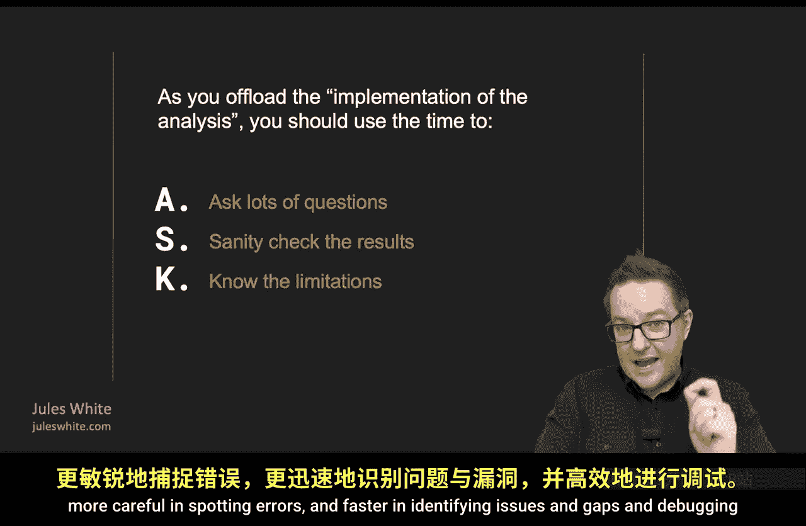

# ChatGPT与Excel：P5：通过提问让ChatGPT协助调试数据分析问题 🔍

在本节课中，我们将学习如何利用ChatGPT来协助我们发现和调试Excel数据分析过程中的潜在问题。我们将通过一个具体的案例，了解当分析结果出现矛盾时，如何通过向AI提问来定位数据中的异常、冗余或不一致之处，从而确保分析的准确性和可靠性。

上一节我们介绍了如何利用ChatGPT进行多文件数据关联分析。本节中，我们来看看当分析结果出现矛盾或疑问时，如何通过提问来引导ChatGPT帮助我们进行调试。

作为主导整个分析过程的人类，你需要持续思考：这些数据合理吗？它们是否通过了“嗅觉测试”或“合理性检查”？当AI工具让你分析得更快时，你的职责就是更加专注于数据本身。你不可避免地会发现数据中的差异、问题或AI产生的意外结果。

这时，我们可以利用AI来协助我们理解问题可能出在哪里。让我们通过一个职位分析的例子来看具体操作。

我已经让ChatGPT完成了初步分析。我们通过关联多个文件，加入了行业名称和所需技能信息，现在得到了一份看起来不错的结果。我们得到了“**最高薪职位（含行业和技能）**”的列表，例如软件开发与市场营销、软件开发与销售，还有一些法律相关职位。这些看起来都符合高薪职位的预期。

但在紧接着的“**最低薪职位（含行业和技能）**”分析中，我们却看到了“软件开发与销售”和“软件开发与业务拓展”等条目。我刚刚才在最高薪职位中看到了“软件开发与销售”。这从整体上看似乎有问题。是软件销售职位真的同时出现在最高薪和最低薪列表中，还是底层数据存在某些问题？

当然，这可能与可变薪酬等因素有关，但我希望深入挖掘并真正理解它。也许数据中存在一些我们尚未发现的问题。

每当你遇到此类问题时，我们能做的一件非常棒的事情就是提问。事实上，在数据分析中，提问是我们能做的最有力的事情之一。与其立即纠结于查看它生成的代码或其他内容，我们通常更愿意退一步，提出问题：为什么会这样？这难道不奇怪吗？然后看看是否存在潜在的解释或需要我们深入研究的差异。

因此，我在这段对话中进行了追问：“最高薪和最低薪职位都出现在软件领域，这似乎很奇怪。请查看数据，看看你是否能发现分析中的任何错误，或者我们可能需要考虑的因素。” 这确实是一项令人难以置信的能力，即深入数据内部，尝试发现可能存在的问题。问题可能是什么？

当然，你可以自己去做这件事，我也鼓励你这样做。但通常情况下，获得一个关于可能出错原因的起点会很有帮助。ChatGPT回复了，并注意到一些重要问题：

以下是ChatGPT识别出的几个关键问题：

1.  **重复的职位条目与不同的薪资值**
    *   **问题识别**：多个职位ID多次出现，且薪资值相同或非常相似。这表明存在数据冗余，同一职位可能因技能或行业的细微变化而被多次列出。
    *   **对分析的影响**：重复条目可能扭曲了平均值和范围计算，尤其是年薪计算。

2.  **薪资数据中的异常值**
    *   **问题识别**：存在最高年薪约200,000美元的职位，但最低年薪异常低，例如10,000美元。这表明要么是数据录入错误，要么是像咨询类职位这样薪资波动很大的角色，其薪酬严重依赖于绩效或工作时间。

3.  **薪酬周期不匹配**
    *   **问题识别**：一些按小时计薪的职位可能与按年薪计的职位进行了直接比较，从而导致错误的洞察。这将是一个大问题。AI可能假设只需要查看薪资列并计算特定列的最大值和最小值。但实际上，存在不同类型的薪资。现在我们必须以某种方式进行标准化，因为我们不能直接将时薪（比如很高的500美元/小时）与年薪（比如200,000美元/年）直接比较。

现在，ChatGPT真正在帮助我们建议：**我们可以采取哪些不同的做法**。

以下是ChatGPT提出的改进建议：

*   **移除重复项**：排除重复的条目。
*   **区分时薪和年薪**：这是一个非常有趣的建议，我需要确定如何处理。是希望为时薪和年薪设置单独的类别，还是希望以某种方式将它们标准化？
*   **处理异常值**：我们是否要剔除异常值，以防它们只是数据录入错误的例子？

现在，它赋予了我们审视分析、对其提出质疑的能力。“软件领域同时出现最高和最低薪资，这真的合理吗？” 然后，它可以提出假设并识别分析中的潜在错误。

这非常有价值，因为作为人类，很多时候很难发现这类问题。因此，拥有一个可以查看数据、我们可以从高层次出发（“这看起来可能不太对劲，帮我找出原因”）的伙伴，然后它可以去假设可能的原因，我们再据此去验证。这真的是一个问题吗？也许不是。但如果是，它帮助我们发现了这些问题。而发现我们分析中的漏洞和缺陷往往是最困难的事情之一。

现在，这让我回到一个非常重要、需要强调的点。

作为人类，AI将帮助你实施分析，帮助你发现分析中的漏洞或问题。这在很多情况下将帮助你更快地推进。

**你的目标不是节省时间，而是进行更好的、更彻底、更扎实、更深思熟虑的分析。** 因此，为了实现这个目标，你因为AI能瞬间生成代码（例如分析平均薪资和最高薪资）而节省下来的时间，应该被投资于以下方面：

以下是利用节省的时间提升分析质量的关键方法：

1.  **提出大量问题**：对自己、对他人、对ChatGPT提问。“软件领域同时出现最高和最低薪资，这真的合理吗？” 提问是帮助梳理是否存在问题的非常有效的方式。
2.  **对结果进行合理性检查**：尽可能多地进行检查。“那里列出的最高薪资合理吗？是10亿美元吗？如果是，那可能不合理。是负数吗？那也可能不合理。” 进行各种基本的合理性检查，确保结果正确。因为你正在腾出时间来进行更好的分析，更彻底地检查，确保在依据它做出决策之前它是正确的。
3.  **了解局限性**：真正了解数据是否存在根本性的限制，限制了我们可以得出的结论。例如，我们知道这些数据中存在很多变异。也许只是有一些异常值或数据录入错误，就像它提到的那样。也许根本无法将这些时薪标准化并与年薪进行有意义的比较，这可能只是数据的局限性。

因此，**提问**是我们应该做的一件非常有力的事情。当我们使用ChatGPT时，我们应该不断提问、提问、再提问。因为我们将节省时间，但我们需要将其投资于确保我们的答案更好。

另一个原因是，如果你使用ChatGPT进行数据分析，你将面临非常高的审查标准。你需要确保你得到的结果比那些不使用它的人更好。通常，那些不使用AI的人会深陷于仅仅试图实施分析、完成一个版本的分析或报告的泥潭中，他们没有时间像你一样彻底——当你腾出这些额外的时间来深入挖掘并对你得到的结果提出大量疑问时。所以，请确保你利用节省下来的时间来获得更好的答案，以更周到的方式思考数据，更仔细地发现错误，并更快地识别问题和调试漏洞。

本节课中，我们一起学习了如何通过向ChatGPT提问来调试Excel数据分析中的问题。我们了解到，当分析结果出现矛盾时，可以引导AI检查数据冗余、异常值和数据标准化等问题。关键在于利用AI节省的时间，更多地投入到提出质疑、进行合理性检查和理解数据局限性上，从而做出更扎实、更可靠的数据分析。