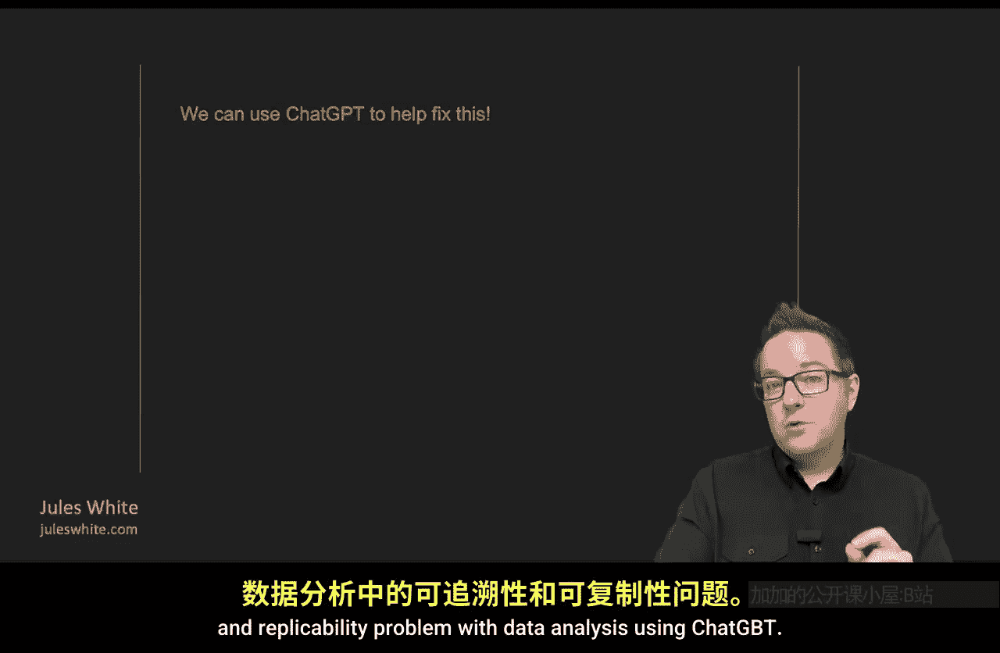

# 006：Excel数据分析的可追溯性与可复现性

在本节课中，我们将探讨生成式AI如何帮助我们构建更值得信赖的数据分析，并重点解决数据分析中的可追溯性与可复现性难题。

---

生成式AI最令我兴奋的一点在于，我认为它能帮助我们获得比当前通常做法更值得信赖的数据分析结果。

这听起来可能有些反直觉。如果你与大多数人交谈，他们的普遍假设往往是不信任AI。AI会产生幻觉、编造信息、误解或曲解数据，总是犯各种错误。然而，我认为这恰恰是一个巨大的机遇。因为你知道还有谁总是在做这些事情吗？是人类。人类也会产生类似幻觉的错误，并时常误解各种事情。

当我们开始处理数据时，我认为这是一个非常普遍的问题。尤其是我们处理的数据量越大，就越容易犯错而不自知。我们回顾一些做过的分析，例如，处理多个文件，试图理解它们如何关联。我们可能不完全了解数据来源，不完全理解列之间的关系，也可能没有彻底思考所有的合理性检查。

而AI可以帮助我们解决这个问题。但有一个特别巨大的机遇，也是本讲的核心，我认为AI能真正帮助我们。那就是：最大的问题不在于我们使用的工具。数据的核心问题在于，我们进行的分析往往难以被他人复现。我们没有以一种便于他人理解的方式记录数据和整个分析过程。我们经常得到的是一个塞满复杂公式的电子表格，但完全不清楚这些公式是如何组合的，其中是否存在错误。事实上，我们知道这些公式和分析中时常存在错误，并且往往要到很久之后才会被发现。

可复现性是一个亟待解决的重要问题。我们如何确保在完成分析后，其他人能够重新运行、检查并验证其合理性？他们需要能够理解分析的细节，并理解可追溯性：数据从何而来？如何使用？如何筛选？如何整合？

我经常看到的情况是，你拿到一份演示文稿，其中包含一张大图表。所有人都想当然地认为那张图表或分析是正确的。我们从不质疑是否应该检查它。而如果我们决定检查并想跟进理解其构成，这通常非常困难。我自己深有体会，因为我做过包含AI内容的演示。很早我就学到了重要的一课：当我们没有记录所有这些信息时，一旦有人提出问题，指出图表或数据中可能存在的疑点，我们就会束手无策，因为我们无法回溯并确认那是否真的是一个问题。

对于生成式AI，我们通常以对话的形式进行思考和工作。我认为，不幸的是，对话虽然是呈现和解决问题的一种好方式，并且如果保存下来，可以包含许多重要的上下文信息用于追溯，这确实很有价值。但我认为我们可以做得更好。

接下来我将展示如何做到这一点。

---

那么，我们如何使用ChatGPT来解决这个可追溯性和可复现性问题呢？一种方法是保存我们进行此类分析时的所有对话记录。

但由于工具本身的一些限制，我不建议你采用这种方式。我们有更好的方法。

现在，让我们来看看如何利用ChatGPT开始解决数据分析中的可追溯性和不可复现性问题。