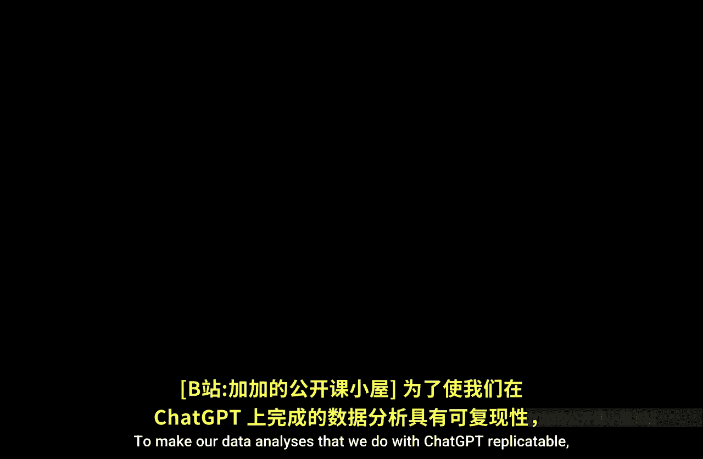
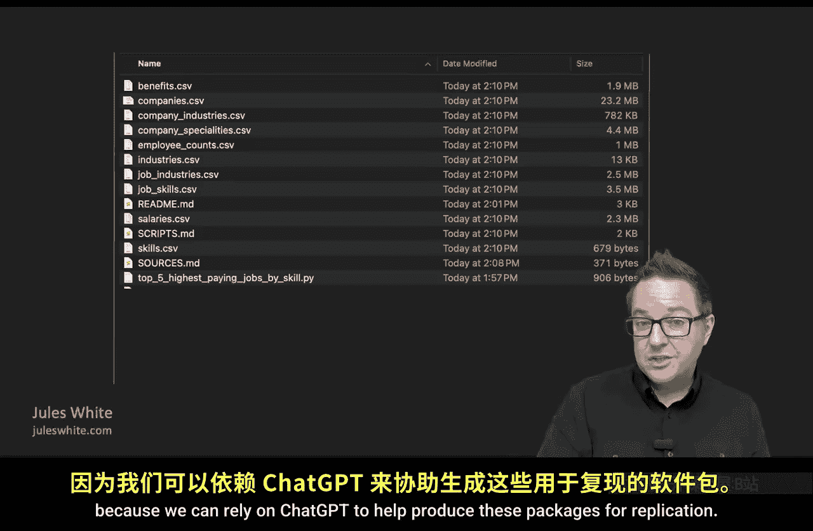

# 007：创建数据分析复现包以增强可信度 📦



## 概述
在本节课中，我们将学习如何利用ChatGPT为我们的数据分析工作创建一个“复现包”。这个包将包含分析的所有关键信息，让他人能够验证、复现并理解我们的工作过程，从而极大地提升分析结果的可信度和透明度。

---

## 构建复现包的必要性
上一节我们介绍了如何利用ChatGPT进行数据分析。本节中我们来看看如何确保这些分析是可追溯和可复现的。我们希望在每次分析结束时，都能生成一个清晰的记录，说明使用了哪些数据、进行了哪些操作，以及可能存在哪些问题。

## 生成可追溯性文档
以下是创建复现包的第一步：生成一份全面的可追溯性文档。我们向ChatGPT发送一个提示，要求它总结整个分析过程。

**提示示例：**
```
创建一个可追溯性文档，确保他人能够：1. 了解使用了哪些数据；2. 知道分析是如何执行的；3. 识别有效性威胁（即分析中可能出错的地方）。我们需要一份让他人能够复现分析并了解其局限性的指南。
```

ChatGPT将根据对话历史生成一份文档，通常包含以下部分：
*   **数据源与描述**：列出使用的文件及其用途。
*   **数据准备与清洗步骤**：例如，过滤掉极端的薪资值或低于最低工资标准的记录。
*   **分析步骤**：回顾分析过程中提出的问题和执行的操作。
*   **有效性威胁**：识别分析中可能存在的错误或假设。
*   **复现指南**：解释重新运行此分析所需的步骤。

生成这份文档的成本极低。你甚至可以提供一个理想文档的样本，让ChatGPT按照相同的格式和章节生成新文档，从而获得更佳效果。

## 保存文档与代码
一旦我们拥有了这份文档，就需要将其保存下来。

### 1. 保存为README文件
我们首先将可追溯性信息保存为一个Markdown格式的README文件，这是一种常见的、易于阅读的格式化文本文件。

**提示示例：**
```
将可追溯性信息保存为 readme.md 文件。
```
ChatGPT会生成文件并提供下载链接。

### 2. 捕获并保存分析代码
在分析过程中，ChatGPT会编写并执行Python代码。我们需要捕获这些代码，以便他人检查和重新运行。

**提示示例：**
```
现在，为每一项分析和可视化创建一个独立的Python脚本，该脚本能够执行分析并生成可视化结果。脚本可以假设所使用的文件与脚本位于同一目录下。请保存每个Python文件，并使用能标识其相关分析的前缀来命名。同时，请输出一个表格，列出分析内容、对应的Python脚本文件名以及该脚本功能的一句话描述。
```

这个步骤会为对话中的每一项分析生成一个独立的、可执行的Python脚本文件，并创建一个索引表格来说明每个文件的作用。

### 3. 创建脚本索引文件
接下来，我们创建一个总览文件来索引所有生成的代码。

**提示示例：**
```
创建一个 scripts.md 文件，其中包含列出所有脚本及其功能的表格，并为每个单独的脚本设置一个章节，说明其作用。
```
这样，我们就拥有了一个所有已创建代码及其功能的“主索引”。

### 4. 记录数据来源
由于是我们自己上传的数据，ChatGPT并不知道原始来源。因此，我们需要创建一个文件来记录数据的元数据。

**提示示例：**
```
创建一个名为 sources.md 的文件，说明所有数据均可从 [此处填入URL] 下载。
```
你可以在此记录数据来源的任何信息，例如数据库查询、文件共享链接或数据获取时间。

## 打包所有内容
至此，我们已经创建了README文件、脚本索引、多个Python脚本文件以及数据来源文件。真正的强大之处在于将它们与原始数据一起打包。

**提示示例：**
```
现在，将 Readme、Sources、Scripts 文件以及原始数据合并到一个我可以下载的zip文件中，以便他人能够复现该分析。
```
ChatGPT会将所有生成的文件和原始数据打包成一个ZIP文件供你下载。解压后，你会看到一个包含以下内容的完整包：
*   `README.md`：分析描述、步骤和有效性威胁。
*   `sources.md`：数据来源说明。
*   `scripts.md`：所有代码脚本的索引和描述。
*   多个 `.py` 文件：可独立运行的Python分析脚本。
*   原始数据文件（如CSV）。



## 总结
本节课中我们一起学习了如何利用ChatGPT创建数据分析复现包。通过生成可追溯性文档、保存分析代码、记录数据来源，并将所有内容打包成一个独立的ZIP文件，我们极大地提升了数据分析工作的透明度、可信度和可复现性。这种方法将分析过程从封闭的工具或复杂的公式中解放出来，使其成为任何人都可以检查、验证和理解的独立成果，从而在数据科学实践中树立了新的标准。