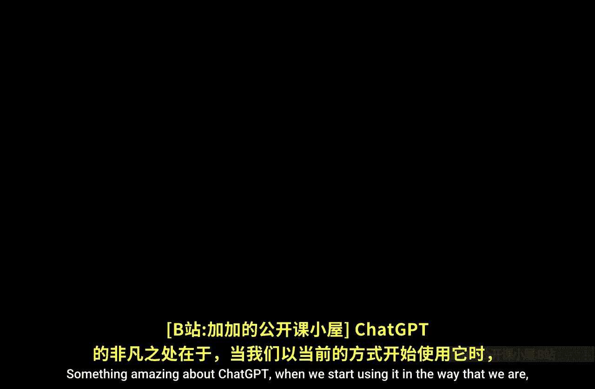
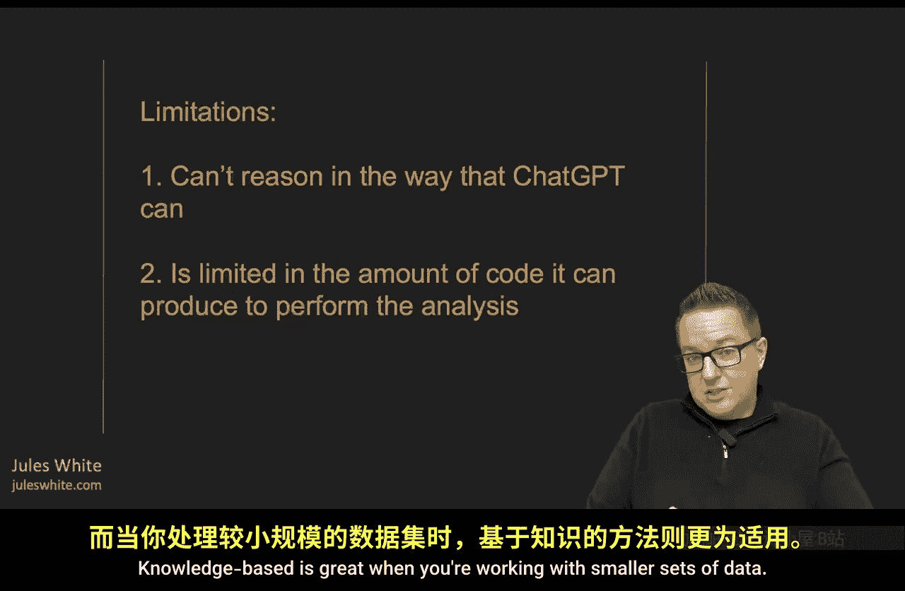

# 008：利用ChatGPT实现数据转换与筛选方法 🧠➡️💻



在本节课中，我们将学习ChatGPT如何将我们的目标和意图“翻译”成计算指令，从而实现数据转换与筛选。我们将重点探讨两种核心方法：基于知识/推理的方法和基于程序的方法，并理解它们各自的适用场景与限制。

## 从目标到计算：ChatGPT的“翻译”能力

当我们以特定方式使用ChatGPT时，其神奇之处在于它能够将我们的目标、陈述和想要达成的效果“翻译”成计算指令。这意味着我们无需费心研究如何编写宏或Python代码来实现目标。我们只需用高层次的语言表达意图，ChatGPT便能将其转化为具体的计算过程。

这背后的原理与模型的架构有关。这些模型最初基于Transformer架构，该架构最初就是在翻译任务的背景下构建和测试的。本质上，ChatGPT正在将我们想做的事情“翻译”成计算。

在处理数据时，特别是来自Excel或CSV文件的数据，我们可以利用ChatGPT来转换和筛选数据。我们只需告诉它我们希望通过转换或筛选实现什么目标，它就会想办法实现。

## 两种核心实现方法

ChatGPT将我们的目标转化为计算主要有两种方式，我们将详细讨论这两种方式，并理解它们的区别以及各自的适用场景。

从高层次看，这两种方式分别是：
1.  **基于知识或推理的方法**
2.  **基于程序的方法**

这两种方式本质上是互斥的，ChatGPT会选择其中一种来执行。当然，它也可能将两者串联起来，例如从一种方法开始，以另一种方法结束。理解何时使用哪种方法至关重要。

## 基于知识/推理的方法 🧠

我们首先来看基于知识或推理的方法。这种方法的核心思想是：我们将数据放入提示词中，然后将其输入给模型（如ChatGPT），模型会输出处理后的数据。

在这个过程中，**模型本身在执行计算和推理**。这对于某些类型的任务非常有效，但并非适用于所有任务。

以下是这种方法的一个关键特点，我们将在最后详细讨论：请注意，在输入阶段，数据量很大，但输出阶段数据量很小。这是因为模型可以接收大量信息，但每次只能输出少量信息。通常，模型的输入容量是输出容量的100到300倍。这意味着我们总是要处理这种输入与输出的不对称性，这会影响我们能用模型做什么，尤其是在处理这类基于知识的任务时。

### 示例：为数据集添加新列

以下是一个基于知识/推理任务的示例。我给了ChatGPT一个数据集样本，其中包含多个国家及其主要作物和文化。我提示ChatGPT为每一行（即每个国家）添加一个新列，内容是“该国最受欢迎的菜肴之一”。

这是一个典型的基于知识的转换任务，如果使用传统代码或宏来实现会非常困难，甚至不可能，除非你事先拥有每个国家的菜肴列表。而在这里，我们要求模型“凭空”创造出来，这就像聘请一位世界文化专家来完成这项任务。

ChatGPT处理后的结果是为每个国家添加了一道菜肴，例如美国-汉堡、印度-印度香饭、墨西哥-塔可、法国-可颂等。

### 适用场景与优势

在以下情况中，这种方法非常有效：
*   **任务需要深度思考**：需要人类级别的推理能力，难以用代码或宏简单实现。
*   **执行机器学习类任务**：例如，可以进行情感分析（为每条客户评论添加“积极/消极/中性”标签），或基于用户历史购买记录进行产品推荐。

你可以将这个思路扩展到任何场景：只要你有行和列的数据，就可以要求模型基于现有信息，通过复杂的推理为每一行添加一个新列。这可以是基于知识的创造（如同雇佣人类专家），也可以是传统的机器学习任务（如分类、预测、推荐）。

### 限制与注意事项

然而，这种方法存在重要限制：
1.  **输入输出不对称**：如前所述，模型能接收大量数据，但输出有限。如果你的数据集有10000行，模型可能都能“看到”，但可能只能输出50行，因为输出受令牌窗口限制。你需要实验并可能将数据分块处理。
2.  **可能产生幻觉**：模型可能会“捏造”信息。就像你给一个人做测试，遇到不会的题目他可能会猜。因此，**务必检查输出结果**。你可以通过提示词技巧来缓解，例如指示模型：“如果某行信息不足以完成请求，则在相应位置填入‘N/A’（不适用）”。
3.  **不适用于需要高精度或复杂数学运算的场景**：这种方法不适合处理需要完美数值精度、复杂公式或数学计算的任务。它更适用于处理与文化、艺术相关的内容，或进行句子改写、SEO优化等基于知识的任务。

## 基于程序的方法 💻

另一种转换方法适用于需要数值精度和处理大量数据的场景，即**基于程序的转换**。我们之前已经做过很多这类转换，只是没有意识到。

### 工作原理：代码生成与执行

当你使用ChatGPT的“高级数据分析”模式（名称可能变化，但功能不变）来处理数值型数据任务时，它并不会像上一种方法那样将数据喂给模型本身。相反，**它会编写代码（通常是Python代码）来执行任务**。

ChatGPT会推理：“我能否编写Python代码来实现用户的目标？”然后，它将我们的意图翻译成代码，用我们的数据作为输入来执行这段代码，并产生输出。

### 示例：数值格式转换

例如，假设我有一个包含“最高薪资”列的数据集。我可以提示：“请将‘最高薪资’重新格式化为以千为单位表示（例如，1.0 代表 1000）。”

ChatGPT会返回转换后的数据，添加了一个名为“最高薪资（千）”的新列，并妥善处理了非数值情况。它是如何做到的？它编写并执行了类似下面的Python代码来实现转换：

```python
import pandas as pd

# 假设 df 是包含‘Max Salary’列的DataFrame
df['Max Salary (Thousands)'] = df['Max Salary'] / 1000
# 处理非数值情况
df['Max Salary (Thousands)'] = pd.to_numeric(df['Max Salary (Thousands)'], errors='coerce')
```

### 优势与特点

这种方法的优势在于：
*   **数值精度高**：代码执行是确定性的，具有可重复性和可预测性。
*   **可处理数据量大**：由于执行的是外部代码，理论上可以处理非常大的数据集，通常不会遇到在模型内部处理时的输出限制。
*   **可审查与调试**：你可以查看生成的Python代码，进行检查和验证。

### 限制与考量

当然，这种方法也有其局限性：
*   **推理能力有限**：代码本身的智能程度无法与模型内部的推理能力相比。模型可以很聪明地编写代码，但代码能实现的功能有固有边界。例如，你无法让它编写代码来“过滤掉所有可能是蔬菜或蔬菜隐喻的文本”，但让它“将所有数值除以100”则很容易。
*   **代码长度限制**：如果任务极其复杂，导致生成的Python代码本身超过了输出令牌限制（例如超过1000个令牌），这种方法也会失效。
*   **可能选错方法**：有时，我们想要进行基于知识的转换，但数据集太大，无法放入模型；或者模型错误地尝试用编写代码来解决一个本应靠推理完成的任务。这时，我们需要手动干预，例如将数据分块，或明确提示它“不要用Python代码，用你的知识来回答”。

## 方法选择与实践策略

在实际操作中，我们需要决定使用哪种转换方法。以下是一些指导原则：

*   **倾向于使用基于程序的方法**：当你需要进行程序化转换或筛选，尤其是涉及数值计算、需要高精度和可重复性时，应优先考虑这种方法。
*   **在特定情况下使用基于知识的方法**：当你处理的是小规模数据集，且任务需要人类级别的知识、文化理解或复杂推理（如创意生成、文本分析、情感判断）时，这种方法非常强大。

有时，我们会遇到混合情况：任务需要知识推理，但数据量太大。这时，我们可能需要手动将数据集分成多个小块，分批提交给模型处理，或者引导模型进行增量式处理。

## 总结

本节课我们一起学习了ChatGPT实现数据转换与筛选的两种核心方法。

*   **基于知识/推理的方法**：模型直接处理数据并运用其内部知识进行推理，适用于需要创意、文化理解或复杂逻辑判断的小规模数据任务，但需警惕其输出限制和“幻觉”可能。
*   **基于程序的方法**：模型通过编写并执行代码（如Python）来处理数据，适用于需要高数值精度、处理大量数据、可重复验证的标准化转换与筛选任务。



理解这两种方法的原理、优势与局限，能帮助我们在实际工作中更高效、更准确地利用ChatGPT来增强数据分析能力，在智能推理与程序化精确处理之间做出最佳选择。