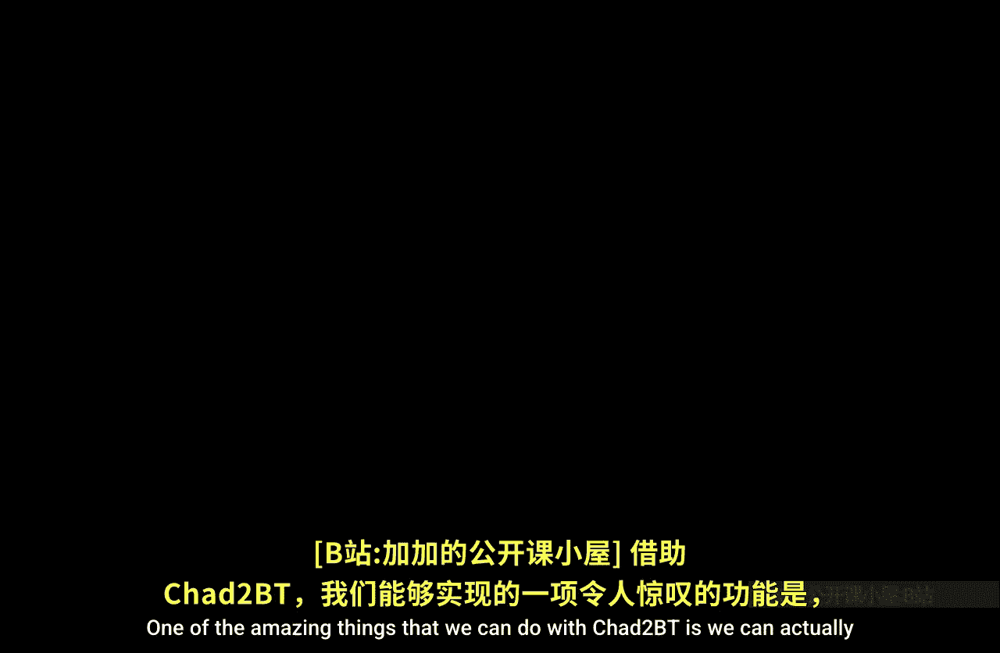
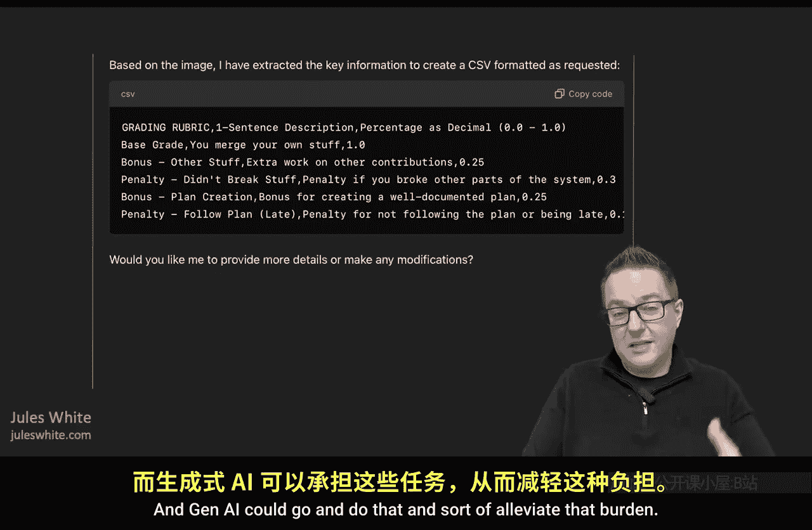

# 009：从非结构化源提取结构化Excel数据 📊



在本节课中，我们将学习如何利用ChatGPT从各种非结构化数据源（如原始文本、照片等）中提取信息，并将其整理成可用于Excel分析的、格式规整的结构化数据。

## 概述

传统的数据分析通常依赖于已经结构化的数据。然而，现实世界中的大量信息，如社交媒体帖子、产品评论、会议白板笔记或现场照片，最初都是非结构化的。手动整理这些数据既耗时又容易出错。本节将展示如何通过巧妙的提示词工程，引导ChatGPT自动完成这项提取和格式化工作，从而高效地创建数据集。

## 从原始文本中提取数据

上一节我们探讨了ChatGPT与Excel的基本交互。本节中，我们来看看如何从一段杂乱的原始文本中提取出清晰的结构化数据。

以下是一个具体的操作示例。假设我们从LinkedIn动态中复制了一段包含多个帖子、作者、发布时间和杂乱格式的文本。

**操作步骤：**
1.  将原始文本粘贴到ChatGPT中。
2.  使用清晰的分隔符（例如`---`）将指令与数据分开。
3.  给出明确的输出格式指令。

**核心提示词结构如下：**
```
{你的原始数据，例如LinkedIn帖子文本}
---
请将此转换为CSV格式，格式为：姓名, 帖子一句话总结, 主题（一个词）
插入行...
...
```

在这个提示词中：
*   **`姓名`**：这是一个简单的列，指示模型直接提取发布者的姓名。
*   **`帖子一句话总结`**：这是一个更丰富的列描述，它要求模型阅读并理解帖子内容，然后生成一句摘要。这展示了列名可以是指令本身。
*   **`主题（一个词）`**：这里的括号`(一个词)`是给模型的额外提示，用于约束输出，确保结果简洁一致。
*   **`插入行...`**：这是一个提示工程技术，它告诉模型“请根据上述格式，用提取的数据填充后续行”。这类似于给人类一个填空模板。

执行后，ChatGPT会输出类似以下的CSV格式结果，可以直接导入Excel：
```
姓名,帖子一句话总结,主题
Alan Carnes,邀请高等教育界朋友讨论生成式AI,生成式AI
Jane Doe,分享关于数据可视化最佳实践的新见解,数据可视化
```

## 从图像中提取数据

我们不仅可以从文本中提取数据，ChatGPT的多模态能力使其也能“看懂”图片并提取其中的信息。这极大地扩展了数据源的范畴。

以下是几种常见的图像数据提取场景：

**1. 截图信息提取**
你可以对屏幕内容（如一篇具体的社交媒体帖子、一个网页段落）进行截图，然后使用与处理文本类似的提示词，要求ChatGPT识别图片中的文字并按照指定格式输出。

**2. 实物照片信息提取**
你可以拍摄现实世界的物体。例如，拍摄一张办公桌的照片，然后提示：“请列出我桌面上所有的物品，每行一件，格式为：物品名称, 估计数量, 类别”。

**3. 手写或白板内容数字化**
在会议或课堂中，经常会将想法写在白板上。你可以拍摄白板照片，然后让ChatGPT将其内容转换为表格。例如，对于一张写有评分标准的白板照片，可以使用提示词：“请将此转换为CSV格式，格式为：评分项目, 描述, 百分比（小数）”。

**重要提示：**
虽然这个功能强大，但目前仍有局限性。模型在处理包含大量（例如上百个）项目的复杂图片时，可能会产生“幻觉”（即编造不存在的内容）。因此，它更适用于处理项目数量有限、内容相对清晰的场景。对于关键数据，务必进行人工抽查验证。

## 应用场景与最佳实践

我们已经看到了从文本和图像中提取数据的方法。这些技术可以应用于众多领域，将难以处理的非结构化信息转化为可分析的数据。

**典型应用场景包括：**
*   **社交媒体分析**：从品牌帖子下的评论中提取情感倾向和关键话题。
*   **市场调研**：将收集到的开放式用户反馈文本分类并总结。
*   **内容管理**：整理从不同文档、邮件中提取的会议纪要或项目要点。
*   **库存初盘**：通过拍摄货架照片快速生成初步的库存清单（适用于小规模场景）。

**使用时的最佳实践：**
1.  **明确列定义**：在提示词中，清晰定义每一列。对于需要复杂处理的列（如总结、分类），在列名中直接描述任务。
2.  **提供输出示例**：如果格式复杂，可以在提示词中给出1-2行期望的输出示例，这能显著提升模型输出的准确性。
3.  **结果校验**：始终对输出结果进行抽查，特别是涉及数字或关键分类时。可以结合Excel的筛选、统计功能进行快速检查。
4.  **分步处理**：如果数据量很大，尝试分批处理，而不是一次性让模型处理所有内容，以提高准确性。
5.  **利用其优势**：这项技术在处理需要人类阅读理解（如总结、情感判断）而非绝对数值精确的任务上尤为高效，能节省大量人力。

## 总结



本节课中我们一起学习了如何利用ChatGPT作为强大的“数据提取助手”。我们掌握了从非结构化的原始文本和图像中，通过设计精炼的提示词，提取出规整的结构化数据（CSV格式）的方法。关键点在于：提供清晰的原始数据、定义带有详细描述的列结构、并使用模板化的提示引导模型完成填充。虽然目前技术对于大规模复杂图像的识别仍有局限，但在处理文本摘要、评论分类、会议记录整理等场景中，它已经成为一个能极大提升效率的实用工具。记住，将结果导入Excel后，你便可以运用各种分析功能，对这些新创建的数据集进行深度挖掘了。