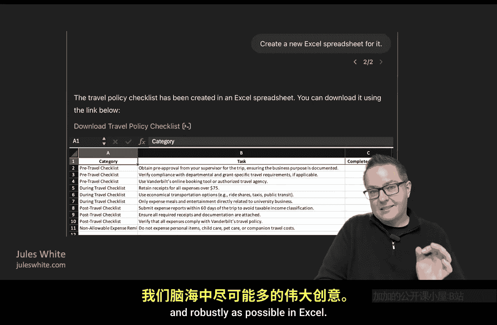

# 011：将文档转化为可执行方案

在本节课中，我们将学习如何利用ChatGPT，将政策、程序等文档内容，快速转化为结构化的Excel电子表格方案。我们将看到，这不仅能极大提升原型设计的速度，还能激发我们构建更佳电子表格的创造力。

## 从文档到电子表格的构想

上一节我们探讨了ChatGPT与Excel结合的基础。本节中，我们来看看如何利用文档作为灵感来源，设计出符合特定要求的电子表格。

当你开始在Excel中使用ChatGPT时，我希望你思考如何用它来实现那些原本“不可能”的事情。它能将计算能力提升到新高度，让我们完成一些过去认为计算机无法胜任的任务。一个绝佳的例子是：我们开始构建Excel电子表格，但使用文档作为设计灵感的来源。我们可以手动阅读文档、思考、收集信息并构建表格，但我们希望更快地进行迭代和原型设计。我们希望花更多时间思考构建电子表格的各种不同方式和排列组合，从而得到一个出色的电子表格，而不仅仅是一个普通的表格。我认为，当我们开始思考利用文档来辅助设计电子表格时，ChatGPT就能帮助我们实现这一点。

那么，将文档转化为电子表格具体意味着什么？我将通过一些例子来说明，并希望能启发你以不同的方式思考如何结合使用ChatGPT和Excel，真正突破可能的边界。

## 实例：旅行费用政策文档

这是一个范德堡大学的旅行和商务费用政策文件，一个大约17到20页的PDF文档，其中列出了所有关于旅行费用的政策和规则。如果我想创建一个电子表格来跟踪这些信息，传统方法是阅读文档，尝试分类所有不同条目，然后手动构建电子表格。

但现在有一种新方法。我将把这个PDF文件上传到ChatGPT，并给出指令：`设计一个符合此政策的、用于跟踪费用的Excel电子表格`。

ChatGPT会读取政策内容，并开始构思由范德堡大学旅行和费用政策所启发的电子表格结构。例如，它会考虑业务类型、费用类型、业务目的等审批文档中可能包含的所有信息。然后，它会开始设计工作表，讨论输入验证等功能。最令人兴奋的是，它最后会问：`您希望我为此电子表格创建一个原型吗？`

这正是我们现在可以做的真正神奇的事情：快速原型设计电子表格。我们通过对话来构思这个电子表格应该包含什么、外观如何、结构怎样。并且，在任何我们觉得有趣的时候，都可以立即生成原型。回答“是，请创建Excel电子表格”，它就会生成一个表格并提供下载链接。

## 快速原型设计与迭代

这为我们提供了什么能力？它使我们能够快速原型设计，并思考电子表格中需要包含哪些内容、如何设计。很多时候，我们过于关注公式等内容，以至于可能直到为时已晚才意识到电子表格中遗漏了关键信息，或者存在更好的设计方式，比如是否应该拆分成多个工作表。

这种方法使我们能够基于真实的文档、真实的业务流程（无论是政策、程序、最佳实践还是清单）进行快速原型设计和构思。你可以给它任何你想要的文档，让它以此为基础进行快速原型设计。

然而，一个空的电子表格是“令人沮丧的”，因为很难感受它将如何被使用。所以，让我们来解决这个问题。在设计电子表格时，另一个令人惊叹的事情是，我们可以用它来帮助填充示例数据，以便更好地感受这个电子表格将如何工作。比起仅仅推理列的含义，查看数据并理解其是否合理要容易得多。

我只需在对话中跟进一句：`你能用一些示例数据填充它吗？` 它就会重新生成包含数据的电子表格。现在打开它，我就能看到示例数据。这看起来合理吗？是否正确？看到数据后，我对这个电子表格的感觉好多了。一个填充了数据的电子表格比空表更“令人愉快”，我也能更好地思考它是否有效，或者是否存在问题。

## 重塑设计以满足具体需求

但看着这个表格，我意识到这并非我真正想要的。我真正想要的是，作为一名个人旅行者，我需要一个电子表格来帮助我跟踪单次旅行。如何构建一个跟踪旅行的电子表格，同时确保我捕获了符合范德堡大学旅行和商务费用政策所需的信息？

这正是快速原型设计的优势所在。我可以说：`重新设计这个工作表，使其适用于跟踪特定旅行的个人旅行者费用。` 它会重新格式化整个电子表格。再次打开时，我得到了分开的工作表：一个“旅行详情”表，用于填写姓名、目的地、起止日期和业务目的（这是我提交费用报告所需的）；另一个独立的部分用于跟踪所有个人费用，捕获提交费用报告所需的关键信息。

这使我能够快速原型设计、构思，并最终构建一个更好的电子表格。这就是我的目标：创建一个更好的电子表格。当然，我可以手动创建，但可能会遗漏政策的某些方面，花费更长时间，迭代次数也更少。而现在，我可以重塑、重新格式化、探索它应有的样子，而不会被已投入的工作和沉没成本所束缚。我可以快速思考设计，而它能帮助我将这些设计反映在我创建的Excel文件中。

## 利用AI的创意并保持控制

ChatGPT还能帮助我们集思广益，思考如何让电子表格变得更好。在最初的设计中，它提到了“输入验证”。这实际上是个非常好的主意，我自己平时可能不会想到要实施输入验证。既然它提出了这个好主意，我就应该采纳。

因此，我在对话中跟进：`你能实现你提到的输入验证吗？` 现在，我是在采纳它自己的想法，并让它将其反映在电子表格中。你可以想象自己拥有一位非常有才华的电子表格设计师，他提出各种实现想法，但最终你是决策者。他向你展示想法，你告诉他去执行。你也可以提出自己的疯狂想法让他实现，或者认可他的好主意并让他去执行。这正是我们在这里所做的。它会重新设计电子表格。

现在，当我返回表格并输入“机票”作为费用类型（这是有效的范德堡费用类型）时，一切正常。但如果我输入“零食”，它会立即提示：“S”不是有效的费用类型。它提出了实施输入验证的好主意，而我只需告诉它去实现这个好主意。我可以告诉它我的好想法，也可以受它的想法启发，然后告诉它我想要什么。但最终，我是电子表格的仲裁者，通过快速对话，不断演进这个电子表格，以捕获由政策启发的重要信息。

在这个例子中，输入验证是基于政策中列出的有效费用类型。我本可以自己阅读并提取所有有效类型，但更有效的方式是提出核心要求：`我们需要输入验证。` 至于具体类型列表是由我逐一识别，还是由AI提取，并不那么重要。最终，我会检查输入验证的实现是否正确，是否遗漏了某个类别。无论如何，我都会进行检查。即使是我自己阅读了所有类型，最后也需要复核。所以，我所做的只是加速设计和迭代过程，但严谨的检查始终是必要的。我们应该始终这样做。

## 拓展想象力：从政策到清单

我们还可以更富创造力地构思电子表格。它不一定只是直接反映费用跟踪。例如，如果我们想将政策转化为旅行者使用的清单，以便他们在电子表格中勾选确认自己遵守了所有相应规则，该怎么办？

我只需在对话中跟进：`将旅行政策转化为旅行者在预订旅行时应遵循的清单。` 它会返回一个包含一长串项目的清单。然后我可以接着说：`好的，现在为它创建一个电子表格。` 它就会将政策转化为清单，并在Excel中呈现出来。

这向我们展示了“文档作为快速原型设计来源”这一理念的力量之一：文档包含大量信息，我们一直在创建各种文档，但现在我们可以将它们转化为许多不同的东西。我可以将旅行费用政策转化为跟踪费用的工作表，可以基于旅行者视角进行设计，也可以将其转化为旅行者出行前的清单，或者任何我能想象到的、可以利用这份旅行和商务费用政策实现的事情。我现在可以在Excel电子表格中实现它们。我创造力的瓶颈仅在于我的想象力、创造力和批判性思维，而不再是我在Excel中输入或创建公式的能力。它解放了我们，让我们能够梦想更大，用Excel做更多事情。

它不会取代你的思考过程、灵感和批判性思维，也不会为你自动化一切，你仍然需要参与其中。但它解锁了我们用Excel做更多事情的能力。它使我们能够拿起那份旅行政策文档或任何其他文档，并将其转化为令人惊叹的东西，然后再转化为另一个令人惊叹的东西，让我们能够尽可能快速、稳健地在Excel中实现我们拥有的尽可能多的好点子。而这正是我们将要探索的各种方法。

## 总结

本节课中，我们一起学习了如何利用ChatGPT将文档（如政策、程序）快速转化为结构化的Excel电子表格方案。我们看到了从上传文档、生成原型、填充示例数据、根据具体需求重塑设计，到采纳AI创意并实施功能（如输入验证）的完整流程。更重要的是，我们认识到这种方法的核心价值在于**解放创造力**，将构建电子表格的瓶颈从技术操作转移到想象力与设计思维上，使我们能够基于同一份文档快速迭代出多种不同的、优秀的解决方案。