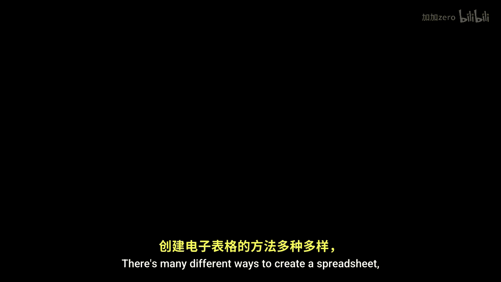
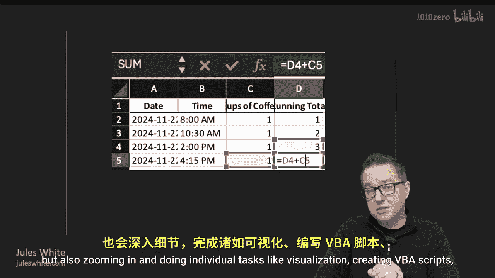

# 012：通过与ChatGPT对话设计和创建Excel电子表格

## 概述
在本节课中，我们将学习如何通过与ChatGPT对话来设计和创建Excel电子表格。我们将看到，将ChatGPT作为思考伙伴，可以帮助我们构思电子表格的结构、数据捕获方式以及计算逻辑，从而更高效地完成设计。

---

创建电子表格的方法有很多种，其中一种方式就是与ChatGPT进行对话。这是一种非常有效的方法，可以帮助我们思考电子表格应该如何设计。因为每当我们开始使用Excel时，最重要的事情之一就是我们的设计是否正确，我们是否真正思考过应该捕获哪些数据、如何捕获以及如何呈现这些数据。事实证明，聊天是一种非常有效的方式，可以帮助我们思考和构思实现这些目标的方法。

那么，让我们开始吧。前几天，我意识到我根本不知道自己喝了多少咖啡，但很可能喝得太多了。今天早上我就喝了很多。也许我应该开始记录一下。那么，如果我开始记录，我的电子表格会是什么样子呢？于是我说：“设计一个非常简单的电子表格，帮助我记录每天的咖啡消耗量。其中一列应该是已喝咖啡杯数的累计总数。”我想从视觉上思考一下，这会是什么样子。

为了让这个过程更有效，如果你是一个视觉型的人，你还可以要求它“格式化为表格”，以确保它以表格形式给出。我这里没有特别要求，但我很幸运，因为它直接设计成了表格。

我看着这个设计，觉得它看起来很不错。我有日期、时间和咖啡杯数列，还有我要求的累计总数。它还给出了解释，告诉我如何构建这个电子表格。所以，如果我想实现它，这里有对列的解释，以及如何创建累计总数公式，并且它引用了将会存在的单元格。

现在，我可以去思考如何构建它了。我认为这部分非常棒。因为当我构建电子表格时，我经常在思考数据。我也需要知道，为了实现我想要创建的不同列，我需要哪些公式。通常，当我思考时，很难知道这些公式是什么。但另一个非常棒的地方是，我告诉了它列要做什么，而它识别出需要进行计算才能使这一列成为可能。它告诉我，并将我的想法转化为计算。这是一个非常重要的概念，我们将看到，它可以将我们的高层次想法和思路转化为计算。一方面，它在设计数据的结构，将我们的目标和想法转化为我们需要捕获的数据结构；另一方面，它也将我们的想法和目标转化为计算。这对于我们能够与Excel和ChatGPT一起创造和完成惊人的事情将非常重要。

当然，一旦我们开始设计，我们就可以快速生成原型，进行实验、触摸和感受，以了解我们的设计是否正确。所以我接着说道：“好的，将其创建为Excel电子表格，并使用累计总数的公式。”于是它创建了电子表格，现在我有了一个示例电子表格。幸运的是，对于这个请求，我甚至没有要求示例数据。它可能自己领会了，意识到我喜欢有示例数据，因此它生成了一个带有示例数据的电子表格。如果你去看累计总数列，它是一个公式。它已经为我实现了这个简单的公式。

这是一个非常简单的例子，但它开始展示了我们如何利用这种方法的潜力。我可以回去说：“你知道吗，我只想要当天的累计总数。重新设计电子表格。我想使用条件格式，将任何我喝超过两杯咖啡的日子高亮显示为红色。”你看，我们可以如何开始思考我们想要什么，获得一个原型，查看它，思考如何改进它。然后我们回去，快速改进和迭代，使其变得更好，最终得到很棒的结果。

我们将看到，随着我们的想法变得更大、更好，我们将需要越来越多复杂的计算和目标来支持我们的电子表格。这对于累计总数来说很好。我们将看到的是，随着计算变得更加复杂，我们将无法一次性完成所有事情。我们将不得不专注于单个公式，并弄清楚如何表达它们，让ChatGPT以可管理的方式逐步构建它们。同时，这也是一种对我们来说可管理的实现方式，因为并非所有内容都能一次性生成到电子表格中。

通常，我们会先生成一个原型，然后专注于该电子表格的某个特定方面，比如某一列或我们想要添加的某个可视化效果。因为你可以把ChatGPT想象成擅长一次写一页内容的东西，而真正复杂的电子表格的内容远不止一页，仅仅一个公式就可能超过一页的内容。ChatGPT一次只能给我们大约一页的内容。所以，我们必须高效地利用这一页。

开始时，我们将用它来构思整体结构，大致是整体的列和我们将要拥有的工作表集合的轮廓。然后，随着我们越来越详细，我们将放大，并使用它能创建的那一页输出来专注于一个公式、一个可视化效果或一组列。因此，我们试图做的是，在我们高层次地讨论整个电子表格时，总是试图高效地利用那个空间。我们将获得大致的高层次细节，比如整体的列，但我们可能无法获得关于如何做某事的非常详细的信息。当我们想要深入研究特定的可视化效果时，我们将需要大量关于如何实现该可视化效果的详细信息和分步说明。因此，我们将需要它能输出的所有页面来描述创建该可视化效果所需的内容。所以，当我们这样做时，我们必须一次专注于那一个任务。

因此，我们将要做的是：当我们设计整个电子表格时，我们是在一个较高的抽象层次上工作，没有太多细节；然后，当我们处理更复杂的事情，比如复杂的可视化效果时，我们将把所有工作集中在那一个任务、那一个可视化效果上。所以，我们将不断地放大和缩小，试图找出如何实现我们拥有的那个特定想法、那个计算、那个数据结构，无论它是什么。

因此，在整个课程中，我们将探索在高层次上做事的各种不同方法，同时也会放大并执行单个任务，如创建可视化效果、创建VBA脚本、创建公式、调试等。

## 总结
本节课中，我们一起学习了如何通过与ChatGPT对话来设计和创建Excel电子表格。我们了解到，ChatGPT可以帮助我们将高层次的想法转化为数据结构和具体计算，并通过快速生成原型和迭代来优化设计。对于复杂任务，我们需要采取“先整体后局部”的策略，高效利用ChatGPT的输出能力，逐步实现电子表格的各个组成部分。