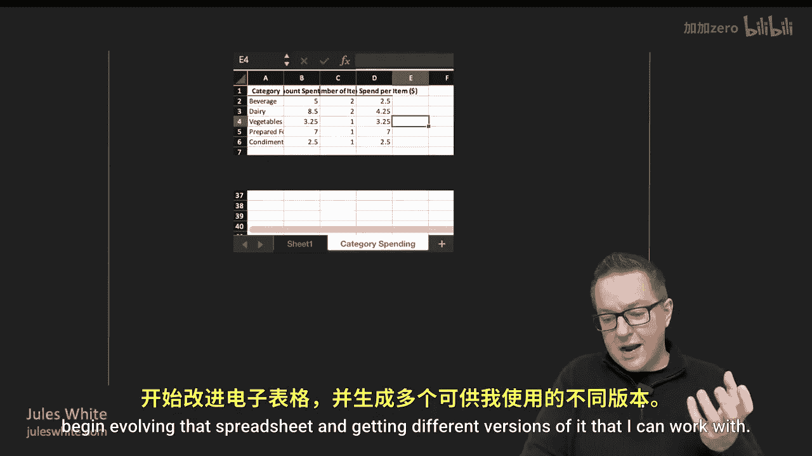

# ChatGPT与Excel：P13：通过ChatGPT多模态提示设计Excel电子表格 🖼️➡️📊


在本节课中，我们将学习如何利用ChatGPT的多模态能力，即结合文本和图像输入，来辅助我们设计和构思Excel电子表格。这种方法能为AI提供丰富的上下文信息，从而生成更贴合实际需求的数据表格设计方案。

## 理解ChatGPT的“视觉”能力 👁️

上一节我们介绍了ChatGPT的基本交互方式。本节中我们来看看它的一个重要特性：像人类一样，ChatGPT也能“看到”并理解图像内容。这意味着我们可以通过上传照片的方式，为AI提供关于现实世界物体、系统或环境的视觉信息。

这种结合文本和图像的交互方式被称为**多模态提示**。充分利用这一能力，尤其是在设计用于数据采集的电子表格时，可以极大地提升设计质量。

## 为何上下文至关重要 🧠

我们设计的电子表格质量、公式的适用性，很大程度上取决于我们提供给ChatGPT的上下文信息的丰富程度。我们试图解决的问题、目标越清晰，AI就越能将这些需求转化为有效的电子表格、计算和所有我们关心的功能。

因此，提供关于问题和目标的丰富上下文，是获得优秀设计方案的关键。

## 实战案例：冰箱库存管理 🧊

让我们看一个简单的、人人都能理解的例子：如何设计一个表格来追踪冰箱里的物品。

首先，我给我的冰箱拍了一张照片。然后，我向ChatGPT提供了以下文本提示：

```
help me design an Excel spreadsheet to create an inventory of what is shown in the photo. I need to be able to keep the inventory up to date and make important decisions with the data. design the rows columns and formulas for derived columns.
```

在这个提示中，我明确了几个关键信息：
1.  **目标**：创建照片所示物品的库存清单。
2.  **用途**：需要能更新库存，并依据数据做出重要决策。这说明了表格将如何被使用和演变，是至关重要的使用上下文。
3.  **设计要求**：设计行、列以及派生列的公式。

同时，我还提供了富含信息的照片作为视觉上下文。

## ChatGPT的设计方案 📝

基于文本和图像的上下文，ChatGPT给出了一个详细的电子表格设计方案。

以下是它建议的核心列设计：
*   **Item ID**: 物品唯一标识
*   **Item Name**: 物品名称
*   **Category**: 类别
*   **Quantity**: 数量
*   **Expiration Date**: 过期日期
*   **Purchase Date**: 购买日期
*   **Days Until Expiration**: 距离过期的天数（派生列）

对于派生列“Days Until Expiration”，它提供了对应的Excel公式：
```excel
=IF([@[Expiration Date]]<>"", [@[Expiration Date]]-TODAY(), "")
```
这个公式能自动计算并倒数物品还有多少天过期。

此外，ChatGPT还根据照片内容生成了示例数据行（例如，它“看到”了我冰箱里的椰奶，并以此为例），并建议了额外的功能，如使用**条件格式**将即将过期的物品标记为红色。

这个案例展示了视觉上下文如何帮助AI理解场景本质（例如，冰箱物品会过期，因此“过期日期”很重要），从而激发出更贴合实际的设计思路。

## 利用照片填充数据与表格演化 🔄

基于这个设计，我可以进一步要求ChatGPT“创建这个Excel表格”，它会生成一个包含上述结构的文件。我还可以尝试让它根据照片“填充”数据。

**请注意**：让AI从一张复杂照片中完全准确地识别并填充大量物品数据，很可能产生“幻觉”（即生成错误或虚构的信息）。对于少量或单个物品，准确率较高；但对于一整张超市货架的照片，错误会很多。因此，目前更可行的方式是将此功能用于获取数据样本以预览表格效果，或用于**单件物品的录入**（例如，拍一张物品照片并说“将此记录到我的库存中”）。

最后，我可以随时提出新的需求来演化这个表格。例如，我可以要求“添加一个用于追踪支出的工作表”。ChatGPT能基于已有的上下文（包括最初的图片），快速扩展表格功能，生成包含“支出追踪”和“分类消费”等新功能的工作表版本。

## 总结 📚



本节课中我们一起学习了如何利用ChatGPT的多模态提示功能来设计Excel电子表格。核心流程是：**从一张现实世界的照片开始，它为AI提供了丰富的上下文，从而启发表格的构思与设计**。这种方法能帮助AI理解特定场景下的关键要素（如食品过期问题），并能用于生成样本数据或在可控场景下录入真实数据。最重要的是，我们可以基于初始的视觉和文本上下文，快速通过提示词来迭代和演化电子表格的设计，使其不断完善以满足动态变化的需求。