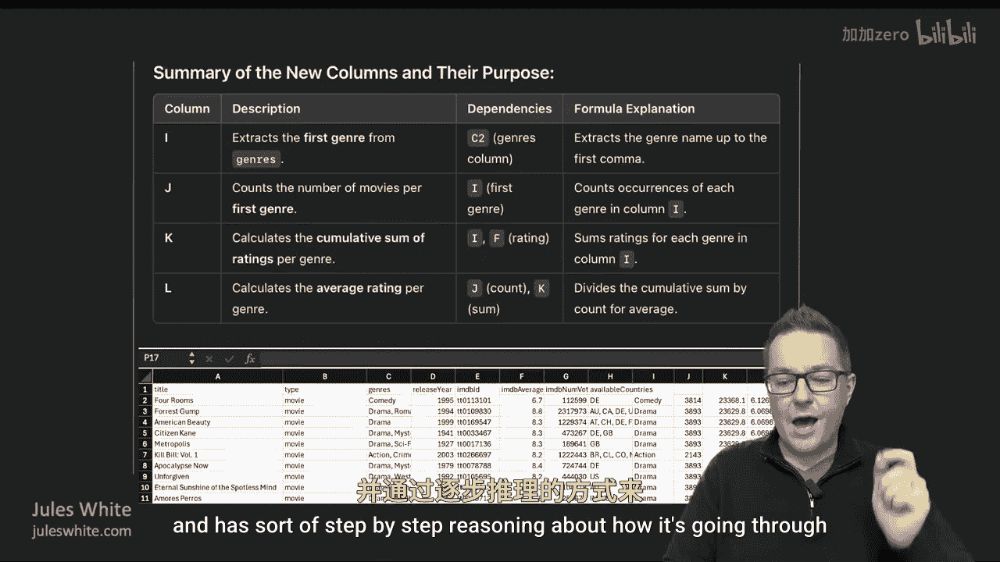

# ChatGPT与Excel：P14：使用ChatGPT创建Excel公式 🧮

在本节课中，我们将学习如何利用ChatGPT来辅助创建Excel公式。我们将从明确数据描述开始，逐步引导AI生成公式，并重点介绍如何通过分步构建和验证来确保公式的准确性。

***

## 明确数据列标识

上一节我们介绍了课程目标，本节中我们来看看创建公式的第一步：明确数据。

在创建任何公式之前，无论其简单或复杂，都必须确保我们清晰地描述了数据。最关键的是，我们需要明确Excel将使用的列标识符（如A、B、C），并确保这些标识符在对话中是明确且正确的。

因此，我总是以一个类似的提示开始对话：

> “这是来自Excel工作表的数据，请描述所有列及其标识符（例如A到Z），并以表格形式呈现。”

我们的目标是获得类似以下的输出，其中包含我们正在处理的工作表的所有列名。如果我们有多个工作表，则需要确保此信息对于我们将要使用的任何工作表都是准确的。

***

## 表达目标并生成公式

在明确了数据结构之后，接下来我们需要表达我们想要实现的计算目标。

我们不应陷入微观细节，而应后退一步，给出一个高层次的目标，让ChatGPT或AI来填充细节，将我们的目标转化为跨电子表格的计算。

以下是一个示例提示：

> “我需要一个可以放入I列的公式，该公式能根据投票数对评分进行加权，以便对投票数较少的评分进行惩罚。”

在这个提示中，我明确说明了要添加新列（I列），并描述了计算目标。ChatGPT随后会生成一个公式，并解释其工作原理。例如，它可能会基于贝叶斯平均或加权函数来构建公式。

***

## 验证与理解公式

当ChatGPT生成公式后，我们必须进行验证和理解。

首先，立即验证它引用的列标识符是否正确。例如，如果它说“假设F列是IMDB平均评分，G列是IMDB投票数”，您需要返回原始工作表确认F列和G列确实对应这些数据。

其次，确保您理解公式的逻辑。ChatGPT通常会提供明确的解释。如果没有，您应该跟进一个提示，要求它“逐步解释这个公式的工作原理”。

理解公式至关重要。如果您不理解，请持续提问，直到弄懂为止。AI工具不会神奇地解决所有问题，最终依赖的是人类的审查和理解。

***

## 请求示例进行测试

为了进一步验证公式，一个有效的方法是要求ChatGPT应用公式到一些样本值上，并测试计算结果是否符合预期。

您可以提出以下请求：

> “请将此公式应用于一些样本值，并展示计算过程，以便我验证。”

虽然ChatGPT无法直接在Excel中执行计算，但它通常会生成Python代码来模拟公式的应用。这非常有帮助，能让您直观地看到输入特定值时的输出结果。

***

## 处理复杂公式：分步构建法

对于更复杂的计算目标，我们不应接受一个塞进单个单元格的庞大复杂公式。相反，我们应该采用分步构建法。

分步构建意味着将复杂的计算分解为一系列简单的步骤，每个步骤对应一个新列。这样做有几个关键好处：
1.  **便于检查**：您可以查看每个中间步骤的结果，验证计算是否正确。
2.  **易于理解**：复杂的逻辑被拆解成易于消化的小块。
3.  **优化AI推理**：引导AI进行链式思考，使其更有可能生成正确的分步解决方案。

以下是一个处理复杂目标的提示示例：

> “我想计算每个电影流派（仅使用列表中的第一个流派）的平均评分，但只针对在该流派中有超过一个条目的电影。请帮助我创建一系列列和公式来实现这个计算。我希望以增量方式完成，创建一系列能捕获中间结果的列。每一列都应是基于前一列的简单计算。新的列应从原始数据集的最后一列之后开始添加。首先，请解释将要创建的列、每列的作用以及它们将使用哪些其他列。”

通过这种方式，ChatGPT会规划并生成一系列简单的列，例如“提取第一个流派”、“计算每个流派的电影数量”、“计算每个流派的评分总和”，最后才是“计算每个流派的平均评分”。每一列都易于理解和检查。

***

## 核心要点总结

本节课中我们一起学习了使用ChatGPT创建Excel公式的系统方法。

以下是创建公式时的关键步骤列表：

1.  **描述数据**：首先向ChatGPT提供清晰的列标识符映射表，确保它“看到”的数据结构与您的Excel工作表一致。
2.  **陈述目标**：用清晰、高层次的语言说明您想通过公式实现什么，而不是具体如何做。
3.  **生成与验证**：获取公式后，立即验证其引用的单元格是否正确，并确保您理解其计算逻辑。
4.  **测试公式**：请求ChatGPT使用样本值演示公式计算过程，以验证输出是否符合预期。
5.  **分步构建**：对于复杂任务，坚持让AI通过创建多个中间列来分步构建解决方案，这便于您检查中间结果并理解整个计算流程。

通过遵循这些步骤，您可以有效地利用ChatGPT作为强大的助手，在降低出错风险的同时，构建出准确且易于维护的Excel公式。记住，您始终是最终的决策者和验证者。