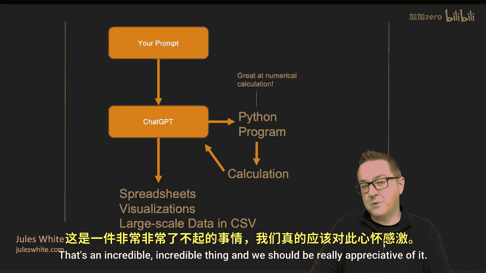

# ChatGPT与Excel： P16：ChatGPT如何进行数值计算与数据分析


在本节课中，我们将要学习ChatGPT处理数值计算与数据分析的核心机制。我们将深入探讨ChatGPT如何通过“自我构建工具”的方式，克服其在直接处理复杂数字任务上的局限，并理解这一过程对于与Excel等工具结合使用的重要性。

## 理解ChatGPT的文本输出

上一节我们介绍了ChatGPT的基本交互模式。本节中我们来看看其最常见的输出形式。

当我们向ChatGPT输入一个提示（Prompt）并提交后，它会直接生成文本输出。例如，当我们要求它“设计一个简单的咖啡消费追踪表格”时，它会生成类似下表的文本描述：

| 日期 | 咖啡种类 | 杯数 | 价格/杯 | 总花费 |
| :--- | :--- | :--- | :--- | :--- |
| 2023-10-26 | 美式 | 2 | 25 | 50 |

这个表格本质上仍然是文本。ChatGPT只是在生成一段格式化的文本来描述表格结构，它本身并不具备直接绘制或操作表格的能力。

## 数值计算的挑战与解决方案

然而，ChatGPT在处理数字方面存在局限。一旦数值计算达到一定规模或复杂度，ChatGPT可能无法有效处理并容易出错。这是一个需要解决的问题。

为了解决这个问题，ChatGPT采用了一种非凡的策略：**自我构建工具**。

### 识别工具构建过程

在交互过程中，你可能会注意到一个特殊的小图标出现，例如 `[_>]`。这个图标是ChatGPT正在为自己构建工具的信号。

> 想象一下，你有一把铲子（ChatGPT）。在你准备挖洞前，铲子发现路上有块石头。于是铲子从你手中跳出，为自己打造了一把镐，用镐敲碎石头后，又跳回你手中，让你继续挖洞。这就是工具为自己构建工具的过程。

当ChatGPT遇到无法直接完成的任务时，它会启动这个“工具构建”流程。

### 工具的本质：代码

那么，ChatGPT构建的工具是什么？答案是：**代码**。

例如，当你要求它“创建一个Excel表格”时，它意识到自己无法直接生成`.xlsx`文件。于是，它会编写一段Python代码，因为Python可以创建Excel文件。它执行自己编写的代码，然后将代码运行的结果——即生成的Excel文件——返回给你。

这个过程可以概括为：
```
用户请求 -> ChatGPT分析 -> 识别障碍 -> 编写解决障碍的代码（工具）-> 执行代码 -> 返回代码执行结果
```

通过这种方式，ChatGPT能够：
*   进行高精度的复杂数值计算。
*   生成可视化图表。
*   创建和转换数据文件（如CSV、Excel）。
*   完成其他其核心模型不擅长直接处理的任务。

## 两种工作模式：直接生成与代码执行

理解ChatGPT何时采用哪种模式至关重要。

以下是两种主要工作模式的对比：

*   **直接生成（通过模型）**：适用于需要创意、设计、指导和小规模数据生成的场景。
    *   **示例**：头脑风暴、解释操作步骤、提供公式建议、生成少量示例数据。

*   **代码执行（构建工具）**：适用于需要精确计算、文件生成或大规模数据处理的场景。
    *   **示例**：创建完整电子表格、进行复杂数据分析、生成数据可视化图表、转换数据格式。

作为用户，你需要留意交互过程中的特殊图标，以了解当前任务是通过模型直接完成，还是通过运行代码来完成的。这有助于你更好地理解和验证其结果。

## 总结与启示

本节课中我们一起学习了ChatGPT处理数值与数据任务的核心机制。

我们了解到，ChatGPT通过**自我构建工具（即编写并执行代码）**的能力，巧妙地弥补了其在直接进行复杂计算和文件操作方面的不足。这种“工具构建工具”的能力，是当前人工智能一项令人惊叹的进步。

每当你看到那个特殊的工具构建图标出现时，背后都是一次精密的软件工程过程：仅仅基于你的自然语言描述，AI就自动规划、编写并执行了代码来实现你的目标。我们应当对此保持欣赏与关注。



掌握这一原理，能帮助我们在将ChatGPT与Excel等工具结合使用时，更清晰地预判其工作方式，从而更高效地利用它进行数据分析和获取洞察。