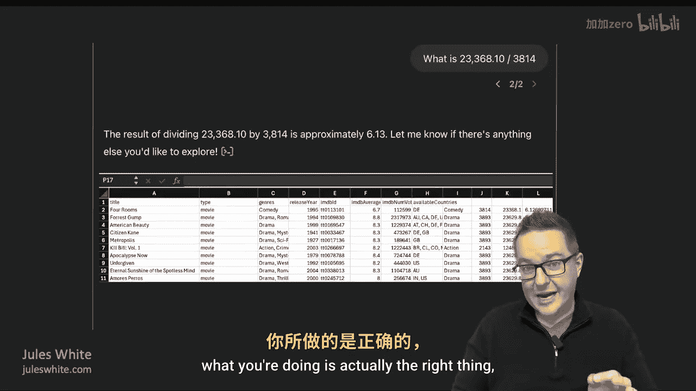

# 017：使用ChatGPT对Excel公式进行双向稳健性准确性检查 🔍

在本节课中，我们将学习如何利用ChatGPT的“双向检查”功能，来验证Excel中复杂公式的准确性和稳健性。这种方法能帮助我们在AI辅助下，更可靠地构建和调试数据分析流程。

人类在Excel中犯错的历史，远比ChatGPT存在的时间要长。因此，我们早已学会通过各种方式去检查和确保结果的正确性。现在，当我们使用ChatGPT时，检查工作依然至关重要。这不仅因为ChatGPT本身可能出错，更因为在我们理解它的解释或将其输出转化为Excel具体实现的过程中，也可能引入错误。例如，我们可能复制粘贴错公式、将其放入错误的列、误解电子表格的结构或各列的含义，从而误导ChatGPT。可能出错的地方非常多，因此，检查答案、验证所得结果是否合理，就显得极其重要。

ChatGPT为此提供了一个极其强大的检查工具，我称之为“双向检查”。我们不仅可以在Excel内部进行检查，还可以在ChatGPT内部，尝试验证它是否能得出相同的答案。具体方法是：我们在Excel中运行公式得到一个结果，然后让ChatGPT在Python环境中执行完全相同的计算（利用其高级数据分析功能来编写和执行Python代码）。如果ChatGPT通过Python计算得到的数字与Excel结果一致，那么我们就从两个截然不同的途径验证了同一项计算。虽然并非所有Excel操作都能在ChatGPT的Python环境中完美复现，但对于大多数我们想要完成的重要计算，这种方法通常是可行的。

上一节我们介绍了双向检查的概念，本节中我们来看看一个具体的操作实例。

我提出了一个需求：计算每个电影类型的平均评分，但只基于其类型列中的第一个条目来包含电影。例如，有些电影的类型是“喜剧，动作”。如果它是“动作，喜剧”，则不想包含；如果是“喜剧，动作”，则想包含。这为公式增加了一些复杂性。如果只是“喜剧”，当然也想包含。我提示ChatGPT帮助我在Excel中构建这个公式。它采用了分步构建列的方法，通过一系列相互关联的列来逐步实现这个复杂公式。

它完成了任务，并给出了一系列用于实现此复杂公式的列。我在Excel中创建了这些列，一切看起来都不错。经过抽查，Excel中的结果似乎是正确的。现在，我希望通过在同一对话中，让ChatGPT用Python复现相同的公式和分析，来进行更严格的检查。

以下是进行此类检查的典型步骤：

通常，我会将已创建的公式或需求描述复制粘贴到一个新的聊天中，或者像本例一样，直接在原对话底部进行跟进。然后，我会逐列地针对特定行复现分析过程。

1.  **选择测试行**：我选择了一个属于“喜剧”类型的行作为起点。
2.  **验证第一列**：我首先询问：“喜剧类电影有多少部？” ChatGPT通过Python分析后回答有3814部。我回到Excel数据中核对，确认这个数字是正确的。这样，我就验证了第一个（相对简单的）列。
3.  **验证后续列**：如果发现任何差异，就可以开始调试并找出原因。接着，我根据公式逻辑询问下一个问题：“喜剧类电影的评分总和是多少？” ChatGPT通过Python计算后给出总和约为23368.10。我再次回到Excel中核对列K（评分总和列）的数值，确认两者一致。
4.  **计算并验证最终结果**：最后，我通过计算平均值来验证：23368.10除以3814。我也可以直接让它计算平均值，但这里为了清晰，我选择明确计算。ChatGPT给出的结果约为6.13，这与我在Excel中得到的结果完全一致。

通过这种方式逐列验证，我基本上是在检查公式的每个组成部分。我通过对比在Python中运行相同分析得到的结果，来验证Excel那一侧的计算是否正确。当然，我也可以尝试一次性运行整个分析并进行差异对比，但一开始选择逐行、逐列验证会更简单明了。

这个过程给了我很大的信心，因为我知道，至少在我所表达的意图范围内，ChatGPT既能在Python中正确实现，也能在Excel中正确实现，并且两者的结果能够匹配。不过，必须强调的是，**如果我最初表达的需求本身就有根本性错误，那么无论它的实现多么完美，构建出的公式也必然是错的**。这要求我们必须持续思考、保持专注，确保我们要求它做的事情本身就是正确的。

这种方法的精妙之处在于，通过将复杂公式分解到多个列中，我们可以**增量式地进行检查和调试**。一旦发现Excel的结果与ChatGPT的Python结果在某一个列上存在差异，我们很可能就将问题**隔离到了公式的某个特定部分**。如果是一个直接输出到单个单元格的复杂公式，一旦出错，将很难定位问题根源。而通过分步构建和检查，我们能够快速定位并修复问题，然后观察修复是否解决了后续列的问题。这种增量构建与增量检查相结合的方式，对于调试和确保公式稳健性来说，是一个极其宝贵的工具。

本节课中我们一起学习了如何利用ChatGPT的Python执行能力，对Excel公式进行“双向稳健性准确性检查”。我们了解了分步构建公式列的优势，并通过实例演示了如何逐列验证，从而在AI辅助下更自信、更高效地完成复杂的数据分析任务。记住，工具再强大，清晰、正确的需求表达和持续的人工核查，始终是获得可靠结果的基础。