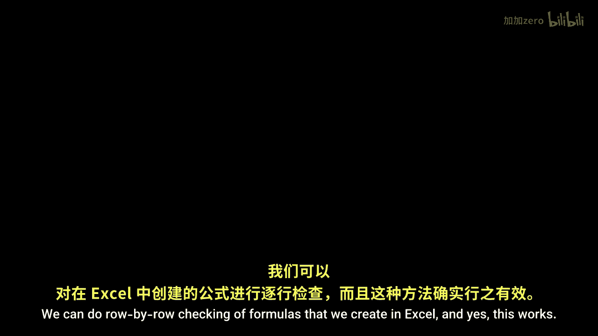

# ChatGPT与Excel：P18：使用ChatGPT批量双向校验Excel公式的扩展性与准确性

## 概述

在本节课中，我们将学习如何利用ChatGPT和Python，对在Excel中创建的复杂公式进行批量、双向的校验。这种方法能有效提升大规模数据处理时的准确性和效率，帮助我们发现数据表示或逻辑实现中的潜在问题。

上一节我们介绍了如何在Excel中逐行检查公式。本节中我们来看看如何将这种校验扩展到批量处理。

## 批量双向校验的原理

我们可以逐行检查在Excel中创建的公式。这种方法确实有效。我们可以查看中间数据，也可以逐个数值进行检查。

然而，当处理大型电子表格时，逐行检查并非总是最高效或最快速的方法。我们无法实际地逐行核对所有内容是否完全匹配。

因此，我想展示另一种方法：进行双向校验。其核心思想是，比较在Python中实现某个逻辑或想法得到的结果，与在Excel中实现同一想法得到的结果是否一致。

我们在Excel中构建了一些公式，创建了许多新列，重塑了数据或基于计算生成了新的衍生数据。现在，我们如何知道这些操作是正确的呢？

我们学到的方法是，可以在Python和Excel中分别进行检查，确认我们得到了相同的答案。但到目前为止，我们只是在逐行逐列的基础上进行交互式检查。

现在我们要做的是扩展这个想法，进行批量处理。

## 实施步骤

以下是实施批量双向校验的具体步骤。

### 第一步：在Excel中创建公式与衍生数据

首先，我们创建所需的公式。我们会进行一些计算，描述我们试图在数据中实现的目标，并据此创建公式和列。所有这些都在Excel中实现，最终得到我们的衍生数据。

### 第二步：在Python中生成对应的CSV文件

接下来，我们需要创建一个相同衍生数据的版本，但这次是通过Python生成一个CSV文件。

其思路是，我们将获取这两个文件，将它们整理成完全相同的形状和格式，然后要求ChatGPT使用Python来比较它们。

在这个阶段，有可能出错。但通常，错误会偏向于它未能识别两个事物是相同的。虽然理论上它也可能错误地认为两者完全相同，但根据我的经验，这种情况较少。无论如何，这是在人工尽职调查之外增加的又一层检查。它**增加**了尽职调查，而非**取代**。因此，你仍应进行所有之前会做的人工检查。

当我完成公式的实现后，我会要求ChatGPT在Python中重现这些公式在新列中的功能，并输出为CSV。

例如，我会说：“读取原始数据，创建一个CSV文件，其中行是年份，列是唯一的电影类型，然后列出每年每个类型发布的电影数量。如果一部电影有多个类型，只考虑列表中的第一个类型。”

这样，我基本上在Python中复现了之前在Excel中完成的数据重塑工作。

### 第三步：启动新对话并上传文件进行比较

一旦我获得了那个CSV文件，就可以开始进行比较了。我通常会开启一个新的对话。虽然这不是必须的，但这是一个好习惯，可以确保之前的对话偏见不会影响当前操作。

然后，我上传两个文件（Excel导出的文件和Python生成的CSV文件）。

接着，我发出指令：“请比较这两个文件，查看它们是否每年每个类型都显示相同的数量。”

请注意，我已经将两个文件整理成了我认为完全相同的形状。我期望得到大致相同的结果。

可能存在一些细微差异，我可以去修复它们。例如，一个文件中的数据表示方式可能存在空白，这可能引发问题。我们需要确保行、列和表示形式完全相同，以便进行批量比较。

### 第四步：分析比较结果并排查问题

ChatGPT会进行全面比较。例如，它可能发现科幻类型的数量从1990年起存在显著差异，显示一个文件的值通常高于另一个，且差异在近年更大。

这时我需要跟进调查，因为我在Excel中实现的计算，在Python中也实现了，却得到了不同的答案。

潜在原因有几个：
1.  我可能错误地实施了ChatGPT在Excel中给我的指导。
2.  ChatGPT可能错误地实施了我在Python中给它的指令。
3.  可能存在解释上的细微差异，两者可能都“正确”，但改变解释会导致我们得到的具体数值不同。

一旦识别出问题，我会要求它：“请并排显示1990年以后的科幻类型数量。”

然后我可能会看到，2020年和2021年的数据看起来不错，但2022年和2024年有误。差异可能不大，但确实存在一些细微问题。

接着，我会调出文件查看，因为这直接告诉了我需要查找差异的地方。我可能会发现，在一个数据集中有“Sci-Fi”和“Sci-Fi & Fantasy”，而在另一个数据集中只有“Sci-Fi”。

这时我需要思考：处理这个问题的正确方式是什么？当我回头查看原始数据时，可能会发现“科幻”有多种表示方式。我当初真的考虑到了正确的处理方法吗？答案可能是没有。我需要重新思考并在数据中处理这个问题。

但这个过程帮助我发现了数据中可能影响分析但我之前不知道的情况。而且它是**规模化**完成的，因为它遍历了所有类型，并精确定位了存在问题的特定类型。

## 批量校验的优势与意义

通过尝试在两端进行批量复现，这些问题得以暴露。现在我可以扩展这种分析，规模化地发现潜在的差异和问题，并在此过程中了解我的数据。

它**并不取代**我原本就会进行的人工检查，但它为我的工具箱增加了一个新工具，提升了我所做工作的稳健性。因为我可以从不同角度审视，确保它们一致，并且可以快速、轻松地完成。我可以发现像数据中“科幻”的不同表示方式这样我可能未曾注意到的问题。

这将有助于确保我的分析、可视化以及所有决策制定更加稳健，因为我可以通过确保两端操作的一致性来捕捉错误。

## 总结

本节课中，我们一起学习了如何利用ChatGPT进行Excel公式的批量双向校验。我们了解了其实施步骤：先在Excel中生成衍生数据，再通过Python复现逻辑并输出CSV，最后利用ChatGPT比较两者的一致性。这种方法的核心价值在于能够规模化、自动化地发现数据逻辑或表示上的不一致，从而提升数据分析的整体质量和可靠性，是人工检查的有效补充。