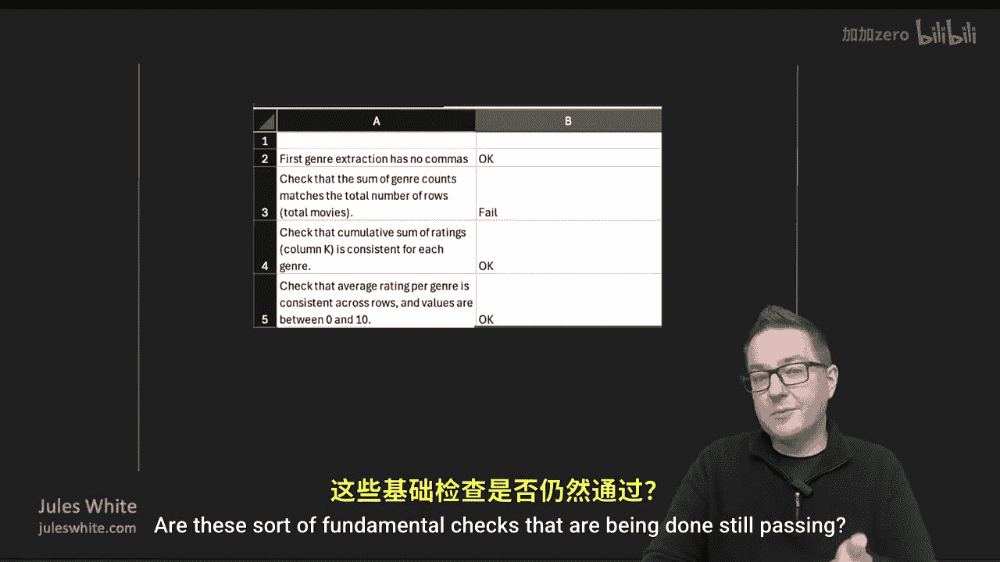

# 019：使用ChatGPT创建Excel测试用例的稳健性测试

## 概述

在本节课中，我们将学习如何利用ChatGPT为Excel中的公式和数据计算创建稳健性测试。我们将探讨在借助AI工具快速构建公式后，如何通过系统性的检查来确保结果的准确性，从而减少错误并提高数据分析的质量。

## 引入测试的必要性

当人们开始考虑将ChatGPT用于Excel时，可能会质疑其可靠性。确实，AI工具可能会产生错误。因此，在结合使用它们时，我们需要比以往更加严谨，进行更彻底的检查。实际上，通过合理利用ChatGPT，我们有可能比单纯依靠人力时犯更少的错误，因为人类在电子表格中引入的错误数量可能非常庞大。

ChatGPT赋予我们快速工作的能力，它能帮助我们设计并实现公式。但这并不意味着我们可以跳过对数据质量和实现正确性的必要检查。

接下来，我们将讨论如何利用节省下来的时间，通过在我们的Excel工作表和工作流程中构建不同的检查和测试，来确保我们得到的是正确答案，而不仅仅是更快的答案。我们的目标是获得更好、更稳健的结果。

## 构建可测试的列结构

在开始构建公式时，我们专注于创建独立的列。我们通常先构建一个相对简单的公式列，然后在此基础上构建另一列，以列的形式逐步增量构建。这种方法的好处是，正如我们之前讨论的，它能够精确定位错误发生的位置，同时也使得检查计算的各个独立部分变得更加容易。

## 借鉴软件工程的测试理念

从计算机科学和软件工程的背景来看，确保人类正确实现软件的方法之一是编写测试。现在，我们（人类）通常需要实现ChatGPT输出的公式，也很可能修改和推理这些公式。同时，ChatGPT本身也可能犯错。因此，就像在软件工程中一样，我们必须进行检查，确保我们的工作、我们的计算实现是正确的。

我们将利用“独立列”这一理念，为每个单独的列构建测试，以检查我们得到的计算结果是否与数据的其余部分一致。

## 利用ChatGPT设计测试

ChatGPT可以帮助我们思考可以运行哪些测试。它在为软件构建设计测试时也表现得非常出色，因为它常常能提供一个外部视角。有时，作为人类或某个想法的实现者，我们很难跳出固有思维，从不同角度思考可以进行哪些检查。

以下是我们将用来引导ChatGPT为我们正在做的工作设计测试的提示词：

> 对于每一列，提出一个简单的检查方法，以确保我正确实现了公式并且没有意外值。请给出你的建议和一个表格。

ChatGPT会返回一个检查或任务的表格，我们可以针对每一列运行这些检查，以确保得到的结果是正确的。

例如，对于提取流派列表中第一个流派的列，它建议实施一个检查来验证输出中没有逗号。这是一个非常基础的检查，类似于软件工程中的做法：我们是否得到了一个不包含逗号的单一值？因为如果包含逗号，说明我们并没有成功分割出值。

对于统计每个流派电影数量的列，我们可以实施一个检查：对J列的所有值求和，并将其与数据集的总行数进行比较。然后我们可以将此用作一项检查。

接着，ChatGPT会逐一解释如何实施每一项潜在的检查。这本质上就是我们可以去实现的一个测试。

## 测试的价值与实施

这种方法的一个美妙之处在于，当我们逐一运行这些测试时（每个列都有一个测试，这非常好），如果其中一项测试出错，并且测试失败，最坏的情况是它促使我们更深入地查看数据。测试并不能证明没有错误，它通常不能证明错误的绝对不存在。但我们可以证明的是，我们已经运行了大量检查，从而建立起信心，相信我们没有在某个地方犯错。

如果检查失败，那么我们就需要更加关注。我们可能会发现测试本身有问题，也可能发现数据本身或我们实现公式的方式有问题。但即使测试本身是“坏”的，它引起我们注意这一事实也是有价值的，因为它促使我们花时间检查、核对并确保一切运行正常。这对于引导我们关注不同方面，确保我们在分析和实现中提供了所需的严谨性非常有价值。

## 将检查建议转化为可执行的测试

我喜欢将这些检查思路转化为可以查看“测试是否通过”的测试。具体做法是，我返回去对ChatGPT说：假设我们将在另一个单独的工作表中实现所有检查。原始工作表名为“原始数据”。请编写每个检查，使其根据结果输出“OK”或“Fail”（也可以是“Pass/Fail”，随你喜欢）。其核心思想是，我们想要实现另一个工作表，基本上就是我们的测试集，其中每一行或每一列（取决于你的设计方式）都在对我们通过其他公式计算产生的结果运行某些测试，以便我们检查并确保某些基本事项是合理的。这是我们在软件工程中常做的事情。

ChatGPT会回复我们：好的，这是你的列标签，我们将在名为“数据检查”的工作表中添加一组检查。基本上，它会逐步指导我们如何实施这些检查。

对于每一项检查，它都会描述其内容，例如“第一个流派提取结果无逗号”，然后给出实现该测试的公式。因此，我们将去构建一个单独的工作表，在其中放入：测试描述、实现测试的公式，然后公式输出“OK”或“Fail”。接着，我们查看那个工作表，看得到的是“Pass/Fail”还是“OK/Fail”。如果得到“Fail”，那么这就是我们需要去调查的事情，我们需要非常仔细地查看测试的逻辑以及我们正在检查的那个列的实现逻辑，看看是否存在问题。

ChatGPT会逐一介绍它将产生的各项不同检查，并给出实现每一项的公式。最后，它会给出一个汇总：这是我们将要运行的所有不同检查及其对应的公式。

## 测试结果的分析与迭代

当我们实现这些后，会得到类似这样的结果。当然，你可以用不同的方式呈现。但基本上，你会得到它建议的所有检查列表以及它们是否通过。

例如，在这种情况下，我看到有一项关于“流派计数与总行数（总电影数）匹配”的检查失败了。现在我可以去查看：是它产生的测试本身有误？还是我的计算有误？或者是数据有问题？但无论如何，它吸引了我的注意力。所有其他显示“OK”的检查，并不意味着那里没有错误，但它增加了我的信心，因为我从一个不同的角度进行了检查并且通过了。这并不意味着不存在某个我尚未审视的、会导致失败的角度，但至少它告诉我，嘿，我从另一个角度看了一下，它看起来仍然是正确的。

但在一个案例中，它显示“不，看起来不对”，这给了我们一个跟进点，确保我们在实现中没有犯错。我可能对失败的原因有所猜测，但我会更详细地深入调查，更彻底地检查它。

构建这些检查非常快，对吧？我说“给我一些检查”，然后我还可以说“给我额外的检查”、“再给我一些不同的检查”。我可以非常快速地做到这一点。我可以开始积累检查，它会告诉我应该检查什么以及对应的公式。这样我就能得到一套非常稳健的检查集。然后，当我开始构建实现（即它告诉我不同的公式来做我关心的不同事情）时，我把它们引入Excel，接着在同一个对话中跟进说“给我一些不同的检查”，或者我另开一个对话但回到上下文说“给我一些检查”（不过我更喜欢在同一个对话中进行）。然后我把这些拿过来，在类似这样的测试中实现它们，用“Pass/Fail”或“OK/Fail”标注，这样我就可以去确保我所做的事情看起来是正确的。之后，当我开始操作数据时，我也可以随时返回并检查这些基本检查是否仍然通过。

## 总结

本节课中，我们一起学习了如何利用ChatGPT为Excel数据分析创建稳健性测试。我们认识到，在借助AI提速的同时，必须引入系统性的检查来保障质量。通过将计算分解到独立的列，并借鉴软件工程的测试思想，我们可以为每一列设计特定的验证方法。ChatGPT不仅能帮助生成公式，还能从外部视角协助设计这些测试用例。最后，我们将这些测试建议转化为带有“通过/失败”状态的可执行检查列表，从而持续监控数据处理的正确性，并在发现问题时快速定位。这种方法使我们能够在享受AI效率的同时，显著提升工作的准确性和可靠性。