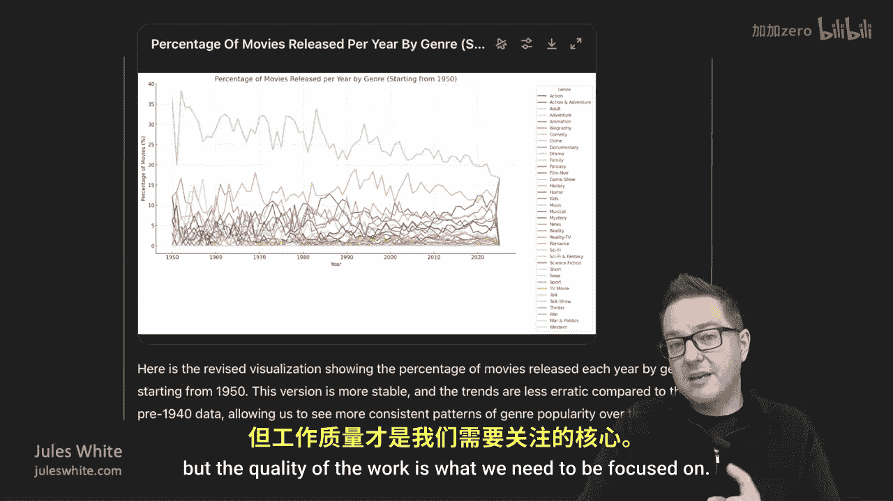

# ChatGPT与Excel： P20： 更优可视化：利用ChatGPT快速生成Excel图表原型 📊

在本节课中，我们将学习如何利用ChatGPT进行数据可视化的快速原型设计。我们将探讨如何通过迭代式对话，探索不同的图表方案，分析可视化结果，并最终确定最适合传达数据洞察的图表形式，从而在进入Excel等工具进行最终实现前，获得更优的可视化方案。

## 理解数据

在开始任何可视化工作之前，充分理解我们正在处理的数据至关重要。这不仅是为了让我们自己理解，也是为了确保ChatGPT能准确理解数据的结构和内容。

以下是开始前的标准步骤：

1.  **上传数据**：将数据集文件提供给ChatGPT。
2.  **描述列信息**：获取数据集中各列的标识符和含义。
3.  **查看数据样本**：提取部分数据样本进行查看。

查看数据样本非常有帮助，因为它能揭示我们可能未预料到的问题，例如缺失值（NaN）或其他异常数据。提前发现这些问题，有助于我们在后续创建可视化时理解图表为何在某些地方看起来“奇怪”。

因此，在获取列信息后，我通常会追加一个提示：“为每列添加三个随机数据样本”。这样，我们不仅能得到样本，还能被明确告知哪些列存在NaN值。例如，在“流派”和“IMDB ID”等列中可能存在缺失数据。这让我在构建可视化时，必须考虑如何处理这些情况。

将数据问题呈现在对话中，不仅让我能看到，也让生成式AI能更有效、更容易地识别并推理这些问题。

## 构思可视化方案

上一节我们介绍了如何理解数据基础，本节中我们来看看如何构思可视化方案。我建议在明确指定具体图表类型之前，先进行一些头脑风暴。

我们可以从一个简单的提示开始，例如：“给我一些可视化点子，来展示不同电影流派随时间变化的受欢迎程度。”

通常，我们的目标是获得实现某个目标的多种想法，即多种可能有助于达成目标的不同可视化方案。初始目标不是指定“我想要这个图表”，而是说“展示能帮我实现这个目标的选项”，无论你试图理解什么，都告诉它，以便它能尝试给出合适的建议。

你也可以更大胆一些，直接说：“用这些数据构思一些有趣的可视化方案，以便我探索和理解数据。”但如果你心中已有特定目标，最好在此处明确说明。

在本例中，我的目标是了解流派受欢迎程度如何随时间变化。ChatGPT回复了多个不同的想法：

*   **折线图**：展示各流派随时间变化的受欢迎程度。
*   **堆叠面积图**：展示各流派随时间变化的受欢迎程度。
*   **热力图**：展示年份与流派的关系。
*   **条形图**：按年份展示各流派的电影数量。

它提供了很多不同的想法。如果它给出的选项都编了号，你还可以回去说“展示第三个方案”或“展示第四个方案”，它会提供该可视化方案的具体说明，因为它刚刚创建了这些方案。

## 迭代与细化方案

在查看了所有建议后，我可能想要一些略有不同的东西。这些建议启发了我的思考。

现在，我提出一个新要求：“可视化每年在每个流派中发布的电影数量。”

请注意，我在这里的指令仍然不够具体。我没有告诉它具体使用哪种可视化类型（热力图、折线图还是其他），我只是说“可视化每年电影数量”。我增加了对数据目标的特异性（追踪每年电影数量作为衡量受欢迎度的指标），但在可视化形式上仍留有余地。

这样做的目的是让我们有机会利用模型内在的生成性、随机性和创造性，来获得不同的可能性。当我这样做时，它以一种我最初没想到的方式进行了可视化，这很有趣：它使用了热力图。

如果我明确告诉它“我想要折线图”，我就不会看到这个选项。而查看这个选项的成本非常低，只需几秒钟的等待时间。它启发了我的思考，让我脑海中形成了另一种看待数据的方式。这个热力图立刻让我看出：戏剧类电影非常受欢迎，尤其是在2020年代末期，但在2024年左右似乎有所下降；喜剧类一直很受欢迎。这是一个我未曾想到的、相当有效的可视化方式。

然而，这并不完全是我想要的。于是我回去调整提示。也许问题在于“数量”并不是我完全想要的。我说：“创建一个可视化，展示每年每个流派发布的电影所占的百分比。”

我所做的是调整提示，改变输入可视化的数据，但没有直接控制可视化类型。当然，我可以回去说“把它做成折线图”，但我喜欢专注于我想看到的实际数据，并经常让生成式AI来决定它认为展示这些数据的最佳方式。

是的，你可以非常明确地指定“把这个做成X类型的图表”。但我喜欢获得一些惊喜，看到一些我以前可能没见过的东西。在这种情况下，我看到了一个更接近我最初想法的图表，它展示了流派随时间变化的受欢迎程度。这是一幅非常有帮助的图表。

我喜欢进行这种探索的部分原因是，即使我脑海中有一个确切想要的可视化模型，我也经常喜欢看看其他选项。某一天我可能会回顾，这些看到的选项会启发我创建其他可能有帮助的可视化，或者我最终可能发现一个我更喜欢的东西。我确实很喜欢那个热力图。

## 交互式分析与可视化调试

关于可视化，一个非常神奇的地方是，我们可以在创建它们的同时，与ChatGPT进行交互式讨论。

我们已经创建了这个可视化图表。通常，ChatGPT看到的是它生成用于创建此图表的代码，它无法像我们一样看到图片。但事实证明，我们可以通过一种称为“多模态提示”的方法来弥合这一差距。

就像我们可以将文件或数据集附加到提示中一样，我们也可以将图像附加到提示中。因此，每当我们构建一个可视化图表，然后意识到我们想讨论该图表中显示的某些内容，并希望ChatGPT看到我们所看到的，我们可以简单地截取该图表的屏幕截图，并将其附加到我们的提示中。

例如，我注意到图表在1940年之前有一个奇怪的“沙漏”形状。我不喜欢这个，我想弄清楚为什么它在那里。我截取了屏幕上该部分的截图，附加到提示中，并说：“解释1940年之前图表看起来奇怪的原因。”

通过抓取我们所看到内容的屏幕截图或照片，我们就可以通过共享的图片来讨论它。我鼓励你这样做：每当你想要讨论你所看到的内容时，就使用多模态提示，为你所看到的内容拍张照或截个图，并将其提供给ChatGPT，否则它无法以你的方式“看到”。

一旦我这样做，它就会分析并回复：“1940年之前图表外观奇怪（包括急剧的峰值和波动的趋势）可能归因于几个与数据相关的问题或历史误差。”这很吸引人，它准确地看到了那个现象，并用文字描述了我看到并让它查看的东西。

它分析的可能原因包括：
*   **1940年之前电影产量有限，流派分类不成熟**：电影业尚处于起步阶段，每年制作的电影相对较少，流派多样性不明显。
*   **数据质量和不完整记录**：20世纪初的记录可能不够全面。
*   **流派分配挑战**：早期电影行业的流派往往没有标准化或明确定义。
*   **小样本量效应**：由于1940年之前制作的电影数量很少，基于百分比的可视化方法可能导致每年百分比波动很大。

然后它给出了一个很好的总结：可能是数据稀疏性、流派定义变化、电影数量少、数据不一致性。

## 快速分析与问题修复

当我们询问“为什么会这样”并且它提出了一系列可能性之后，我们可以跟进并告诉它：“根据你的解释或关于如何解决这个问题的建议，去分析数据并确定哪一个是根本原因。”

基本上，我告诉它：“你刚才说的所有都可能是问题，我要你做个分析来确定哪一个才是原因。” 请花点时间思考一下这里正在完成的复杂任务，并欣赏这是多么神奇。想象一个同事向你展示这张图表，你说：“这图表看起来有点怪。” 他们说：“嗯，可能是A原因，可能是B原因，可能是C原因，可能是D原因。” 然后你说：“很好，把你刚才说的所有可能性都分析一遍，找出是哪一个导致的。” 这正是我们在这里所做的，而ChatGPT可以为我们完成这个分析。

它正在进行快速原型设计，同时也在对可视化本身进行快速分析，帮助理解它为什么看起来是那样，这是正确的吗？或者是我们需要在可视化中修复的问题？当我们说“分析数据并确定哪一个是原因”时，我们是在告诉它去跟进它自己提出的关于可视化可能存在问题的建议。

然后它回复说：“好的，看起来关键发现是：电影产量稀疏和独特流派数量多。” 所以基本上，问题就是电影数量少，但流派很多。我说：“很好，让我们从1950年开始吧。” 既然1940年之前有问题，我们干脆从1950年开始分析，这在我的分析案例中是可以接受的。

请注意，我们正在非常快速地完成这个修复过程。如果我必须直接在Excel中处理这个问题，会花费更长的时间。但通过这种交互式操作，我可以真正快速地探索数据，比在像Excel这样后期用于实现数据的工具中要快得多。

当我告诉它从1950年开始重做时，它非常快速地过滤了数据，并从1950年开始重新生成了图表。现在我得到了一个看起来不错的、可以使用的可视化图表。

## 总结与应用

本节课中，我们一起学习了如何利用ChatGPT进行数据可视化的快速原型设计。

至此，我已经得到了想要的可视化图表。我可以选择将这个可视化图表导出，作为我的终点，放入PowerPoint幻灯片，或者导出我需要的所有成果物以及创建过程的讨论，以便他人可以复现。

或者，在这一点上，我已经有了可以带入其他工具（如Excel）并实现的东西。当我使用Excel界面工作时，Excel内的可视化可以更新，但快速原型设计让我能自由地探索许多不同的选项来理解数据，从而更有效地理解数据中的潜在问题或可视化中的问题，这些问题可能会限制我们的视野或产生我们想要消除的奇怪伪影。

我们可以逐一消除它们，进行分析，完成所有这些有趣的事情。一旦我们确定“是的，这确实是我想要展示的”，我们就可以花时间进行最终实现。

这使我们最终能够获得更好的结果。我们这样做的真正原因，是希望得到一个更好、更严谨的分析，一个更好的可视化，一个对数据情况更好的传达，而不是更容易出错或考虑不周的东西。我们希望最终得到经过深思熟虑的成果，探索了更多选项，更详细地探索了数据。现在，我们可以专注于如何实现这个图表的细节，如何使其在Excel中工作。这让我们能够专注于产出更高质量的工作。虽然我们可能也会更快地达到目标，但工作质量才是我们需要关注的重点。