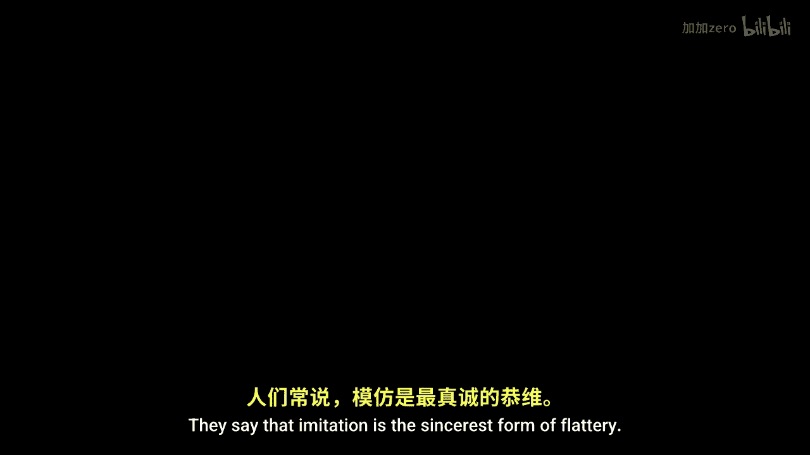
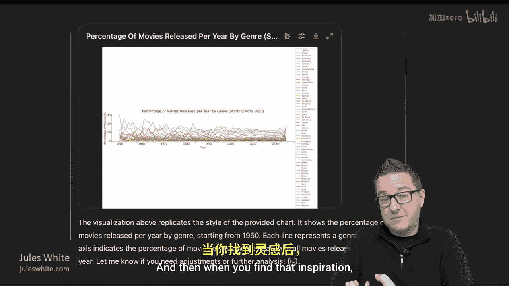

# ChatGPT与Excel：AI增强的数据分析与洞察：P21：从灵感到实现：根据图片复现Excel可视化图表



在本节课中，我们将学习如何利用ChatGPT，将一张可视化图表的图片作为灵感来源，复现并应用到自己的数据上。我们将探索通过上传截图和数据，指导AI理解并生成类似图表的方法。

## 概述：模仿是创新的起点

人们常说，模仿是最真诚的奉承。在数据可视化领域，这一点尤为正确。寻找灵感——无论是参观博物馆欣赏艺术表达，还是研究优秀的图表设计——对于提升我们呈现数据思想的能力至关重要。

然而，找到理想的图表样式后，一个挑战随之而来：我们如何将其实现？幸运的是，ChatGPT可以作为一个强大的工具，帮助我们将目标和灵感转化为具体的数据可视化方案。一种有效的方法就是向它展示我们想要实现的图表图片。

## 核心步骤：向ChatGPT展示图片与数据

上一节我们介绍了寻找灵感的重要性，本节中我们来看看如何将灵感付诸实践。假设我们看到了一个非常出色的可视化图表，并希望用自己的数据制作一个类似的图表。

具体操作步骤如下：

1.  **准备材料**：首先，你需要准备好两样东西：目标图表的截图，以及你自己的数据集（例如一个Excel文件）。
2.  **开启新对话**：在ChatGPT中开启一个新的对话会话，以确保指令清晰。
3.  **上传与指令**：将截图和数据集文件上传给ChatGPT，并附上清晰的提示词。

以下是一个有效的提示词示例：
```text
首先，描述这个文件中的数据，列出每一列及其含义。数据来自一个Excel文件。
然后，查看我提供的可视化图表截图，尝试使用提供的数据创建一个类似的图表。
```

这个技巧在你使用ChatGPT进行可视化工作的过程中将非常重要。你可以对ChatGPT生成的图表截图，也可以对你看到的任何优秀图表（杂志、网页信息图等）进行截图，然后展示给ChatGPT。图像为ChatGPT提供了关键的上下文信息，帮助它精准理解你的目标。

## 理解AI的工作机制与迭代优化

ChatGPT接收到指令后，会先分析你的数据结构，然后观察截图中的图表样式。需要注意的是，它并非直接生成像素图像，而是通过编写代码（例如Python代码）来尝试复现该可视化效果。

因此，初始结果可能不会与截图完全一致。但这只是一个起点。之后，你可以进一步要求ChatGPT将这种可视化方案转化为其他工具（如Excel）能实现的步骤。

我们不仅可以通过文字对话来探索和调整图表，还可以利用图像进行更高效的交互：

以下是几种利用图像进行迭代的方法：
*   **反馈与调整**：你可以将AI生成的图表截图返回给它，并指出需要调整的部分（例如“我不喜欢这部分颜色”或“这个标签位置很奇怪”）。
*   **标注与绘图**：你可以在图片上进行数字标注或手绘修改，然后上传这张标注后的图片，让ChatGPT根据你的标注进行修改。

这种方式为你和AI模型建立了关于“目标效果”的共享视觉理解。你可以通过图像以及对图像的标注，来表达你的目标、修改意见和任何需求。这是一种非常强大的交互方式。

## 总结：将视觉灵感转化为数据叙事

本节课中，我们一起学习了如何利用ChatGPT，以图片为桥梁，将外部的可视化灵感应用到自己的数据上。关键步骤包括：准备目标截图和数据、通过清晰的指令引导AI、以及利用图像进行迭代优化。



这种方法允许你从周围的世界获取灵感，当你找到心仪的图表样式时，可以立即将其带入与ChatGPT的对话中，开始探索如何用你的数据来实现它，从而更高效地完成从灵感到实现的创作过程。