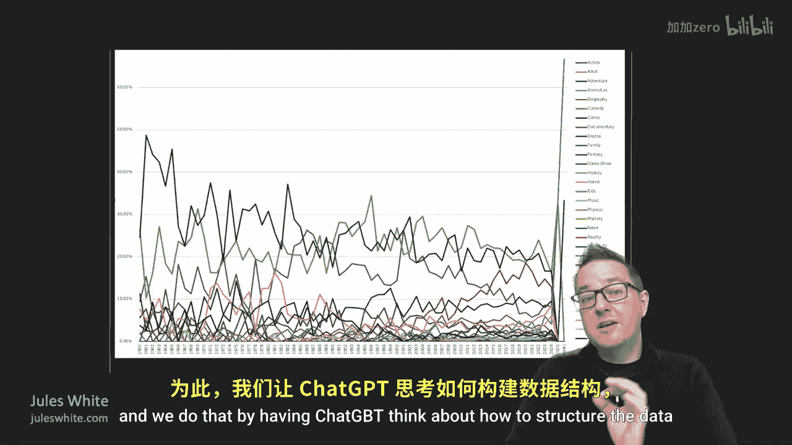

# 022：在ChatGPT指导下创建Excel可视化图表 📊

在本节课中，我们将学习如何利用ChatGPT的指导，将已设计好的数据可视化方案，在Excel中高效、准确地实现。核心在于理解如何将数据重塑为最易于生成图表的格式，并遵循清晰的步骤来构建图表。

---

上一节我们探讨了如何与ChatGPT协作设计可视化方案。本节中，我们来看看如何将这些方案在Excel中落地实现。

一旦我们设计出了一个出色的可视化方案，下一步就是将其在我们选择的工具中实现。在本案例中，我们将在Excel中实现它。

那么，如何将这个已构思好的可视化方案进行复现，以便在Excel中随着数据变化而动态可视化呢？

以下是实现这一目标的有效策略。我们希望找到实现此目标的最简单方法。

我们希望尝试在Excel中创建一个表格或一组列，使得生成图表变得轻而易举。我们的目标是让生成图表变得像选中数据然后点击“插入图表”那样简单。这意味着我们需要在前端完成所有数据整理、表示和分析工作，使得最终的可视化步骤极其简单。

这样做并非必须，但它会让你的工作轻松很多。部分原因在于，对于ChatGPT而言，思考数据的列格式和表示方式，可能比思考复杂的表达式和可视化本身更容易。因此，更有效的方法是思考如何将数据整理成一种格式，使得实现可视化成为微不足道的细节。

我将从这次对话的末尾开始，添加一个额外的提示：**“在Excel中复现这个图表。为了让可视化尽可能简单，我需要创建哪些列？”**

ChatGPT将返回并描述为了使这个可视化变得简单，我应该拥有的数据形状。

当我们快速原型化可视化时，我们是在Python中进行的。Python可以完成一些非常复杂的操作并为我们自动化所有步骤。但一旦进入Excel，它无法为我们自动化所有事情。在某些情况下，它可以使用VBA脚本，我们将在某个时间点讨论这一点。但现在，我希望你思考不使用VBA脚本的情况。当你不用它时，你将不得不做一些手动工作。我们希望最小化手动工作，并尽可能降低出错的可能性。最简单的方法是尝试生成一系列列或一个新工作表，将数据整理成正确的格式，以便我们能全面查看并了解情况。

ChatGPT回复说，最佳方式是：**将年份作为行，将所有流派作为列**。这并非我们数据的当前形状。所以，它基本上是在告诉我们，这就是你需要重塑数据以简化可视化的方式。

因此，一旦我们得到了这个目标——即让ChatGPT描述一个非常易于进行可视化的数据格式，我们就可以接着说：**“请根据我当前的数据，给出分步说明，以创建一个具有这种格式的独立工作表。我想使用数据透视表。”**

在这个案例中，我知道我想使用数据透视表，因为我认为这会使事情对我更容易。当然，你需要一些Excel专业知识才能提出“我想使用数据透视表”这样的要求。如果你不知道，可以省略这些细节，让ChatGPT为你选择。但目标是先让它描述数据形状，然后跟进询问如何在Excel中将当前数据转换成那种形状。

现在，我想花点时间说明：每次你提出这个问题，它可能会给出略有不同的实现方式，甚至完全不同的方法。你应该利用这一点。例如，如果它给出的选项看起来需要大量手动工作（比如没说用数据透视表，而是说手动为每个流派创建一列），而你不喜欢，你可以编辑你的提示词重新提交。它可能会返回并说：“好的，这是使用数据透视表的版本。”因此，不要仅仅接受第一个答案，因为它可以提供许多不同的答案和实现方式。

同样，如果你不喜欢它最初给出的数据形状，你可以描述你想要的形状，引导它达到目标。你不必接受它说的一切，你可以随时返回并重新提交相同的提示词，或稍作编辑后重新提交，或继续对话并说：“不，这不是我想要的，我想做点别的。”但请记住这一点。

在本案例中，它回复说：好的，以下是如何使用数据透视表来实现。加载数据到Excel（这很明显）。准备数据：拆分“流派”列。这很有趣，因为我需要从当前这种“动作,喜剧,冒险…”的单一列格式，拆分成分离的列或条目，并且我只想要第一个流派。它告诉我应该这样做。

事实证明，它的想法是正确的，但它没有完全理解我数据的布局。这里有一个它难以察觉的有趣后果：如果我将此列拆分成单独的列，我可能会覆盖右侧的数据。由于我的“流派”列足够靠右，拆分操作可能会覆盖其他数据。这是我在实际操作并开始查看时发现的。所以，哦，这不会达到我想要的效果。因此，我稍微调整了一下：我先把那列移开，然后拆分它，再取我需要的值。所以，它是一个指南，但最终，你仍然需要保持关注。它不应该取代你的思考。如果你不理解它在做什么，你真的不应该尝试去实现所有这些步骤，因为如果你不理解，你很有可能会犯错，产生错误的可视化，并做出错误的决策。归根结底，你要不断提问，不断与它协作，直到你理解它在做什么。

如果你不理解它在做什么，就不要继续。在本案例中，我发现了它正在做一件有细微错误的事情，我直接手动纠正了它。但你也可以告诉它：“嘿，那一步错了，能给我另一种方法吗？因为我会遇到这个问题。”

然后它说：插入数据透视表。描述了如何设置数据透视表。我完成了所有这些步骤。它告诉我如何将其改为基于百分比，进行一些清理和其他操作。最终我得到的是一个数据透视表，它基本上以它之前提供的格式给出了数据。如果你看这个数据透视表，它本质上实现了我们在这里看到的效果：流派基本上作为列，年份作为行，百分比作为值。虽然在排序格式上略有差异，但我们看到行向下延伸，流派作为列横跨。

然后，从这里开始，它告诉我们如何创建折线图：**选中所有数据，点击‘插入’选项卡，选择折线图**，然后我们就得到了可视化图表。

因此，当你在尝试复现可视化时，我希望你不要过多地思考“如何实现可视化”，而是首先思考：**为了创建这个可视化，我能将数据放入的最简单格式是什么？** 你的工作重点应该放在如何正确地重塑数据上。

在你尝试创建可视化之前，重塑数据就是核心工作。你希望将精力投入到重塑数据上。另一个原因是，你学到的所有关于如何构建公式、如何创建单独的列、如何调试和定位问题的技能，这时都能派上用场。你可以使用相同的技术来确保数据被正确重塑，因为很可能你将使用一些公式将数据重塑为你想要的格式。然后，你可以应用所有你学过的技巧，确保在创建这些列时，方法简单易懂，并有助于你定位错误。

一旦数据被正确重塑，你确认它是正确的并检查了错误，你就可以生成可视化图表了。但是，如果你试图一步完成太多事情，就很容易出错。我想再说一次：早在ChatGPT出现之前，人类就一直在Excel中犯错。我们不需要ChatGPT的加入才能在Excel中犯错，而ChatGPT在Excel中也会像我们一样犯错。我们不希望的是将两者结合起来，导致人类不理解错误，而ChatGPT也没意识到它犯了错，然后我们都假装一切正确。我们不希望走到那一步。

我们想要做的是，以这样一种方式使用ChatGPT：**帮助我们提高分析和可视化的严谨性，以及公式的正确性**。我们通过使用ChatGPT来帮助我们思考可视化应该是什么样子，进行更多检查，然后帮助我们以一种可以逐步检查的方式来实现。只有在我们获得了经过仔细检查的、真正稳健的数据之后，我们才去生成可视化。当我们生成可视化时，我们希望它非常直接了当，以至于我们犯错的几率最小。我们通过让ChatGPT思考如何构建数据以使可视化尽可能简单来实现这一点。

---

本节课中，我们一起学习了如何利用ChatGPT指导在Excel中实现数据可视化。核心流程是：**1） 让ChatGPT建议最简数据格式；2） 获取分步操作指南（如使用数据透视表）；3） 在理解的基础上手动执行并检查；4） 基于整理好的数据轻松插入图表**。关键在于将工作重心放在**数据重塑**而非图表生成本身，并始终保持审慎检查，以确保最终结果的准确性。