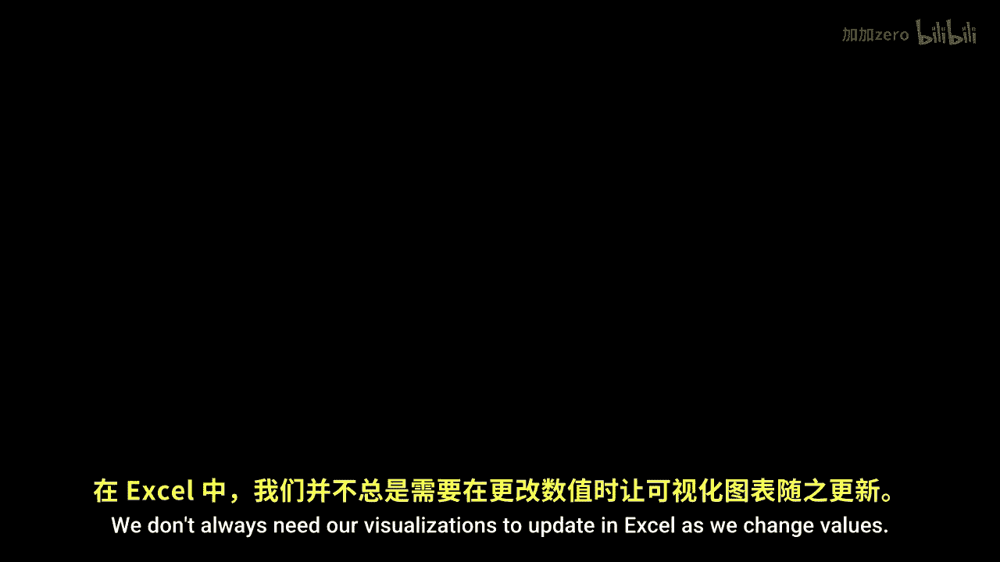
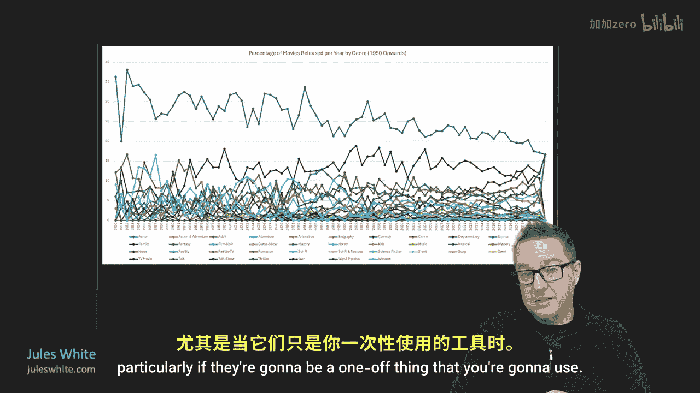

# 023：用ChatGPT快速构建Excel可视化图表

在本节课中，我们将学习一种高效技巧，利用ChatGPT快速生成Excel图表，而无需在Excel内部进行复杂的数据整理与计算。这种方法能显著提升创建可视化图表的速度。

## 概述

上一节我们探讨了在Excel内部使用公式和数据透视表来整理数据并创建图表。本节中，我们来看看一种更快捷的“作弊模式”。这种方法的核心思想是：**将繁重的数据整理工作交给ChatGPT（或Python）完成，我们只需将整理好的静态数据导入Excel进行可视化**。

## 核心方法：分离数据处理与可视化

我们并不总是需要让Excel图表随着原始数据的变化而实时更新。同样，我们也不一定非要在Excel内部完成所有中间数据的计算和整理工作。

如果我们的核心目标是**快速得到可视化图表**，并且不介意中间数据是否与原始数据在Excel中保持动态链接，那么可以采用一种更高效的方法。

### 操作步骤

以下是利用ChatGPT快速构建Excel图表的步骤：

1.  **指令ChatGPT进行数据整理**：在对话中，向ChatGPT提供原始数据，并明确指令。例如：“我需要用Excel重新创建这个图表。请根据原始数据，生成任何必要的衍生数据，并以CSV格式提供给我，同时附上在Excel中创建该图表的逐步指南。”

2.  **获取并下载整理好的数据**：ChatGPT会在其环境中（例如使用Python）执行数据筛选、聚合、重塑（如将数据整理为以年份为行、类型为列的表格格式）等操作，然后提供一个CSV文件的下载链接。

3.  **将数据导入Excel**：下载CSV文件，并将其导入到Excel工作表中。

4.  **在Excel中创建图表**：根据ChatGPT提供的步骤指南，使用导入的静态数据在Excel中创建（例如折线图）并格式化图表。

### 方法优势与局限性

**优势**：
*   **速度极快**：最耗时的工作——将数据重塑为易于可视化的格式——由AI自动完成。
*   **流程简化**：你无需在Excel中手动构建复杂的公式或数据透视表。

**局限性**：
*   **数据静态化**：一旦将CSV数据复制到Excel，中间数据就与原始源数据断开了链接。它们成为独立的实体，无法随原始数据自动更新。
*   **适用场景**：这种方法非常适合用于**一次性分析**或对数据实时更新要求不高的报告。只要你在导入后仔细检查中间数据和最终图表的正确性，这通常不是问题。

## 总结

本节课我们一起学习了一种提升Excel图表制作效率的技巧。其核心公式可概括为：
**快速可视化 = ChatGPT处理数据（输出CSV） + Excel静态制图**

当你的首要目标是快速获得一个正确的图表，并且可以接受使用静态的、整理好的中间数据时，这种方法能极大地节省你的时间和精力。它让你能够更专注于数据洞察本身，而非数据整理的过程。