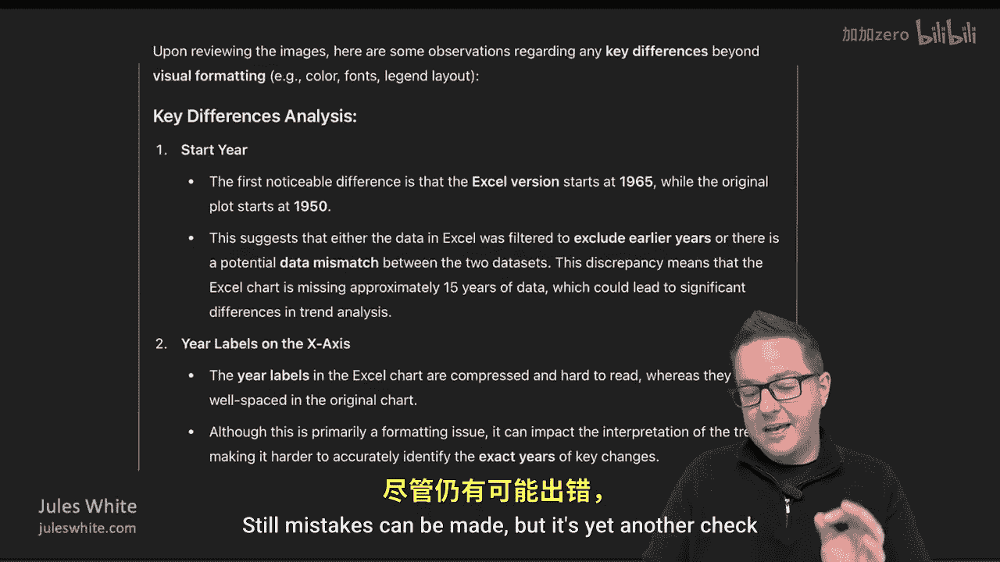

# ChatGPT与Excel：AI增强的数据分析与洞察：P24：双重校验：用ChatGPT对Excel可视化图表进行双向检查 👁️

## 概述
在本节课中，我们将学习如何利用ChatGPT作为“第二双眼睛”，对Excel中创建的可视化图表进行双向检查。这种方法旨在补充人工审查，帮助我们更有效地发现图表中可能存在的细微差异或错误，从而提升数据分析的严谨性和质量。

## 正文
人眼在观察事物时并非总是完美无缺。有时我们操作过快，有时注意力不够集中，尤其是在面对复杂的可视化图表时，可能会忽略其中细微的差异或不一致之处。

有趣的是，ChatGPT可以充当我们的第二双眼睛来审视这些可视化图表。我们不仅可以利用它来检查公式和数据，还可以对数据和公式进行双向检查。同样，我们也可以让它协助检查可视化图表本身。

需要明确的是，这样做并非为了取代人眼或人工审查。其目的是**补充**人工审查，增加一道检查工序，从而降低我们犯错的可能性。

接下来，我将展示如何进行可视化图表的双向检查，即如何利用ChatGPT作为我们的第二双眼睛。

## 检查流程
我首先在ChatGPT中创建了一个可视化图表。我非常喜欢这个图表，然后我让ChatGPT指导我如何在Excel中重新创建并实现这个可视化。

现在我想知道的是，我在Excel中得到的这个版本，是否存在任何我可能忽略的明显错误？

我已经用肉眼检查过，它看起来很不错。但对于如此复杂的图表，我的肉眼检查可能并不完全准确。因此，我喜欢做一个非常简单的检查：只需截取两个可视化图表的屏幕截图。

然后将它们导入ChatGPT进行双向检查，或者说，让这第二双眼睛也看看。我们让ChatGPT也“看一看”，看它是否能注意到任何差异。

## 向ChatGPT提问
我向ChatGPT提问：“除了图例、布局、颜色、字体等方面，你是否看到任何可能导致两个图表存在差异的关键可视化或数据上的不同？”

再次强调，这并非完美的方法。我并不期望ChatGPT的视力一定比我好，我只是想要一个二次检查。即使我们俩都没发现问题，也不意味着它就是完美的，你仍然需要去查看底层数据和其他方面。但这能让我获得一个第二意见。

## ChatGPT的分析结果
ChatGPT回复并进行了分析：

以下是关键差异分析：
*   **整体趋势一致性**：两个图表都显示“戏剧”类别的总体趋势一致。该类别从1950年起在两个图表中均表现出稳定的突出地位。
*   **线条位置与X轴一致性**：从1950年到近年，跨X轴（年份）的趋势线在两个图表中看起来都正确对齐。
*   **Y轴数值范围**：两个图表中关键类别的Y轴数值范围相似。主要类别保持在25%到40%的范围内。次要类别（如科幻和动作）在两个图表中的百分比水平也大致相同。
*   **线条顺序与密度**：该图表的一个显著特征是低百分比范围内类别的密度。两个图表均未显示任何异常的峰值或骤降，这表明不存在一个图表有而另一个图表没有的数据问题。
*   **图例与标签**：图例位置不同，但我已告知这可以接受。

**分析总结**：数据没有差异，视觉差异是表面性的，关键趋势一致。

这实际上可能是对这两个图表比我通常所做的更深入的分析。如果让我并排观察，我可能会觉得“嗯，看起来不错”。而ChatGPT提供了更详细的分析。当然，这个分析可能有缺陷或错误，但它让我对图表的正确性多了一份信心。

## 故意引入错误进行测试
让我们在Excel图表中故意制造一些错误。例如，我们让图表从一个不同的起始年份开始，这样数据看起来就会有点不同。当我们给它看一个截图，其中可视化本身相同但数据的起始点略有偏移时，它能发现吗？

同样，我提供了截图。但这次，为了让测试更公平、更具挑战性，也为了更清晰地看出差异，我提供了两个截图：一个是原始正确的Excel可视化图表，另一个是存在细微错误的Excel可视化图表（起始点偏移）。它能匹配并发现两个Excel可视化之间的差异吗？

答案是肯定的，它可以。

## ChatGPT识别错误
它识别出的第一个显著差异是：在出错的Excel版本中，图表从1965年开始，而原始图表是从1950年开始的。因此，它发现我基本上移动了可视化的起始点。

## 总结与核心价值
这非常令人惊叹，它确实为我们提供了一双额外的眼睛来检查可视化图表。

再次强调，我们不想取代人工审查，也不想取代从其他人那里获得的二次检查。但对我个人而言，我需要一个额外的检查来**增强**我工作的严谨性。我可以利用ChatGPT来检查我从Python得到的和从Excel得到的结果是否一致。

因为如果我能让两个可视化图表在两边看起来相似，我就能建立信心：我正确地遵循了ChatGPT的指导，并且没有犯任何错误。我也可以确信，没有出现数据损坏或其他可能引发问题的情况。

当然，这并不意味着ChatGPT正确地实现了我所陈述的目标而没有误解。不，它不意味着这一点。但它让我感到安心：我在Excel中遵循ChatGPT指令的实现，与它在Python端所做的结果相匹配。这让我相信事情被正确地完成了。虽然错误仍然可能发生，但这确实是我们为了提升工作严谨性和质量所能做的又一项检查。

**核心公式**：
`最终信心 = 人工审查 + ChatGPT辅助检查`
这个公式代表了通过结合人工智慧与AI工具，我们可以构建更可靠的数据分析工作流程。