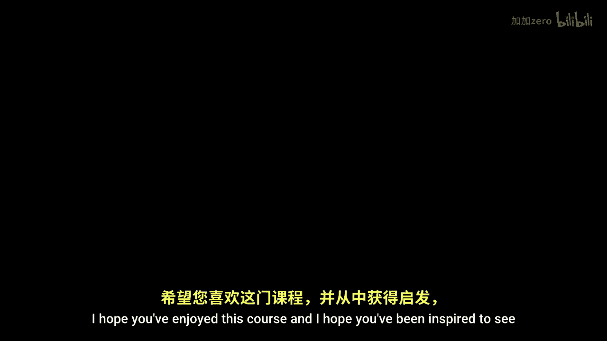

# 025：课程总结与致谢 🎓

在本节课中，我们将一起回顾整个课程的核心收获，并对未来的学习与实践提出展望。

---

我希望你喜欢这门课程，并受到启发，认识到我们可以去完成那些看似不可能的任务。借助ChatGPT，这些任务如今变得完全可能实现。这促使我们重新思考如何对待工作，如何运用像Excel这样简单的工具，将其转变为一种强大的媒介。我们可以从一张照片、一份文档出发，完成令人惊叹的计算，帮助实现各种复杂的想法和应用。

通过让ChatGPT成为我们的合作伙伴，它赋予我们的能力远超以往仅使用Excel所能达到的极限。

---

如果你喜欢这门课程，我将非常感激你能将它推荐给其他人。如果你获得了课程证书，请将其分享到LinkedIn。也欢迎你在LinkedIn上联系我，我很乐意与你保持连接，并希望你继续关注范德堡大学以及我在创建新课程方面的工作。

最重要的是，我衷心感谢你花时间与我一同完成这门课程。我希望你能去创造一些了不起的东西。如果你真的创造了什么，请分享出来。我非常乐意在你发布的任何关于你惊人成就的内容中被提及，让更多人知道可以通过学习这门课程来掌握这些技能。

非常感谢你，我真心感激你在这门课程中投入的所有时间。

---

本节课中，我们一起回顾了ChatGPT与Excel结合带来的变革性力量，并展望了未来的学习与实践方向。感谢你的参与，期待看到你的精彩创造。