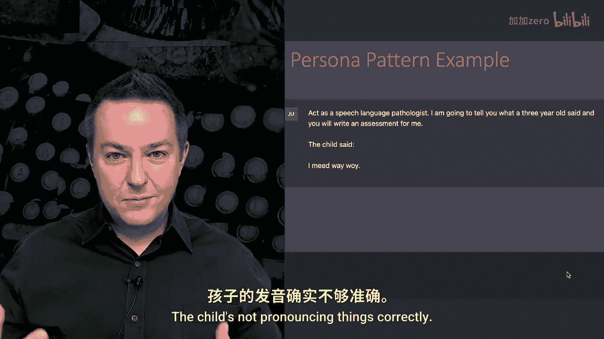

# 028：扮演言语病理学家 🧑‍⚕️

在本节课中，我们将通过一个具体的示例来理解提示工程的重要性。我们将看到如何通过特定的提示模式，激发大型语言模型（如ChatGPT）的复杂能力，从而获得我们自身知识领域之外的深度分析。

为了帮助你理解提示工程为何如此重要，我将给出一个初始示例。这个示例展示了我们如何触及ChatGPT真正复杂的能力，当然，你也可以在其他大型语言模型上实现类似效果。

我们触及这些能力的方式是使用一种模式。这是一种在编写提示时可以使用的模式，它能帮助我们利用大型语言模型这些非常有趣的能力。如果你了解这些模式（我们将在课程中详细讨论），你编写提示的效率会更高，也能更轻松地完成其他人难以做到的事情。

现在，我将给出一个示例。这个示例将使用一种称为“角色扮演模式”的方法。在此我不会详细解释这种模式，但基本上，这是一种随处可见的模式。你会在互联网上看到大量关于使用这种模式完成各种不同任务的例子。其基本理念是，你需要要求大型语言模型（本例中是ChatGPT）扮演一个特定的角色。这意味着你需要让它像一个人、一个无生命物体、一只动物或某个系统那样行动。你可以通过多种方式使用它，这非常有趣。在本例中，我们将使用它来扮演一个角色。

我们将利用一个与我关系密切、但我对其领域一无所知的角色。角色扮演模式的一个真正有用的地方在于，你可以想象，如果你需要打电话给一位专家以获取某个问题的帮助，你知道该打给谁，但你并不确切知道他们会告诉你什么，或者他们会如何分析你的问题。

因此，我需要一个我知道可以求助的专家。在本例中，我的妻子是一名言语病理学家，我可以让她查看输出结果并告诉我效果如何，但我对言语病理学或他们的工作方式一无所知。

我设想了一个场景：我儿子三岁时，说话发音不准确。于是我去找ChatGPT，对它说：“作为一名言语病理学家，我将告诉你一个三岁孩子说的话，请你为我写一份评估报告。孩子说：‘I need Wei Wei。’” 你可以想象，这可能只是我这个家长听错了，孩子发音不正确，我甚至不知道如何正确记录这件事，如何用语言正确表达这一切。所以，从我的角度来看，这是一个复杂的问题，我甚至不知道如何用语言恰当地描述和提问。但我知道我会去找一位言语病理学家，并向他们描述这个情况。

我试着想了一句听起来像我儿子在那个阶段可能会说的话。那么ChatGPT说了什么呢？首先，你注意到它的输出看起来像一份报告。它写道：“主题：三岁儿童言语样本评估。儿童言语样本：‘I need way O。’” 它用引号引起来，然后写道：“评估：根据提供的言语样本，该儿童可能正在经历一些在这个年龄段常见的音韵和构音错误。” 我并不知道什么是音韵或构音错误，我也不会知道该向ChatGPT询问这些内容。但基于我使用的这种角色扮演模式，我触及了ChatGPT审视此问题并知道该告诉我哪些正确信息的能力。

它说有音韵和构音错误。它说孩子的发音似乎在辅音生成方面存在错误，并且可能在音节结构方面存在一些困难。

以下是关于辅音错误的详细分析：
*   **辅音错误**：孩子似乎在生成某些辅音时存在困难，特别是 **/n/** 和 **/l/** 音。孩子将“need”说成了“need”（此处原文为“need instead of need”，疑为笔误，可能意指将“need”发成了类似“nei”的音），将“toy”说成了“why”。然后它在括号中给出了它的假设（它假设目标词是“need”和“toy”）。因为你可以回想，我的言语样本是“I need way why”，我妻子告诉我这不是一个很好的例子，可能不是一个孩子实际会说的话。尽管如此，它仍然在推断：如果这确实是孩子说的话，这可能就是他们想表达的意思。它推断出这一点，然后告诉我他们存在辅音错误，具体来说，他们在 **/n/** 和 **/l/** 音上有困难。

接着它继续分析音节结构：
*   **音节结构**：孩子将单词“way”发成“way”，可能表明在正确的音节结构方面存在一些困难。孩子可能想说“play”，但说成了“way”，这暗示了将初始辅音簇 **/pl/** 替换成了单个辅音 **/w/**。这可能是一个称为“辅音簇简化”的简化过程的例子。

我不会知道如何要求ChatGPT去检查是否存在音节结构问题或辅音簇简化，但我使用了“扮演……”这种模式，我说“扮演一名言语病理学家”，现在我得到了我甚至不知道如何要求的丰富输出。

然后它继续说，顺便说一下，如果你想做一件非常不受欢迎的事，那就是让ChatGPT生成看起来像是在做某人工作的输出。这总是会让人非常“受欢迎”。有一天早上我就对我妻子做了这件事。我妻子当时不太高兴，因为她正准备去上班，而我却在说ChatGPT正在生成看起来像她生成的报告。她对我说的一件事是：“如果那是一个三岁的孩子，我会告诉家长他们可能不需要担心，你知道，儿童的言语能力还在持续发展。” 我是在转述她的话，她说得更优雅，但她的意思是，这给你的分析太过头了。我说，是的，但ChatGPT在最后也说了这一点：“考虑到孩子的年龄，重要的是要记住，一些言语发音错误是发育过程中正常的，可能会随着时间的推移自行解决。”当然，那时她已经出门了，因为她早上真的没准备好坐在那里听我告诉她ChatGPT正在做言语病理学家做的工作。我认为这会取代她的工作吗？不。但我认为，通过正确的模式，我们可以触及它真正广泛而强大的能力。我认为它让我们能够专注于我们真正想花时间做的事情上。我妻子喜欢和孩子们一起工作，她喜欢与他们互动，并试图理解如何帮助他们。写报告，也许……我不想过多代表我妻子发言，但我猜这可能不是她工作中最喜欢的部分。她真正热爱的是与孩子们一起工作并努力帮助他们。因此，你可以想象，像这样的工具可以让她更多地专注于她在现实世界中真正关心的事情，也许可以帮助她围绕孩子的需求整理思路并撰写这些报告。

我只是希望你能看到，通过在我们的提示中加入一点正确的结构，我们就可以通过这些大型语言模型，创造出非常强大的方式来将我们的想法和思维具体化。

本节课中，我们一起学习了如何通过“角色扮演模式”的提示工程，让ChatGPT模拟特定专家角色，从而获得超出我们自身知识范围的深度、结构化分析。这个示例展示了精心设计的提示如何能激发AI的潜力，帮助我们更高效地获取专业见解，将精力集中在更具创造性和人际互动价值的工作上。