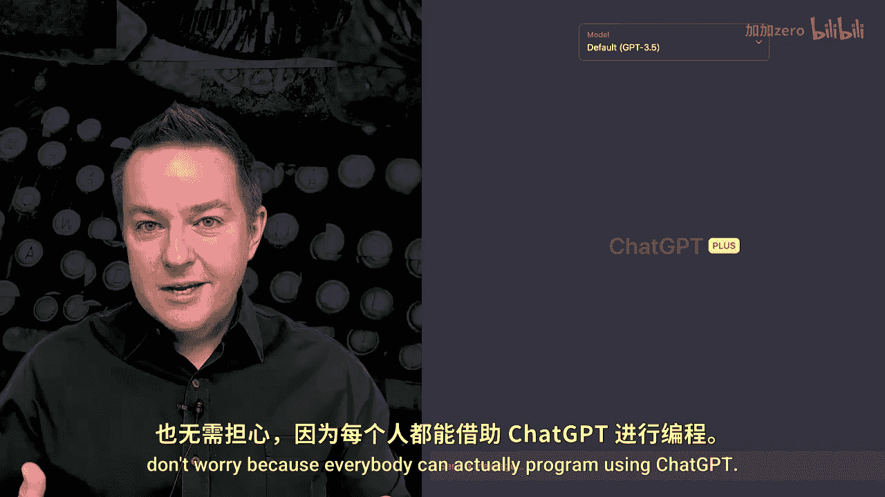
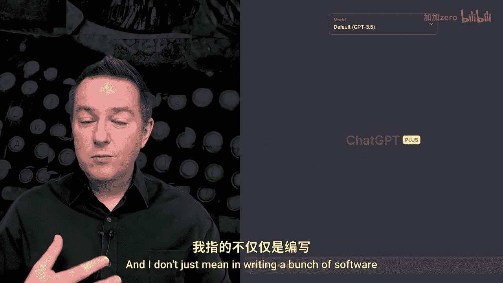
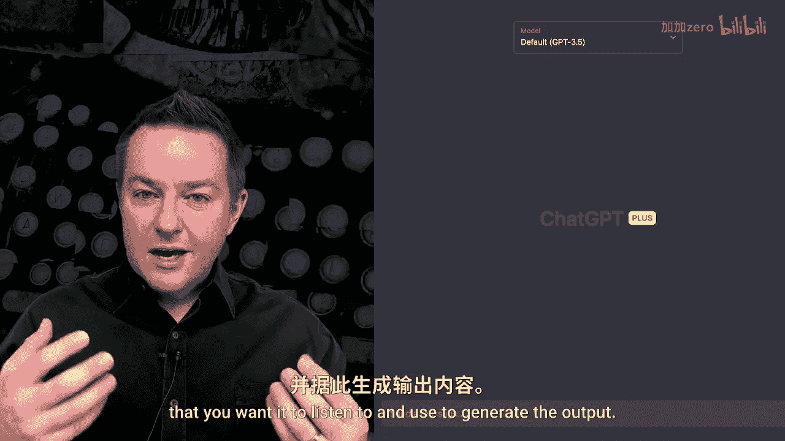
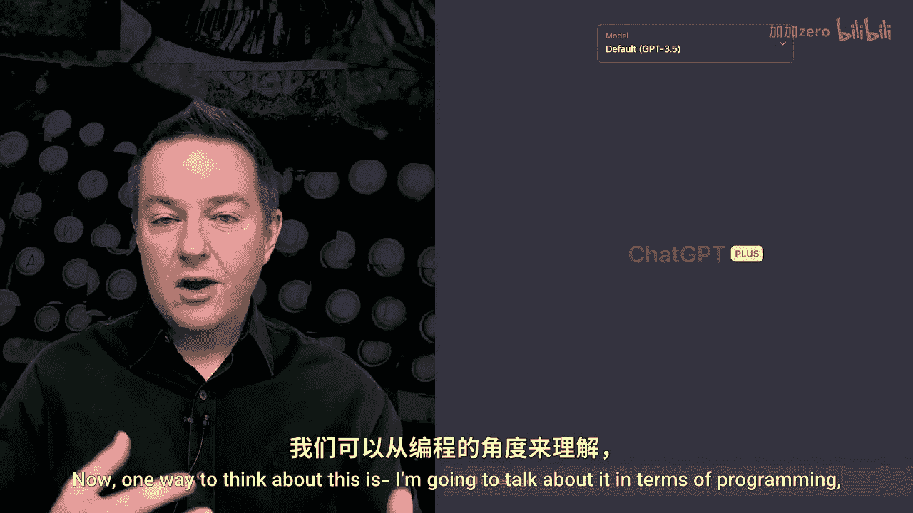
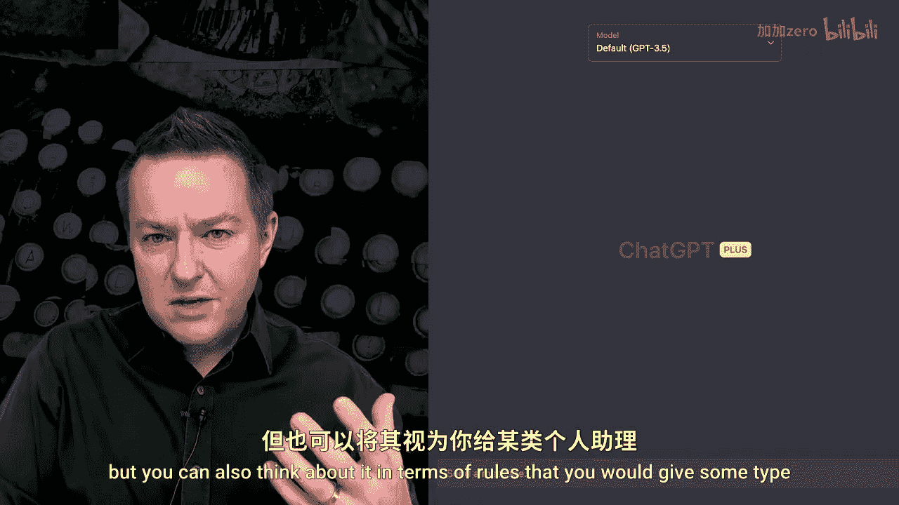
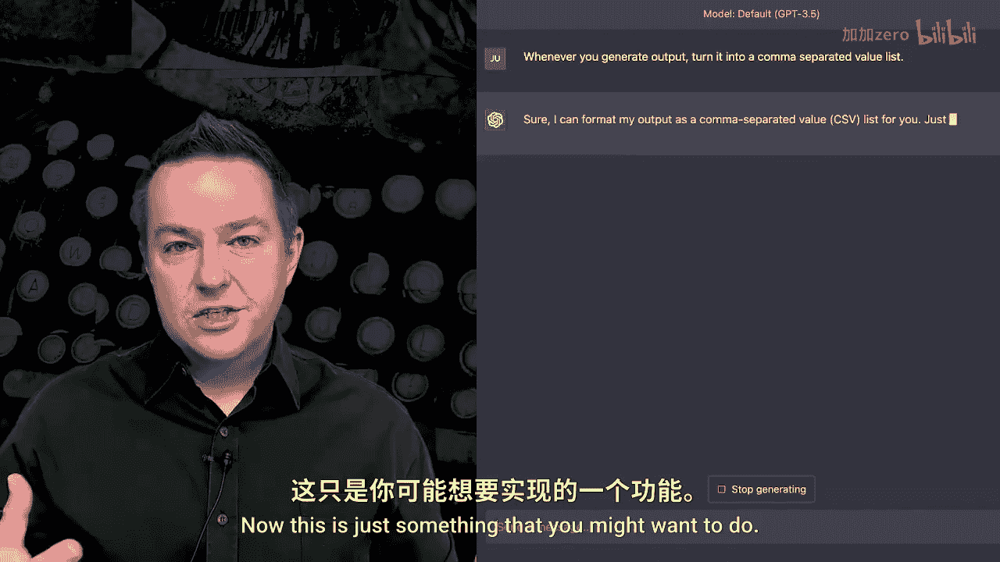

# 033：人人都能用提示词编程 🧠

在本节课中，我们将学习如何超越简单的问答，使用提示词来“编程”ChatGPT。这意味着我们可以为ChatGPT设定复杂的规则和指令，让它按照我们指定的方式处理和输出信息，就像编写一个简单的程序一样。

## 从提问到编程

上一节我们介绍了ChatGPT的基本交互方式。本节中我们来看看如何将简单的提示升级为结构化的“程序”。

提示词的功能远不止向ChatGPT提问或下达指令。实际上，你可以用它来编写程序。如果你不是程序员，也无需担心，因为每个人都可以通过ChatGPT进行“编程”。这里所说的编程，并非指编写在电脑上运行的复杂软件，而是指为ChatGPT设定一系列需要遵循的规则和复杂指令，让它根据这些规则来生成输出。

理解这一点的一种方式是将其视为编程。你也可以将其想象成给一位私人助理下达工作规则。让我们来看一个例子。

## 一个编程示例：生成CSV列表

我将要求ChatGPT执行以下操作：**“每当你生成输出时，将其转换为逗号分隔值列表。”**

这是一个你可能会用到的数据格式化操作。如果你使用过Excel，逗号分隔值（CSV）本质上就是用逗号分隔的条目列表，这是一个非常简单的概念。

有时，你可以将表格视为一个逗号分隔值列表。你可以将表格的第一列视为第一个值，然后用一个逗号分隔并引出第二列，再用一个逗号引出第三列。因此，一个三列表格可以表示为：第一个值，逗号，第二个值，逗号，第三个值。如果你使用过不同的电子表格程序，很可能接触过这种格式。

现在，ChatGPT回复说它可以将输出格式化为CSV。我输入：“我的名字是Jules White，我正在教授一门关于提示词工程的课程。”我们可以看到，它创建了一个逗号分隔值列表，本质上是在创建一个表格。它决定表格有两列：“姓名”和“课程”，第一列是我的名字，第二列是我的课程“提示词工程”。

值得注意的是，它自行决定了列名，我并未指定。但如果我想调整，我可以给出更多指令。

## 细化程序：定义列结构

我可以补充说：**“从现在开始，逗号分隔值列表的列应该是：姓名、课程、角色。”**（角色指个人在课程中的身份）。

现在，我再次输入：“我的名字是Jules White，我正在教授一门关于提示词工程的课程。”我们看到它重新格式化了输出，现在包含了姓名（Jules White）、课程（提示词工程）和角色（教师）。

至此，我们实际上已经编写了一个“程序”。我们告诉ChatGPT，每次我们输入内容时，它都需要按照我们给定的特定结构进行格式化。这不仅仅是提问，我们是在告诉它如何解读我们的输入。

## 扩展程序：生成额外示例

我们可以继续为程序添加更多功能。例如，我们可以说：**“此外，除了我输入的内容，请生成符合我所要求的CSV格式的额外示例。”**

现在我们看到，它基于我最初设定的“姓名、课程、角色”格式，填充了额外的示例。我再次输入：“我的名字是Jules White，我正在教授一门关于提示词工程的课程。”你会注意到，我们的程序变得更复杂了。它不仅根据我的输入创建CSV，还遵循我的指令，生成符合此格式的额外示例。

## 构建交互式程序

当你创建提示词时，你可以做的远不止提问和获取答案，你实际上是在编程交互过程。关键在于，我们正在进行一场对话。

回顾最初，我提供了第一条指令：“每当你生成输出，将其转换为逗号分隔值列表。”它开始执行。然后我开始细化我的“程序”：在某个时间点，我补充说“从现在开始，逗号分隔值列表的列应该是...”。接着，我又说“此外，我还希望你生成示例...”。

我们实际上编写了一个程序。现在，每当我们输入新内容时，ChatGPT都会使用这个不断演进的程序来生成输出。

你可以想象与一位私人助理对话：你先要求他做X，他照做了；然后你意识到还需要Y，于是你给他增加一条规则；你再次要求他做X，他做得更好了，但可能仍不完全符合预期，于是你再增加一条规则。在这个过程中，你就是在为他构建一套程序，一套在你下达特定任务时他需要遵循的指令集。

这正是我们与ChatGPT所做的——我们正在进行编程。我们反复使用相同的输入（“我的名字是Jules White，我正在教授一门关于提示词工程的课程”），但每次得到的输出都不同且更复杂，因为我们要求ChatGPT执行不同的操作，为这个“程序”赋予了更多指令。最终的结果是，我们获得了结构化的输出，并附带了额外生成的示例，这一切都源于我们要求ChatGPT执行的操作。

## 本节总结

本节课中，我们一起学习了如何将ChatGPT提示词视为一种编程工具。我们通过一个从简单CSV格式化到定义列结构、再到自动生成示例的渐进过程，演示了如何通过对话和添加指令，逐步构建一个能理解并执行复杂规则的“程序”。这揭示了提示词工程的强大之处：通过清晰的指令，即使是非程序员，也能引导AI完成结构化、可重复的复杂任务。