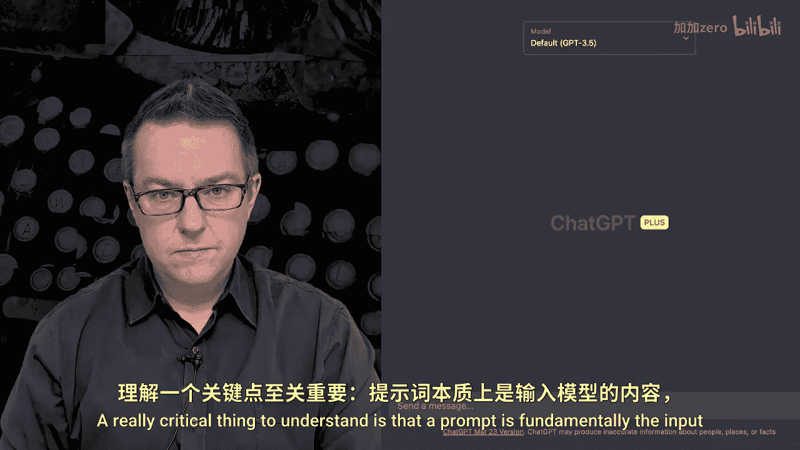
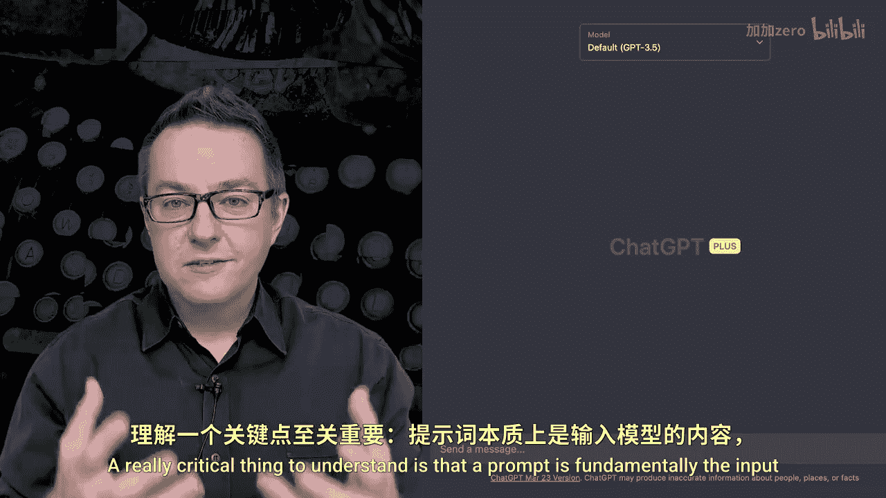
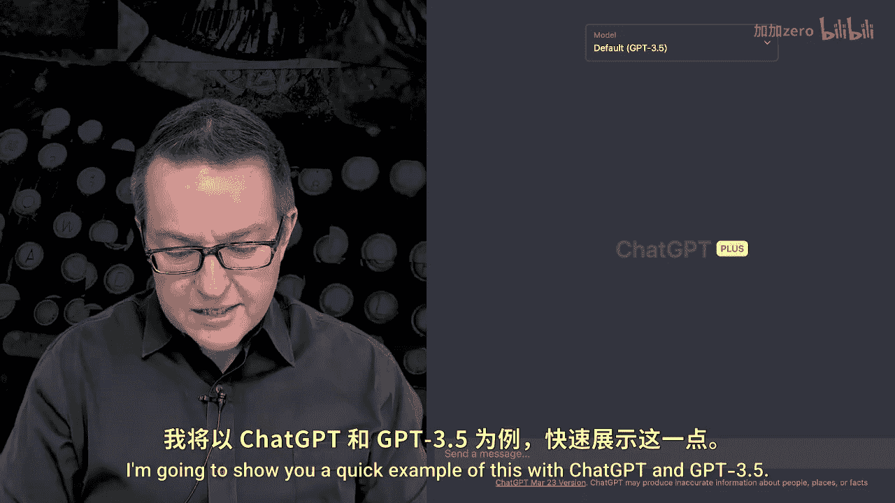

# ChatGPT与Excel：AI增强的数据分析与洞察：P37：提示词长度限制 🧠

在本节课中，我们将要学习一个关于大型语言模型（如ChatGPT）的核心概念：提示词的长度限制。理解这一限制对于设计有效的提示词至关重要。

## 概述

提示词本质上是输入给模型的指令或信息。然而，所有大型语言模型对单次输入的提示词大小都有一个根本性的限制。我们不能创建无限长的提示词。这一限制对如何设计提示词有着深远的影响。

## 理解限制

上一节我们介绍了提示词的基本概念，本节中我们来看看其物理限制。每个大型语言模型都会对我们可以放入提示词并发送给它的内容量设定一个基本的上限。

为了直观展示这一点，我们来看一个ChatGPT（GPT-3.5）的快速示例。当尝试粘贴一篇关于法国革命的维基百科长文时，ChatGPT会返回错误信息：“您提交的消息过长。请重新加载对话并提交更短的内容。”

这个例子清楚地表明，我们不能无限制地向模型提供信息。

## 限制带来的挑战

现在，如果我们回顾之前讨论过的提示词维度，会发现提示词的一个用途是引入模型未训练过的新信息。如果我们想向ChatGPT引入新信息，就必须意识到我们一次能提供的信息量是有限的。

我们可能希望向ChatGPT提供各种新信息，但不能一次性全部“倾倒”给它，然后要求它基于此进行推理。这并非其工作方式。

因此，作为用户，我们的目标之一是尝试**筛选并使用仅完成任务所必需的信息**。我们不能把所有信息都扔进去，然后指望ChatGPT自己理清头绪。

## 应对策略：成为内容编辑者

我们可以将这个过程想象成撰写一篇有字数限制的文章。我们不能随意堆砌内容，而必须进行编辑。在提示词设计的语境中，我们就是**内容编辑者**，编辑信息的上下文，并且我们有一个“预算”。

以下是我们可以采取的一些策略，以在预算内处理大量信息：

*   **选择性包含**：在将信息提供给ChatGPT之前，我们可以通过某种查询或过滤器，**选择与任务相关的信息片段**。例如，我们可以过滤掉不相关的信息类型。
*   **总结与压缩**：我们可以将信息**总结**成我们认为能保留推理所需要点的形式。例如，我们可以要求将每段信息总结为一句话，从而获得比原文更短的摘要。
*   **定向总结**：我们可以要求总结时**保留特定类型的信息**。例如，我们可以指示：“用一句话总结此信息，并保留关于人数的数据。” 如果原始总结没有保留人数，而我们后续的推理又需要这些数据，那么定向总结就至关重要。

## 核心技巧：利用模型自身进行压缩

一个强大的技巧是，我们可以**将信息块交给大型语言模型本身，要求它为我们总结或压缩**，以便后续用于推理。我们可以明确指示总结的目标，例如“为完成XX任务而总结”或“保留信息的YY方面”。

这能帮助我们创建保留了重要部分的、浓缩版本的信息。

## 总结与展望

本节课中我们一起学习了提示词的长度限制及其重要性。这是一个我们必须始终设法应对的根本性限制。

随着大型语言模型的发展，其处理能力可能会增强，使得对于许多直接的手动交互任务，长度限制不再构成问题。然而，考虑到我们日常处理的信息量之大，总会存在一些任务涉及的信息过多，无法一次性全部输入。

在这些情况下，我们必须综合运用多种策略：
1.  查询并获取信息子集。
2.  过滤掉无关信息。
3.  在将信息提供给模型之前，对其进行总结或压缩。

理解并巧妙应对提示词的长度限制，是有效利用AI进行数据分析和获取洞察的关键一步。