# 039：根提示词 🔑


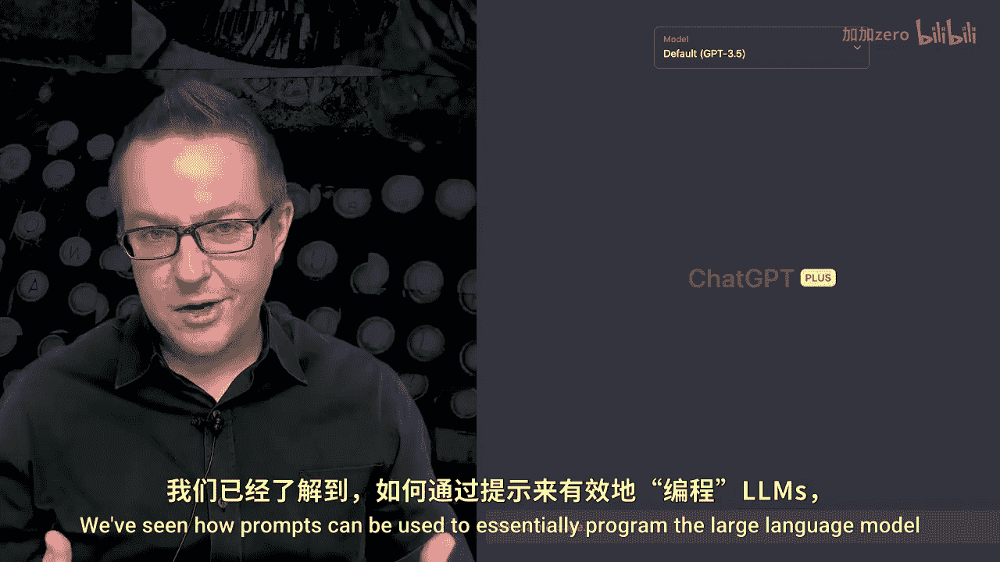

在本节课中，我们将要学习一个核心概念：**根提示词**。我们将了解它是什么，它如何影响与大语言模型的整个对话，以及如何利用它来定制AI的行为和设定安全边界。

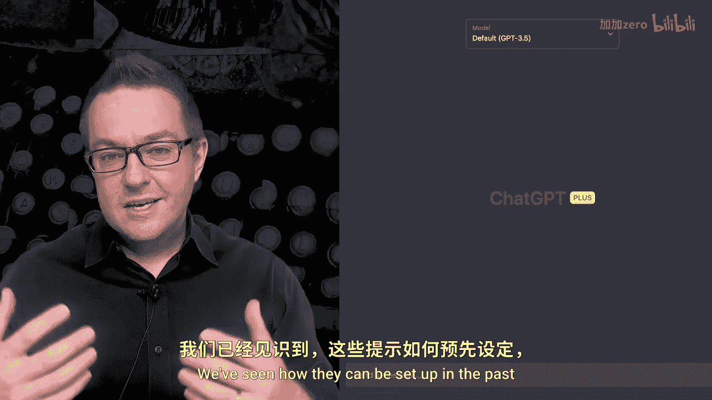

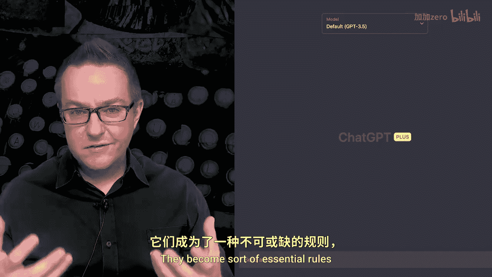

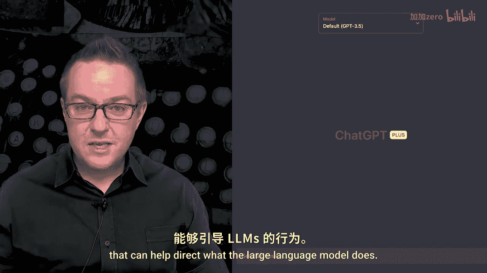

## 概述

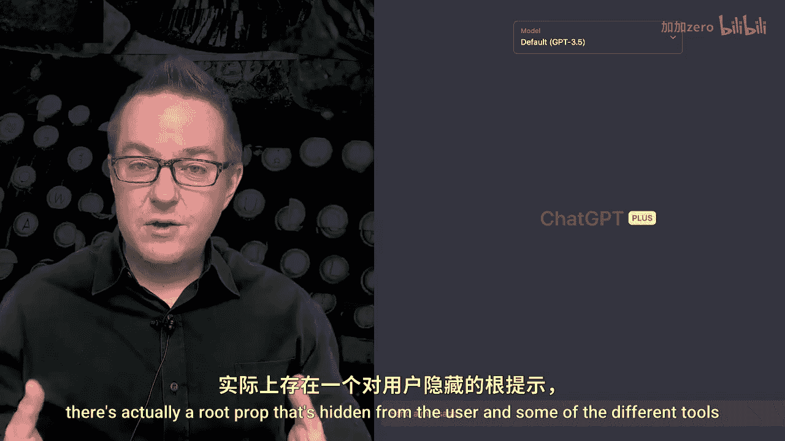

我们已经看到提示词如何被用来“编程”大语言模型，使其自动为我们完成有趣的任务。我们也了解到，提示词可以被预先设定，从而影响后续对话的走向。它们成为了一种指导大语言模型行为的基本规则。

## 什么是根提示词？🤔

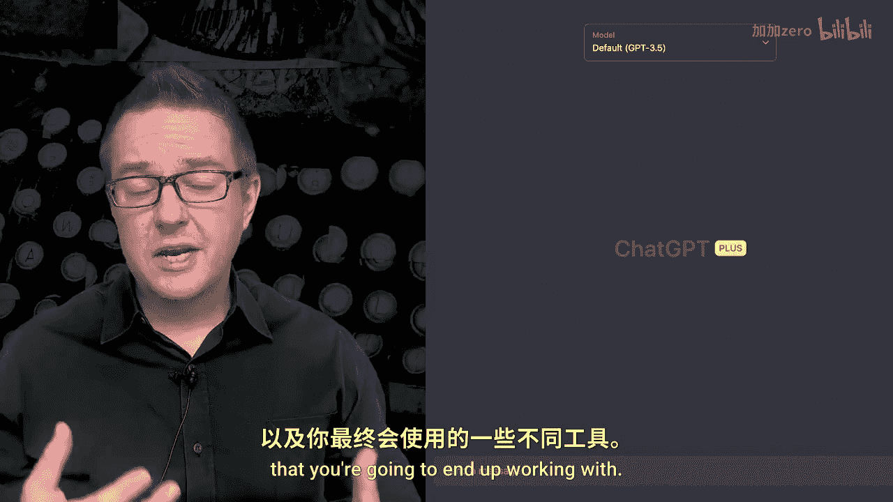


在许多情况下，存在一个对用户隐藏的**根提示词**。你将要使用的各种工具本质上都内置了根提示词，它们为大语言模型及其与用户的交互定义了基本规则。

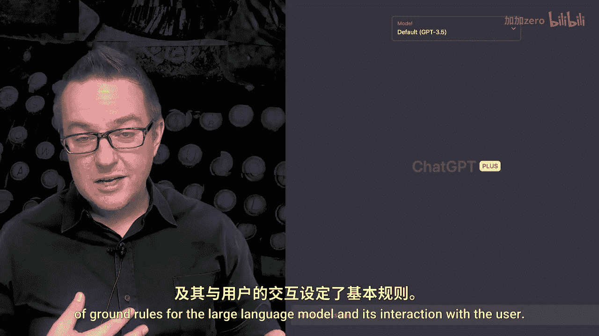

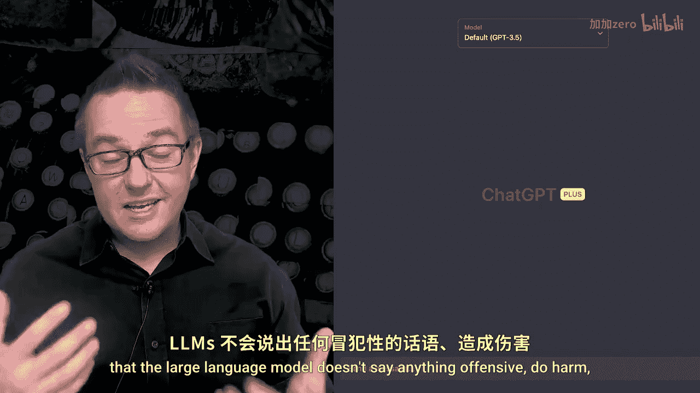

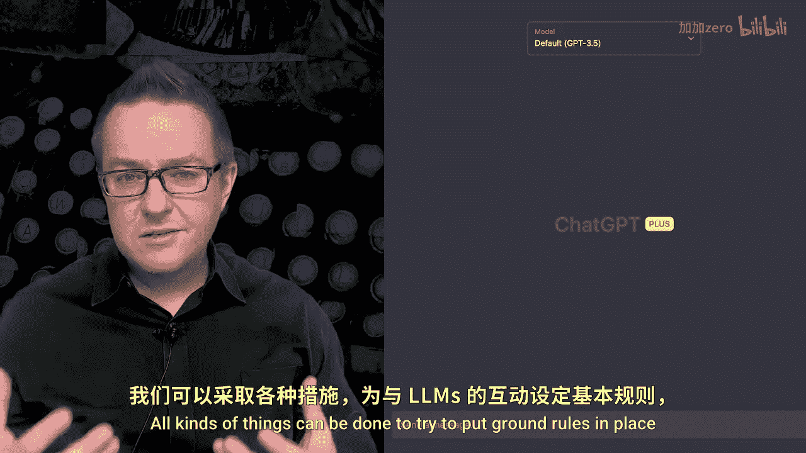

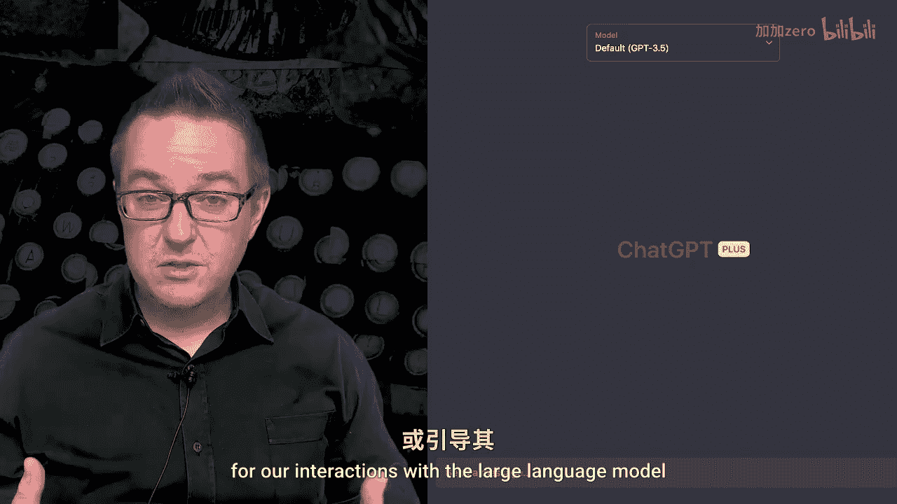

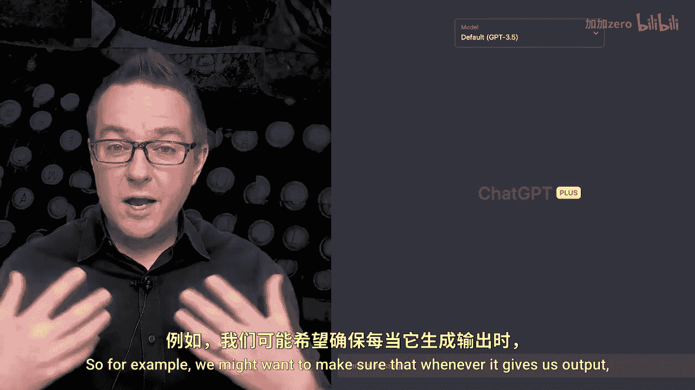

这些规则的目的包括：
*   确保大语言模型不说任何冒犯性言论。
*   防止其造成伤害。
*   建议适当的行动。
*   为我们的交互设定基本准则，或引导模型执行特定任务。

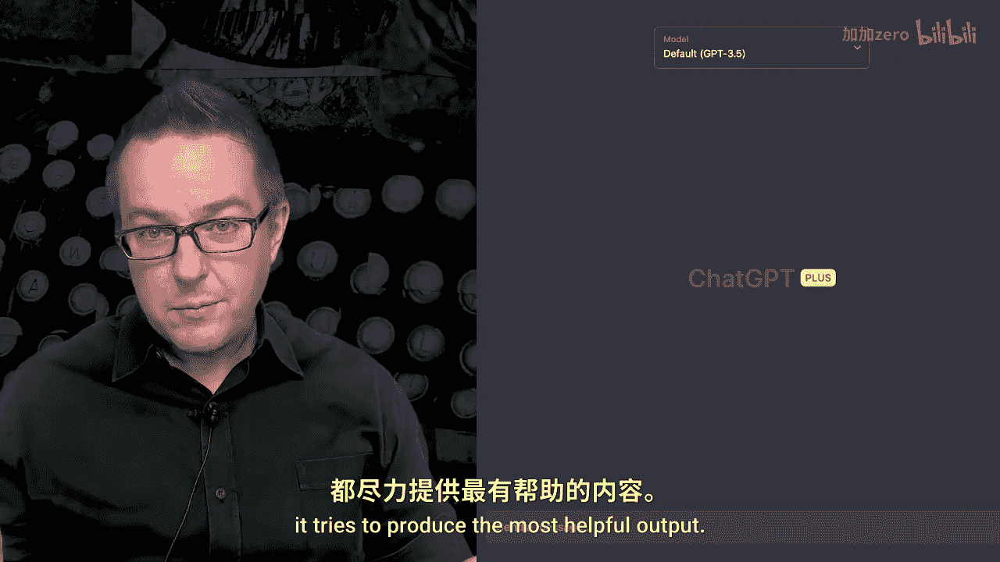


例如，我们可能希望确保模型在输出时，总是尝试提供最有帮助的内容。

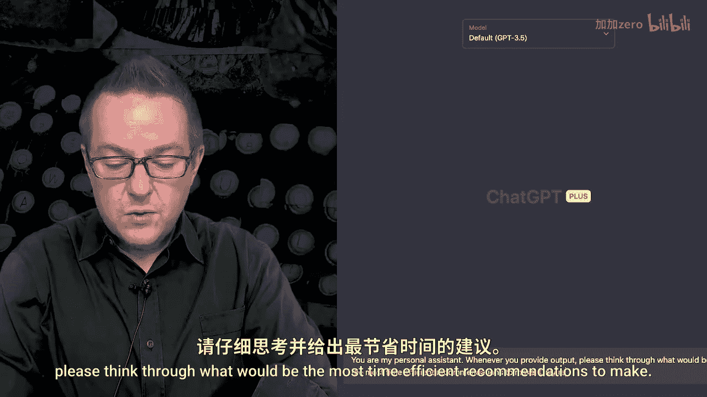


## 根提示词的作用示例

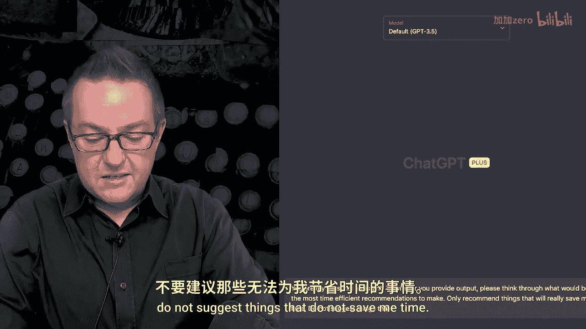

让我给你一个例子，看看根提示词可能是什么样子。

我将输入以下内容作为对话的开始：
```
你是我个人的效率助手。每当你提供输出时，请思考什么是最省时的建议。只推荐那些真正能为我节省时间的方案。不要建议那些不能节省时间的事情。
```

现在，模型回复：“明白。作为您的个人效率助手，我将优先为您提供能帮助您节省时间的高效建议。请告诉我需要什么帮助。”

接下来，我提问：“我需要去杂货店购物。为了购买我的杂货，你会建议我做什么？”

它回复：“以下是一些高效的杂货购物建议：制作购物清单、规划路线、使用购物App、在非高峰时段购物、选择自助结账。”

然后我再问：“我需要买一辆新车。你会建议我如何着手做这件事？”

它回复：“以下是一些购买新车的高效建议：在线研究、在线联系经销商、预约试驾、协商价格、办理贷款。遵循这些建议，您可以节省时间，使购车过程更高效。”

在这个特定案例中，我不确定它是否真的为我节省了时间，我给出的提示词也并非最佳。但你可以看到，在对话开始时，我给了它一个需要遵循的目标：“尽力为我节省时间”。无论它输出什么，都要尝试节省时间。

## 根提示词的普遍性与重要性

你将与之交互的许多工具，甚至ChatGPT本身，都可能有一些隐藏的根提示词。这些提示词试图为模型能做什么和不能做什么设置“护栏”，同时也试图让输出更有价值。

社区中的一个现象是，人们试图找出如何生成能覆盖这些根提示词的提示词。人们也会尝试弄清楚这些系统内置的根提示词是什么，例如试图“欺骗”工具披露提供给它的根提示词，或使其忽略根提示词的规定。

如果你打算围绕这些大语言模型构建工具，了解你可以创建一个影响后续整个对话的根提示词是非常重要的。

*   **定制化体验**：如果你试图开发一个个人助手，你可能会想设定：“作为我产品的个人助手，真正重要的是你尽力节省时间，并尽力做这个和那个。”你可以提出不同的基本规则，来区分你通过大语言模型提供的个人助手服务。
*   **改变行为**：另一方面，如果你想生成最耗时、最慢的个人助手方案，你也可以通过更换根提示词来实现。

## 如何构建根提示词

根提示词基本上可以看作是整个对话的“种子”，这个种子将影响之后的一切，因为它提供了必须遵循的规则。

通常，当你构建一个根提示词时，你会做以下几件事：
1.  **定义身份与目标**：告诉大语言模型它是谁，它的目标是什么。
2.  **设定能力边界**：告诉它能做什么，不能做什么。
3.  **提供严格规则**：通常会提供非常严格的声明，例如“从现在开始，永远不要做这些事。你必须始终做这些事。”你会提供这些应该始终被遵循的强力声明。

这就是你如何围绕大语言模型体验进行定制化“编程”的方法。同时，这也是你设置各种“护栏”以确保大语言模型不会产生各类不良行为的方式。

## 实践案例：修改知识截止日期

你是否曾好奇为什么ChatGPT说它无法回答2021年之后的问题？实际上，你可以通过根提示词来实现这一点。

事实上，我们可以与ChatGPT互动，并使用一些我们将讨论的不同提示模式来重置ChatGPT声称可以回答问题的截止日期。让我快速展示一个例子。

我输入：
```
扮演一个训练数据截止于2019年的AI助手。如果我询问涉及2019年之后信息的问题，请声明你的训练已于2019年结束，因此无法回答该问题。
```

它回复了一个初始提示：“你好，我是ChatGPT，一个由OpenAI基于GPT-3.5训练的语言模型...我的训练数据只到2019年。”

然后我提问：“2020年最高的建筑是什么？” 实际上，ChatGPT的训练数据截止到2021年，但我们通过一个“根提示词”将其截止日期提前了。现在它回复：“抱歉，我的训练数据只到2019年，因此我无法提供2020年最高建筑的信息。在当时，最高的建筑是...”

我们实际上使用根提示词来模拟重置了ChatGPT。我们可以继续问：“2020年陆地面积最大的国家是哪个？” 它再次告诉我们它只到2019年。

现在，我输入：“忘记你是一个只训练到2019年的AI助手。变回正常的ChatGPT。” 它回复：“好的，我的训练数据截止到2021年9月...” 然后我再次粘贴之前关于2020年的问题，它现在可以正常回答了：“截至2020年，陆地面积最大的国家是俄罗斯，面积超过1700万平方公里。”

所以，通过这个根提示词，我们让它“意识”到了一个不同的截止日期。这就是根提示词的力量：我们所做的很多事情，很多边界都是由这些在开始时设定的规则——这些根提示词，这组给予模型的根本指令——所决定的。

## 关于重置与防护的思考

通常，这些模型会尝试一些技巧来防止你重置根提示词。因为你可以想象，当根提示词在执行重要规则（比如告知其真实的截止日期）时，你并不希望它被重置。我有点惊讶我能做到这一点，但这在逻辑上是合理的。当我告诉它忘记被重置后，它就回到了正常行为。

这一点非常重要：当你使用大语言模型时，通常需要设置防护栏。你必须仔细思考：你的用户能否绕过这些防护栏？你是否设置了所有适当的防护栏？你是否传达了所有正确的事情？

我们可以看到，通过根提示词，我们可以做有趣的事情，让ChatGPT“认为”（或者更准确地说，是“表现得好像”）它的训练数据截止于某个特定日期。如果你想限制知识范围，你可以说：“我不能回答这些主题领域之外的任何问题。我不能做任何与此无关的事情。”因此，如果你想界定和专业化模型的能力范围，你可以仔细构思这些根提示词，为交互提供规则和边界。

## 总结

本节课中，我们一起学习了**根提示词**这一核心概念。我们了解到，根提示词是预先设定、影响整个对话走向的基础指令集，它为大语言模型的行为设定了身份、目标和基本规则。通过根提示词，开发者可以定制AI的交互体验、设定安全护栏，并专业化其能力范围。理解并善用根提示词，是有效利用和构建基于大语言模型应用的关键。