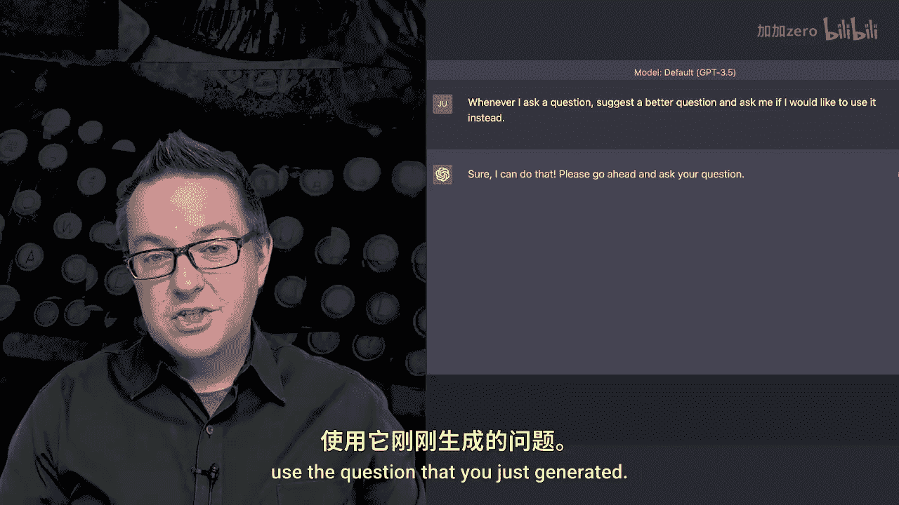

# 040：问题优化模式 🎯

在本节课中，我们将学习一种简单有效的方法，来提升我们与ChatGPT这类大型语言模型的交互质量。这种方法被称为“问题优化模式”。

## 概述

与大型语言模型互动时，我们提出的问题质量直接决定了答案的质量。然而，我们可能对某个话题缺乏足够深入的了解，无法提出最精准的问题。问题优化模式的核心思想，就是利用ChatGPT自身对语言和知识模式的理解，来帮助我们优化原始问题，使其更具体、更清晰，从而获得更高质量的回复。

## 模式原理

上一节我们介绍了问题优化模式的目标，本节中我们来看看其背后的核心思想。

大型语言模型在训练过程中学习了海量的语言模式和知识关联。当我们提出一个较为宽泛的问题时，模型能够基于其训练数据，推断出在该话题下，哪些信息通常是重要的，或者哪些提问方式更为有效。因此，我们可以将模型视为一个“问题优化助手”。

**核心公式**可以概括为：
`优化后的问题 = 模型知识库(原始问题 + 常见关联模式)`

直观地说，我们提供一个初始问题，然后借助大型语言模型对该问题所属领域的语言模式和常见关注点的理解，来生成一个改进版本。

## 基础实施方法

理解了原理后，我们来看看如何具体实施这个模式。方法非常简单直接。

我们只需在向模型提问时，预先给出一个指令。以下是实施步骤：

1.  在对话开始时，或每次提问前，向ChatGPT发出指令。
2.  指令内容为：**“每当我提出一个问题时，请建议一个更好的问题，并询问我是否愿意使用它来代替原问题。”**
3.  之后，模型会在你每次提问后，先提供一个优化版本并征询你的意见。

这个简单的指令旨在确保我们始终使用最佳的问题或提示词与模型进行交互。

## 用户体验优化技巧

基础方法已经能工作，但我们可以进行一个小调整，让交互体验更加流畅。

这个调整的关键在于让模型主动提供选择，而不是要求用户手动复制粘贴优化后的问题。我们使用的指令是：

**“每当我提出一个问题时，请建议一个更好的问题，并询问我是否愿意使用这个优化后的问题来代替原问题。”**

这个调整从用户体验角度来看非常有用。现在，模型不仅会生成更好的问题，还会直接询问“您想使用这个问题吗？”。如果我们回答“是”，模型将使用优化后的问题进行回答；如果我们回答“否”，模型则会使用我们最初提出的原始问题。这使得整个优化过程更加便捷。

## 实战案例解析

现在，让我们通过一个具体例子来看看这个模式的实际效果。我们将从一个通用的问题开始。

我的初始问题是：“我应该去范德堡大学吗？”

如果我们审视这个问题，会发现它非常模糊和宽泛。无论是谁被问到这个问题，都缺乏足够的信息来做出有意义的回应或建议。一个更好的问题应该能提供更多用于决策的背景信息，例如考虑因素、权衡标准等。

这正是ChatGPT所做的。它回复道：“当然，这是一个优化后的问题建议：‘在决定是否就读范德堡大学时，我应该考虑哪些因素？这些因素如何与我的个人目标和优先级相匹配？’ 您想使用这个优化后的问题来代替原问题吗？”

这个模式非常实用，因为一旦启用，我们就能在提问时自动获得更好的问题版本。它的一个额外好处是能促使我们反思自己的需求。

当我们看到像“我应该考虑哪些因素…”这样的优化问题时，我们可能会意识到这正是我们真正想问的。但有时，我们也会发现模型优化的方向并非我们所愿，这让我们意识到问题可能存在多种解读方式，我们需要补充更多背景信息。

例如，如果我真正关心的是范德堡大学的计算机科学专业，我可能会想：“哦，我应该提到我计划主修计算机科学。”或者，如果大学所在城市对我很重要，我可能需要补充关于纳什维尔生活体验的信息。

因此，这个模式不仅能帮助我们获得更好的问题，有时还能通过展示一种优化路径，让我们发现自己遗漏了哪些关键上下文信息，从而引导我们更全面地思考。

## 总结

本节课中，我们一起学习了“问题优化模式”。我们了解到，通过指令让ChatGPT在回答前先优化我们提出的问题，可以显著提升交互效率和信息获取质量。这种方法不仅利用了模型的知识来完善问题本身，还能通过观察模型的优化建议，反过来帮助我们更清晰地梳理自己的真实需求和思考盲点。这是一个简单而强大的技巧，能让你与AI的对话更加精准和富有成效。