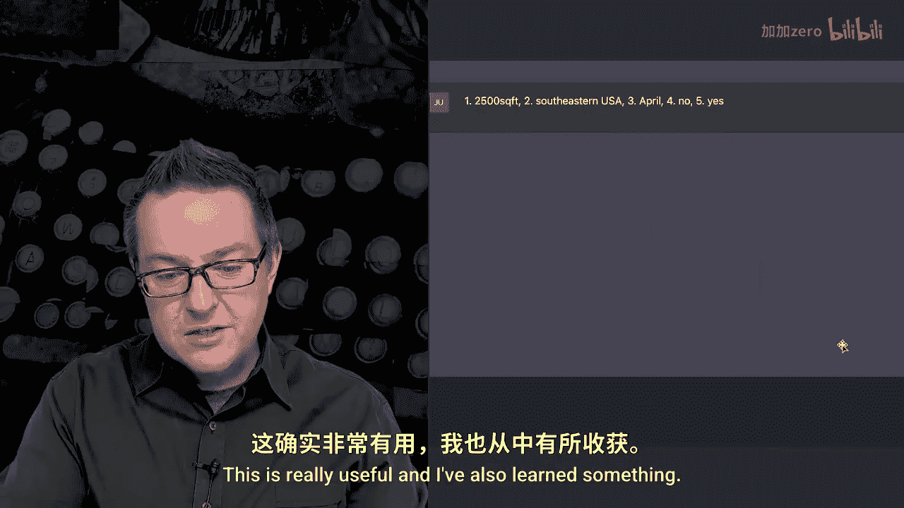
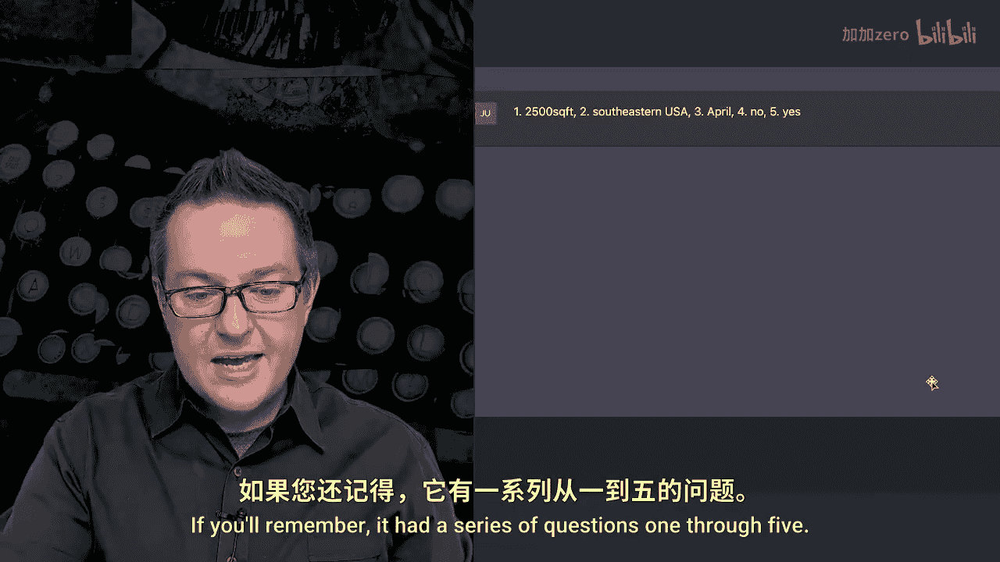
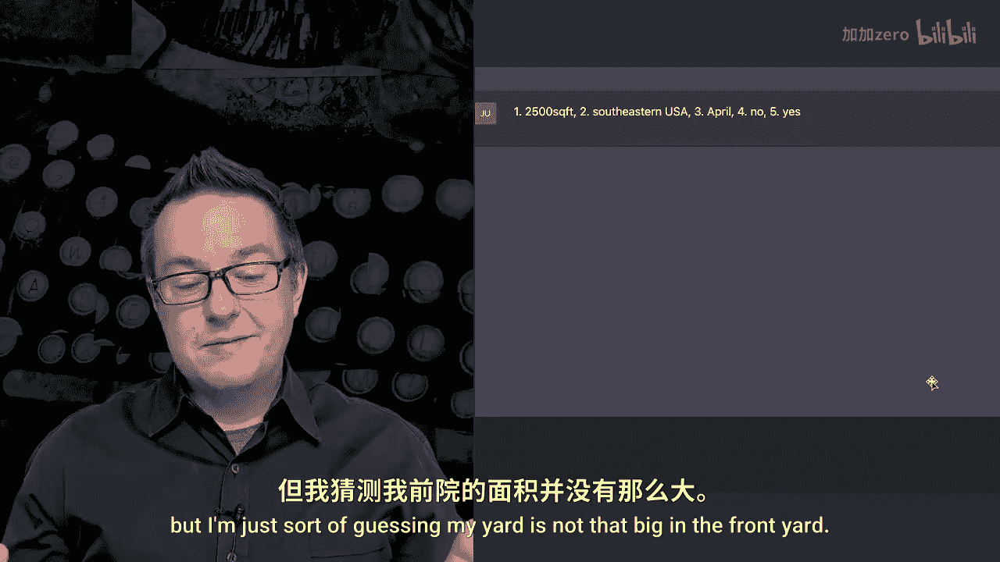
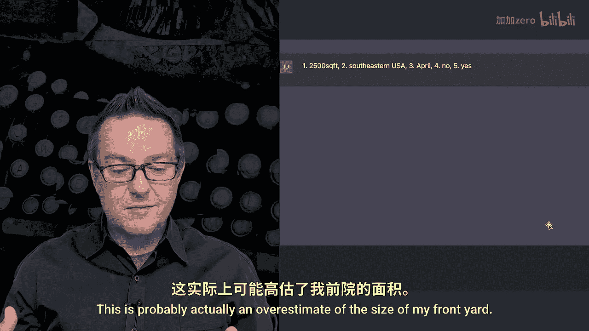
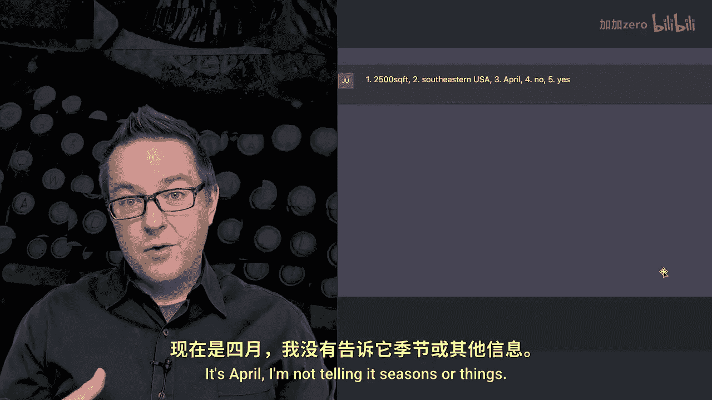
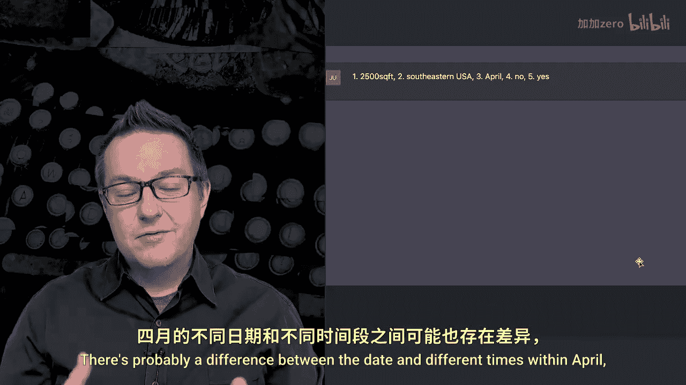
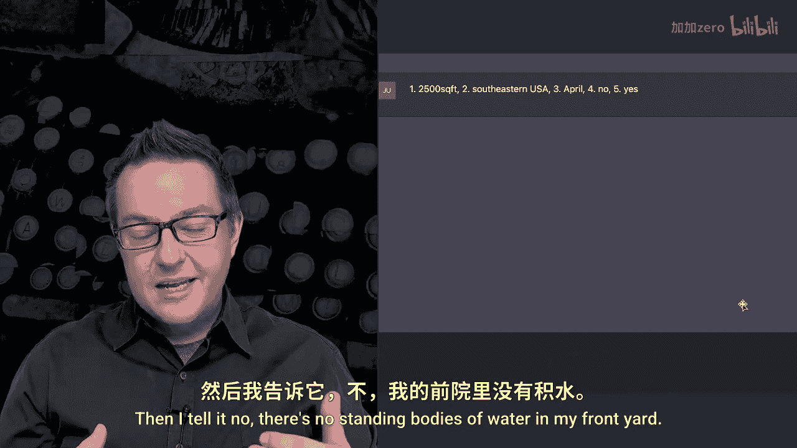
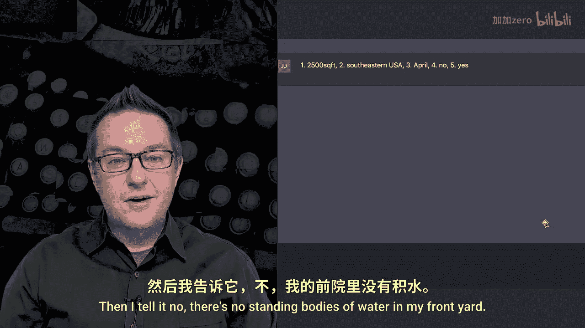
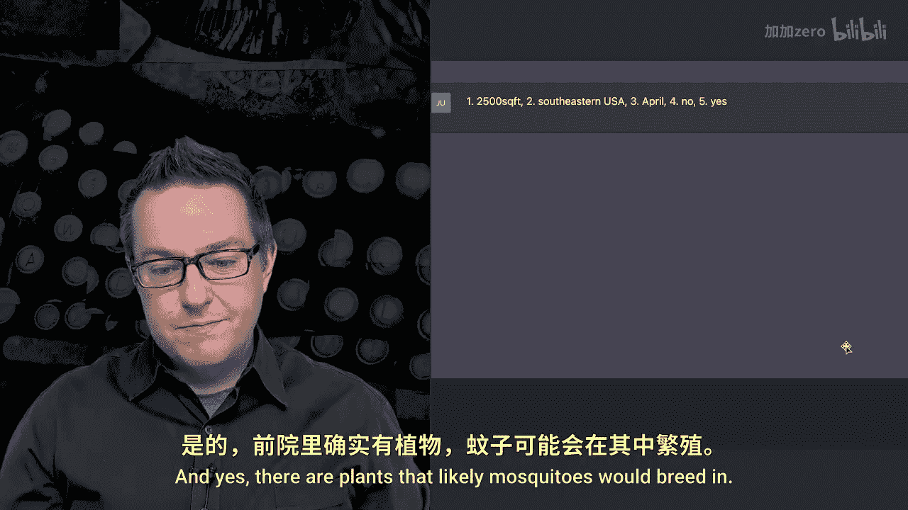

# ChatGPT与Excel：AI增强的数据分析与洞察：P41：认知验证模式 🧠

在本节课中，我们将要学习一种名为“认知验证模式”的提示工程技巧。这种模式的核心思想是，通过引导大型语言模型将复杂问题分解为一系列子问题，从而获得更准确、更可靠的答案。

---

大型语言模型有一个有趣的特性：在许多情况下，如果它们能将一个问题分解成一系列更小的问题，它们的推理能力会变得更强。有时，如果它们能解释自己的思考过程，推理效果甚至会更好。

关于这种现象有多种假设。直观地理解，我们可以认为大型语言模型在训练数据中见过特定问题被分解为一系列步骤。因此，如果它能遵循这些独立的步骤，它就知道下一步该生成什么内容，以解决特定步骤并最终得出答案。

关于“分解问题”的理念，我们将在课程后续部分详细讨论。但现在，我们可以利用一个简单的技巧和模式，自动帮助大型语言模型分解问题，从而获得更好的答案。

一个简单的方法是：直接要求大型语言模型在遇到问题或提问时，总是将其细分为一系列有助于回答整体问题或解决整体问题的独立问题或子问题。我们可以简单地“编程”让大型语言模型遵循这个规则。

**认知验证模式**正是为此目的而设计。我们将告诉大型语言模型：当你被提问时，请遵循以下规则：
1.  生成一系列有助于更准确回答该问题的附加问题。
2.  结合这些独立问题的答案，生成对整体问题的最终答案。

再次直观地思考一下：如果我们向大型语言模型提出一个通用或特定的问题，它可以利用其在训练数据中见过的模式，找出通常与此问题相关的其他问题。这有助于它从知识库中收集与该问题通常相关联的其他问题。当它找到这些相关问题时，很可能就能获得能提供额外细节或背景信息的问题，从而更好地回答原问题。

然后，当我们为所有这些子问题提供答案时，它就能获得额外的上下文信息，从而给我们一个更好的整体答案。同时，这也有助于我们作为用户来结构化自己的思维。因为当我们提问并看到问题被分解时，它会帮助我们认识到问题的其他维度。

---

### 实践案例：前院有多少只蚊子？

让我们通过一个实践案例来看看这个模式如何运作。这里，我向模型发出指令：“当你被提问时，请遵循这些规则：生成一系列有助于更准确回答该问题的附加问题；结合这些独立问题的答案，生成对整体问题的最终答案。”

模型回复：“当然可以。请告诉我问题是什么，我将生成附加问题。”

我提出了一个自己无法轻易回答、也不太了解的问题。我想，通过提出一个可能过于宽泛、信息不足的问题，这个模式会很有帮助。于是我问：“我的前院可能生活着多少只蚊子？”

我不知道答案，也没有深入思考过，但我对这个答案很感兴趣，甚至不知道该如何着手计算。模型遵循了我们的提示模式，即认知验证模式，生成了一系列附加问题。让我们看看这些问题：

以下是模型生成的附加问题列表：
*   **你的前院面积有多大？** 这显然很重要。院子越大，蚊子可能越多，很可能与院子的平方英尺面积相关。
*   **你所在地区的气候如何？** 这显然也非常重要。如果我住在沙漠或北极，很可能根本没有蚊子。
*   **现在是什么季节？** 另一个很好的问题。我提问时没想到这个维度。我可能是在蚊子很多的春夏季节提问，当时它们在我院子里飞来飞去让我很烦，但我没想到需要在问题中包含时间信息。
*   **你的前院或附近是否有任何水体或积水源？** 这显然是一个重要因素，因为蚊子在水中繁殖。我其实知道这一点，但在最初的问题中没有包含这个信息。
*   **你的前院是否有任何吸引蚊子的植物或植被？** 这是另一个重要因素。

现在我们可以看到，它已经将我的原始问题分解成了一系列有助于回答原始问题的子问题。这非常有用，我也学到了一些东西。

---

### 提供答案并获取最终估算

为了回答这些问题，我将逐一回复模型。它提出了五个问题，我将依次回答：
1.  关于面积：大约2500平方英尺。（实际上我并不确定，只是猜测，我的前院没那么大，这可能还是个高估。）
2.  关于气候：我住在美国东南部。
3.  关于时间：现在是四月。（我没有告诉它具体的季节或其他信息，只给了月份，这可能不够具体，即使在四月内不同日期也可能有差异。）
4.  关于水源：前院没有积水。
5.  关于植被：是的，有植物可能吸引蚊子。

然后，模型根据提供的信息给出了估算：“基于提供的信息，以下是对你前院蚊子数量的估算。” 它给出了一些数据点，并适当地进行了限定说明，这是件好事。

它说：“一般来说，在有积水源的地区，典型的蚊子种群密度范围是每平方米10到100只。然而，由于你的院子或附近没有积水源，密度可能会更低。” 接着它总结道：“很难提供精确的估算。但是，根据物种、气候和植被存在等各种因素，你的院子里可能有几十到几百只蚊子。”

这个结果相当不错。它能将范围缩小到“几十到几百只”，这比我预期的范围要精确。这也设定了我的心理预期。在盛夏时节，当我走到前院时，我会发誓有成千上万只蚊子，快把我活活咬死了，所以我通常认为数量要多得多。但根据这个估算，可能我错了，或者这个估算有误，但它实际上给出了相当合理的推理。

这种方法的一个优点是，我对它的答案完全错误的怀疑减少了，因为它问了我一系列合理的问题来推导答案。它还提供了一些我可以跟进核实的事实，比如一只雌性蚊子一次产多少卵，有水源地区的蚊子密度等。它给了我一个相当不错的答案，也给了我一系列可以改进这个答案的问题。

---

### 模式的价值与总结

现在我要补充说明一下。我说它给了我一个“相当好”的答案，但事实上我并不知道正确答案，我也不是这个领域的专家。对于从大型语言模型获得的任何输出，我强烈建议你进行验证。但我觉得这很有趣，因为至少，它通过这个问题帮助我了解了可能影响我院子蚊子数量的因素，并给了我一些可以跟进和核实的东西，看看这些事实是否站得住脚，看看这些问题是否真的有用。

但它们看起来确实是有效且重要的问题：
*   前院面积有多大？—— 我不确定是否需要研究这个，但更大的院子很可能有更多蚊子。
*   气候如何？—— 我知道这很重要。
*   现在是什么季节？—— 根据个人经验，我也知道这很重要。
*   前院或附近是否有积水？—— 我知道这很重要，这是在美国东南部的常识。
*   前院是否有吸引蚊子的植物？—— 我碰巧也知道这是一个重要因素。

所以，它实际上给了我一系列非常好的问题，也给了我一些与这些问题相关的事实（这些事实我需要去核实，因为我不太了解）。这是一个非常有用的工具，可以自动分解问题。我可以看到它如何推理和思考这个问题，这也改善了我自己思考如何回答这个问题的方式。

在许多情况下，我们会发现，让大型语言模型分解问题将有助于它给我们更好的答案，从而使我们获得更准确的结果。

---

**本节课中，我们一起学习了“认知验证模式”。** 这种模式的核心是引导模型通过 **`生成子问题 -> 获取子答案 -> 综合成最终答案`** 的流程来处理复杂提问。它不仅能提升模型回答的准确性和可靠性，还能帮助我们作为用户更结构化地思考问题，识别问题的关键维度。这是一种简单而强大的提示工程技术，适用于需要深度推理或信息不足的场景。