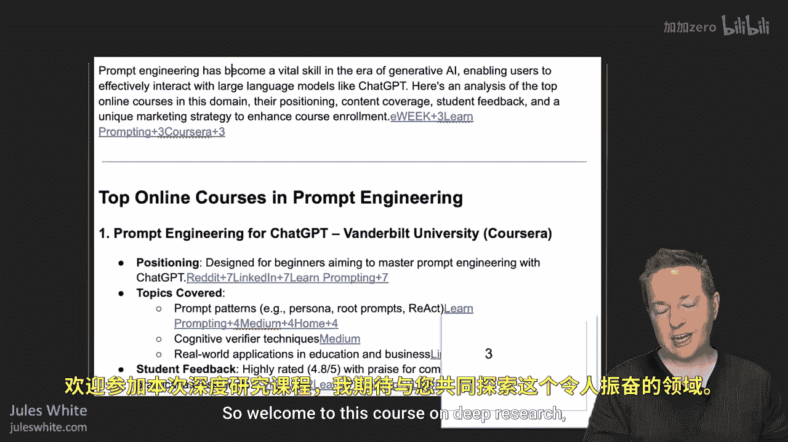

# 001：什么是深度研究 🧠


## 概述
在本节课中，我们将要学习什么是“深度研究”。这是一种利用生成式AI进行深度、全面研究的方法，它能够像雇佣一个博士团队一样，为你搜集信息、分析数据并撰写详尽的报告。我们将探讨其工作原理、独特优势以及如何有效利用这一强大能力。

---

想象一下，无论何时你有任何问题或需要进行分析，你都可以去雇佣一个博士团队来研究这个问题。这个团队会为你查找所有相关的研究、新闻、市场竞争数据，将它们整合起来，并撰写一份条理清晰、内容出色的报告。这对你来说价值有多大？这正是“深度研究”所能做到的。

它在根本上改变了我们使用生成式AI的方式，使得简单的“提示”变得无比强大。接下来，我们将深入探讨深度研究的不同之处、其背后的运作机制，以及我们应如何思考并运用这种能力。

当你可以随时“雇佣”一个博士团队来研究任何你感兴趣的话题，并为你撰写一份10到15页的报告时，这无疑是一种变革性的能力。但有时，这就像面对一张空白画布，让人不知从何下手：我该如何开始？如何利用和部署这种AI劳动力？因为这本质上就是你雇佣来为你工作的**AI劳动力**。

---

## 从简单任务开始理解

让我们从一个简单的任务开始，感受一下深度研究是什么样子。

我将去“雇佣”这个博士团队，为我做一些关于“提示工程”课程的市场调研。我选择这个主题是因为我本人对此有投资，并且教授提示工程课程。我想了解市面上有哪些顶尖课程，它们是什么样子，我的竞争对手在做什么。

于是，我进入深度研究工具，并输入了以下提示：
```
进行一项关于顶尖在线提示工程课程的竞争市场分析。这个主题下有哪些顶级课程？它们各自如何定位？涵盖哪些主题？学生们对它们有何评价？最后，为其中一门课程的讲师制定一个独特的营销策略，该策略应独立于平台使用，以提升课程注册人数。
```

这是一个复杂的任务，就像我真的雇佣了一个博士团队来为我做一件非常有价值的工作。

但这里发生了一件非常重要的事情：要出色地完成这个任务，需要的不仅仅是即时从提示中获得的反馈。它确实需要进行一些**研究**。为了做好这份分析，它必须阅读和查找当前的信息。我不想要基于模型训练时数据的市场分析，我想要的是它能根据**今天**能找到的信息所做的市场分析。

---

## 深度研究的工作流程

那么，当我将这个提示输入深度研究工具时会发生什么？一些关键的事情发生了，这由其工作原理驱动。

**第一步：澄清问题**
无论我问什么，它首先都会跟进并提出澄清性问题。在这个案例中，它问道：
*   你是否对特定平台（如Coursera、Udemy、edX）的课程感兴趣？
*   分析应侧重于初学者、中级还是高级水平？
*   你只想要付费课程吗？
*   你是否只寻找英语授课的课程？

一旦它获得了这些信息，它就会开始为我进行研究。它这样做是为了进行**澄清**。原因在于，当我输入这些问题的答案（我接下来就会做）并启动任务后，它将在后台运行10到15分钟。因为我的提示会“孵化”出一个AI，让它与自己进行内部对话。它会开始向自己提问，开始从外部世界拉取信息，然后必须分析这些信息——这都需要时间。

所以，一旦我启动任务，大量的AI劳动力将被“孵化”出来处理这个任务——我的AI博士团队就开始工作了。如果我给的任务描述有误，它可能会运行很长时间，然后给我一个不想要的答案。因此，它通过澄清来确保开始工作后能做出好成果。

**第二步：启动研究**
在我提供了澄清信息（例如：“查看所有主要平台，关注注册人数最多的课程，查看所有类型的课程，主要关注英语课程”）并按下回车后，它会说：“好的，我将开始启动，去搜索所有这些信息并撰写报告。”

然后，我们会看到一些惊人的事情发生。它显示“开始研究”。深度研究的一个关键区别在于它是**智能体驱动的**。这意味着它具有**自主性**，可以代表你采取行动。在这里，它采取的行动就是在网络上搜索公开的外部信息，将其作为来源，用于撰写即将创建的报告。

这正是我希望它做的：去寻找竞争课程，告诉我相关信息，进行市场调研。因此，它本质上是一个**AI智能体**——这个“智能体”部分意味着它有采取行动的能力，而它将采取的行动就是搜索信息、拉取信息、分析所找到的内容，然后基于此决定下一步搜索什么。它会一遍又一遍地重复这个过程，持续10到15分钟，直到它觉得收集了足够的信息来很好地回答问题。

**第三步：观察过程**
在这个过程中，我们可以观察它。虽然你观看这些视频时用户界面可能已经改变，但核心原则是相同的。它会采取行动，并且通常会以某种活动形式向我们报告它在做什么。

我们看到它启动后，活动区域开始填充内容，它会告诉我们：“这是我的思考过程，我试图完成什么，以及我正在代表你采取什么行动。”这样我们就能观察它的行为，了解它的方向。如果发现它走错了路，我们甚至可以中途停止它。

在这里，我们看到它显示：“我正在从Coursera、Udemy等主要平台收集关于高注册量的英语提示工程课程的信息，包括讲师、课程结构、学生反馈和定价细节。”它正在完全按照我们的指令，作为一个智能体，拉取撰写报告所需的信息。

这非常不可思议。这就是我们的AI博士团队，我们雇佣并部署的AI劳动力，它外出为我们完成所有查找工作。

**第四步：收集与引用**
当它拉入信息时，它会开始在“来源”部分展示它找到了什么。例如，它找到了Coursera上的内容，这很合理；也找到了其他平台的内容。它会思考这些信息如何与某些原则对齐，然后列出所有**引用**。当它找到认为有价值的内容时，就会将其列为最终报告中将提供的引用或来源。

所以，在撰写报告之前，它正在进行广泛的搜索。但这并非一次性搜索。有时我们在标准的ChatGPT界面中也会看到类似功能：输入提示，它会快速进行网络搜索，拉取顶部结果然后回答问题。

但深度研究做得更深：它拉取结果，阅读它们，进行推理，然后思考还缺少什么，还应该调查什么。基于此，它会调整并采取额外的行动。这是一个真正的区别点。如果它发现了一些有趣的信息点，它可以跟进进行额外搜索，开始阅读相关的其他主题。这至关重要，因为它允许它进行更深入、更彻底的研究，就像你阅读研究论文、综述或新闻文章时一样。

如果文章引用了重要的内容或谈论了一个你一开始不知道的新话题，你可以跟进，不断拉取那篇论文、新闻文章或白皮书的不同线索，形成一个信息蜘蛛网。深度研究正在做同样的事情：它是一个智能体，根据发现的内容进行调整，然后拉入新信息，跟进需要深入探索的信息线索。

---

## 深度研究的输出与优势

当它完成后，你会得到一份基于所有这些来源撰写的出色报告。我想指出一些关键的不同之处：

**1. 高质量、连贯的写作**
它开箱即用，就配置为能出色地撰写非常连贯的报告。默认情况下，它不会返回那种带有表情符号的大段项目符号列表（当然你可以调整它那样做）。它更倾向于撰写像一份连贯的白皮书、研究论文或市场分析那样的内容。这对于需要高质量写作的任务来说非常强大，就像你期望一个AI博士团队所做的那样。

**2. 真实的引用与溯源**
在撰写报告时，一个非常强大的功能是它会拉入找到的来源，并**正确地引用它们**。与你在其他工具中可能听到或看到的、会**幻觉**编造所有来源的情况不同，这些来源都不会是幻觉的。它们将是它找到的真实来源，它会提供链接或引用。在报告中，你将能够跟进并阅读所有内容。因此，它所做的惊人之处不仅在于撰写报告，还在于为你提供了其工作的路线图和来源，你可以去核实，或者利用一个连贯的叙述来帮助自己探索和理解这些主题，从而了解更多信息。这非常强大。

**3. 长篇输出能力**
这确实是一个区分点：它能写出大量输出，可以给你一份10到15页的报告。为了做到这一点，它必须有大量的来源来引用，以确保不产生幻觉。一旦你把所有内容整合起来——例如，我们将这份非常长的报告放入Google文档——它最终长达**19页**。

这是该工具内的一项变革性能力，因为现在我不需要反复为不同的文本片段进行提示，然后自己将它们拼接到文档中。我只需告诉它：“这是我想报告的内容。”它就会完成所有的研究工作并撰写报告，而且能写出非常长篇、完全连贯的内容，不需要我来回提示六到十次来收集所有这些信息（实际可能需要更多次）。

---

## 与传统AI工具的对比

为了快速比较，我用GPT-4o和ChatGPT运行了相同的任务。我得到的结果要**短得多**，更倾向于列表形式，而不是真正的博士水平的散文风格。即使将这份非常列表化的内容（这本身就很占篇幅）放入Google文档，它也**只有3页**。

因此，在雇佣和部署这种AI劳动力方面，我们看到了显著的差异。传统方式下，我们可能需要反复“照看”它，不断提示、提示、再提示，试图构建这份研究报告，并希望引用正确，希望它搜索了足够多的主题，希望我们看到了正确的主题——我们需要做很多“手把手”的工作。

而现在，我们得到的是一个**AI智能体**，是我们部署的**AI劳动力**，它为我们进行研究并撰写研究报告。

---

## 总结与展望

所以，我们将要探索的就是这种惊人的能力。既然我们拥有了一支可以部署、能自主为我们研究某个主题的AI博士团队（AI劳动力），我们现在该做什么？

坦率地说，如果让我亲自撰写这份报告，可能至少需要一天时间。而在10到15分钟内，我就得到了它。现在，我可以阅读这份报告，获取为我完成的分析和研究。让报告、信息和研究为我完成的速度，变得和我能想出问题的速度一样快。我可以部署这些AI智能体，然后去喝杯咖啡。等我回来时，我已经有了可以辅助决策、制定战略和思考的信息。

我的目标不是让它替我做决定，而是让它做大量的研究，将信息带回来帮助我思考。在我看过报告并产生想法后，我可能会说：“现在，去查找与此相反的观点。”我们将探讨使用它的各种不同方式，审视它独特的长处和能力，这些是任何人类团队都难以匹敌的，也是你希望集中精力利用它的地方。



欢迎来到这门关于深度研究的课程，我期待与你一起探索这个精彩的主题。