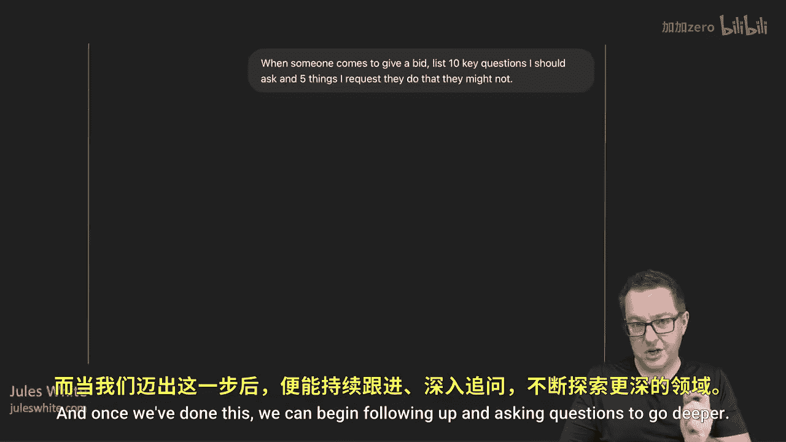

# 002：在资源受限时获取专业洞察的深度研究法

## 概述
在本节课中，我们将学习如何在时间和预算都有限、无法聘请人类专家的情况下，利用生成式AI的“深度研究”功能来获取高质量的专业洞察，以辅助我们做出重要决策。我们将通过一个更换家用空调系统的具体案例，来演示这一方法的应用流程与价值。

## 引言：决策困境与AI解决方案
你是否曾遇到过这样的情况：需要做出一个非常重要的决定，但时间紧迫，预算也有限。你发现自己身处一个必须整合大量信息的境地，因为既没有时间也没有资金去聘请一位人类专家来帮助你。

这种情况时常发生。很多时候，我们需要做的决策，其重要性尚不足以动用预算去聘请专家；或者，即便有预算，寻找一位值得信赖的专家本身就很困难。等到完成法律文书等所有手续时，决策的时机早已错过。因此，在许多情况下，我们就是没有时间和金钱去获取人类专业知识来帮助我们。

那么，我们该怎么办？“深度研究”是解决这个问题的绝佳工具。接下来，我们将对比如何使用标准的聊天模型（如ChatGPT）与深度研究功能，看看后者能带来哪些不同的价值，以及它如何填补我们在需要高质量、有证据和引用支持的信息来辅助决策时的空白。

## 核心方法：用深度研究填补知识空白
我们的做法是，当处于当前没有解决方案的“知识低谷”时，就利用深度研究来填补这个空白。

现在，我将用一个我最近遇到的真实问题来演示如何填补这个空白。这个问题是关于我家的空调系统。我住在美国田纳西州的纳什维尔，那里天气炎热潮湿，空调是家家户户的标配。我家的一台空调坏了，我需要更换它。但我对这个领域一无所知。

在当时的情况下，我不太可能找到一位价格合适、能在我家人被热得受不了之前帮我解决问题的专家。我不是要雇人来修理或更换，这行不通，因为家里太热了，家人会受不了。我们该如何解决这个问题？我们将把这个问题交给深度研究来处理。

## 实战案例：构建AI驱动的购买指南
我们将利用深度研究来生成一份“AI购买指南”。这是一个极佳的应用场景，因为我们需要购买某样东西。通常，当我们购物时，我们不愿意额外花钱请人提供购买建议；而且我们往往希望立刻完成购买，尤其是在维修或故障的情况下。比如你的车坏了，或者生活中其他重要的东西坏了，你需要立刻修好它，因为你的生活或工作依赖于它。但做决定很困难，因为花费昂贵。通常，维修或采购的东西越专业、越昂贵，找到相关信息就越难，我们确实需要人类帮助，但就是没有钱或时间。

我们将以暖通空调系统为例。在获取AI购买指南时，我们希望它能提供非常具体、贴合我们自身情况的信息。

以下是我输入的提示词：
> 我需要为我的住宅购买一套新的暖通空调系统（即家用空调系统）。我需要3.5吨的规格，因为这是我旧系统的规格。我住在田纳西州纳什维尔市一栋有100多年历史的老房子里。这是一个重要的背景：如果我的房子是全新的，可能隔热很好，这点就不重要。但我住的不是新房子，没有最新的窗户，所以我需要考虑这一点。我需要一份全面的选项列表，并附上如何选择理想机型的详细建议。

接下来，我设置了一个输出格式部分。这是你应该经常做的：设置一个部分来解释你希望AI输出的关键内容，比如对信息使用的限制、可以放入输出的信息块，并希望有一个清晰的方式来展示。在这个案例中，我是这样写的：

> **输出格式：**
> - 提供5到7条关于如何选择的关键建议。
> - 选取排名前15的机型，制作一个对比表格。
> - 提供获取最佳交易的具体策略。
> - 列出需要询问的问题。
> - 提供关于可靠性、最佳购买时机以及合理安装成本的重要信息。

这非常棒，对吧？你经常能看到各种产品对比评测，但你永远得不到一个基于你自身背景和情况定制的对比。这就像是为你自己的问题和情况量身定做的“产品对决”。

## 处理AI的追问与生成报告
AI开始工作后，它会像我们之前看到的那样，提出一些后续问题。通常，在这种情境下，你确实不知道如何回答这些后续问题。这里有一个简单的技巧：你可以直接说“我不知道，请根据你的最佳判断来选”或“请以我的最佳利益为考量来决定”。你不需要回答所有问题，可以让AI自行选择。

于是，AI为我生成了一份出色的报告。现在，我想看看这份AI购买指南的深度。如果你正在采购某物，或需要进行一项重要且昂贵的维修，这是一个极好的用例，因为它提供的专业知识正好填补了你可能没有时间和金钱去获取的那个“知识空白”。

## 深度解析生成的购买指南
针对“在纳什维尔百年老宅中升级暖通空调系统”这个问题，生成的报告开头是一段写得非常好的引言。

接着是关键建议部分，它考虑了纳什维尔的气候和燃料选择：
*   热泵在该地区很流行。
*   双燃料系统也是一个选择（我最终因为一个建议选择了电炉）。
*   优先考虑能源效率和正确匹配容量。
*   评估百年老宅的结构兼容性，现有的（或缺乏的）基础设施是一个关键因素。报告指出，如果你的房子里没有输送空气的管道，还有其他选择，比如无管迷你分体式系统（我认识一些人就安装了这种）。

然后是顶级系统的对比。我特别喜欢看那些在最后把所有产品列在表格里的评测，这让信息对比变得容易得多。任何时候，当你需要一份沿着多个维度进行的深入详细分析时，你都可以让深度研究为你搜集信息。虽然它一次能搜集的信息量有限制，但它确实可以进行非常详细的对比。

在这个案例中，它搜集了许多产品的信息，并构建了这个表格。这个表格太宽了，一页幻灯片显示不全，但你可以看到它滚动时的样子。表格包含了成本（哦，这可不便宜）、保修信息以及我可能想知道的各种重要功能。

## 报告中的超具体价值与惊喜发现
报告还做了一件很棒的事，因为每当我进行产品采购时，我通常都想弄清楚两件事：一是我该买什么以及为什么；二是我如何获得最划算的交易。报告里包含了一些很棒的内容，其中很多我大概知道，但有一条非常惊人，它可能就值ChatGPT用深度研究做这件事所花的10分钟。

那就是，因为它知道我住在哪里、我的背景，所以我得到的不仅仅是一份通用的产品购买指南，而是一份针对我个人需求和我居住地的超具体指南。它指出，我所在地区的电力公司过去曾为热泵安装提供过返利。实际上，当我的另一台空调坏掉时，我已经安装了一台热泵。所以现在，我甚至可能可以追溯申请一些返利。我之前都不知道，现在我会在之后跟进这件事。这很重要，因为它对我个人来说是超具体的。如果我只是去搜索一份通用的暖通空调热泵产品对决，它不会告诉我“顺便说一下，国家电力公司有返利，你应该查一下”。而现在，我得到了针对我的超具体建议。

报告还包含了：
*   **家庭兼容性**：提到了Trane（特灵），这很有趣，因为报告将其列为可靠性榜首，这也是我自己研究时发现的。而且，当我与技术人员交谈时，他们也推荐了Trane，这成为了我决策过程的一部分，因为当你处理一件非常昂贵的东西时，你希望它能用很久。
*   **安装成本**：给出了安装成本的范围。
*   **安装公司推荐**：这对我来说非常重要，因为它列出了可以进行安装的一些顶级公司名单。因为我购买的不是可以从商店买回来塞进车后备箱带回家的东西，而是一个设备加上安装到我家的复杂采购。所以，知道该找谁安装、谁擅长这个，并且它帮我筛选了所有网站和评论来提供这些信息，这非常棒。名单上的公司，有些是我自己研究时也开始发现的，有些我没见过，但我最终选择的那家公司就在这个名单上，这让我很放心。如果我当初不知道该找谁，我认为它给出的名单非常准确。例如，Donaldson（唐纳森）这家公司我之前不知道，但当我开始研究时，看到了很多关于它的好评。所以，如果我没选择Precision（普莱辛），我可能会去咨询他们。

这种能够根据你的决策和背景提供深度、深入信息的能力，非常有价值。

报告还继续提供了：
*   **需要询问的问题**。
*   **各种惊人的细节**。
*   **需要避免的“危险信号”**。

## 总结与拓展
我刚才所做的，就是为自己填补了一个重要的知识空白。我有一个需要快速解决的问题，但没有大量资金去解决。它正好落在了“我没有足够的预算和时间去聘请人类专家”这个空白地带。因此，我运用了深度研究来完成它。这是一个极具价值的用例，因为生活中有各种各样类似的问题，我们在决策过程中需要帮助，我们正在做一个重要的决定，我们需要帮助，但我们没有时间和预算去获取人类帮助；或者我们在组织内部，受到招聘规则或其他因素的限制，无法获得所需的专业知识，我们必须尽力而为，而深度研究正是填补这一空白的方法。

现在，有一件非常了不起的事情是，很多人会认为这只是填补空白。但我们可以做得更多，这暗示了下一步：一旦我们完成了这份报告，我们就可以开始跟进并提出更深层次的问题，进行更深入的探索。

## 本节课总结
在本节课中，我们一起学习了如何利用生成式AI的“深度研究”功能，在时间和预算双重受限的情况下，获取专业、深入且高度定制化的洞察来辅助重要决策。我们通过一个更换家用空调系统的完整案例，演示了从定义问题、构建提示词、处理AI追问，到解析最终报告的全过程。这种方法的核心价值在于，它能根据你的具体情境提供超具体的建议，填补了那些不足以聘请专家但又至关重要的知识空白，是每位决策者都应掌握的高效工具。