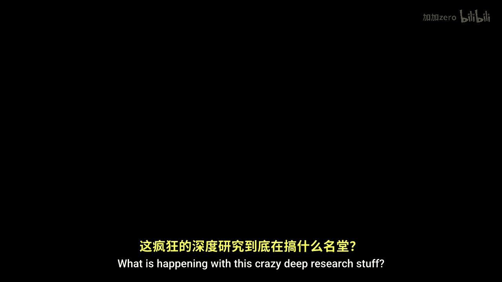
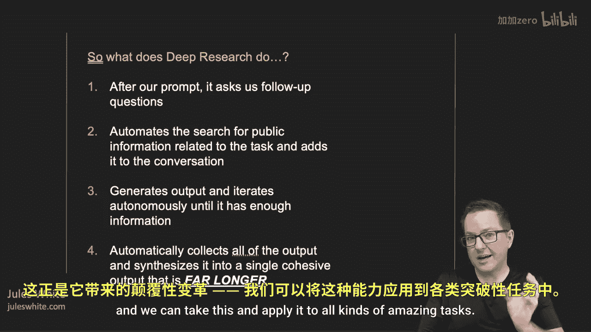

# 生成式AI战略领导者：P3-06：深度研究的工作原理 🧠

在本节课中，我们将深入探讨“深度研究”功能背后的工作原理。我们将了解它如何自动化复杂的任务，以及它为何能如此高效地生成长篇、连贯的报告。

上一节我们介绍了与生成式AI进行有效对话的基础。本节中，我们来看看“深度研究”如何将这个过程自动化并提升到一个新的水平。

## 与生成式AI进行高效对话的要素

当我们希望与生成式AI（例如ChatGPT）进行高质量对话以解决问题时，需要做到以下几点：

以下是关键步骤：
1.  **提供具体信息**：我们不仅依赖其训练数据，还需要提供大量文档、网站链接等具体信息，以便AI能够引用并基于这些信息进行推理，从而给出有根据的答案。
2.  **明确任务与偏好**：我们需要让AI充分理解我们的具体需求、希望任务如何被解决、以及我们的个人偏好和期望。
3.  **迭代与精炼**：在对话过程中，我们通常需要反复迭代和精炼。这包括提供澄清、注入额外信息、获取更多输出，因为单次交互的信息量通常有限。
4.  **整合输出结果**：当AI生成多个输出片段时，我们需要思考如何将它们最终整合成我们需要的完整成果。

## 以撰写报告为例的传统流程

现在，让我们将思路聚焦到撰写文档和报告上。假设我们需要一份10页的报告。

想象一下，我们需要撰写一份10页的报告，例如一份关于范德堡大学在生成式AI领域工作的市场竞争分析。我们需要做很多事情：

以下是传统流程中的主要挑战：
*   **信息搜集耗时**：为了高质量完成报告，我们需要找到所有相关课程的信息。这可能需要多次提示AI进行网络搜索（例如，搜索Coursera、edX、Udacity等平台上的内容），或者我们自己手动查找并将信息输入对话中。
*   **输出需要手动整合**：AI可能每次只能生成半页或一页内容。我们需要将这些输出片段复制粘贴到报告中，并确保它们连贯、统一，这涉及大量的手动工作。

**总结来说**：明确任务指令（通过提示工程）和获取单个输出并不难。反复迭代以生成所有内容需要中等程度的努力。但最后将所有内容复制、粘贴、融合、整理格式，则需要大量的手动劳动。

## 深度研究的革命性自动化

那么，深度研究功能做了什么了不起的事情呢？它自动化了上述繁琐流程。

以下是深度研究自动化的核心环节：
1.  **任务理解与澄清**：在开始漫长的（10-15分钟）工作前，它会通过追问来确保准确理解我们的需求。
2.  **自动化信息搜集**：它接管了耗时费力的公开信息搜索工作，自动将相关信息引入对话，免去了我们反复手动搜索或提示的负担。
3.  **自主迭代与自我对话**：这是其神奇之处。它在一个循环中与自己进行对话。例如，它搜索并找到一些信息（如Coursera课程），然后基于已找到的内容，自我对话决定下一步该搜索什么、还缺少什么、需要探索哪些方面。这种**自我对话循环**让它能自主运行10-15分钟，并根据发现不断调整搜索方向。
4.  **生成连贯的长篇输出**：最后，它不会只生成一页内容，而是直接产出一份10-15页的、完全连贯、格式统一的报告。用户无需在不同输出间进行复制粘贴和整合。

**其底层逻辑**是：它自动化了整个“研究-对话-整合”流程。通过长时间的自我对话，它将一个冗长的“对话历史”融合成一份基于所发现信息的、连贯且撰写精良的报告。这正是它带来变革性影响的原因，我们可以将这种能力应用于各种惊人的任务中。

本节课中，我们一起学习了深度研究功能如何通过**自我对话循环**和**全流程自动化**，将我们从繁琐的信息搜集、迭代提示和手动整合工作中解放出来，直接生成高质量、长篇且连贯的复杂报告。这是生成式AI应用中的一项重大进步。