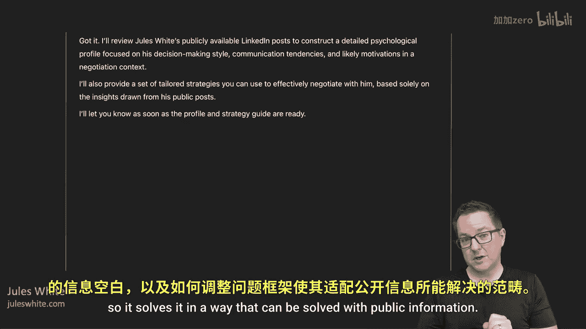

# 生成式AI战略领导者：P4-09：理解深度研究的局限：它无法对信息进行推理 🔍

在本节课中，我们将探讨深度研究（Deep Research）工具的一个根本性局限：它无法对自身无法获取的信息进行推理。理解这一局限对于有效、安全地使用AI至关重要。

上一节我们介绍了深度研究强大的信息整合能力，本节中我们来看看它的能力边界在哪里。

## 核心局限：无法访问即无法推理

深度研究无法完成它无法访问信息的工作。它无法对缺失的信息产生深刻的见解。如果所需信息无法在公开的互联网上找到，或者用户没有上传支持性文档，那么它将对此一无所知。

**核心公式**：`AI的推理能力 ∝ 其可访问的信息量`

这一局限至关重要，因为很多时候我们需要融合公开信息和私有信息来完成任务。

## 通过个人案例理解局限

为了帮助你理解这种局限，最简便的方法是选择一个总是包含私有信息的对象：人。我们可以通过一个可以验证的事实来检验它。

让我们看看它究竟了解我们多少。关于你个人，有多少公开信息？仅凭这些公开信息，它能否告诉你所有你需要知道的事情？

答案是否定的。因为我们都有私生活，都有丰富的、它无从知晓的人生经历。同样的情况也适用于我们的组织。组织拥有丰富的文化、历史、上个季度发生的事情、员工间的私人关系以及未在互联网上公开或难以表述的战略重点。

所有这些信息都没有以它能找到的方式被记录下来。

## 人类不可或缺的角色

因此，人类在与AI协作时将始终扮演不可或缺的角色。当你使用它时，你需要提供大量的背景信息。同时，你也必须意识到，有很多事情是它不知道的，因此它无法在这些方面支持你。你必须谨慎对待它做出的决定或建议，并考虑到信息缺失这一因素。

## 一个演示案例

以下我将以自己为例，来划分它知道什么和不知道什么。

我向深度研究工具提出了一个请求：“为这个人建立详细的心理档案，帮助我理解他的思维模式、潜在动机、处事方式、人格特征等。给我一个推理其决策和目标的框架。我需要10页内容。” 同时，我提供了我的领英个人资料链接。

这是一个对自己做的有趣活动，也是一个极佳的训练，因为它能快速揭示，基于你公开投射的信息，它了解你什么，又不了解你什么。

它回复并询问我建立心理档案的目的。我出于好玩回答：“我想与这个人谈判，想了解他的思维过程。” 我给出了以下约束条件：“**仅使用**其领英帖子中的信息。输出内容需包括对其人的总体概述，以及根据其心理特征定制的谈判策略。”

我认为这很有趣，因为我想知道它如何看待与我谈判的策略，同时也想看看它通过我在领英的公开发帖究竟了解我多少。我预计它会知道很多。

## 构建提示词的技巧

在构建这个提示词时，我再次强调几点技巧：

1.  **控制信息来源**：我通过约束条件告诉它**仅依赖**领英上的信息。你可以通过控制你希望它使用或不使用的信息来引导它。例如，你可能知道某些公开信息并不准确，你不想让它使用这些信息，以免将其引入歧途；或者你希望它以不同的思维方式来解决问题。
2.  **指定输出格式**：我明确告诉它输出中需要包含哪些部分，并在提示词中用破折号分隔出专门的章节来详细说明。

它随后开始运行并生成报告。

## 本练习的目的与启示

这个练习的目的不是向你展示我的心理档案，而是让你理解并选择一个它无法知晓全部信息的场景，从而让你明白这些工具的认知边界。

**关键结论**：它只能基于其能找到的公开信息进行推理。

这将对它在组织内为你所能做的事情产生限制。同时，这也意味着，如果你想跨越这些限制、克服这些局限，你就必须通过提供信息来填补空白。而你提供信息的详细程度，将决定它在处理那些无法公开找到的信息时能做得有多好。

## 实践练习与总结

接下来有一个练习，你可以对自己或他人运行这个心理档案分析，或者设计其他它无法找到全部公开信息的任务。

我认为让它分析我的心理档案非常有趣。它在很多方面做得相当不错，但归根结底，它并不了解真实、完整的我。这限制了它能说的内容、它能推断出的关于我的信息以及它能提出的决策建议。它给出了很多很棒的内容，但也存在很多不准确和模糊之处。

**总结**：请将此作为一个简单的练习，来学习了解AI知道什么和不知道什么。务必始终思考：我该如何为任何它不知道的信息填补空白？或者，我该如何调整问题，使其能够仅用公开信息来解决？

通过本节课，我们一起学习了深度研究工具的根本局限——无法对未访问信息进行推理，并通过具体案例理解了人类在提供上下文和私有信息方面的关键作用。在后续使用中，请时刻牢记这一局限，并善用提示词技巧来引导AI，以发挥其最大效能。