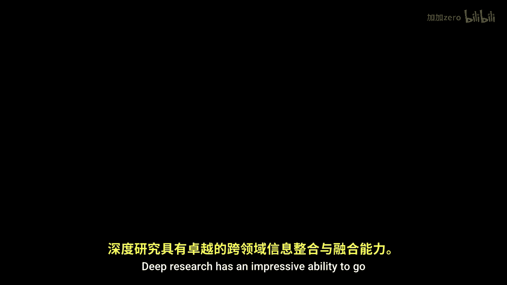
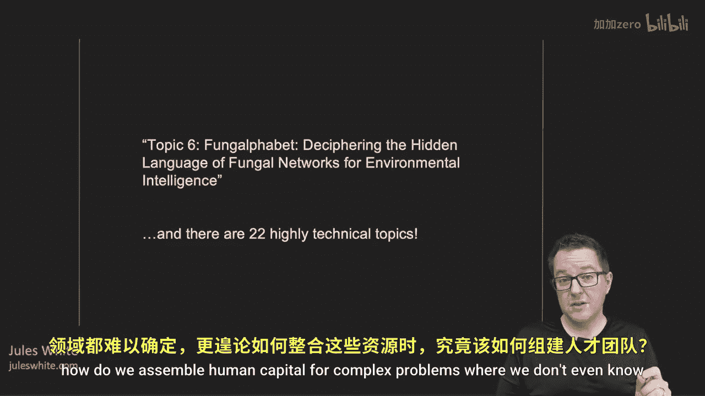

# 005：以人类为例

在本节课中，我们将探讨生成式AI（特别是深度研究工具）如何解决一个极具挑战性的问题：为复杂的跨学科研究项目组建专家团队。我们将以范德堡大学响应政府研究倡议为例，说明AI如何融合多领域知识，高效地“组装”人力资本。

## 深度研究的融合能力

上一节我们介绍了AI在特定领域的专长，本节中我们来看看它在融合多领域信息方面的超能力。深度研究工具具备一项令人印象深刻的能力，即跨越许多不同领域去融合信息。

尽管单个人类专家可能在某一领域更出色，但这些工具真正大放异彩、产生巨大影响力的场景，是当我们面临那些横跨大量技术性或复杂性领域的问题时。为了解决这类问题，需要融合所有这些不同领域的信息和概念。

## 复杂问题的典型场景

那么，这类问题具体是什么样子呢？一个引人入胜的例子就是“人力资本”问题。当我们拥有一个大型组织、大量人员和资源，并且需要解决某个问题或完成某项任务时，我们应该让谁参与进来？组织规模越大，问题越复杂，就越难确定谁拥有合适的技能，他们如何协同工作，以及我们如何将所有资源整合成一个能够执行任务的有价值团队。

问题越庞大，这项工作就越困难。如果我们整天都在用同一批人解决非常简单的常规问题，则不需要这种能力。但如果你正在处理一个极其复杂、难以攻克的问题，需要去寻找合适的专业知识，那么这种能力就具有难以置信的价值。

同样，对于其他所有需要汇集跨学科专业知识、融合多种不同见解，以形成深思熟虑的研究或产品的问题，这种能力也极具价值。

## 大学研究背景下的应用

现在，我们将在大学研究的背景下审视这个问题。“多大学研究倡议”是美国政府资助大学各类基础科学与研究的项目。其中一个难题是，当项目发布时，它包含20多个高度技术性的主题。范德堡大学收到这个项目后，如何找到那些研究领域可以融合、从而共同攻克每个主题的教职员工团队？你如何找到合适的人选来撰写研究计划，争取这笔研究经费，并尝试解决这些困难的科学问题？

这很困难，因为这些是超级复杂的事情。校园里没有任何单一个体能认识所有人，并充分了解每个人的工作，从而为这个项目所寻求的每一个提案主题，有效地找出优秀的团队去争取。

## 向深度研究工具提出挑战

所以，我们将把这个问题交给深度研究工具，让它来为范德堡大学“组装”人力资本，以应对所有这些不同研究主题的提案征集。

以下是给AI的指令概要：
*   查看新的“多大学研究倡议”项目。
*   为每个主题，提出由范德堡大学教职员工组成的跨学科研究合作团队。
*   为每个主题，思考关键研究领域和相关术语。
*   寻找在此领域某些方面知名的范德堡大学教职员工。
*   寻找来自其他学科、可以与他们以意想不到的方式合作、从而创造出激动人心提案的教职员工。
*   寻找校园里以前获得过此类奖项、团队可以致电寻求指导或可以加入团队的教职员工。
*   最终，为每个主题提供一个范德堡大学教职员工团队及融合他们研究的可能想法。

我认为校园里没有任何单个人或团队能很好地完成这项工作。这是一个极其困难的问题：审视校园里所有范德堡大学的教职员工和研究人员，弄清楚如何将他们的研究“缝合”在一起，以创建团队来攻克这些高度技术性的科学主题。除此之外，还要试图找出以前获得过此类奖项、可以为他们提供建议的人，同时寻找那些疯狂的、跨学科的、意想不到的联系，这些联系可能以某种独特的方式提升团队实力。

这确实需要融合如此多的学科，理解如此多的主题，才能“组装”起人力资本去解决和攻克这些不同的研究问题。

## 理解任务的PhD级难度

现在你可能会问自己，我之前谈了很多关于AI能处理PhD级别内容的想法。我想让你感受到，是的，它确实可以，它在许多事情上具备类似PhD级别的洞察力。

让我们看看这个项目是关于什么的。如果你阅读实际的征集书，它会说：**本计划涉及高风险基础研究，旨在理解或实现前所未有之事，并定期产生重大科学突破**。这些都是非常复杂的研究主题，并非常识，也不是我们知道答案的普通认知。AI需要推理出哪些范德堡大学的教职员工拥有专业知识，有可能在该主题上取得科学突破。从理解它需要做什么的角度来看，这是PhD级别的任务。

如果你想看一个示例主题，让我们看看这个：**主题6，真菌字母表：破译真菌网络的隐藏语言以获取环境智能**。这只是22个主题中的一个。现在，请思考一下。如果你必须去组建一个团队来做这件事，那将异常困难。仅仅是组建一个团队来找出所有能胜任的教职员工，就非常复杂。

想想试图解决这个难题所需的管理开销和复杂性。而实际情况很可能是，等到团队终于组建好所有团队时，为时已晚，因为提案征集的截止日期已经过去，我们无法解决问题了。

## 人力资本组装的瓶颈

因此，这是一个绝佳的例子，说明在某些情况下，我们不仅没有时间去“组装”人力资本，更可能的是，我们甚至无法“组装”出能够决定谁应该去争取这个问题的人力资本。我们找不到能够为我们解决这个问题的人类专家，因为所需的知识横跨太多不同的领域，并且在技术上非常精深。要找到一组个体并及时将他们组织起来以解决问题，将非常非常困难。这正是AI工具大显身手的绝佳案例。

所以，这是一个极好的例子，说明了何时应该使用它：
*   问题横跨许多不同领域。
*   需要对这些领域有大量的技术性理解。
*   一个很好的用例是当你需要根据团队成员的专长和经验，将人力资本“组装”成团队时。

## 信息准确性的关键作用

现在，回到那个观点：如果AI找不到信息，它就无法解决问题。当我们执行这个任务时，从我的角度来看，它在组建范德堡大学教职员工团队方面做得非常出色。

它做得不完美的一点是，它依赖我们的网站来确定谁是范德堡大学的教职员工。而我们的网站并不总是最新的。有时教职员工离职了，更新网站需要几个月时间。有时甚至需要更久，我不得不承认，通常至少需要几个月才能更新信息，说明某位教职员工已前往其他大学。

所以，它实际上组建了一些很棒的团队，但其中一些成员已经去了其他地方。这正好回到了那个关键点：**它将根据其可用的信息给你一个答案**。

在这种情况下，如果我能以某种方式收集关于范德堡大学实际教职员工的信息，并告诉AI用它得出的结果与实际的教职员工名单进行交叉核对，结果可能会更好。但我没有那样做。这向你表明，当你进行此类操作时，请注意，如果它没有准确、最新的信息（例如，关于你的人力资本、你的业务、你的约束条件或它正在处理的问题），它就不会给出完美的结果。

尽管如此，这仍然是一个极其有效、优秀的用例：**我们如何为复杂问题“组装”人力资本，尤其是在我们甚至不清楚需要哪些专业知识以及如何将它们组合起来的情况下**。

---

本节课中我们一起学习了生成式AI在融合跨领域专长方面的强大应用。我们通过范德堡大学响应复杂研究项目提案的具体案例，看到AI如何能够理解高度技术性的主题，并跨越学科界限，识别和组合合适的人类专家来形成潜在的研究团队。这展示了AI在解决需要“超人类”广度知识融合、特别是在时间紧迫或人力难以全面协调的场景下的战略价值。同时，我们也再次认识到，确保AI所依据信息的准确性和时效性，是获得可靠结果的关键。