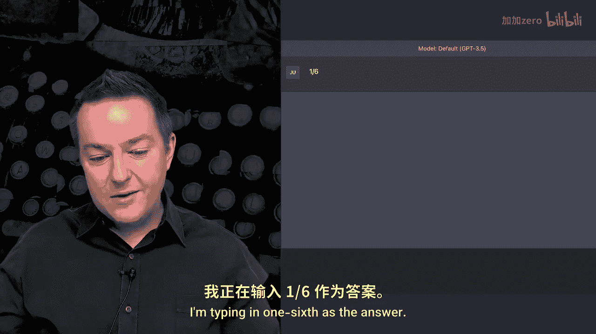

# 006：融合埃塞俄比亚与墨西哥食物制定膳食计划


在本节课中，我们将通过一个具体的示例，来理解如何将大型语言模型（如ChatGPT）作为强大的创意原型工具，而不仅仅是问答或写作助手。我们将看到如何将一个复杂的想法逐步具象化、迭代和完善。

## 将语言模型视为创意原型工具


上一节我们介绍了语言模型的基本概念，本节中我们来看看如何将其作为工具来使用。

你不应将ChatGPT这类大型语言模型仅仅视为撰写文章或回答问题的工具，那样会大大低估其能力。它们实际上是能够帮助你**将想法具象化**、**探索多种概念**，并通过与工具的**交互来不断优化**这些想法的强大工具。这些工具能让你完成许多令人着迷的事情。


接下来，我将通过一个示例来展示这些工具的巨大潜力，以及它们如何帮助你完成那些原本非常困难的任务。

## 一个复杂的创意：融合菜系制定膳食计划


为了找到一个大家都能理解的例子，我想到了我的家庭和一个“疯狂”的想法。我们身边有很棒的乌兹别克斯坦餐厅和埃塞俄比亚餐厅。于是我问自己：**创建一个融合了乌兹别克斯坦和埃塞俄比亚菜系的膳食计划会是什么样子？**


此外，我过去尝试过生酮饮食，所以我想这个计划最好也是**生酮友好**的，因为我仍然希望限制碳水化合物的摄入。同时，考虑到实际操作性，所有食材必须能在我家附近的普通美国超市轻松买到，否则我可能不会去烹饪这些餐食。

## 向ChatGPT提出初始请求


基于以上想法，我向ChatGPT提出了第一个请求。这是一个相当复杂的问题，我认为世界上很少有人能轻易回答，即使有，我也很难找到他们，雇佣他们的成本也会很高，而且他们绝不可能像AI这样快速地为我完成。

我的初始提示是：
```
请为我的家庭创建一个基于埃塞俄比亚和乌兹别克斯坦食物融合的膳食计划。我希望采用生酮饮食，并且每天摄入不超过2000卡路里。选择的菜肴食材应能在普通美国超市轻松购得。
```

## 模型的首轮回应与分析

ChatGPT迅速给出了回应：“这是一个结合了埃塞俄比亚和乌兹别克斯坦风味，同时符合生酮要求且每日热量在2000卡路里以内的示例膳食计划。”

以下是它提供的部分内容：
*   **早餐**：用炒鸡蛋搭配炒洋葱、番茄和埃塞俄比亚**Berbere香料**（注：由辣椒粉、红甜椒粉、大蒜粉、姜、孜然和香菜制成）。

请注意它的做法：它在括号内注明了Berbere香料的常见成分。这**暗示**了这种香料可以在普通美国超市买到，因为所有这些香料都很容易获取。它不仅回答了我的问题，提供了一个埃塞俄比亚风味的早餐建议，还额外提供了关于食材可获得性的信息。

虽然我不确定这是否是一道非常地道的埃塞俄比亚菜肴，它可能只是受其启发并进行了美式改良，但对于我正在尝试的“原型设计”目标来说，这已经相当令人印象深刻了。


它继续提供了午餐、晚餐等建议，例如“乌兹别克风味羊肉串配烤蔬菜……”。所有这些建议看起来都相当符合生酮饮食的原则。

这个初步结果可能包含错误，也不完美，但它为我这个“疯狂”的想法提供了一个非常好的**初始形态**。我可以在此基础上继续工作、优化和改进。这正是我希望你在本课程中思考的一点：**不要将其视为一次性问答**，而是一个迭代的过程。

## 迭代优化：添加份量信息

基于首轮回应，我意识到还缺少一个关键信息：我不知道每道菜应该吃多少。因此，我进行了第一次迭代优化。

我接着提问：
```
你能为每道菜提供一个适合我（在2000卡路里限制内）的大致份量吗？
```

ChatGPT回应道：“当然，以下是基于每日2000卡路里限制的每道菜大致份量。” 然后它详细列出了每餐的食材具体用量，例如早餐是“两个鸡蛋，半杯洋葱，半杯番茄，一茶匙Berbere香料混合物，配以四分之一个中等牛油果”。

现在，我拥有了更具体的执行信息。我并没有立即去计算这些食物的具体宏观营养素，因为我当前的目标是**快速探索和原型化这个想法**。我可以继续优化，要求它进行更详细的分析，以确保完全符合我的需求。

## 深化创意：融入家庭互动元素

接下来，我想将这个想法进一步深化，使其更贴合我的家庭生活。我的妻子和我比较喜欢尝试新食物，但我9岁的儿子并不总是愿意尝试新菜肴。我该如何让他对尝试这些新食物感到兴奋呢？

于是，我再次转向ChatGPT寻求帮助。我提出了新的请求：
```
我的儿子9岁，有时他不愿意尝试新菜肴。为了让这次烹饪冒险对他更有趣，你能为每道菜创作一个简短的宝可梦对战故事吗？……请确保每个故事都以一个悬念结尾，激励他去尝试新食物。
```

也许我能找到一个人来制定这个融合菜系的生酮膳食计划，但几乎不可能有人能像AI这样快速地完成。而现在这个请求——创作结合特定菜肴的定制化儿童故事——更是进入了**难以找到单个人类专家**来完成，且成本高昂的领域。而我在几分钟内就完成了。

## 模型的创意生成：故事与游戏

ChatGPT的回应非常出色：“当然。以下是为每道菜搭配的一些简短宝可梦对战故事。”

例如，针对那道含有Berbere香料的早餐，它创作了一个故事：皮卡丘和朋友们在埃塞俄比亚荒野探险时，被一群狡猾的宝可梦盗贼伏击……最终他们战胜了“Berbere火龙”，但火龙留下了一种火辣的香料，赋予了他们的早餐鸡蛋独特的风味。故事以悬念结尾：“你能帮助皮卡丘和他的朋友们击败Berbere火龙，并享用这顿辛辣的早餐吗？”

这非常了不起，不是吗？我们从一份膳食计划，发展到通过融入我儿子感兴趣的元素（宝可梦）来帮助他对用餐感到兴奋。虽然这个悬念可能不是最完美的，但这并不重要，因为我正在**快速实验我的想法**，试图**赋予我的思想以形态**。

接着，我想到在餐桌上我们还会讨论儿子在学校学的东西，他喜欢数学和数学游戏。我能否将这一点也整合到这个“疯狂”的想法中呢？

我继续请求：
```
我想请你和我的9岁儿子玩一个数学游戏，教他关于分数除法和营养知识。每次问他一个涉及宝可梦和这些主题的问题，并将其变成一个游戏：当他答对时，宝可梦就获胜。请提出第一个问题。
```

ChatGPT回应道：“太好了！让我们来玩一个涉及宝可梦和营养的有趣数学游戏。问题一：皮卡丘和他的朋友们计划的一餐中包含半杯熟米饭，但他们需要将其平均分给三只宝可梦。每只宝可梦能得到多少米饭？” 然后它给出了提示，并**等待我（或我儿子）的回应**。


这时，交互模式发生了转变：从我们向它提问，变成了它根据我们的指令向我们提问。我输入了答案“1/6”。ChatGPT随后反馈：“干得好！答对了。每只宝可梦将得到1/6杯熟米饭。我们通过将1/2除以3得到这个答案……”并为我们展示了计算过程。



## 从概念到软件：实现最终形态

至此，我们已经从一个融合菜系的生酮膳食计划（疯狂想法），发展到添加了份量信息，再到生成了激励孩子的宝可梦故事，最后创建了一个结合营养知识的数学游戏。

我想，我们还能做些什么来真正赋予这个想法完整的形态呢？于是，我运用了我作为计算机科学家的领域知识，决定**为这个游戏编写代码**，制作出真正的软件。

我提出了更技术性的请求（具体细节因涉及专业知识而省略），关键点在于：ChatGPT随后生成了实际的**Python软件代码**，用于创建一个可以运行这个数学游戏的网络应用程序。最终，我得到了可以真正在电脑上运行、与儿子互动的软件。

## 总结与核心启示

本节课中，我们一起学习了一个完整的示例，展示了如何利用大型语言模型进行创意原型设计。

我们从一个简单的想法（融合菜系膳食计划）出发，通过**快速迭代和原型化**，将其发展成了多种不同的形态：
1.  **基础方案**：符合特定饮食和地域限制的膳食计划。
2.  **优化方案**：添加了具体的份量/热量信息。
3.  **扩展形态**：生成了用于提升兴趣的定制化儿童故事。
4.  **互动形态**：创建了结合教育目的（数学、营养）的互动游戏。
5.  **实体形态**：最终生成了可运行的游戏软件代码。

在整个过程中，我们可以在任何时间点对任一形态进行**进一步细化**，也可以将其**重塑**成完全不同的形态，甚至最终将语言模型生成的“形态”转化为独立运行的软件。

这种**将我们的想法快速迭代和原型化的能力**，正是我们使用ChatGPT这类大型语言模型所能做到的强大事情的例证。希望这个示例能激发你对本课程即将学习的内容的热情，并理解这些工具在战略创新中的巨大潜力。