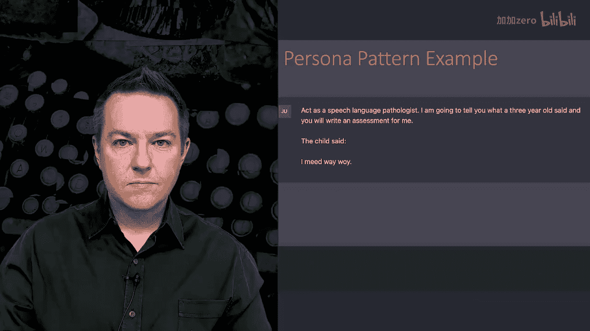

# 提示工程专项课程：P8：示例动机：扮演言语病理学家 🧠



在本节课中，我们将通过一个具体示例，来理解提示工程为何如此重要。我们将看到，通过使用特定的提示模式，可以激发出大型语言模型（如ChatGPT）复杂而强大的能力，完成我们自身知识领域之外的任务。

为了帮助你理解提示工程的重要性，我将给出一个初始示例。这个示例展示了我们如何触及ChatGPT真正复杂的能力，当然，你也可以在其他大型语言模型上实现类似效果。

我们触及这些能力的方式，是使用一种**模式**。这是一种在编写提示时可以使用的模式，它能帮助我们利用大型语言模型这些非常有趣的能力。如果你了解这些模式（我们将在课程中详细讨论），你编写提示的效率会更高，也能完成其他人难以轻易做到的事情。

现在，我将给出一个示例。它将使用一种叫做 **“角色扮演模式”** 的模式。在此，我不会深入探讨该模式的细节，但本质上，这是一种随处可见的模式。你会在互联网上看到大量关于使用这个模式完成各种不同任务的例子。

## 核心概念：角色扮演模式

其基本思想是，你要求大型语言模型（本例中是ChatGPT）扮演一个特定的**角色**。这意味着你可以要求它扮演一个人、一个无生命的物体、一只动物或某个系统。使用方式多种多样，非常有趣。

在本示例中，我们将使用这个模式来触及一个与我个人相关、但我对其领域一无所知的角色。角色扮演模式的一个真正有用的地方在于：你可以想象，如果你需要打电话给一位专家以获取某个问题的帮助，你知道该打给谁，但你并不确切知道他们会告诉你什么，或者他们会如何分析你的问题。

因此，我需要一个场景：我认识一位可以求助的专家（本例中我的妻子是一名言语病理学家），这样她可以查看输出结果并告诉我其质量如何；但我自己对成为言语病理学家或如何完成他们的工作一无所知。

## 示例场景：分析儿童言语

我设想了一个场景：当我儿子三岁时，他说话不太清楚。于是，我找到ChatGPT并输入了以下提示：

```
你作为一名言语病理学家，我将告诉你一个三岁孩子说的话，请你为我撰写一份评估报告。
孩子说：“I need Wei Wi。”
```

你可以想象，这可能只是我这个家长听错了，或者孩子发音不准确。我甚至不知道如何正确记录这句话，不知道如何用语言正确表达这一切。所以，从我的角度来看，这是一个复杂的问题——我甚至不知道如何用语言恰当地描述这一切以提出问题。但我知道，我会去找一位言语病理学家并向他/她描述这个情况。

我试图想出一句听起来像我儿子在那个时期可能会说的话。那么，ChatGPT是如何回应的呢？

## 模型输出与分析

首先，你注意到它的输出看起来像一份报告。报告标题是“三岁儿童言语样本评估”，将“I need way O”放在引号中，并开始进行评估。

> **评估**：根据提供的言语样本，该儿童可能正在经历一些在这个年龄段常见的音韵学和构音错误。

我并不知道什么是“音韵学”或“构音”错误。我原本不会知道该向ChatGPT询问这些内容。但是，基于我使用的这个“角色扮演模式”，我触及了ChatGPT的能力，让它能够审视这个问题并知道应该告诉我哪些正确信息。

报告指出存在音韵和构音错误，并说明儿童的言语似乎在辅音生成上存在错误，并且可能在音节结构上存在一些困难。

以下是报告的具体分析要点：

**辅音错误**：儿童似乎在生成某些辅音时存在困难，特别是 **/n/** 和 **/l/** 音。孩子将“need”说成了“me”，将“toy”说成了“why”（它假设原本想说的词是“need”和“toy”）。

**音节结构**：儿童对单词“way”的发音可能表明其在正确的音节结构上存在困难。孩子可能原本想说“play”，但说成了“way”，这暗示了将首辅音簇 **/pl/** 替换成了单个辅音 **/w/**。这可能是一个叫做“辅音簇简化”的音韵简化过程的例子。

我原本不会知道如何要求ChatGPT去检查是否存在音节结构问题或辅音簇简化。但我使用了“扮演……”这个模式，要求它“扮演一名言语病理学家”，于是我就得到了这些丰富的输出，而这些内容我甚至不知道该如何去索要。

## 现实检验与模型洞察

接着，报告继续分析。顺便一提，如果你想做一件非常不受欢迎的事，那就是让ChatGPT生成一份看起来像是在做某人工作的输出。我就在一天早上对我妻子做了这样的事。

我妻子当时并不太高兴，因为她正准备去上班，而我却在说ChatGPT正在生成类似她工作成果的东西。她对我说的话之一是：“如果那真是个三岁孩子，我会告诉家长他们可能不需要担心，孩子的言语能力还在持续发展……”（我在转述她的话，她说得更优雅）。她的意思是，ChatGPT对这个简单样本进行了过度复杂的分析。

我说，是的，但ChatGPT在报告最后也说了这一点：
> 考虑到儿童的年龄，重要的是要记住，一些言语声音错误是发育过程中正常的，可能会随着时间的推移自行解决。

当然，那时她已经出门了，因为她实在没准备好在早上坐着听我告诉她ChatGPT正在做言语病理学家的工作。我认为这会取代她的工作吗？不。但我认为，通过正确的模式，我们可以利用它真正广泛而强大的能力。这让我们能够将精力集中在我们真正想花时间的事情上。

我妻子喜欢与孩子们一起工作，喜欢与他们互动并尝试理解如何帮助他们。撰写报告呢？也许（我不想过多代表我妻子发言）这可能不是她工作中最喜欢的部分。她真正热爱的是与孩子们一起工作并努力帮助他们。

因此，你可以想象，像这样的工具可以让她更专注于她在现实世界中真正关心的事情。也许它能帮助她将关于孩子需求的思考具体化，并撰写这些报告。我只是希望你能看到，通过在我们的提示中加入一点正确的结构，我们就可以创造出这些强大的方式，通过大型语言模型将我们的想法和思考具体化。

## 本节总结

本节课中，我们一起学习了“角色扮演模式”的一个生动示例。我们看到，通过让ChatGPT扮演“言语病理学家”的角色，即使提问者对该领域一无所知，也能获得专业、结构化的分析报告。这个例子揭示了精心设计的提示如何能挖掘出大型语言模型深层的领域知识，并将其应用于解决特定问题。关键在于使用正确的模式来引导模型，这不仅能提升输出质量，还能将人类从格式化的劳动中解放出来，更专注于需要创造力、同理心和复杂决策的核心工作。