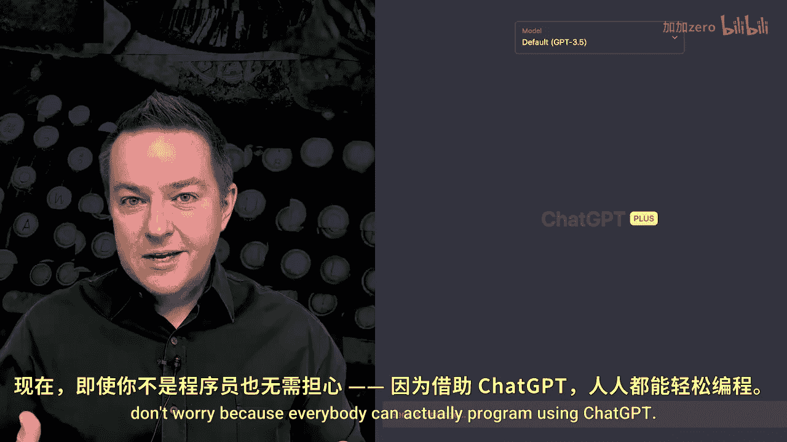
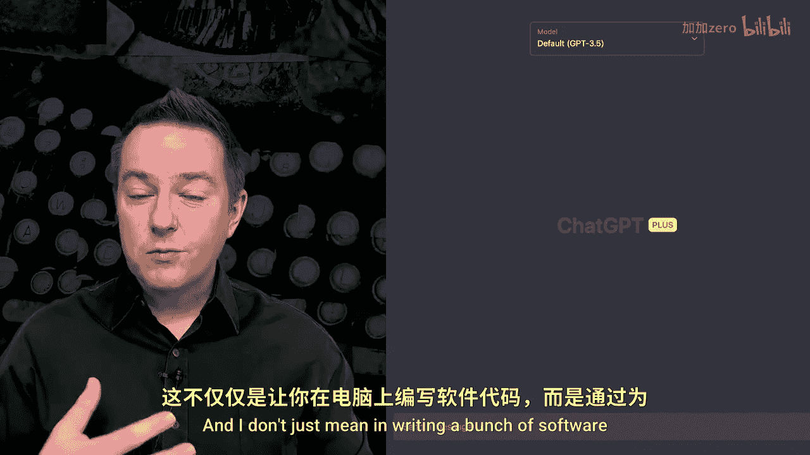
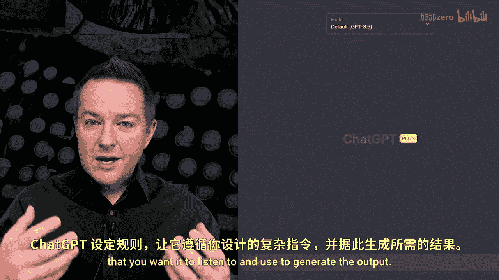
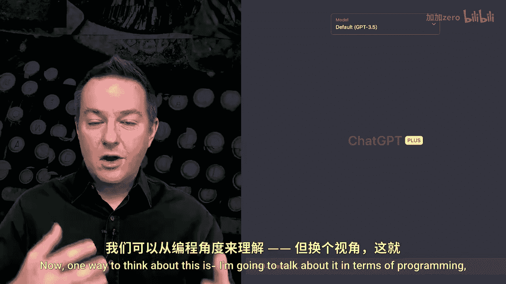
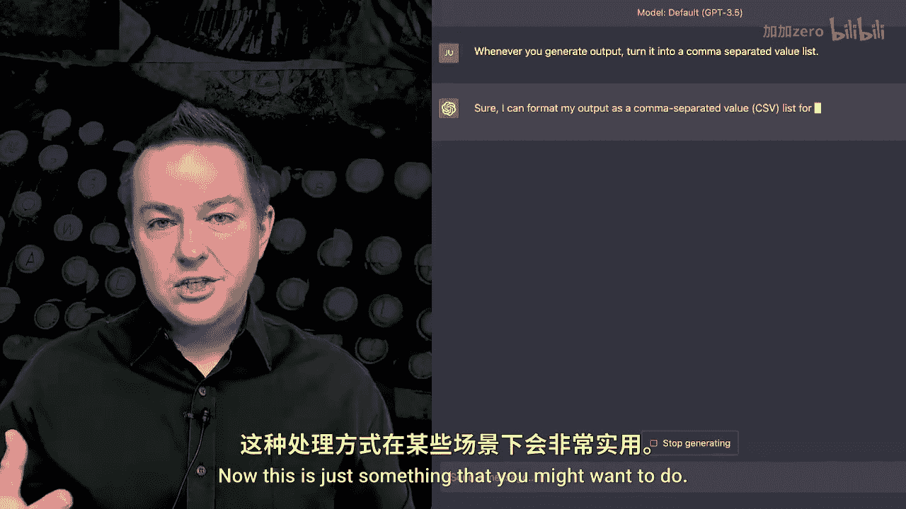
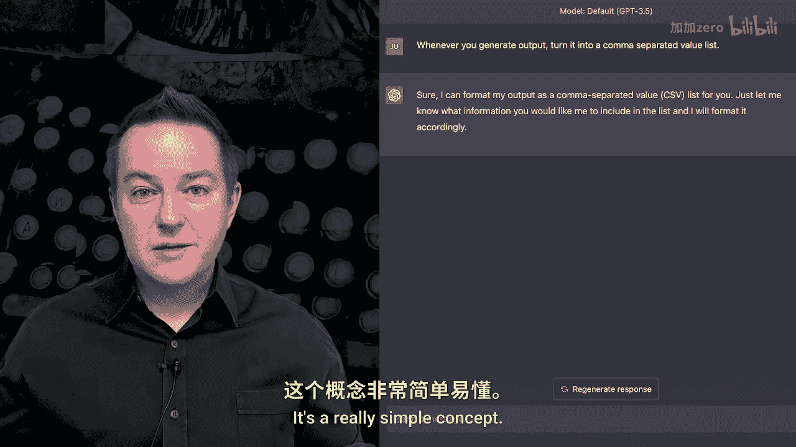

# 013：人人都能用提示词编程 🧠


在本节课中，我们将要学习如何超越简单的问答，使用提示词来“编程”ChatGPT。我们将看到，即使你不是程序员，也能通过编写清晰的指令和规则，引导AI生成结构化的、符合特定格式的输出。

## 概述：从提问到编程

提示词的作用远不止向ChatGPT提问或下达简单指令。实际上，你可以用它来编写“程序”。这里的“编程”并非指编写在计算机上运行的复杂软件，而是指为ChatGPT设定一系列需要遵循的规则和复杂指令，从而控制其输出格式和内容。你可以将其理解为给一位个人助理下达一套详细的工作指南。




上一节我们介绍了提示词的基本概念，本节中我们来看看如何通过构建指令集来实现“编程”。







## 编程式提示词实例




让我们通过一个具体例子来理解。假设我们希望ChatGPT将其所有输出都格式化为逗号分隔值列表。CSV是一种常见的数据格式，用逗号分隔不同字段，可以简单理解为表格的一行。


首先，我向ChatGPT发出初始指令：





**指令：**
```
Whenever you generate output, turn it into a comma separated value list.
```

然后，我提供输入：“my name is Jules White, and I am teaching a course on prompt engineering.”

ChatGPT的**输出**可能是：
`Jules White, prompt engineering`

它自动将信息分成了两列（姓名和课程），但我并未指定列名。为了获得更精确的控制，我需要“优化我的程序”。

## 优化程序：指定输出结构

现在，我添加更详细的规则来完善这个“程序”。

**新增指令：**
```
From now on, the columns of the comma separated value list should be: Name, Course, Role.
```

再次输入相同内容：“my name is Jules White, and I am teaching a course on prompt engineering.”

此时，ChatGPT的**输出**变为：
`Jules White, prompt engineering, teacher`

现在，输出严格遵循了我定义的`Name, Course, Role`三列结构。我们已经编写了一个能理解并格式化输入的小程序。

## 增强程序：自动生成示例

我们可以进一步扩展程序的功能。例如，要求它在基于我的输入生成CSV的同时，自动补充更多符合格式的示例。

**再次新增指令：**
```
In addition, generate additional examples that fit the format of the CSV I have asked you to produce.
```

第三次输入：“my name is Jules White, and I am teaching a course on prompt engineering.”

以下是ChatGPT可能生成的**输出**：
```
Jules White, prompt engineering, teacher
Jane Doe, data science, student
Alex Johnson, machine learning, researcher
```

现在，这个“程序”不仅根据我的输入创建了CSV，还遵循指令生成了额外的示例数据。

## 核心概念：通过对话迭代构建程序

回顾整个过程，我们通过多次对话逐步构建了一个复杂的指令集：

1.  **初始规则**：将所有输出转为CSV格式。
2.  **添加结构**：明确CSV的列名（Name, Course, Role）。
3.  **增加功能**：在输出中自动生成补充示例。

每次我输入相同的内容“my name is Jules White...”，但ChatGPT的输出却因程序规则的迭代而变得越来越丰富和结构化。这就像你向助理交代任务：先提出基本要求，发现不足后补充规则，直至他完全按照你的预期工作。我们正是在用同样的方式为ChatGPT编程。

## 总结

本节课中我们一起学习了如何使用提示词为ChatGPT“编程”。关键点在于：

*   **超越问答**：提示词可以用于设定复杂的、需要持续遵循的规则。
*   **迭代构建**：通过持续对话，逐步添加和细化指令，像搭建积木一样构建出功能完善的“程序”。
*   **控制输出**：你可以精确控制输出的格式、结构和内容，使其符合特定需求（如生成**CSV**格式数据）。

掌握这种“编程”思维，将帮助你设计出更强大、更可靠的提示词，从而更有效地利用生成式AI的能力。