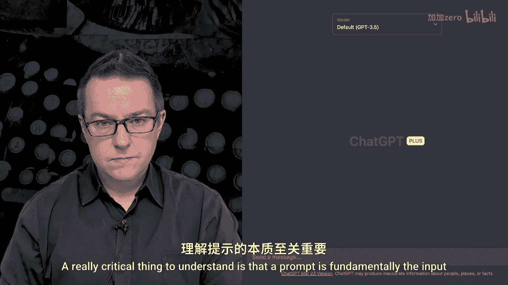
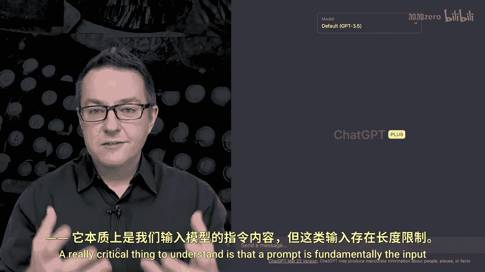
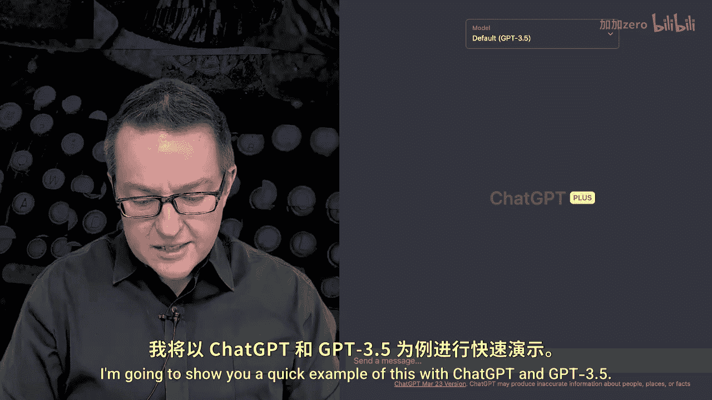

生成式AI战略领导者：P17：提示词长度限制 🧠

在本节课中，我们将要学习一个关于提示词（Prompt）的关键概念：长度限制。理解这一点对于设计有效的提示词至关重要。

一个至关重要的概念是，提示词本质上是输入给模型的指令。

我们创建的提示词在大小上存在限制，无法创建无限长度的提示词。

每一个大型语言模型都会对我们可以输入并发送给它的提示词内容有一个基本的限制。

因此，这是一个需要注意的重要事项，因为它对提示词设计的思考方式有着深远的影响。

接下来，我将以ChatGPT和GPT-3.5为例，快速展示这一点。

我将粘贴一篇关于法国大革命的维基百科文章。

我粘贴了大量来自维基百科描述的法国大革命文本，ChatGPT会说什么呢？它说：“您提交的消息过长。请重新加载对话并提交更短的内容。”

这揭示了一个重要观点：我们不能无限制地提供信息。

现在，如果我们回顾之前讨论过的提示词维度，使用提示词的一种方式是为ChatGPT或其他大型语言模型引入其未训练过的新信息。

如果我们想为其引入新信息，我们必须意识到，我们一次能够提供给它的信息量是有限的。我们可能有很多新信息想提供给ChatGPT，但不能一次性全部倾倒给它，然后说“现在开始基于这些信息推理吧”，这不是它的工作方式。

因此，作为用户，我们的目标之一是尝试筛选并使用仅需的信息，以完成我们要求ChatGPT执行的任务。我们不能把所有东西都扔进去，然后说“嘿，ChatGPT，你自己看着办”。我们可以输入很多内容，根据模型不同，能输入的量可能有多有少，但我们必须在一定程度上扮演编辑的角色。我们是内容编辑，在编辑信息的上下文，并且我们有一个预算。我们不能无限制地倾倒信息。你可以把它想象成你在写一篇论文，你的论文有页数限制；或者你在写一篇文章，有字数限制。你不能随意倾倒内容。

那么，我们该怎么做呢？首先，我们必须思考哪些信息是最重要的，需要实际提供。

例如，假设我们真正关心的是1789年10月5日。如果是这样，这就是我们想要粘贴给ChatGPT进行推理的内容。然后我们可以问：“10月5日发生了什么？”接着它会告诉我们10月5日发生的事情。

但是，如果我们问一个超出10月5日范围、并且它未训练过的问题呢？在这个例子中，它很可能训练过关于法国大革命的信息，因为这显然发生在2021年之前。但如果我们有想要纳入的新信息，我们必须思考如何将这些信息放入我们的预算中。

那么，我们有哪些方法可以做到这一点呢？我们如何获取大量信息并尝试将其纳入预算？

以下是几种我们可以采用的方法：

1.  **选择性包含**：我们可以在ChatGPT之外，运行某种查询或过滤器，选择与任务相关的信息片段。有很多方法可以做到这一点，我不会一一详述。我们可以设置一个过滤器，在将信息提供给ChatGPT之前，就移除我们认为不相关的信息类型。
2.  **信息摘要**：我们可以将信息以我们认为能保留推理所需内容的方式进行总结。例如，我们可能无法粘贴所有相关信息，但我们可以说：“我们将提取这些信息，并为每个段落总结成一句话。”然后我们会得到一个摘要，这比原文稍短一些。现在我们有了一个一句话的事件摘要。
3.  **利用模型进行摘要**：我们可以要求ChatGPT或其他大型语言模型为我们总结信息，然后我们可以重复使用这个摘要。我们还可以将多个摘要组合起来。

然而，这种方法只有在确保我们的摘要或过滤方式保留了执行后续任务所需信息时才有效。

我们也可以说：“用一句话总结这些信息，但要保留关于人数的信息。”然后我们会得到一个保留了人数信息的摘要。如果你看之前的摘要，上面没有保留人数，如果这是我们推理所需的重要信息，那么我们就丢失了它。因此，如果我们以那种方式总结，然后使用该信息进行需要人数的推理，显然我们就失去了所需的内容。

在这里，我们要求它总结，但我们要求它总结是为了保留特定信息或完成特定任务。我们通过明确指令来实现这一点，例如：“用一句话总结这些信息，保留关于人数的信息。”我们也可以要求ChatGPT：“保留用于推理人口数量或抵抗力量/国民自卫队人数所需的信息。”我们可以提供上下文。

因此，我们必须认识到，提示词大小的预算限制将是我们始终需要设法克服的一个基本限制。

随着大型语言模型变得更大，它们可能会达到一个规模，使得对于许多实际任务，特别是当我们直接手动与大型语言模型交互时，这个大小限制不再重要，因为我们可以直接将50页文本复制粘贴到模型中，并要求它从中提取信息或基于此执行任务。

但是，考虑到我们日常处理的信息量，可能会有不同类型的任务涉及的信息量如此之大，以至于我们无法一次性全部输入。

当我们遇到这类情况时，我们必须考虑以下策略：

1.  **查询获取子集**：只获取相关的文档或文档部分。
2.  **过滤**：如何移除无关的信息。
3.  **摘要或压缩**：在将信息提供给大型语言模型之前，如何总结或压缩信息。正如我们刚才看到的，一种方法是：我们可以将信息块提供给大型语言模型，然后要求它为我们总结或压缩，以便后续用于推理。

我们还可以说：“总结或压缩此信息，以完成特定任务或保留信息的这些方面。”这可以帮助我们创建保留重要部分的摘要或精简版本的信息。因此，当我们需要对越来越大量的信息进行推理时，这可能是一个强大的技术。

本节课中，我们一起学习了提示词长度限制这一核心概念。我们了解到，所有大型语言模型对输入提示词的大小都有基本限制，这要求我们在设计提示词时必须扮演“内容编辑”的角色，精心筛选和准备信息。我们探讨了三种应对信息过载的策略：选择性包含、信息摘要以及利用模型本身进行摘要和压缩。理解并灵活运用这些方法，对于高效利用生成式AI处理复杂任务至关重要。