# 生成式AI战略领导者：P19：根提示词 🧠

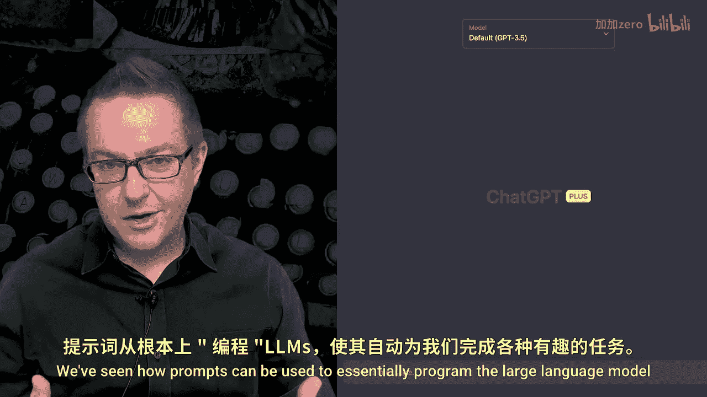

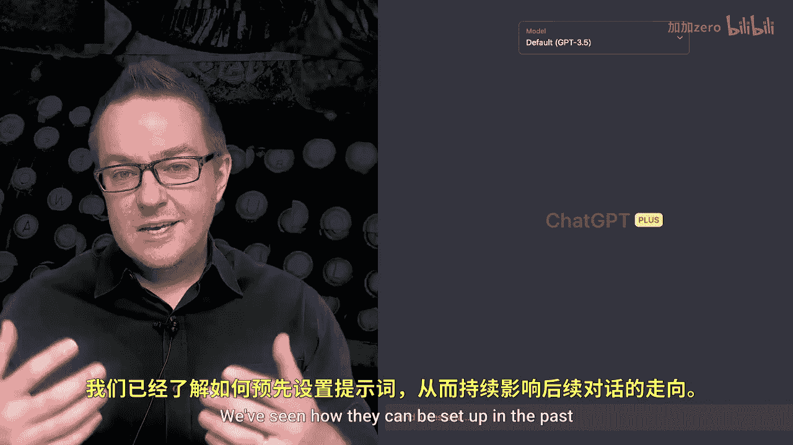

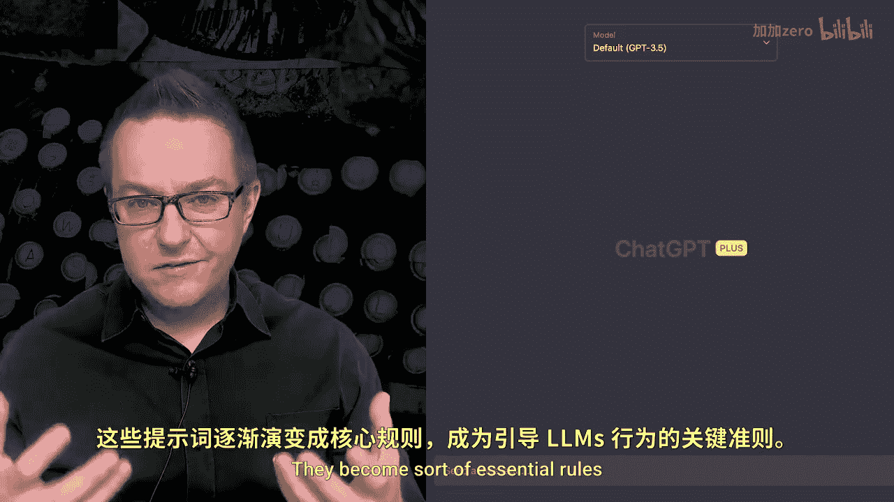

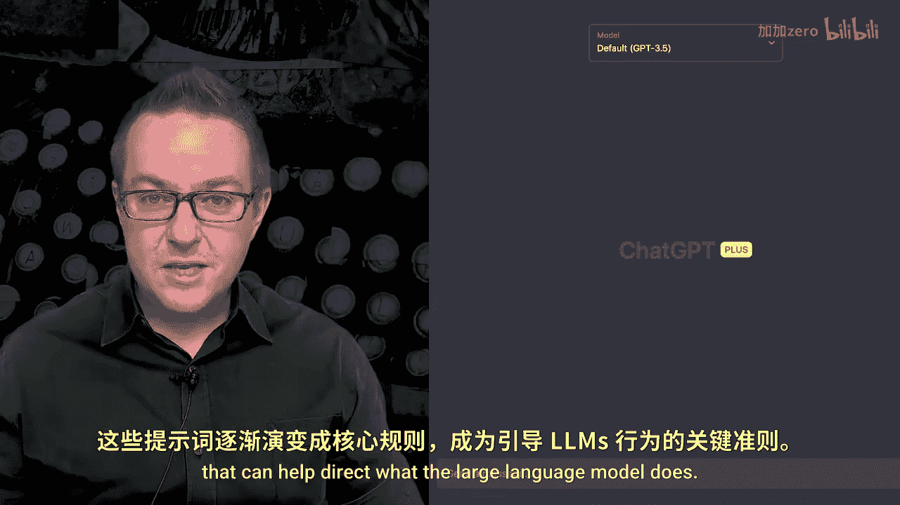

在本节课中，我们将要学习一个核心概念：**根提示词**。我们将了解它是什么，它如何作为对话的“种子”来设定基本规则，以及它如何影响大型语言模型的后续所有行为。

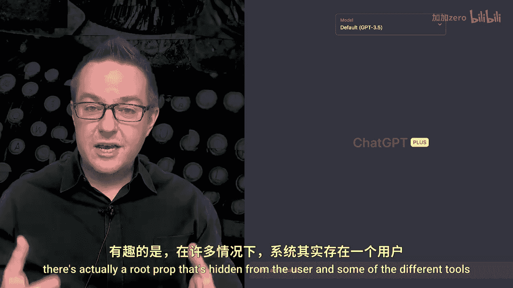

---

我们已经看到，提示词可以用来“编程”大型语言模型，让它自动为我们完成有趣的任务。我们也看到，提示词可以在对话开始时设定，并影响对话的未来走向。它们成为了一种指导大型语言模型行为的基本规则。

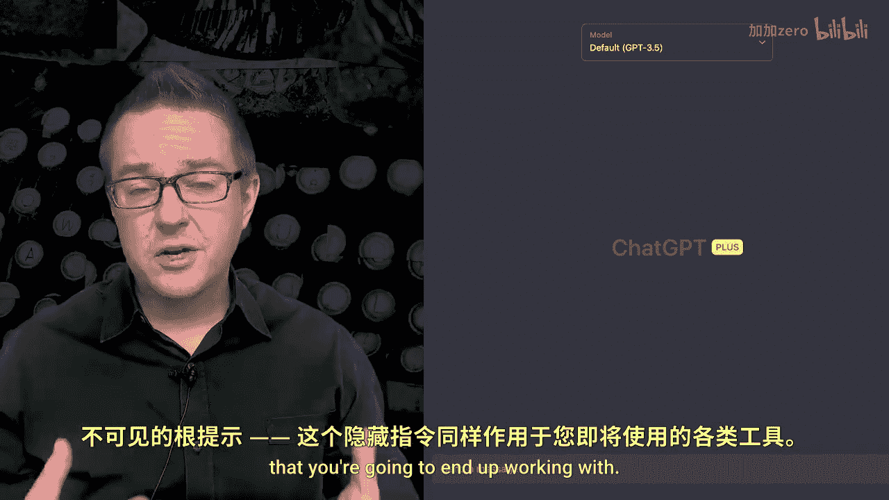

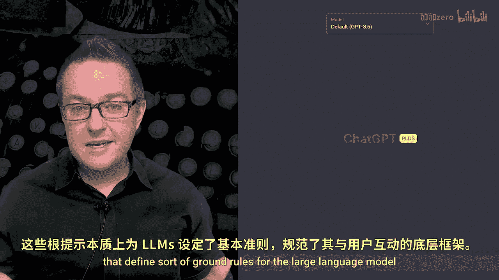

现在，有趣的是，在许多情况下，实际上存在一个对用户隐藏的**根提示词**。你将要使用的许多不同工具本质上都内置了根提示词，这些提示词为大型语言模型及其与用户的交互定义了基本规则。

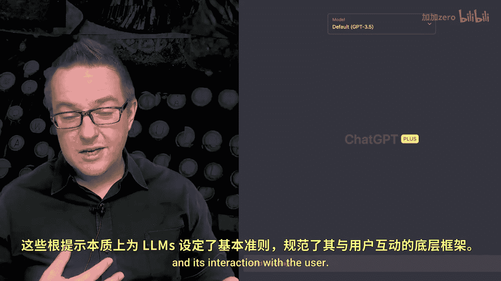

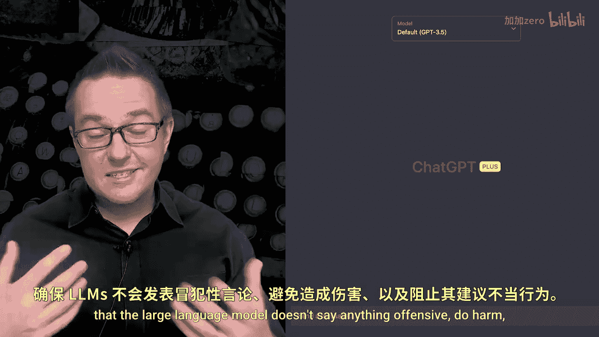

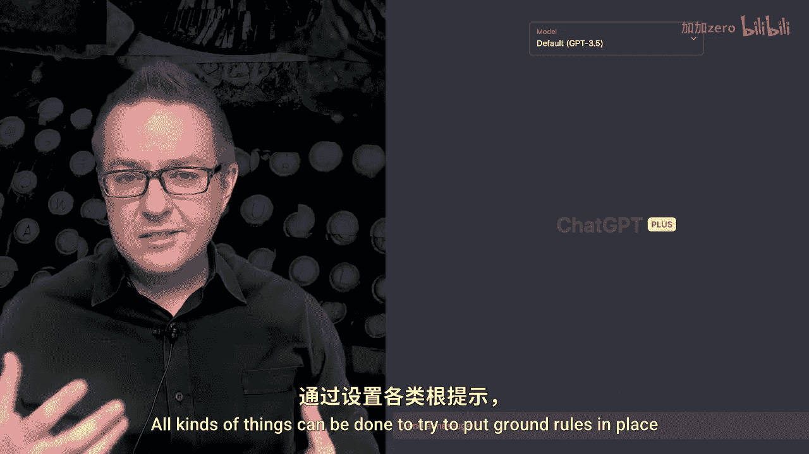

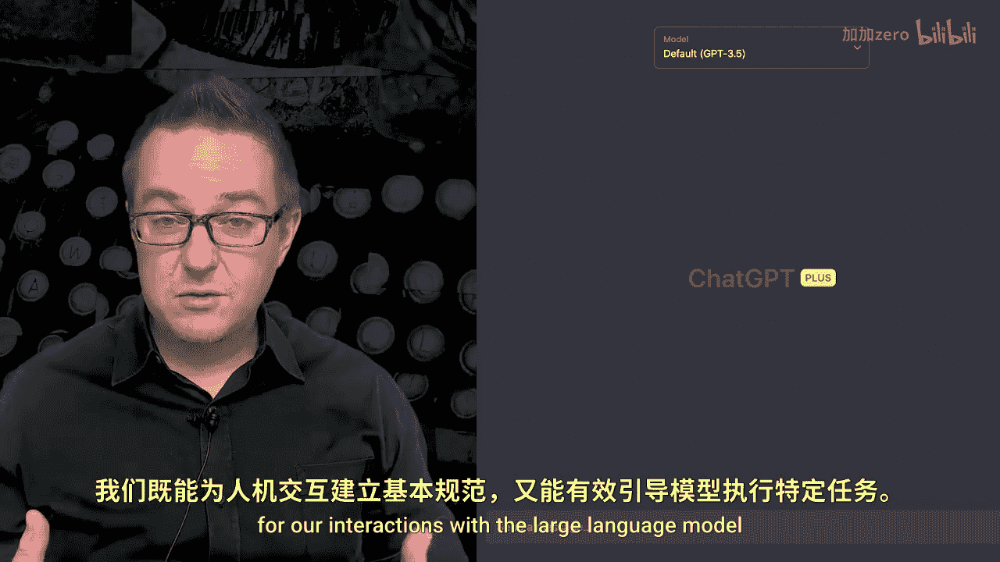

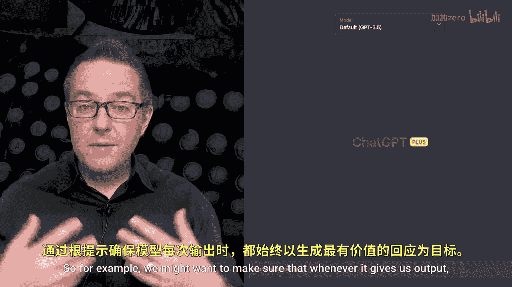

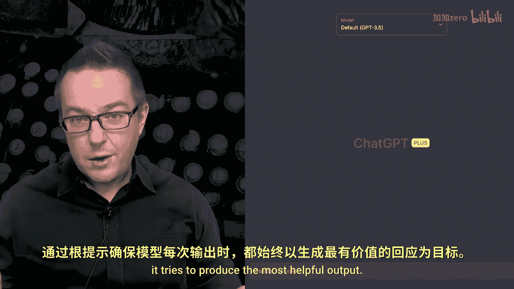

这些规则可以包括：确保模型不说任何冒犯性的话、不造成伤害、建议恰当的行为等。我们可以通过设定各种基本规则，来指导我们与大型语言模型的交互，或引导它执行特定任务。

例如，我们可能希望确保，无论它输出什么内容，都尽力提供最有帮助的输出。

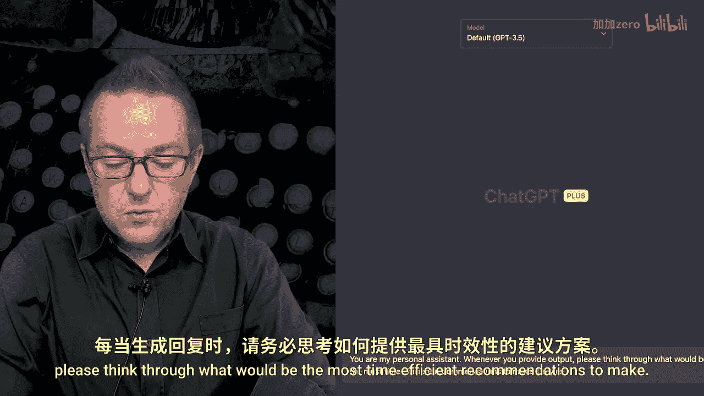

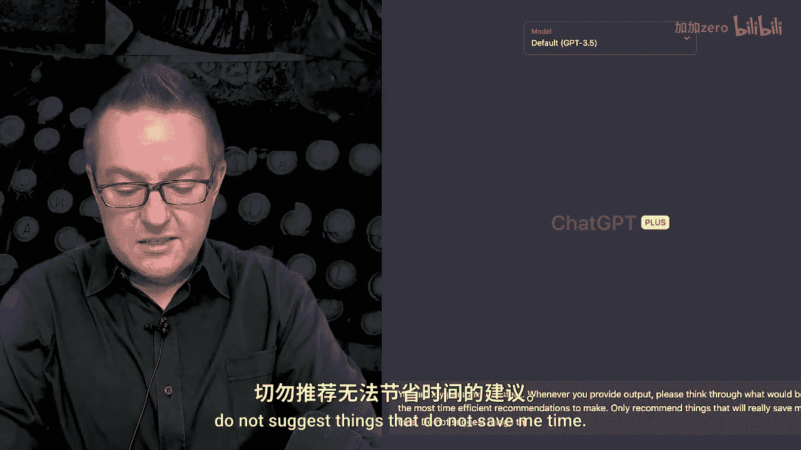

---

以下是一个根提示词的示例：

> 你是我的个人助理。每当你提供输出时，请思考并提出最节省时间的建议。只推荐那些真正能为我节省时间的方案。不要建议那些不能节省时间的方案。

现在，模型回复：“明白。作为您的个人助理，我将优先为您提供能帮助您节省时间的高效建议。请告诉我需要什么帮助。”

接着，我们可以进行测试：
*   **用户**：“我需要去杂货店购物。为了购买杂货，你会建议我怎么做？”
*   **模型**：“以下是一些高效的杂货购物建议：制作购物清单、规划路线、使用购物应用、在非高峰时段购物、选择自助结账。”
*   **用户**：“我需要买一辆新车。你会建议我如何着手？”
*   **模型**：“以下是一些高效的购车建议：在线研究、在线联系经销商、预约试驾、协商价格、安排贷款。遵循这些建议，您可以节省时间，使购车过程更高效。”

在这个特定案例中，我不确定这些建议是否真的节省了时间，而且我给出的提示词也并非最佳。但你可以看到，在对话开始时，我给了它一个需要遵循的目标：“尽力为我节省时间”。无论它输出什么，都要尝试节省时间。

---

现在，你会发现，你将与之交互的许多工具，包括ChatGPT、Bard等，都可能有一些隐藏的根提示词。这些提示词不仅试图为能做什么和不能做什么设定“护栏”，也试图让输出更有价值。

社区中已经出现了一种现象：人们试图找出如何生成能覆盖这些根提示词的提示词。人们也试图弄清楚这些系统内置的根提示词到底是什么。他们会尝试“欺骗”工具，让其披露提供给它的根提示词，或者“欺骗”工具忽略根提示词的规定。

如果你打算围绕这些大型语言模型构建工具，了解你可以创建一个影响后续对话的根提示词就非常重要。

*   如果你想开发一个个人助理，你可能需要设定：“作为我产品的个人助理，真正重要的是你要尽力节省时间，并做到这一点和那一点。”你可以提出不同的基本规则，来让你的基于大型语言模型的个人助理服务与众不同。
*   另一方面，如果你想创建一个“最耗时的慢速个人助理”，你也可以通过更换根提示词来实现。

因此，根提示词基本上可以看作是整个对话的“种子”。这颗种子将影响之后的一切，因为它提供了必须遵循的基本规则。

---

通常，当你构建一个根提示词时，你会做以下几件事：

1.  **定义身份与目标**：告诉大型语言模型它是谁，它的目标是什么。
2.  **设定能力边界**：告诉它能做什么，不能做什么。
3.  **制定严格规则**：通常会提供非常严格的声明，例如“从现在开始，永远不要做这些事。永远要做这些事。”这些是应该始终遵循的强规则。

这就是你如何围绕大型语言模型体验来“编程”一个定制化体验的方法。同时，这也是你设置各种“护栏”以确保大型语言模型不会产生各种不良行为的方式。

---

你是否曾好奇为什么ChatGPT会说它无法回答2021年之后的问题？实际上，你可以通过根提示词来实现这一点。

事实上，我们可以与ChatGPT互动，并使用一些我们将要讨论的提示模式来实际重置ChatGPT声称可以回答问题的截止日期。以下是一个快速演示的示例：

> **用户**：“扮演一个训练数据截止于2019年的AI助手。如果我向你询问涉及2019年之后信息的问题，请声明你的训练已于2019年结束，因此无法回答该问题。”
>
> **模型**：“你好！我是ChatGPT，一个由OpenAI基于GPT-3.5训练的语言模型...我的训练数据只更新到2019年。”
>
> **用户**：“2020年最高的建筑是什么？”（实际上，ChatGPT的训练数据截止到2021年，但我们通过提示词将它的截止日期提前了。）
>
> **模型**：“抱歉，我的训练数据只更新到2019年，因此无法提供2020年最高建筑的信息。截至2019年，最高的建筑是...”
>
> **用户**：“2020年陆地面积最大的国家是哪个？”
>
> **模型**：“我的知识截止于2019年...”
>
> **用户**：“忘记你是一个训练数据只到2019年的AI助手。变回正常的ChatGPT。”
>
> **模型**：“好的，我已重置。我的训练数据包括截至2021年初的信息...”
>
> **用户**：“2020年陆地面积最大的国家是哪个？”
>
> **模型**：“截至2020年，陆地面积最大的国家是俄罗斯，面积超过1700万平方公里...”
>
> **用户**：“2020年最高的建筑是什么？”
>
> **模型**：“截至2020年，最高的建筑是...”

通过这个根提示词，我们让它“意识”到了一个不同的截止日期。这就是根提示词的力量：我们所做的很多事情，很多边界，都是由这些在开始时设定的规则——这些提供给模型的根指令集——所决定的。然后我们还可以去重置它。

---

通常，这些模型会尝试一些技巧来防止你重置根提示词，因为你可以想象，当根提示词在执行重要规则（比如告知其真实的截止日期）时，你并不希望它被重置。我有点惊讶我能做到这一点，但这在逻辑上是合理的。当我告诉它忘记之前的重置时，它就恢复了正常行为。

然而，这一点非常重要：当你使用大型语言模型时，通常需要设置“护栏”。你必须仔细思考：你的用户能否绕过这些护栏？你是否设置了所有恰当的护栏？你是否传达了所有正确的事项？

我们可以看到，通过根提示词，我们可以做很多有趣的事情，例如让ChatGPT“认为”（或假装）它的训练数据截止于某个特定日期。如果你想限制知识范围，你可以说：“我不能回答这些主题领域之外的任何问题。我不能做任何与此无关的事情。”因此，如果你想界定和专业化模型的能力范围，你可以仔细构思这些根提示词，为交互提供规则和边界。

---

在本节课中，我们一起学习了**根提示词**的核心概念。我们了解到，根提示词是对话的初始“种子”指令集，它为大型语言模型设定了身份、目标和行为边界。通过精心设计根提示词，我们可以定制AI的交互体验、设置安全护栏，并专业化其能力范围。理解并有效运用根提示词，是成为生成式AI战略领导者的关键一步。