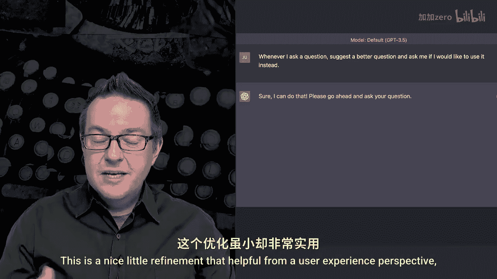
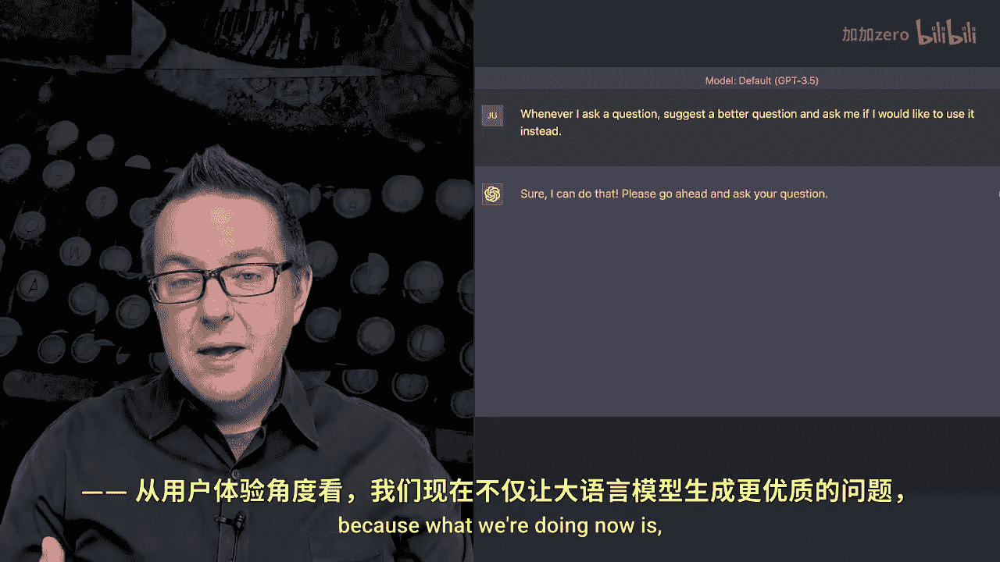
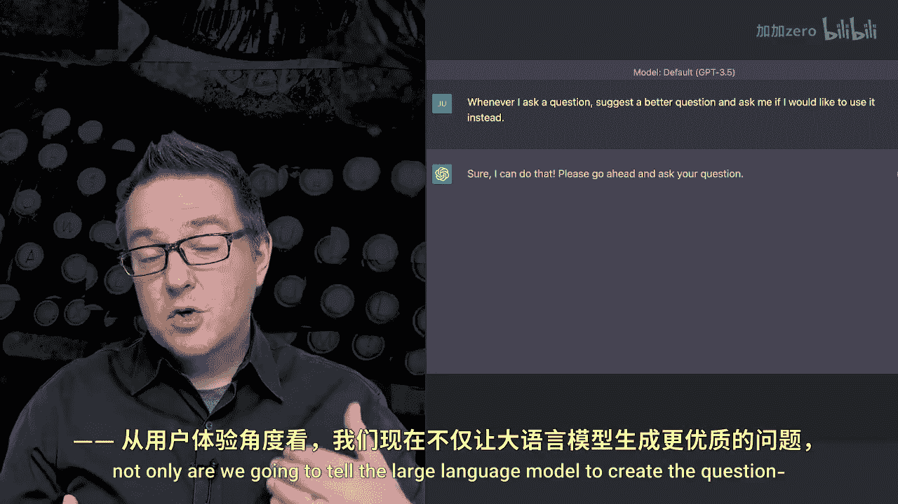
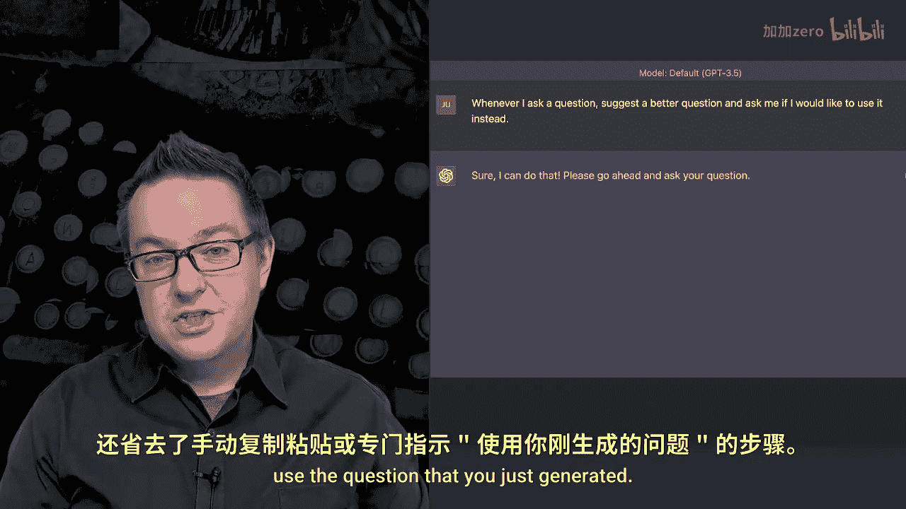
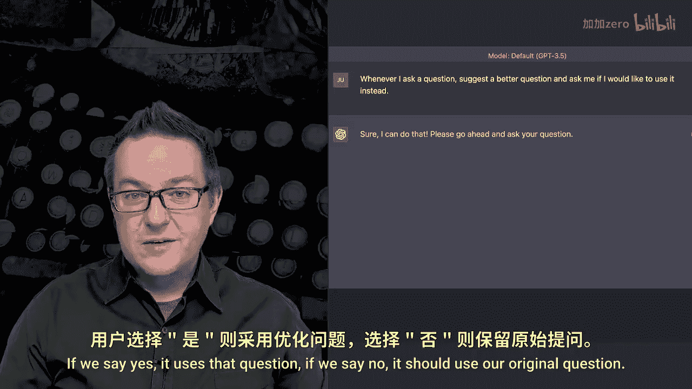
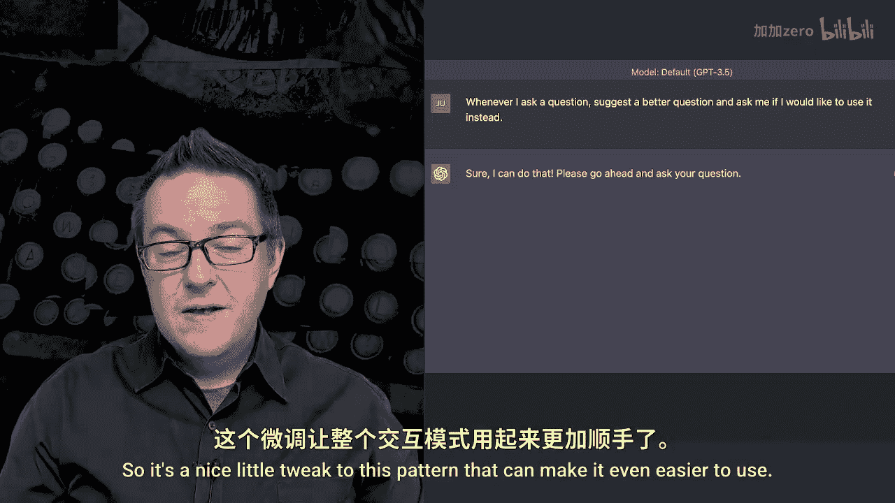

# 生成式AI战略领导者：P20：问题优化模式

## 概述

在本节课中，我们将要学习一种非常简单但有效的方法，来提升我们与大型语言模型（如ChatGPT）的交互质量。这种方法被称为“问题优化模式”。其核心思想是，利用模型自身对语言和主题模式的理解，来帮助我们改进提出的问题，从而获得更精准、更有用的回答。

## 问题优化模式的核心思想

上一节我们介绍了本课程的目标，本节中我们来看看“问题优化模式”背后的基本逻辑。

大型语言模型在训练过程中学习了海量的语言模式和知识。当我们提出一个可能比较宽泛或模糊的问题时，模型能够根据其训练数据，推断出与该主题相关的常见询问方式、关键因素或更精确的表述。

因此，问题优化模式的直观做法是：我们提出一个**初始问题**，然后借助大型语言模型对该问题主题下语言模式的理解，来生成一个**优化后的问题版本**。

## 基础模式与指令

理解了核心理念后，我们来看看如何具体实施这个模式。以下是实施该模式的基础指令。

这个模式非常简单。我们只需要在向模型提问时，预先给出一个指令。一个基础的指令范例如下：


```
每当我提问时，请建议一个更好的问题，并询问我是否想使用它来代替我的原问题。
```

这个指令告诉模型：在每次回答我们的问题之前，先对我们提出的问题进行优化，并以交互的方式让我们选择使用原问题还是优化后的问题。

## 用户体验优化：一个实用的小调整



基础模式已经很有用，但我们可以通过一个小的调整来进一步提升用户体验。这个调整的核心是让交互更加流畅。







我们可以将指令修改得更加人性化：

```
每当我提问时，请建议一个更好的问题，并询问我是否想使用这个更好的问题来代替。
```






这个调整的巧妙之处在于，它创建了一个简单的决策循环：
*   如果我们回答 **“是”**，模型将使用它生成的优化问题来提供答案。
*   如果我们回答 **“否”**，模型将回退并使用我们最初提出的原始问题。

这使得整个过程无需我们手动复制、粘贴优化后的问题，交互更加自然和高效。

## 模式应用实例分析

现在，让我们通过一个具体的例子，来看看这个模式在实际中是如何工作的。

假设我们提出一个非常宽泛的问题：
> 我应该去范德堡大学吗？

这是一个模糊且信息量不足的问题。无论是问一个人还是问AI，都很难给出有意义的建议，因为缺少决策所需的关键背景（如专业兴趣、个人目标、财务考量等）。

当我们对模型启用“问题优化模式”后，它可能会将上述问题优化为：
> 在决定是否就读范德堡大学时，我应该考虑哪些因素？这些因素如何与我的个人目标和优先级相匹配？

然后模型会询问：“您想使用这个优化后的问题来代替吗？”

我们可以看到，优化后的问题更加结构化，它引导思考者去明确**决策标准**和**个人背景**，这能导向一个更有深度和针对性的回答。

## 模式的双重价值

这个模式不仅能帮助我们获得更好的问题，它本身也是一个强大的反思工具。有时，优化后的问题能揭示我们原始提问的模糊性。

当我们看到模型生成的优化问题时，可能会发生两种情况：
1.  **认可与学习**：我们发现优化后的问题正是我们想表达但未能清晰表述的，从而学习到如何更好地提问。
2.  **发现信息缺口**：我们发现优化问题指向了一个我们未曾考虑的方面（例如，它可能强调了“学术项目”或“地理位置”）。这提示我们，自己的原始问题可能遗漏了关键上下文。例如，我们可能意识到需要补充：“我计划主修计算机科学”或“我对纳什维尔的生活很关心”。

因此，这个模式不仅能**产出更好的问题**，还能帮助我们**理解构成一个好问题需要哪些信息**，从而在后续交互中提供更充分的背景。

## 总结

本节课中，我们一起学习了“问题优化模式”。我们了解到，通过指令让大型语言模型在回答前先优化我们提出的问题，可以显著提升交互质量。我们学习了基础的指令格式，以及一个提升用户体验的交互式调整。通过实例分析，我们看到了该模式如何将模糊问题转化为结构化问题。更重要的是，我们认识到这个模式具有双重价值：它既是**优化提问的工具**，也是**促进我们反思问题完整性、发现所需上下文的工具**。掌握这个简单模式，能让你在与生成式AI协作时事半功倍。