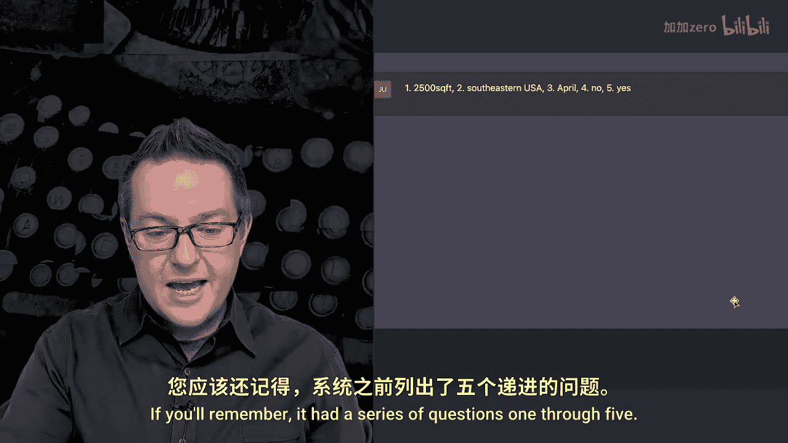
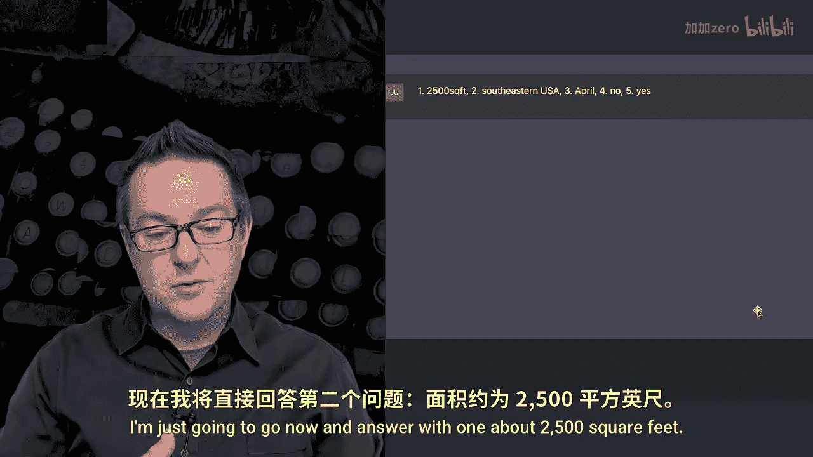
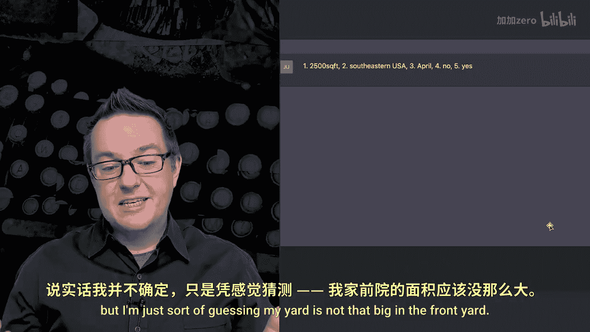
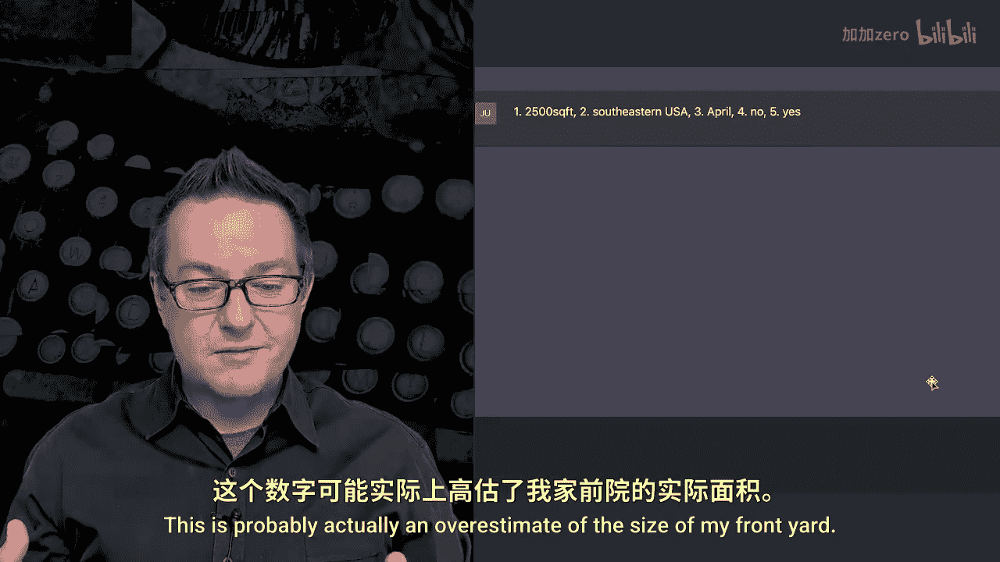
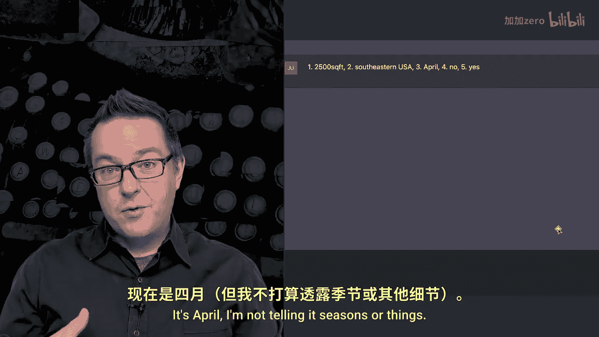
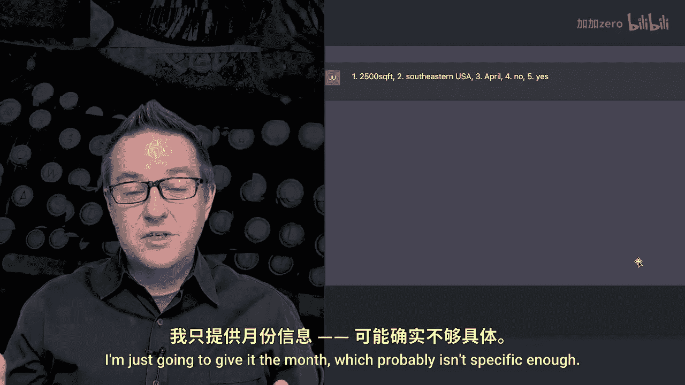
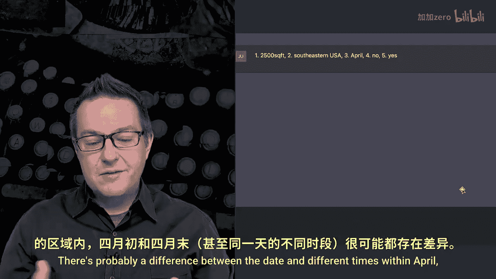
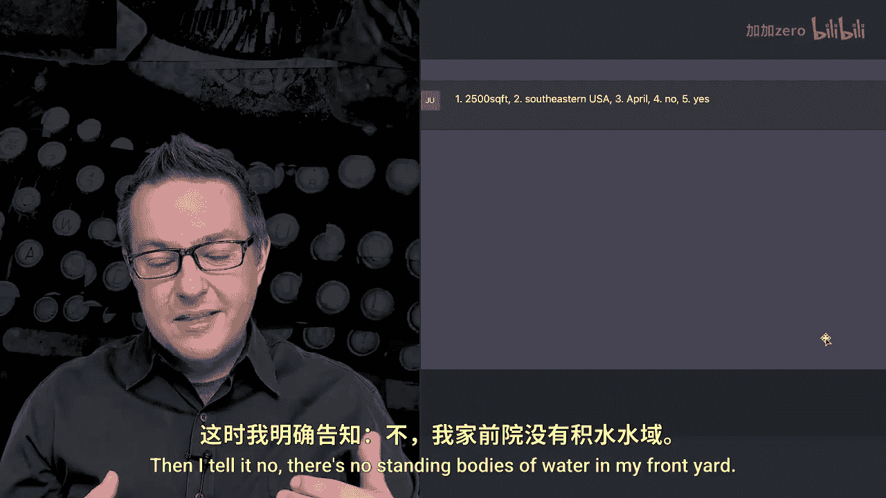
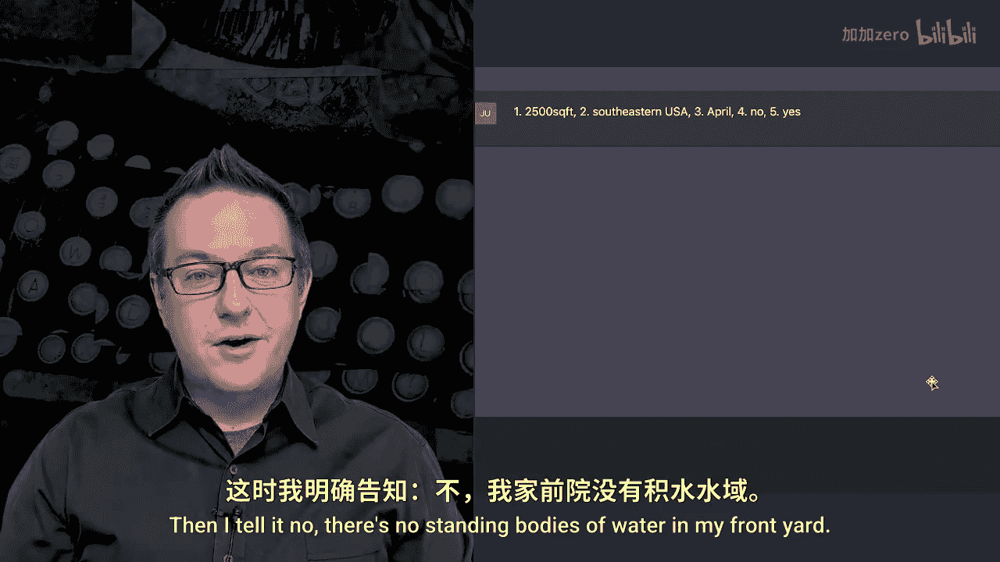
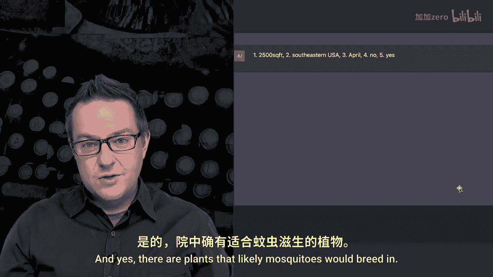

# 生成式AI战略领导者：P21：认知验证模式 🧠

在本节课中，我们将学习一种名为“认知验证模式”的提示工程技巧。这种模式的核心思想是，通过引导大型语言模型将复杂问题分解为一系列子问题，从而获得更准确、更可靠的答案。

---

## 核心概念：分步推理

大型语言模型有一个有趣的特性：在许多情况下，如果将一个问题分解成一系列更小的问题，它们实际上能进行更好的推理。有时，如果模型能解释其思考过程，推理效果甚至会更好。

关于这种现象有多种假设。直观地理解，我们可以认为大型语言模型在训练数据中见过特定问题被分解为一系列步骤。因此，如果它能遵循这些独立的步骤，它就知道下一步该生成什么内容，以解决特定步骤并最终得出答案。

**核心公式**可以概括为：
`复杂问题 -> 分解为子问题 -> 分别回答子问题 -> 综合得出最终答案`

虽然“分解问题”的理念将在课程后续深入讨论，但现在我们可以利用一个简单的技巧——一个简单的模式——来帮助我们自动分解问题，从而从大型语言模型中获取更好的答案。

---

## 认知验证模式详解

上一节我们介绍了分步推理的概念，本节中我们来看看如何具体实现它。一个简单的方法是直接要求大型语言模型，在遇到任何问题或任务时，都将其细分为一系列有助于回答整体问题或解决整体任务的独立问题或子问题。我们可以通过编程方式（即设计特定的提示词）来让大型语言模型遵循这一规则。

认知验证模式正是为此目的而设计。我们将告诉大型语言模型：**每当回答问题时，请遵循以下规则：**
1.  生成一系列有助于更准确回答该问题的附加问题。
2.  结合这些独立问题的答案，生成对整体问题的最终答案。

从直觉上思考：当我们向大型语言模型提出一个通用或特定的问题时，它可以利用其在训练数据中看到的模式，找出通常与此问题相关的其他问题。这有助于它从知识库中收集与原始问题相关的其他问题。当它找到这些相关问题时，很可能就能获得能提供额外细节或背景信息的问题，从而更好地回答原始问题。

当我们逐一回答所有这些子问题时，模型就拥有了额外的上下文信息，从而能给我们一个更好的整体答案。同时，这也帮助我们用户构建自己的思维框架。因为当我们提问，而模型开始分解问题时，它会帮助我们认识到问题的其他维度。

---

## 实践案例：前院的蚊子

让我们通过一个实践案例来看看它的效果。以下是我给模型的指令：“当你被问到一个问题时，请遵循这些规则：生成一系列有助于更准确回答该问题的附加问题。结合这些独立问题的答案，生成对整体问题的最终答案。”

然后，我提出了一个自己也不知道确切答案、信息也不充分的问题：“我的前院大概生活着多少只蚊子？”

模型遵循了认知验证模式，生成了一系列附加问题。以下是它提出的问题：

*   **前院的面积有多大？** 这显然很重要，面积越大，蚊子可能越多。
*   **你所在地区的气候如何？** 这非常重要。如果我住在沙漠或北极，很可能根本没有蚊子。
*   **现在是什么季节？** 另一个很好的问题。我提问时可能没考虑到这个维度。
*   **你的前院或附近有水体或积水源吗？** 这很重要，因为蚊子在水中繁殖。
*   **你的前院有吸引蚊子的植物或植被吗？** 这也是一个重要因素。

现在，它把我的原始问题分解成了一系列有助于回答原始问题的子问题。这非常有用，同时我也学到了一些东西。

接着，我逐一回答了这些问题（例如：前院约2500平方英尺，美国东南部气候，现在是四月，没有积水，有植被）。模型基于这些信息给出了估算：“根据提供的信息……由于你的院子或附近没有积水源，密度可能会更低……很难提供精确估计。然而，根据物种、气候和植被存在等各种因素，你的院子里可能有几十到几百只蚊子。”

这个范围比我预期的要精确。更重要的是，我对这个答案的怀疑减少了，因为它通过询问一系列合理的问题来推导答案。它还提供了一些我可以跟进核实的事实（例如，一只雌蚊一次产卵数，有水源地区的蚊子密度等）。至少，它帮助我了解了可能影响院子里蚊子数量的因素，并给了我后续可以跟进和验证的线索。

它提出的问题看起来确实有效且重要。我知道院子大小、气候、季节、积水、植被这些因素都很关键。因此，这是一个非常有用的工具，可以自动分解问题，让我看到它推理的过程，也改善了我自己思考如何回答这个问题的方式。

---

## 总结与提醒

本节课中，我们一起学习了**认知验证模式**。这种模式通过引导大型语言模型将复杂问题自动分解为关键的子问题，不仅能让模型利用更具体的上下文进行推理，从而可能给出更准确的答案，还能帮助提问者结构化自己的思维，识别问题的关键维度。

**重要提示**：正如案例所示，对于从大型语言模型获得的任何输出，尤其是涉及事实或专业知识的答案，**强烈建议您进行核实**。认知验证模式提供了一种更透明、更可追溯的推理路径，但这不意味着最终答案一定是绝对正确的。它更像是一个强大的思维辅助和问题分析工具。