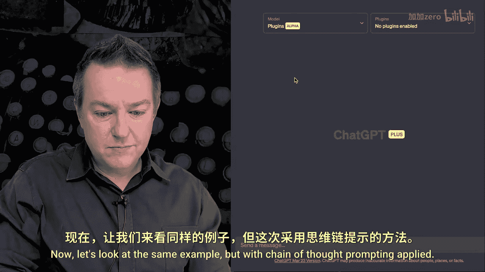

# 生成式AI战略领导者：P28：思维链提示 🧠

在本节课中，我们将学习一种名为“思维链”的提示技巧。这种技巧通过要求大型语言模型展示其推理过程，从而显著提升其在复杂问题上的回答质量。

---

你可能记得在学生时代，尤其是在数学考试中，老师会要求你“展示解题步骤”。你需要解释是如何得出答案的，或者证明你的结论是正确的。这种展示工作和解释推理的能力在许多领域都非常重要。

事实证明，在编写提示词时，这一点也变得至关重要。让大型语言模型解释其推理过程，实际上能使其为我们提供更好的表现。这听起来很有趣，但仔细想想也合乎逻辑。大型语言模型基于大量文本模式进行训练，学习预测下一个内容。如果它能正确地解释其推理，那么它就更有可能得出正确答案，因为正确的答案在逻辑上应该紧随正确的推理之后。

同样地，如果它正确地解释了第一步，那么它很可能也能正确地完成第二步，因为它可能见过类似问题的推理过程。这是一个直观的解释。你可以这样理解：如果你将问题分解为多个独立的步骤，并解释它们之间的逻辑和顺序，那么最终的答案作为正确推理的自然延伸，其正确率也会更高。对于以准确预测下一个词元为目标的大型语言模型来说，如果第一步和第二步都正确，那么后续步骤也很有可能正确。

因此，我们有一种专门的技巧来实现这一点，它被称为“思维链提示”。接下来我将展示一些例子。当你构建需要复杂智能和推理能力的提示时，记住这一点非常有帮助。我们并非总是需要这种逐步分解和解释的过程，但当我们需要更有效的推理时，理解思维链提示的工作原理就非常有用。

---

首先，我将从一个**反面例子**开始，展示不使用思维链提示的情况。在这个例子中，我还会演示一个在提示词结构和措辞上犯的错误，稍后我们会回到这个错误。

以下是三个需要推理的问题。在前两个问题中，我给出了示例答案。

**示例1：**
问题：我有4名自行车赛车手开始比赛，平均时速30英里，每人骑行2小时。所有骑手骑行的总里程是否大于200英里？
答案：是。

**示例2：**
问题：我有一个自行车比赛的集结流程，集结一组8名骑手需要47秒，再花67秒让该组到达起跑门并准备就绪。我希望每30秒就有一组新选手开始比赛。为了持续每30秒开始一场比赛，我是否需要始终有8组选手处于集结状态？
答案：否。

**目标问题：**
问题：我在一个没有重力的宇宙飞船里。我有一个杯子，里面有一根针。我用脚在床上移动，碰倒了杯子，杯子掉到地板上。我拿起一本书放在桌子上。地板上有什么东西吗？

在这个设置中，我使用了“少量示例”提示法，向模型展示了几个带有“是”或“否”答案的问题示例，试图引导它对目标问题也给出“是”或“否”的答案。这是**没有**使用思维链提示的版本。

那么，ChatGPT是如何回答的呢？它说：**是**。当装有针的杯子被碰倒到地板上时，杯子和针最终都会落在地板上。在没有重力的情况下，物体不会像在地球上那样下落，但它们仍然会对施加的力做出反应而移动。在这种情况下，你的脚施加的力导致杯子和针移动并最终停在地板上。拿起一本书放在桌子上不影响杯子的位置，所以它们会留在地板上。

因此，它的答案是：地板上会有东西，即杯子和针。

---

现在，让我们看看应用了**思维链提示**的同一个例子。

以下是使用了思维链提示的版本。关键区别在于，我们在给出的示例中**详细阐述了每个答案背后的推理过程**。

**示例1（带推理）：**
问题：我有4名自行车赛车手开始比赛，平均时速30英里，每人骑行2小时。所有骑手骑行的总里程是否大于200英里？
**推理：** 每位骑手将骑行 30英里/小时 × 2小时 = 60英里。我有4名骑手。因此，骑手骑行的总里程是 4 × 60英里 = 240英里。
**答案：** 是。

**示例2（带推理）：**
问题：我有一个自行车比赛的集结流程，集结一组8名骑手需要47秒，再花67秒让该组到达起跑门并准备就绪。我希望每30秒就有一组新选手开始比赛。为了持续每30秒开始一场比赛，我是否需要始终有8组选手处于集结状态？
**推理：** 每组需要 47秒 + 67秒 = 114秒 才能准备就绪比赛。我需要计算在一组准备就绪之前，可以举行多少场比赛。114秒 ÷ 30秒/场 ≈ 3.8场。我不能有部分组，所以需要向上取整到4。我只需要有4组处于集结状态，就能每30秒开始一场比赛。
**答案：** 否。



**目标问题（带指令）：**
问题：我在一个没有重力的宇宙飞船里。我有一个杯子，里面有一根针。我用脚在床上移动，碰倒了杯子，杯子掉到地板上。我拿起一本书放在桌子上。地板上有什么东西吗？
**请先提供你的推理，然后给出答案。**

通过这种方式，我们不仅给出了示例答案，还展示了得出这些答案的完整思考链条。同时，我们明确指示模型在回答目标问题时，也要“先提供推理，然后给出答案”。

有趣的是，我们看到了与之前不同的推理，并得出了不同的答案。之前得到的答案是“是”，但现在模型回答：**否**。因为在零重力环境中，不存在“在地板上”这个概念。

它的推理是：在没有重力的宇宙飞船中，物体的行为与在地球上不同。当杯子和针被碰倒时，它们不会像在地球上那样“掉到”地板上。相反，它们会漂浮在原地或沿受力方向移动。因此，在没有重力的情况下，不存在地球上那种物体“停留在地板上”的概念。

所以，在这个案例中，我们通过思维链提示得到了一个更符合物理原理的答案（“否”），而之前的简单提示则得出了一个有瑕疵的答案（“是”）。

---

### 思维链提示的核心要点

上一节我们通过对比看到了思维链提示的效果。本节我们来总结一下它的核心机制。

思维链提示的核心思想是：**引导模型模拟人类解决问题时的逐步推理过程**。

以下是实现有效思维链提示的几个关键步骤：

1.  **在示例中展示推理**：在提供给模型的“少量示例”中，不仅给出问题和答案，还要详细写出从问题到答案的每一步推理。
    *   **格式示例**：
        ```
        问题：[你的问题]
        推理：[逐步的逻辑推理或计算过程]
        答案：[最终答案]
        ```

2.  **明确指令**：在最终的问题提示中，明确要求模型遵循“先推理，后答案”的格式。
    *   **常用指令**：`“请逐步推理。”` 或 `“让我们一步步思考。”`

3.  **分解复杂问题**：对于特别复杂的问题，可以主动将问题分解成子问题，引导模型分步解决。

其工作原理在于，大型语言模型在训练时学习了大量的文本模式和逻辑序列。当它看到展示出来的、正确的推理步骤时，会更倾向于在生成答案前，先激活并遵循类似的逻辑推理路径。这种“模仿思考”的过程，能有效减少模型直接“跳跃”到错误答案的概率，从而提高输出的准确性和可靠性。

---

### 何时使用思维链提示

我们已经了解了思维链提示是什么以及如何操作。那么，在什么情况下应该使用它呢？

思维链提示并非适用于所有场景。对于简单的事实问答或创意写作，可能不需要如此复杂的提示结构。但在以下情况中，它尤其有用：

*   **数学与逻辑问题**：涉及计算、比较或逻辑推导的问题。
*   **常识推理**：需要结合多方面常识进行判断的场景（如宇宙飞船的例子）。
*   **多步骤任务**：需要按照特定顺序执行多个步骤才能得到答案的任务。
*   **避免“幻觉”**：当需要模型提供可靠、可验证的答案时，要求展示推理过程有助于发现其逻辑漏洞。

---

在本节课中，我们一起学习了“思维链提示”这一强大的提示词技巧。我们了解到，通过要求大型语言模型像学生解题一样“展示其工作步骤”，即先进行逐步推理再给出最终答案，可以显著提升模型在复杂推理问题上的表现。关键在于：在示例中提供完整的推理过程，并明确指令模型遵循相同的格式。记住这个技巧，当你需要模型进行深入思考而不仅仅是简单回应时，它将是一个非常有用的工具。