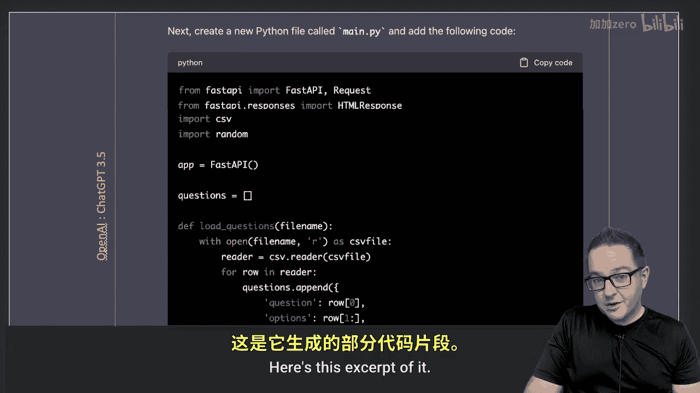
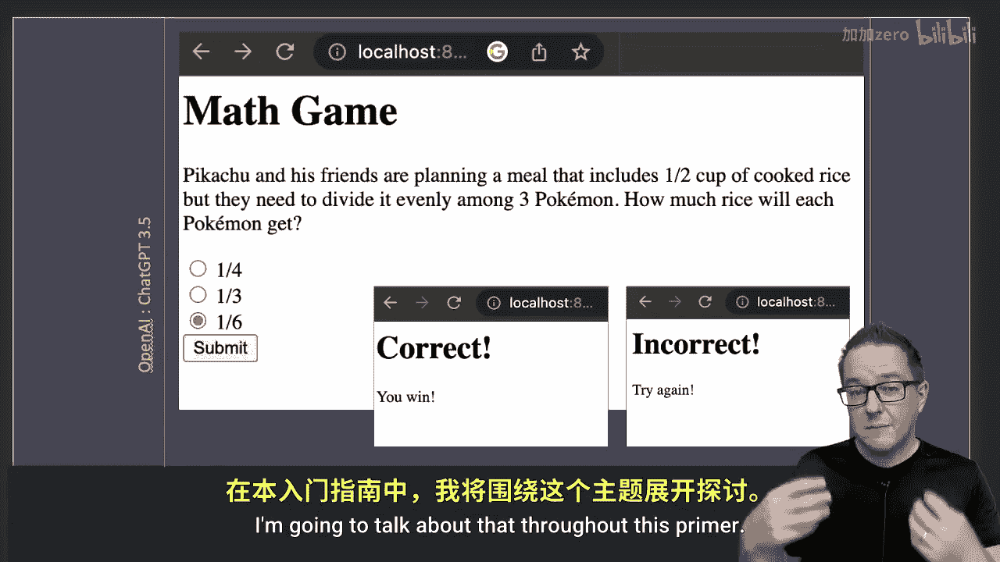

# 044：生成式AI的突破性新能力 🚀

在本节课中，我们将学习生成式AI的核心概念、其运作方式以及它如何通过对话迭代来创造和精炼内容。我们将探讨如何将生成式AI视为一个强大的协作工具，而非一个简单的问答机器。

欢迎来到生成式AI入门课程。我是朱尔斯·怀特。我是范德堡大学的计算机科学教授，也是范德堡大学未来学习与生成式AI倡议的主任。该倡议旨在确保范德堡大学在生成式AI的应用方面成为世界领导者和创新者。我将与大家探讨范德堡大学内部如何应用生成式AI，以及您应如何看待生成式AI、需要了解哪些知识、在培训员工时应考虑什么，还有它的能力及其重要性。

现在，这项技术在2022年10月之前，如果有人问我类似ChatGPT这样的东西是否会在我的有生之年出现，我会断然回答：不可能，永远不会发生，别信。我大错特错了。我想向大家展示的是其中蕴含的能力深度，以及为何这让我如此兴奋。

作为一名计算机科学家，我常常感觉自己像在通过望远镜仰望星空，承诺五年后我们将抵达那颗行星。然而有一天，当我正看着望远镜时，我回头一看，一艘UFO已经降落在了我身后。ChatGPT就是这样，它就像一项不可思议的新外星技术。当我们开始使用它时，它仿佛在地球上瞬间传送树木，并解决各种我从未想过计算机能解决的惊人问题。

因此，我兴奋地想要向大家展示并帮助大家探索所有这些能力，以一种不同于您在新闻中可能看到的方式来理解它。

现在，我想花点时间提一下，我在Coursera上教授一门关于ChatGPT提示工程的课程。截至本次录制时，已有超过15万人学习了这门课程。您将看到的很多内容都来自他们的想法和创新，这些反馈给了我启发。我将谈谈我所看到的他们在工作中的实践和创新。所以，我要特别感谢所有学习过那门课程的人以及我收到的所有反馈。

现在，每当我们开始谈论生成式AI时，都需要建立一个关于它究竟是什么的心智模型。我们到处都能听到AI这个词，生成式AI是AI的一种类型，而目前我们看到的很多兴奋点确实都围绕着生成式AI。因此，我鼓励您在谈论AI时，转而谈论生成式AI，因为生成式AI是我见过的最令人兴奋的事物之一，正是它引发了大量的热潮。

当我们开始谈论生成式AI时，很多人对其是什么、如何工作、能用来做什么并没有一个清晰的心智模型。

所以我想为您建立这个心智模型。想象一下短信，我们都知道它是如何工作的：您输入一条消息并发送出去，然后另一个人（很可能是您的朋友）会输入回复并发送回来。

生成式AI的工作原理与短信非常相似，至少我们使用的许多界面是如此。您输入一条消息并发送出去。但生成式AI不是您的朋友回复您，而是AI回复您。或者您发送一条消息，生成式AI不是您的朋友，而是创建一张照片、一段视频或一段录音发送给您。这就像发短信一样，只不过我们不再是与另一个人交谈，而是在与生成式AI交谈。

现在，每当我们开始谈论生成式AI时，了解一些基本术语很重要。您需要知道的一个非常重要的术语是**提示**。提示是您输入到生成式AI短信或聊天应用程序中的消息，是您发送给AI并等待其回复的消息。当它给您发送回复时，那个回复就是**输出**。

现在，我们在屏幕上看到了一些可能的提示示例，例如“写一首关于法国大革命的诗”。如果您有合适的朋友，他们也能写一首关于法国大革命的诗。

这些提示并不是特别好的提示，我们稍后会详细讨论，但它们都是您可以输入并发送的内容。

现在，每当我最近（自它出现以来）查看关于生成式AI的新闻时，我都感到有些沮丧，因为新闻完全没抓住重点。我想鼓励您重新思考生成式AI的可能性以及它将如何影响我们。

当我看新闻时，我看到的是：我问了ChatGPT一个可能不好或措辞不当的问题，然后得到了一个糟糕的答案，因此ChatGPT毫无用处。这是完全错误的看待生成式AI和这些工具的方式。

您应该考虑通过对话进行迭代、精炼和创造内容。您不应该只问一个问题，得到一个答案，如果答案不完美就扔掉。相反，您应该考虑得到回复后，就如何改进提供反馈，并持续精炼它。就像您有一个助手，他第一天上班交给您一些工作，但工作并不完美，您不会因此解雇他，说他太糟糕了、是个白痴然后让他走人。不会，您会与他合作，培训他，并更详细地解释您的任务要求，因为您也可能沟通有误。

那么，让我们来看看通过对话精炼内容意味着什么。

我将给ChatGPT一个任务，我认为在纳什维尔，甚至在美国，都很难找到一个人能做得这么好或这么快。

我一开始会说：让我们创建一个膳食计划，我们都需要吃饭，对吧？

“请为我的家人创建一个膳食计划，该计划基于埃塞俄比亚和乌兹别克斯坦的融合美食。我想吃生酮饮食，每天最多摄入2000卡路里。选择的菜肴食材应易于从普通的美国杂货店获取。”

这是一个非常困难的任务。我不知道能找到谁来为我做这件事，而且它有很多复杂性，比如“普通美国杂货店食材”是什么意思？谁有这方面的知识？要找到能完成这个任务的人真的很难。

那么ChatGPT怎么说？它说：“这是一个结合了埃塞俄比亚和乌兹别克斯坦风味、同时符合生酮友好且每日限制在2000卡路里以内的示例膳食计划。”这几乎是瞬间完成的。

然后它说：“早餐：炒鸡蛋配炒洋葱、西红柿和埃塞俄比亚柏柏尔香料混合物。”接着请注意它做了什么。在括号里，它写道：“用辣椒粉、红甜椒粉、大蒜粉、姜、孜然和香菜制成。”它在向我们示意，这些是您可以从普通美国杂货店买到的食材。这不是您做不了的东西，而是用普通美国杂货店食材就能制作的东西，而且这些食材都是。

现在这是一个草稿。它为我们创建了草稿输入、草稿输出，我们可以在此基础上进行加工和精炼。

如果这是在新闻里，我接下来会看到的是：“哼，这永远取代不了营养师，这是个糟糕的工具。你说每天2000卡路里，它甚至没给你份量大小，完全没用。”这是完全错误的看待这些工具的方式。

我对此的比喻是：想象有人递给米开朗基罗一把新锤子。米开朗基罗走到石头前，敲了一下石头，然后看着石头说：“呃，它看起来不像《圣母怜子》或其他美丽的雕塑。”然后他扔掉锤子，感到沮丧，说：“这是个糟糕的工具，我再也不用了。”这就是我们每天看新闻时发生的事情，那些文章荒谬至极。

不，米开朗基罗会怎么做？他拿起锤子，敲击石头，再敲一下，再敲一下，他持续使用工具在石头上精炼和迭代，直到得到美丽的输出。他也明白，他使用工具的技能同样重要，甚至更重要。他必须知道如何使用工具，必须精炼使用工具的技能，必须自我教育。他不会仅仅因为工具第一次没做对就说工具很蠢，我再也不用了。不，他不会那样做，他会迭代、精炼并与工具合作。他也明白自己是这个过程中的平等参与者。

那么，假设我们真的很关心份量大小，我们该怎么做？我们只需跟进。我们在同一个对话中问：“你能根据我每天2000卡路里的限制，为每道菜给我一个大概的份量大小吗？”

ChatGPT怎么说？它说：“当然可以。以下是基于每日2000卡路里限制的每道菜的大致份量。”现在它说：“早餐：两个鸡蛋，半杯洋葱，半杯西红柿，一茶匙香料混合物。”

现在我知道，如果这是在新闻里，接下来会是：“哼，你说生酮饮食，但那上面说半杯洋葱，那上面的宏量营养素全错了，碳水化合物太多了。”如果我们真的关心碳水化合物或宏量营养素或其他什么，我们可以继续通过后续问题来精炼和塑造内容，尝试探索并使其变得更好。

但我要换个方向，帮助您理解这个工具的能力和可能性深度。

因为宏量营养素并不是我对这个膳食计划的真正问题。就像我总会因为意志力不够而有宏量营养素的变化。

我对这个膳食计划的真正挑战是，我有一个九岁的儿子，他是个喜欢冒险的食客，但真正的挑战是让他首先愿意尝试这道菜。所以我思考了一下，我能用ChatGPT来帮我解决这个问题吗？

于是我说：“我儿子九岁，有时他不愿意尝试新菜。为了让这次烹饪冒险对他来说更有趣，你能为每道菜创作一个简短的宝可梦对战故事吗？我会在晚餐前和他一起读这些故事，让他对尝试新食物感到兴奋。确保每个故事都以一个悬念结尾，激励他去尝试食物。”

这是一个非常复杂的任务。祝您好运能找到一个人，既能生成那个膳食计划，又能为九岁孩子创作引人入胜的、带有悬念的宝可梦对战故事。ChatGPT怎么说？

“当然可以。故事：皮卡丘和他的朋友们正在探索埃塞俄比亚的荒野，突然遭到一群狡猾的宝可梦盗贼的伏击。当他们穿过茂密的丛林时，偶然发现了一个藏满宝藏的隐秘洞穴。”然后它继续说：“最后，他们取得了胜利。但在那之前，龙留下了一股炽热的香料，为他们的早餐鸡蛋注入了风味十足的刺激。您能帮助皮卡丘和他的朋友们对抗柏柏尔龙，并享用这顿辛辣的早餐吗？”

这太不可思议了。在去年11月之前，我们没有任何普遍可用的计算能力，可以让一个人直接输入指令，就能创作出激励九岁孩子吃我们刚刚想出来的一堆菜肴的宝可梦对战故事。我们拥有的任何东西都无法接近这个水平。如果我作为一名软件工程师试图编程实现它，我也做不到。

在一段文字中，我们从这个膳食计划开始，精炼了它，添加了份量大小，现在又有了与之配套的对战故事。我们还能用ChatGPT和生成式AI做什么？

我想了想和儿子在餐桌旁做什么。我们喜欢和他谈论他在学校学的东西，他喜欢数学，喜欢在iPad上玩数学游戏。我想，如果我能让ChatGPT和他玩一个数学游戏，那该多酷啊。这样当我们坐在桌旁时，他可以读宝可梦对战故事，然后玩这个很酷的数学游戏，这会让他有一次非常兴奋的体验。

于是我说：“我想请你和我九岁的儿子玩一个数学游戏，教他分数除法和营养知识。一次问他一个涉及宝可梦和这些主题的问题，把它变成一个游戏。当他赢了，宝可梦就赢了。问第一个问题。”

这开始使用一种叫做**提示工程**的技术，使这一切无缝衔接。

现在，关键点在于，我只是在进行对话，而这只是对话中的一个后续消息，它正在精炼内容并将其引向不同的方向。

ChatGPT怎么说？“太好了，让我们玩一个有趣的涉及宝可梦和营养的数学游戏。问题一：皮卡丘和他的朋友们计划一顿饭，其中包括半杯熟米饭，但他们需要平均分给三只宝可梦。每只宝可梦能得到多少米饭？”

然后它做了什么？ChatGPT做了什么？它等待。

它等待他回答，因为它知道自己在玩游戏，然后需要等待他提供输入。我们通常认为是我们向生成式AI提问或告诉它做什么，但它也可以向我们提问，向我们索取信息，并等待我们将信息反馈给它，然后再做出回应。它还理解游戏、轮流、游戏规则以及此时它需要做什么的概念，这是非常深刻的推理。

然后，当他输入正确答案（即1/6杯）时，会发生什么？

它说：“干得好！答对了。”它为他计算了数学。然后它说：“问题二：小智想制作一杯冰沙……”它继续到下一个问题，它会一直持续问他关于这个主题的问题，创造一个他可以互动的一整个游戏。请注意，我们为了创造这一切所做的，基本上就是在对话中给了它几段文字，我们持续精炼这个想法，跟进它，并发展它。

但作为一名计算机科学家，我想，他在ChatGPT里玩游戏固然很好，但如果我想把它拿出来，创建一些他可以在iPad上玩的真正可运行的软件，我能做到吗？

于是我告诉它：“让我们用Python为此创建代码。”然后我给它一些我作为程序员的领域知识，说明我想要什么。ChatGPT就去生成了代码，这是其中的一段摘录。然后这就是在浏览器中运行的软件，他可以在iPad上玩，也可以在笔记本电脑上玩。

请注意我做了什么。我基本上获取了内容，并通过对话迭代地精炼了它。我所做的只是非常、非常快地输入了几段文字。我正在发展和创建内容的不同草稿，作为人类，我可以进去使用或精炼和编辑，但我驱动着整个过程。这是我的创造力，是我的思想在驱动这个过程，但它加速了我的生产力和我的能力。

如果您回想一下我们去年的计算能力，地球上真的没有什么能触及我们刚刚看到的东西。当然，地球上没有普遍可用的东西能做到这些。

生成式AI绝对将改变我们在工作场所所能做的事情，并将改变人类所能做的事情。我将在整个入门课程中讨论这一点。

在本节课中，我们一起学习了生成式AI的基本心智模型，理解了**提示**与**输出**的关系。我们通过创建融合菜系膳食计划、添加份量、创作激励故事以及开发互动数学游戏等一系列实例，深入探讨了如何通过持续对话来迭代和精炼内容，从而将生成式AI作为一个强大的协作工具来释放创造力与生产力。关键在于，我们不应期望单次提问就获得完美答案，而应像使用任何高级工具一样，通过练习、反馈和迭代来掌握它，并利用它来扩展和增强人类自身的能力。