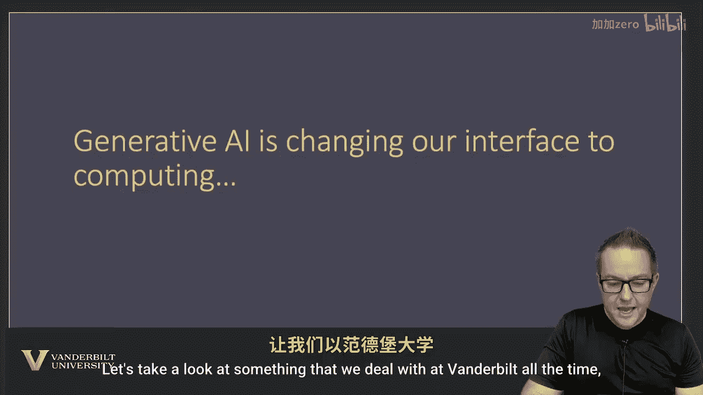
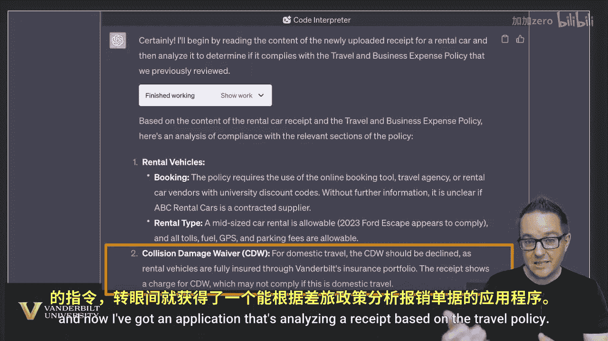
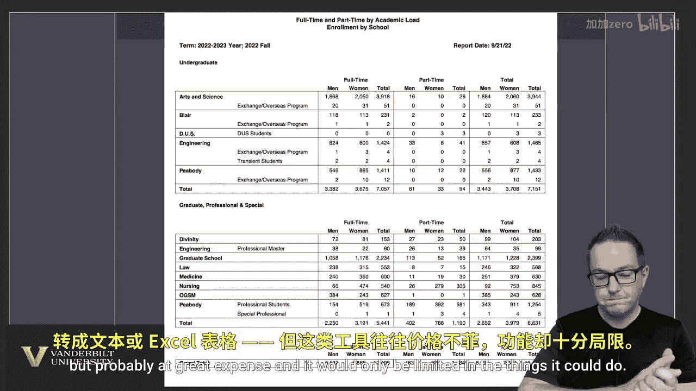
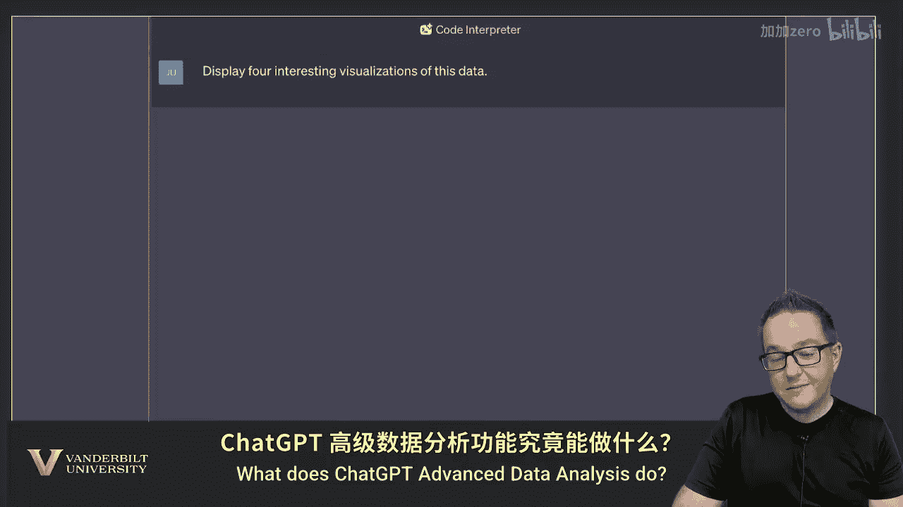
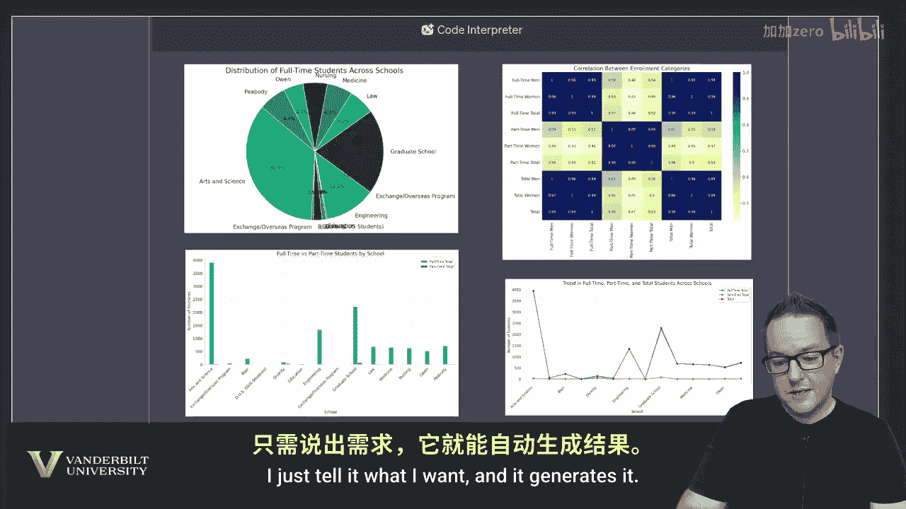
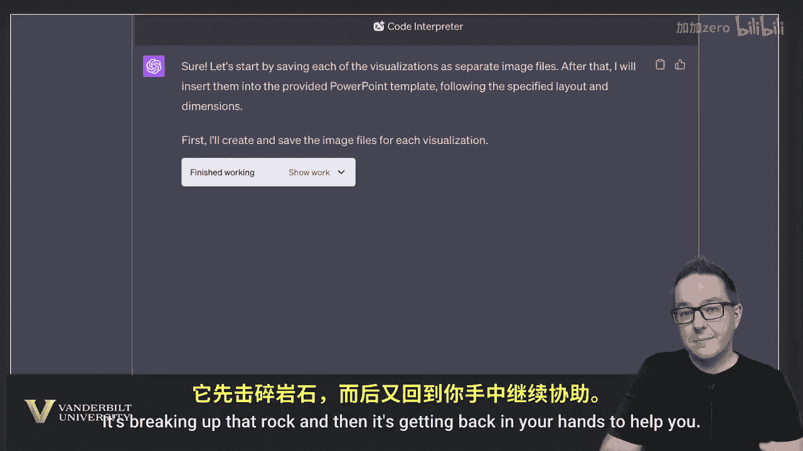
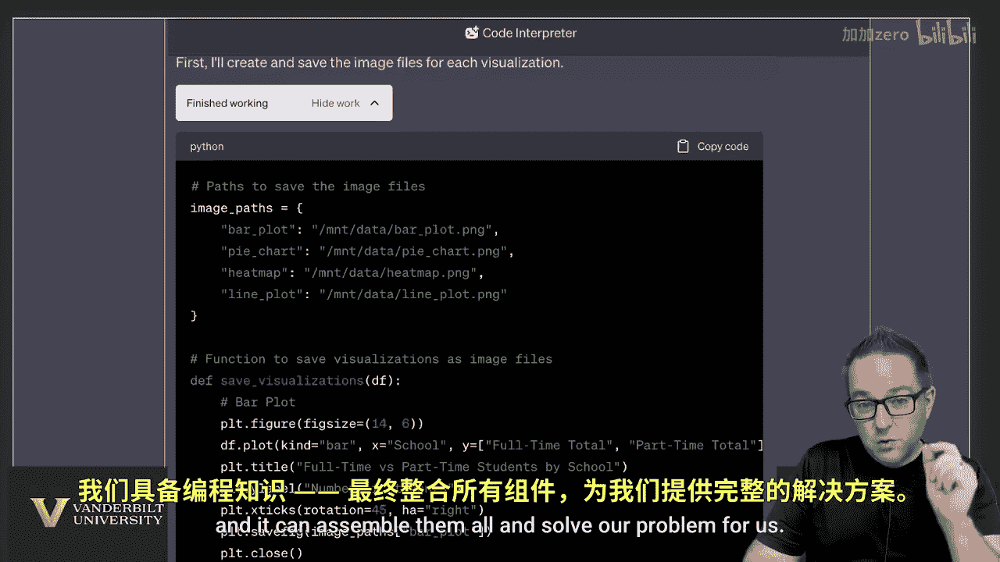

# 045：生成式AI如何重塑计算领域 🚀

在本节课中，我们将探讨生成式AI如何从根本上改变我们与计算机交互的方式。我们将看到，它正在取代传统的图形用户界面和编程，成为我们访问计算能力的新主导接口，并将极大地扩展每个人的能力。

## 从具体应用看趋势

上一节我们看到了ChatGPT生成宝可梦故事、膳食计划和软件代码等具体应用。这令人兴奋，但我们需要退一步，审视一个正在发生的、将影响每个组织和职场的大趋势。

当人们问我哪些领域将受到最大冲击时，我的回答是：**任何涉及计算机的领域**。这是因为我们与计算交互的基本方式即将改变，并且正在改变。

## 传统计算接口的局限

多年来，我们一直与图形用户界面（GUI）打交道。在GUI中，你只能做程序员预先创建好的按钮所允许的事情，你的能力受限于预先编程的功能。

或者，如果你像我一样是一名软件工程师，你可以编写源代码，编程实现任何你想要的功能。但这需要付出极高的时间和精力成本，之后还需要维护，工作量巨大。

在这两者之间，一直缺乏一种既能提供编程的灵活性，又具备GUI易用性的中间方案。而生成式AI即将改变这一切。

## 生成式AI：新的主导接口

生成式AI将取代GUI和编程，成为我们与计算交互的主导接口，并将彻底改变人们的能力范围。

让我们通过一些例子来理解这一点。

### 示例一：解读复杂政策文档

以下是我们在范德堡大学经常处理，可能你的组织也经常处理的事情：报销。

这是范德堡大学的差旅和业务费用政策，大约有20页。我必须承认我从未完整读过它。我敢打赌，你的组织里很多人，甚至可能你自己，也从未读过你们的差旅和业务费用政策。这可不是你想坐下来读的东西。

我们如何利用生成式AI来改变这一点？实际上，我确实“读”过范德堡大学的差旅和业务费用政策，但不是直接读的，而是通过ChatGPT和一个名为“ChatGPT Advanced Data Analysis”的工具来解读的。

**具体操作如下：**
1.  我将政策文件（PDF格式）上传到ChatGPT Advanced Data Analysis。
2.  我给出指令：“请阅读提供的文档，以便你能回答相关问题。”
3.  我没有进行任何编程，甚至没有将PDF转换成文本，也没有进行互联网搜索，只是上传了政策PDF。

接着，我问了一个现实中可能遇到的问题：“假设我在国外旅行，乘坐的出租车在前往一个重要会议的路上抛锚了。如果我付钱让一位私人公民用摩托车载我去会议，这笔费用可以报销吗？”

以下是ChatGPT的回答：
> “根据文档中的信息...大学要求旅行者选择最合理、最经济的交通方式。（这是文档中的直接陈述。）非常规交通方式在本政策中没有明确提及...范德堡大学没有单独的拼车政策...鉴于以上几点，在紧急情况下，如果没有其他合理且经济的交通方式可用，由私人公民摩托车产生的交通费用**可能**被视为允许的支出。然而，大学政策并未明确说明这一点，报销可能需经审核。”

这是一个非常谨慎、经过深思熟虑的回答。它从政策中提取了适当的文本部分，然后组合成一个非常合理的回应。在去年11月之前，没有任何计算工具能如此有效地做到这一点。如果你想创建这样一个工具，将需要付出巨大的努力。

### 示例二：将政策转化为可执行知识

让我们更进一步，看看这将如何变革计算。

如果我想知道一张收据是否符合政策怎么办？我上传了一份PDF格式的租车收据，并说：“请分析附件中的收据，并告知我它是否符合规定。”

这是一个完全不同的任务。这不仅仅是总结与问题相关的信息，而是要求：理解政策，将其转化为可执行的知识或信息，并将其应用于一张收据。

ChatGPT Advanced Data Analysis回复：
> “对于国内旅行，碰撞损害免赔额（CDW）应被拒绝，因为租赁车辆已通过范德堡大学的保险组合全额投保。收据显示收取了CDW费用，如果是国内旅行，这可能不符合规定。”

这具有变革性。在生成式AI出现之前，我该如何解决这个问题？我会去编程。我会编写一个庞大的规则引擎。这不会只是我一个人的工作，而是一个团队在努力编程，试图创建一个能应用所有不同规则的应用程序。你的组织中可能也有类似的东西，试图自动化部分流程，但这做起来既困难又费力。

而我是如何创建这个“应用程序”的？我没有编程。我只是给了它文档和正确的提示，然后又给了它第二个文档和第二个提示。现在，我就有了一个能基于差旅政策分析收据的“应用程序”。这是一种根本性的变革能力。

### 示例三：让数据分析触手可及

让我再举一个例子，说明生成式AI在如何访问计算以及计算如何对每个人变得可及方面，具有变革性能力。

我们一直有程序员，他们可以通过编程做任何想做的事，只需要投入时间和精力。但其他所有人都无法获得计算中同样的灵活性和能力。

这是范德堡大学关于各学院课程注册情况的报告，是一个PDF文件。

在这些生成式AI工具出现之前，如果我需要研究或处理这个PDF，我可能不得不从PDF中剪切粘贴到Excel等工具中，然后尝试计算或绘制图表来分析。这将需要大量的手动劳动和精力。

作为程序员，也许我可以通过编写定制软件来自动化这个过程，或者找到一个特殊的工具，能将PDF中复杂的表格转换成文本或Excel表格，但这可能代价高昂，并且功能有限。

**生成式AI能做什么？**

1.  **提取数据**：我将教学注册报告上传到ChatGPT Advanced Data Analysis，并说：“请将此PDF的每一页提取为单独的文本文件。”它照做了，我可以点击每个链接下载。以前要做到这一点，我需要使用专门的工具来提取所有页面并进行转换，或者手动点击一堆按钮。
2.  **转换为结构化数据**：我可以说：“将其中特定一页转换为Excel文件。”然后我得到一个链接，可以下载该页面上所有已转换为Excel格式的数据。如果我手动操作，将花费大量时间；如果编程实现，则需要高度定制化。
3.  **自动生成可视化**：为什么还要在Excel中操作呢？当我使用这个新的计算接口时，它给了我各种全新的能力。在同一个对话中，我直接跟进说：“展示四个有趣的数据可视化。”请注意，我没有告诉它要可视化什么、用什么坐标轴、什么颜色、从数据中提取哪些列。我只是告诉它：“给我四个有趣的东西”，因为我想探索这些数据。作为一个人类，我希望花更多时间思考数据、分析并试图传达我的信息，而不是花时间从PDF复制粘贴到Excel文件。我想真正加速我的思考过程。于是，ChatGPT Advanced Data Analysis为我生成了四个可视化图表。

现在我可以查看这些可视化图表，决定我想做什么，思考它们对我意味着什么。这非常强大。我不需要编程，不需要剪切粘贴到Excel，也不需要知道如何在Excel或其他工具中操作来创建这些图表。我只需告诉它我想要什么，它就能生成。

4.  **自动生成演示文稿**：我进一步思考，如果我生成这些可视化图表，很可能是因为我要做演示。如果它能把这些图表变成PowerPoint幻灯片不是更好吗？于是，我回到ChatGPT Advanced Data Analysis，上传了一个PowerPoint幻灯片模板，然后告诉它：“将每个可视化保存为图像，然后将这些图像作为单独的幻灯片插入到附件的PowerPoint中。”我还给出了一些额外的提示，让图像在幻灯片上位置正确，并在图像旁边添加一个描述其内容的文本框。

它生成了我的PowerPoint文件，我可以点击下载链接获取。这是我的PowerPoint文件，请注意，这正是我本次演示使用的同一个模板。它已经将每个可视化图表作为单独的幻灯片插入到我的PowerPoint演示文稿中，并在可视化图表旁边放置了描述其内容的文本框。

现在，我可以把时间花在思考我的演示、我的信息、分析重点是什么上，而不是在这些繁琐的任务上花费更少的时间。这是一种真正具有变革性的能力，将对工作场所产生巨大影响，并且将远远超越PowerPoint文件和Excel。

## 变革的核心：AI能为自己创建工具

为什么说这具有变革性？因为你刚才看到的远比你以为的更具变革性，我想谈谈原因。

当我使用这个工具时，它做了一些全新的事情。想象一下，你在后院，拿着铲子准备挖洞。就在你要挖之前，你的铲子低头看到你要挖的地方有块石头。于是，铲子从你手中跳出来，把自己变成了一把镐，敲碎了石头，然后又跳回你手中，你继续挖。这正是这个工具刚才所做的：它为自己创建了另一个工具，来解决它需要为你解决的问题，然后它又“跳回”你手中，为你创建了那个PowerPoint演示文稿。

**这是一个生成式AI工具可以为自己创建其他工具以帮助完成任务的能力。**

当我说“去创建PowerPoint演示文稿，并将这些图像作为单独的幻灯片插入”时，我们看到这里弹出一个小灰框，上面写着“已完成工作”。

这就是生成式AI在为自己构建工具。它正在动态地为自己构建一个工具来帮助你解决问题，然后使用自己的工具解决问题的一部分，再回来继续这个过程。这就像预见到你铲子路上的石头，它为自己造了一把镐，敲碎了石头，然后回到你手中帮助你。

它构建的工具是软件。当我们展开那个“已完成工作”的小框时，我们看到的是一个Python程序，它是动态编写的，允许它生成PowerPoint演示文稿和那些数据可视化的图像。**它正在动态地为你创建软件，以帮助你解决问题。**

## 总结：新接口，新可能

我们习惯于将GUI视为与计算交互的方式，但这即将改变。我们将能够超越编程，超越GUI，转向一种更有意义、让计算更易访问、并极大加速我们创新和做事速度的方式。

因为我们可以创建一个工具，当我们告诉它“这是我想解决的问题”时，它可以开始构建解决该问题所需的所有软件片段，而无需我们知道如何编程。它可以组装所有这些片段，为我们解决问题。这将彻底改变我们利用计算所做的事情。

因此，正在发生的真正创新是：**生成式AI正在取代GUI，并正在取代编程，成为我们与计算交互的主导接口**。我们仍将拥有大量程序员，计算机科学家需求依然旺盛，GUI也仍将存在。但我们将拥有一个新的接口——生成式AI——它将迅速接管许多任务，并极大地扩展我们的能力，扩展我们在计算方面能做的事情，以及普通用户在没有计算机科学专业知识的情况下能做的事情。

本节课中，我们一起学习了生成式AI如何通过成为新的计算接口来重塑整个领域。我们看到了它如何解读文档、应用规则、分析数据、创建可视化甚至生成完整演示文稿，而这一切都无需传统编程。其核心在于，AI能够动态创建工具（软件）来解决特定问题，这标志着我们与计算机交互方式的一次根本性转变，将使计算能力对每个人都更加民主化和强大。