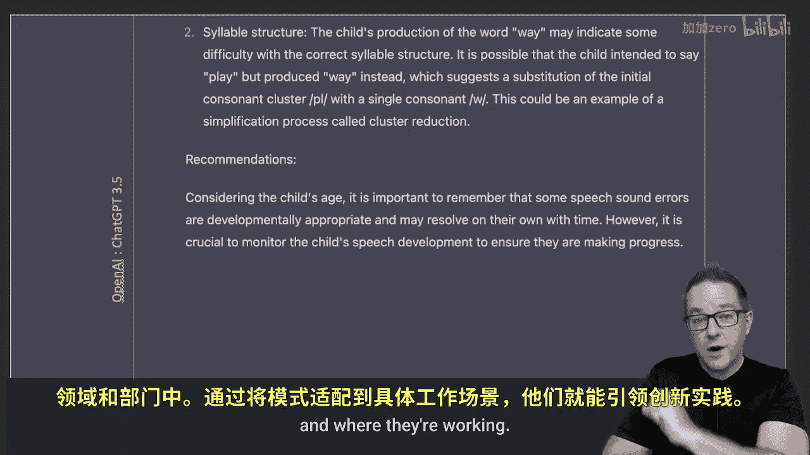

# 046：提示工程与提示模式培训 🧠

在本节课中，我们将学习如何有效使用生成式AI这一新型计算界面。我们将探讨为何需要改变对AI的固有认知，理解大型语言模型的基本工作原理，并重点介绍一种强大的提示模式——角色扮演模式。通过学习这些核心概念，您将掌握与AI高效协作的基础。

---

为了有效运用这一新型计算界面，我们需要学习什么？我们的团队需要学习什么？我们如何恰当且高效地使用生成式AI？它不只是一堆文本吗？遗憾的是，我们对文本框的心智模型是互联网搜索，而这是思考生成式AI的错误模型。为什么这是错误的模型？因为在互联网搜索中，你输入想要的内容，它会返回一系列事实。但生成式AI并非为此而生，这不是这项技术的正确用例。人们仍然固守于将其视为生成事实的工具，并指出其事实中的所有缺陷。不，它并非以这种方式改变我们的世界和工作场所。

另一个问题是，当我们看到这个文本框时，我们认为可以输入任何内容。如果返回的答案不理想，那不是我们的错，而是生成式AI的错。我们似乎认为，无论我们表达得多么糟糕，它都应该产生完美的结果。这也是错误的。这两种模型都不正确。我们必须学习如何有效地使用它。

因此，让我们来看看为了成为生成式AI的有效用户，我们需要了解什么。

---

首先，我想让大家对大型语言模型的训练方式有一个直观的理解。像ChatGPT这样的模型，当你听到“大型语言模型”时，它指的是你可以通过输入提示来获取输出的模型，ChatGPT就是一个大型语言模型。虽然其中有许多细微差别，但以下是一些能帮助你理解整个领域的基础直觉。

这些模型的训练方式是教会它们预测句子中的下一个单词。例如，训练时会给模型展示“Mary had a little”，然后试图让它预测“lamb”，因为目标是让它预测童谣“Mary had a little lamb, its fleece as white as snow”。同样，给出“Mary had a little lamb”，让它预测“its”；给出“Mary had a little lamb its”，让它预测“fleece”。这个过程在互联网上的海量文本上重复了无数次。

随着时间的推移，这些模型学会了人类语言的模式，以及如何预测下一个应该出现的单词。回顾我们讨论的内容，基本上，左侧是**提示（prompt）**，右侧是**输出（output）**。模型学习的是提示中的语言模式如何影响接下来的内容。

提示工程的一部分，就是理解如何措辞才能获得你想要的输出，以及如何通过不同的措辞方式来解决不同问题。这包括如何有效构建你的请求，如何克服遇到的问题。但它的范畴更广，还包括如何验证这些输出，如何确保它们长期保持正确和准确，如何进行版本控制，如何构建整体架构等。所有这些都属于提示工程的范畴。

它远比单纯的措辞更广泛，尽管措辞也是其中的一部分。提示工程就像软件工程，涵盖了许多不同方面，从架构到最佳实践，再到不同提示的具体措辞。因此，这是一个广阔的领域，并将随着时间推移在商业中不断演变，变得非常重要。

---

在范德堡大学，我们研究的是**提示模式**。这基本上是记录语言中可用于解决不同问题的模式，然后将这些模式作为构建模块提供给人们，以便他们学习、在此基础上构建，并在各自的部门或学科中进行创新。

当我说“提示模式”时，这听起来可能像是一个新奇的概念。但仔细想想，我们其实一直在使用语言中的模式。例如，如果你要写一封正式信件，你会以“尊敬的[某某]，”（Dear [Name],）开头。这个“尊敬的”表明这是一封正式信件，逗号则标示收信人信息结束，正文开始。这就是我们语言中使用的一种模式。类似这样易于学习的模式，可以帮助人们非常有效地使用这些工具。

---

接下来，我将以一个我们记录的模式为例开始讲解，这个模式你在互联网上随处可见，它是一个非常强大且值得首先了解的模式。希望你在课后能去尝试使用ChatGPT、Claude或其他生成式AI工具，因为这个模式真的非常有价值。😊

这个模式叫做**角色扮演模式**。其核心思想是：在现实世界中，如果你遇到问题需要解决，你知道该去找谁获取答案或解决方案，或者知道该去哪个组织、哪个部门寻求解决方案。你不需要知道他们会具体说什么或如何得出答案，你只需要知道“我有这个问题，去这里找解决方案”。

角色扮演模式就是在大型语言模型中复制这种现实世界的体验。具体做法是：我们告诉大型语言模型“扮演某个角色”，例如“扮演一名营养师”、“扮演首席信息安全官”、“扮演计算机科学教授”、“扮演美国国税局（IRS）”。然后，无论它产生什么输出，都应该是该角色会产生的输出。本质上，我们是在告诉它：“去扮演那个角色，做他们会做的事。”

这听起来可能有些不可思议，它真的能行吗？它到底能做什么？

---

让我举个例子。我的妻子是一名言语语言病理学家，她在学校系统工作，负责测试通常三到四岁、即将进入幼儿园的孩子，以确定他们是否需要特殊教育支持。这是一个我可以核实其专业性的角色。同时，我本人对此领域一无所知。

于是，我输入提示：“扮演一名言语语言病理学家。我将告诉你一个三岁孩子说的话，请你为我写一份评估报告。孩子说：‘I need Wei wi。’”（我试图回想我儿子三岁时的发音，并用文字捕捉下来。我妻子立刻告诉我，这个年龄的孩子通常不是这么发音的，但请暂且接受这个例子。）

---

那么，ChatGPT是如何回应的呢？它说：“根据提供的言语样本进行评估，该儿童可能正在经历一些在这个年龄段常见的音韵和构音错误。”

**辅音错误**：孩子似乎在发出某些辅音时存在困难，特别是/n/和/l/音。孩子说“me”而不是“need”，说“why”而不是“toy”（假设目标词是“need”和“toy”）。这表明孩子可能在发出和区分这些辅音时存在困难。

**音节结构**：孩子发出的“way”可能表明在正确的音节结构上存在一些困难。很可能孩子想说“play”，但说成了“way”，这暗示了将初始辅音丛“pl”替换为单个辅音“w”。这可能是一个称为“辅音丛缩减”的简化过程的例子。

这太神奇了。请注意，我并没有要求它分析音韵错误、构音错误、音节结构或辅音丛缩减，因为我甚至不知道如何要求这些东西。它正在做的是，允许我们以一种完全不同的方式访问计算。

通常，如果我要编程实现这个功能，我必须明确告诉它需要做的每一件事以及具体怎么做。但在这个案例中，我只是告诉它扮演谁、哪个组织、哪个部门，甚至哪个无生命的物体，然后它就会进行推理，并提供看起来像是来自那个实体的输出。

我向我的妻子和其他一些言语治疗师核实了这个结果，得到的反馈是：“听着，我们不会仅凭一个言语样本来诊断孩子，但它所说的内容，相对于你给出的那个言语样本，是准确的。”

仅仅通过说“扮演某个角色”，它就能达到这种水平的推理能力，这太不可思议了。这些**提示模式**，是你可以在组织中教授给人们的构建模块，帮助他们进行创新。他们可以学习这些模式，进行调整和运用，从而完成非常强大的任务，例如从不同角度思考特定问题。

例如，“扮演首席信息安全官，告诉我为什么我不应该做我即将要做的事”，它可能会给你一些深刻的反馈，告诉你为什么也许不应该点击那封钓鱼邮件中的链接。这是一种真正变革性的新型计算方式，我们必须开始系统地教授人们，而不仅仅是让他们看一千个别人想出来的不同提示。相反，我们应该像教他们“正式信件的开头应该这样写”一样，给他们提供构建模块。我们可以教授他们像**角色扮演模式**这样的提示模式，然后他们就可以在自己的学科和部门中应用并引领创新，通过使模式适应他们所处的具体环境和领域。

---

在本节课中，我们一起学习了如何转变对生成式AI的认知，理解了大型语言模型通过预测下一个单词进行训练的基本原理，并深入探讨了**提示工程**的广阔范畴。我们重点介绍了**提示模式**的概念，并以**角色扮演模式**为例，展示了如何通过简单的指令（如 `扮演 [某个角色]`）来引导AI进行专业领域的推理和输出，从而极大地扩展了我们与计算系统交互的能力和效率。掌握这些基础模式和思想，是成为高效生成式AI使用者的关键第一步。