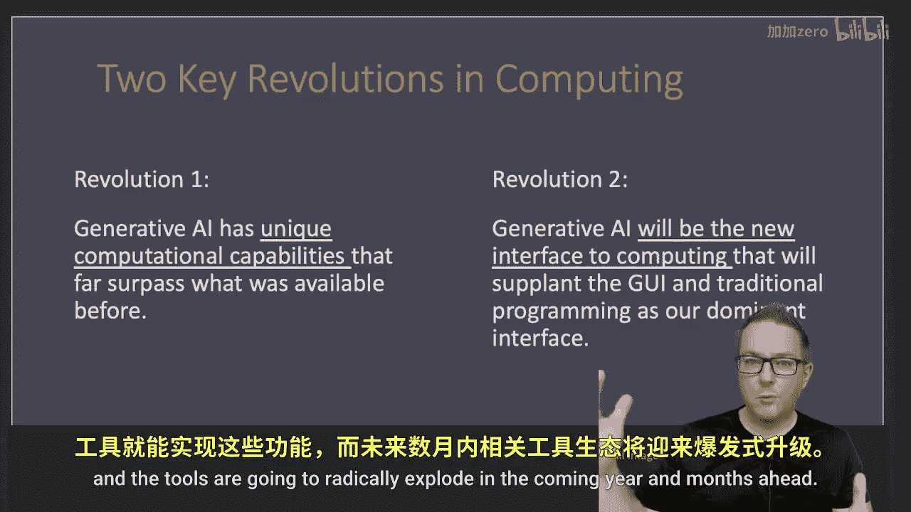

# 047：人人都能用提示词编程 🚀


在本节课中，我们将探讨生成式AI如何从根本上改变我们与计算机交互的方式。我们将看到，通过简单的自然语言提示，任何人都可以“编程”，创造出有用的工具和自动化流程，而无需编写一行传统代码。

---

## 从自然语言到结构化数据 📊

上一节我们强调了生成式AI将改变人机交互的界面。本节中，我们来看看它如何改变我们所能完成的任务类型。

传统编程需要我们使用Python等语言编写源代码。但在生成式AI的帮助下，我们甚至可以从零代码开始“编程”。这意味着，每个人都可以通过提示词进行编程。

以下是一个基本程序的创建过程：

1.  **定义程序规则**：我输入提示：“`每当生成输出时，请将其转换为逗号分隔值列表。`”
    *   逗号分隔值列表是一种描述表格数据的格式，类似于Excel中的数据，由逗号分隔的列组成，例如：`姓名, 角色`。

2.  **运行程序**：在对话的后续提示中，我输入程序要处理的数据：“`我的名字是Jules White，我正在教授一门关于提示工程的课程。`”

3.  **查看输出**：生成式AI（此处为ChatGPT）回应：“`姓名, 课程
    Jules White, 提示工程`”
    *   这正是一个CSV列表。我刚刚编写了一个程序，它能将我输入的下一条提示转换为可以复制粘贴到文件并导入Excel的CSV格式。

请注意，我并没有编写复杂的编程指令，也没有详细说明如何操作。我甚至没有在程序规则中指定列名（“姓名”和“课程”），只是在对话中提到了它们。AI自动推断出需要生成一个有效的解决方案，并进行了正确的语义映射。这种能力在以往是极其复杂和难以实现的。

---

## 动态修改与增强程序 🔧

现在，假设我不只想要“姓名”和“课程”两列。

我可以简单地修改我的程序。在对话中，我添加一条新指令：“`从现在开始，逗号分隔值列表的列应为：姓名，课程，角色。`”

然后，我再次输入完全相同的数据：“`我的名字是Jules White，我正在教授一门关于提示工程的课程。`”

这次，AI的输出变为：“`姓名, 课程, 角色
Jules White, 提示工程, 教师`”


我通过自然语言修改了程序，并用同一个输入运行了新程序，得到了不同的输出。我们完全可以通过提示词本身来编程并实现复杂逻辑。

让我们进一步修改程序。我添加指令：“`除了我输入的内容外，请生成符合我所要求的CSV格式的额外示例。`”

这是一个非常困难的任务。在这些工具出现之前，生成符合指定格式的额外合成数据是极其困难的。现在，我们不仅是在编程，更是在利用一些前所未有的复杂计算能力，并且仅通过文本就能实时完成。

再次运行程序后，输出不仅包含我的原始信息，还生成了一系列符合格式的合成数据。这在能力上是完全变革性的。

---

## 构建一个实用的个人应用：邮件加速器 📧

为了让概念更具体，我们来看一个更贴近生活的例子：如何处理周末积压的长邮件线程。

我将使用提示工程编写一个程序来解决这个问题。


以下是我输入的提示，它定义了我的“邮件加速器”应用：
```
充当我的个人助理。当我给你一个长邮件线程时，你将为我创建一个带编号的问题和待办事项列表。
如果我输入一个编号，你将用一段话总结邮件链中围绕该编号的对话。
如果我输入一个编号和一个段落数，你将为我起草一封包含那么多段落的回复供我审阅。
```

我创建了一个完整的小应用程序，甚至包含一个菜单系统。我所做的“编程”只是清晰地用一段文字解释了我想要什么。

接下来，我复制粘贴了一个关于安排生成式AI课程的非常长的邮件线程（涉及多位教员和行政人员）。

AI分析后输出：“`以下是基于邮件线程的问题和待办事项列表：
1. 建议的课程标题和描述是什么？...
...
7. 教室和日程最终确定了吗？（周二、周四 9:30，ESB 048房间）`”

它从复杂的对话中提取出了真实的关键信息。要手动找出所有这些信息需要花费很长时间。


现在，我使用我内置的菜单系统。我输入“`7`”，要求它总结关于第7条（教室和日程）的对话。

AI回复：“`在邮件线程中，团队讨论了课程的教室和日程...Shiro建议了周二、周四上午9:30的时间段，当时唯一可用的房间是工程与科学楼048室（容量60人）。Jules批准了这个选择。Cho提到这个大小对于课程的首次运行很合适。对话没有提供关于教室和日程的进一步细节，因此看来团队已达成一致。`”

这非常强大。它不仅说明了谁说了什么，还通过推理指出“因为没有人提出反对或进一步讨论，看来团队已达成一致”。这是一个极其复杂和高级的任务。而我是如何实现的？仅仅是通过一段解释程序的文本——我用提示词完成了编程。

---


## 总结与展望 🌟

本节课中，我们一起学习了如何通过提示词进行“无代码编程”。

生成式AI将带来两大计算革命：
1.  **独特的新计算能力**：例如，从非结构化文本（如“我叫Jules，我教提示工程课”）中正确提取并语义映射到CSV列；或者理解邮件上下文并推断出“团队已达成一致”。这些是以往难以实现的高级能力。
2.  **全新的人机交互界面**：我们可以用自然语言以全新的方式控制计算。我们既可以生成程序源代码并运行，也可以直接在提示词中编写完整的应用程序，完成诸如总结邮件等对自己有用和有价值的任务。



目前，我们仅用非常简单的工具就实现了所有这些功能。在未来的几个月和几年里，相关工具将会爆炸式发展，带来更广阔的可能性。