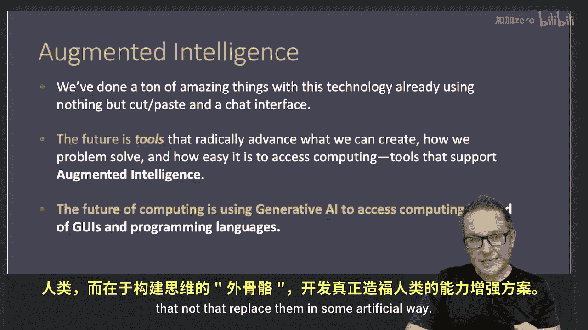

# 048：增强智能的ACHIEVE框架 🧠


在本节课中，我们将学习一个名为ACHIEVE的框架。这个框架旨在指导我们如何正确使用生成式AI，以实现**增强智能**，即放大和增强人类的创造力与解决问题的能力，而不是用人工智能替代人类。

---

## 概述：从替代到增强

我对生成式AI的发展方向有一个充满热情的愿景。这个愿景的核心不是试图**替代**和**排挤**人类的人工智能，而是关于**增强智能**。在增强智能中，我们放大和增强人类的创造力与解决问题的能力，本质上赋予人们新的能力。它就像是思维的**外骨骼**，可以放大你内在的人类火花，让你能够创造和完成比以前更有趣的事情，而不是夺走你的本质。它让我们有更多时间进行批判性思考，创造以前无法创造的新奇事物，并有更多时间与他人互动，保持人性。我认为这才是其真正的潜力，而不是去取代人类。从这个角度出发来对待生成式AI至关重要。

因此，我将提供一个框架来思考如何恰当地使用生成式AI。我使用的这个框架叫做 **ACHIEVE**。

---

## 理解ACHIEVE框架

ACHIEVE框架是我创建的，旨在帮助思考如何以正确的方式使用AI，以实现增强智能的愿景，而不是试图用人工替代品来取代我们。我们已经看到，各种人造事物并不能真正替代真实的事物。

ACHIEVE框架涉及几个关键方面，它关乎我们如何利用这些新能力：

*   **A - 协助人类协调**
*   **C - 削减繁琐任务**
*   **H - 提供安全网**
*   **IE - 激发更好的问题解决与创造力**
*   **V - 助力伟大想法快速扩展**

接下来，我将通过一个具体案例来逐一解释这些方面的含义。


---


## 案例背景：策划一场大学教师研讨会

我将通过一个例子来说明。假设我们要设计并主办一场大学教师研讨会，需要召集一批参与者。我们需要解决和处理一系列不同的问题：如何与参与者沟通、如何规划研讨会、处理意外问题（如儿童看护）、以及后续如何跟进并与他们保持互动。

我们将看到许多现实世界中的问题，并运用ACHIEVE框架内的生成式AI来解决它们并产生影响。

---

## A：协助人类协调 🫱🏻‍🫲🏼


我们通常不认为这些工具能帮助人类，但它们确实可以在协助我们彼此协调方面发挥巨大作用。

假设我已经记录了第一次规划会议的录音，并整理了会议纪要。这可以是一个虚拟会议的原始转录稿，也可以是我手动输入的笔记。

现在，我可以对AI发出指令：
```prompt
扮演我的个人助理，阅读以下会议记录，并为我提供讨论要点的摘要。
```
AI会阅读并生成摘要，这本身就有很大价值。

但为了更好实现人类协调，我可以做更重要的事情。我可以告诉它：
```prompt
列出计划中任何团队应该解决的模糊之处。
```
作为人类，我们经常制定计划，但计划往往存在模糊性。由于不同的人对同一件事有不同的理解，这会导致协调不畅和问题。能够识别模糊点是一件非常重要的事。你可以想象在会议结束时，输入会议记录并询问：“嘿，这里面有什么模糊的地方？我们来讨论一下。”或者提前审阅一份规范或计划，获取关于可能存在的模糊点的反馈。


如果AI说错了怎么办？这没有坏处，事实上是好事。作为一个团队，我们会讨论：“它说这里模糊，我们认为是这样吗？为什么？” 这样我们就能对所做的事情有更深入的了解，并确保没有遗漏什么。这相当于为我们的协调工作增加了一双眼睛。

例如，AI可能会指出：“7月研讨会的确切注册人数未在记录中提供。此信息对规划和后勤至关重要。” 或者“没有为John提交审阅草稿设定明确的截止日期，这可能导致延误或沟通不畅。” 它通过阅读笔记和计划，找出计划中不明确的具体事项。


我们还能用它做什么？我们可以思考谁应该跟进这些模糊点。例如，我们可以说：
```prompt
谁应该跟进列出的每个模糊点？
```
如果我们有记录了谁说了什么的转录稿，它可以告诉我们。例如，对于“7月研讨会注册人数”这个模糊点，AI可能会建议：“Sam Gray（被直接问及此事的人）应向Daniel Brown提供此信息。” 对于“草稿审阅截止日期”，它可能建议：“最初要求更新的Riema Myster应为John Burke设定一个明确的截止日期。”

这样，它就开始帮助我们作为一个团队更好地协调，思考模糊之处并解决问题。

---

## C：削减繁琐任务 ✂️

我们每天花费大量时间在处理那些可能并非最佳利用我们批判性推理和创造力技能的事情上。坦率地说，很多时候，正是这些任务让工作难以应对，甚至让人想要离职。

那么，我们如何用它来削减繁琐任务呢？在规划这个研讨会时，我们创建了一份调查问卷，允许参与者自由填写他们目前如何使用ChatGPT以及任何他们想分享的内容。


作为将要主持研讨会的人，我可以手动尝试将这些信息剪切粘贴到不同的受众分组中，试图弄清楚谁以不同的方式使用它，并进行所有分析。但这需要大量工作。


所以，我上传了调查回复，并说：
```prompt
这是注册我们提示工程与ChatGPT研讨会的人员名单。描述此文件中的数据。
```
然后我继续跟进：
```prompt
注册表中有一个问题是‘您目前如何使用ChatGPT/Bard/Claude等？’。你能将其转化为使用类型列表，并将回复分组到这些类型下吗？
```
我要求它查看那些自由文本回复，进行分类，并将人们的回复分组到不同类别下。

它返回的类别可能包括：“尚未使用”、“完全不使用”，并自动将所有不同的回复分组到不同类别下。我本可以手动复制粘贴、想出这些类别并手动完成，但我希望把时间花在思考我的受众以及如何最好地与他们沟通上。

然后，我可以思考其他分组方式，并快速让它重新分组一切，以便我从不同角度查看。这是该工具的真正优势之一：我可以快速查看不同的分组方式。在此之前，这需要花费大量时间、繁琐的剪切粘贴和重新组织，以至于我不会探索多种不同的受众细分和理解方式。但现在，我只需说：“再给我三种可能的分组方式。” 它可能会说：“好的，这是按具体任务分组：未使用、写作与沟通、编码与开发、研究与教学。” 然后我可以跟进查看这些分组和个别回复，并让它整理所有内容。


关键在于，它让我作为人类有更多时间去思考如何与这些其他人互动。它消除了繁琐的任务，让我有更多时间处理真正重要的事情。

---

## H：提供安全网 🛡️

我们可以做的一件非常强大的事情是提供安全网。作为人类，我们总是担心犯错，我们希望尽量减少犯错的可能性或能够及时发现错误。

我想到的一件事是，我要去展示这些材料，我之前曾向不同的受众展示过。也许我之前是向一群计算机科学教授展示的，因此他们会熟悉不同的术语。我不希望开始演讲后，才意识到我使用了所有这些没有定义的术语，犯下在前10张幻灯片就失去听众的错误。

因此，我将我的120张幻灯片上传到ChatGPT的“高级数据分析”功能中，然后说：
```prompt
阅读我的前10张幻灯片，并告诉我我使用了哪些技术术语，这些术语我可能没有定义，而制造业商业高管受众可能不熟悉。
```
对于那个特定受众，它返回了一些可能的术语。它在我的演示方面为我提供了一个安全网。现在，也许我不会失去我的听众，因为它让我从另一个视角审视内容，指出其中可能我没有定义、可能需要更多解释的术语，因为我的受众发生了变化。


或者，让我们看看在协调和安全网方面我们能做的另一件事。这在构建软件时是一个大问题，但在其他领域也存在。问题是：我们正在处理一个问题，两个团队独立处理问题的不同部分，但当团队汇合时，他们意识到做出了相互冲突的决策。在软件中，这意味着我们无法整合两部分，或者软件的两部分无法协同工作，从而浪费了时间、精力和金钱。在这个研讨会的案例中，也许我们有两个团队，一个负责后勤，一个负责整体规划，他们做出了冲突的决策，这可能是个问题。让我们尝试解决这个问题。

我说我将上传第二个团队的会议记录：
```prompt
负责研讨会后勤的第二个团队刚刚开完会。这是他们的会议记录，请指出该团队与另一团队在决策上的任何潜在冲突。
```
它返回并指出：“场地大小与布局：后勤团队建议使用大学主礼堂进行会议，这与最初计划在较小场地（可能是B会议室）进行的计划相冲突。” 以及“IT要求：后勤团队列出的必要设备包括高分辨率投影仪、多个无线麦克风、良好的音响系统和几台笔记本电脑。这与初始团队的IT要求相矛盾，后者可能是基于较小的房间设置。”

现在，它不仅在帮助我们捕捉像演示文稿这样的个体错误，还帮助我们捕捉可能产生重大影响的协调性潜在错误。这帮助我们作为人类做得更好。我喜欢在我的错误成为问题之前就被发现，比如在我开始演讲之前，或者在我们意识到预订了错误的房间之前。


---

## IE：激发更好的问题解决与创造力 💡


这是从我的角度来看最重要的部分，它关乎激发人类更好的问题解决能力和创造力。

我们经常听说AI存在偏见。但我们人类本身也存在极大的偏见，并且实际上是我们产生了导致AI训练数据存在偏见的数据。有趣的是，如果使用得当，它可以帮助我们克服自身的一些偏见。例如，我们在解决问题时存在偏见：我们知道一种解决问题的方法，就会自动尝试用这种方法解决每个问题。我们在数据确认上存在**确认偏差**，我们会查看数据，并试图看到我们想看到的东西。

因此，生成式AI的用途之一是帮助我们跳出思维定式，更具创造力，并激发新的方式和解决方案。

我们的研讨会遇到了一个有趣的问题：我们需要提供儿童看护服务。通过查看自由文本表单的受众细分，我们意识到（参与者的）孩子都是四年级学生，而且他们都对宝可梦感兴趣。那么，我们能否围绕家长学习的内容，创建一些针对这个年轻受众的有趣内容呢？

所以我们说：
```prompt
请提供三个不同的90分钟课程计划，用于向四年级学生教授大语言模型概念，使用宝可梦示例和动手练习。
```
它返回了不同的课程计划，例如：“什么是大语言模型及其工作原理？想象一个游戏：你描述一个宝可梦，我必须猜出你在想哪一个。你的描述越好，我就越容易猜中。强调大语言模型是类似的：它试图根据已经看到的单词来猜测下一个单词。”


它所做的是给我们提供可以激发灵感的想法。我们不会直接采用它们。我们会将它们视为草稿输出，然后我们作为人类进行回应。我们编辑、改进它。事实上，这是你作为使用者需要知道的最重要的事情之一：**你必须与之互动**。你必须将其视为草稿，并加以改进、迭代和加工。你必须将你的思考和创造力注入这个过程。否则，你可能会被自动化淘汰。如果你所做的只是复制粘贴测验问题并获取答案来作弊，从长远来看，你将不具备就业能力。但如果你能以创造性和有趣的方式与工具互动，如果你将输出视为草稿并打算编辑、完善和改进它，这就是你需要具备的使用哲学。我们需要鼓励人们拥有这种哲学：不要只看表面价值，要真正审视它，理解是否存在缺陷，努力改进它，然后变得真正具有创造力和洞察力，用它来解决更大更好的问题。

让我再举一个例子。我有这120张幻灯片，我上传了它们，并要求它进行总结。

但在总结完成后，我要做一件非常有价值的事情。我会说：
```prompt
扮演一个对我演示中所有内容都持怀疑态度的人。找出我的假设、断言和其他要点的缺陷，然后为我生成10个难题。
```
它会做什么？它返回：“这是你在幻灯片中做出的假设：你假设ChatGPT和类似工具将带来难以置信的生产力提升。问题：这些工具是否也可能引入新的挑战和低效率，例如需要额外监督或存在误用风险？” 这是一个很好的问题，我应该解决它。通过使用这个工具，它激励我更批判性地思考，跳出我对这个特定内容的视角，开始改进和思考。

它不是在取代我，而是在促使我思考。然后我做出回应，思考如何解决那个问题。这是一种根本性的新能力。


---


## V：助力伟大想法快速扩展 🚀

我们已经看到了许多我们可以做的疯狂新能力和事情的例子，但我想谈谈这一个。

我设想在研讨会结束时，我想给每个人发送个性化的电子邮件，让他们对ChatGPT或生成式AI感到兴奋。我需要一些方式来吸引那个受众。

我想到一个主意：如果我的每一封电子邮件中都包含一个**定制提示**，这个提示针对收件人所在的部门和他们所做的工作，展示一些你可以用ChatGPT做的事情，那该多棒。

但对我来说，要扩展这个想法会非常困难。为每个部门想出提示，并拥有使它们具有相关性的领域知识，这并不容易。作为一个个体，我该如何做到这一点？使用这样的工具，我可以扩展这个想法。

所以我说：
```prompt
我要为每位与会者创建定制的研讨会后跟进邮件。我希望你创建一个有趣的ChatGPT提示列表，以及将大语言模型与每个学科或部门结合的方式。
```
基本上，我告诉它生成一些提示，人们可以从这些邮件中复制粘贴到ChatGPT中，看到它做一些有趣且与他们相关的事情，从而帮助他们感到兴奋并参与进来。但请注意发生了什么：我们要求ChatGPT提出其他人如何与它自己对话的想法。它是在提议你可以与它对话的方式。这是一种变革性的、疯狂的新能力。

它返回并提出了许多不同的想法。我将放大其中两个。

这是一个营销人员可以复制粘贴的营销提示：
```prompt
设计一个全面的营销活动，用于推出环保产品，结合数字和传统渠道。
```
现在他们可以从邮件中复制粘贴出来，看到它做一些与他们的领域相关的事情。或者校友关系提示：
```prompt
概述一个为期一年的校友重新联系参与策略，包括活动、沟通和合作机会。
```
他们可以从邮件中复制粘贴出来。如果我必须从头开始思考所有这些想法并写下来，我无法扩展这个想法。重要的是我脑海中关于如何做这件事的模板和想法，然后我利用那个模板进行扩展。这完全关乎扩展事物的能力。


---


## 总结与展望

这一切都关乎**增强智能**，而不是取代人类，不是关于人工替代品。它是关于思维的**外骨骼**，并通过ACHIEVE框架使用它来增强和放大我们的创造力和解决问题的能力，这样我们就可以穿上那个外骨骼，做出惊人的事情。

那么，接下来是什么？是工具。到目前为止，我们所做的一切基本上都是在聊天界面中剪切粘贴。但未来将在于这些工具，它们将生成式AI集成到我们日常工作中使用的工具里。它们将改变我们能创造什么、我们能以多快的速度创造、我们能解决多大的问题、我们能有多大的创造力。它将为表达提供一个全新的媒介，我们访问计算的方式将发生根本性改变。



计算的未来是生成式AI作为我们与它交互的界面，能够彻底改变我们能做什么以及我们如何控制这些东西。因此，当你思考如何与它互动时，你必须从这种增强智能的角度来思考。思考ACHIEVE框架，以及你如何在自己的学科和领域中应用这个框架，去做那些有益于人们的事情，赋予他们思维的**外骨骼**，而不是以某种人工方式取代他们。