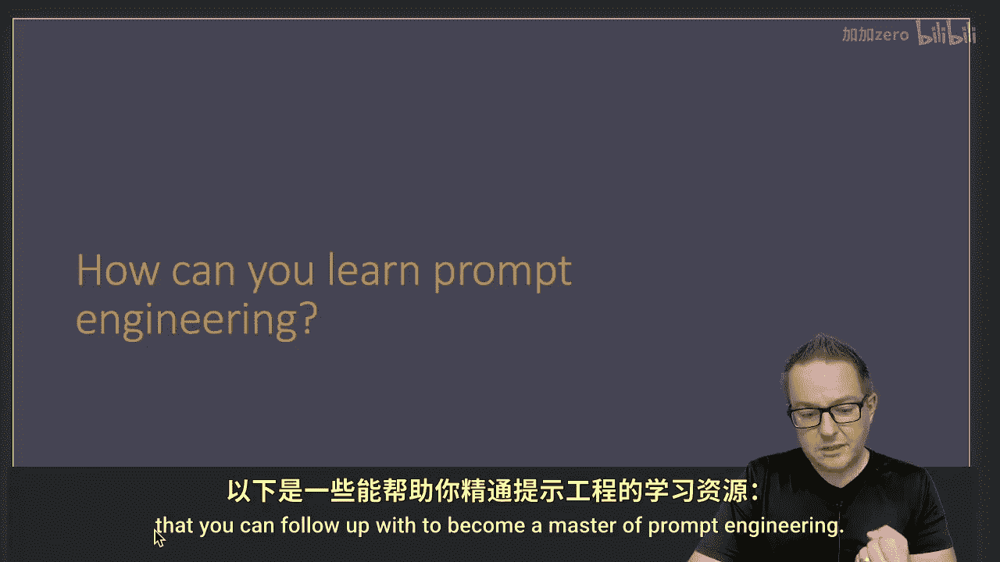
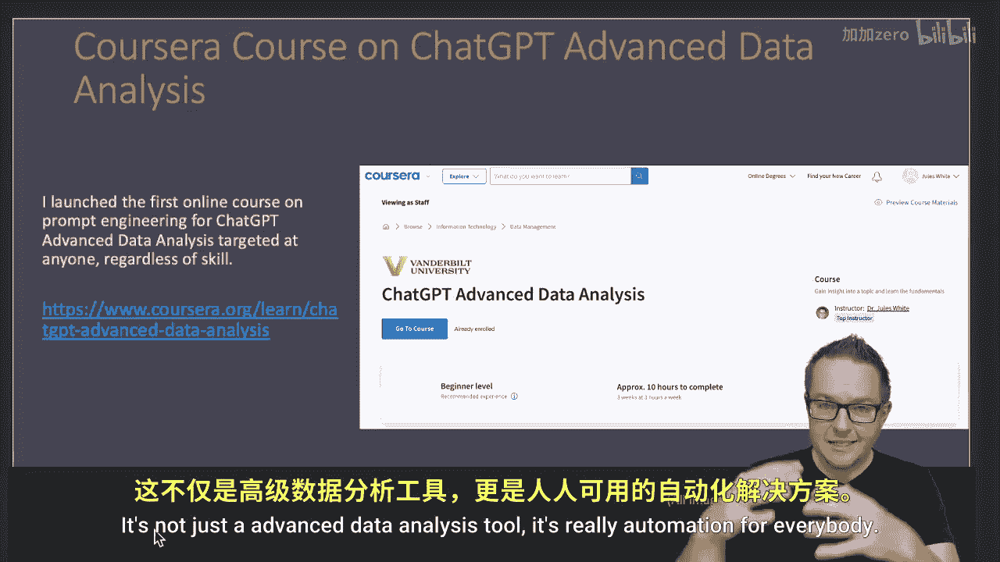
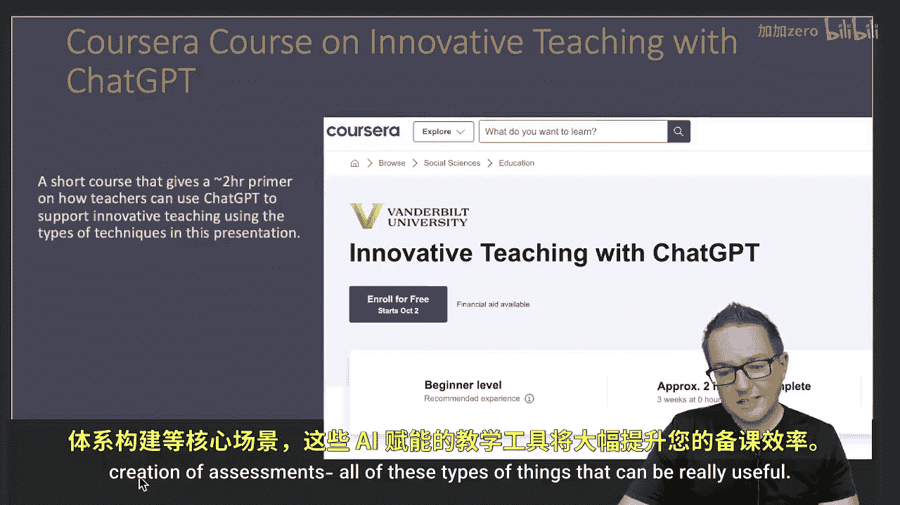
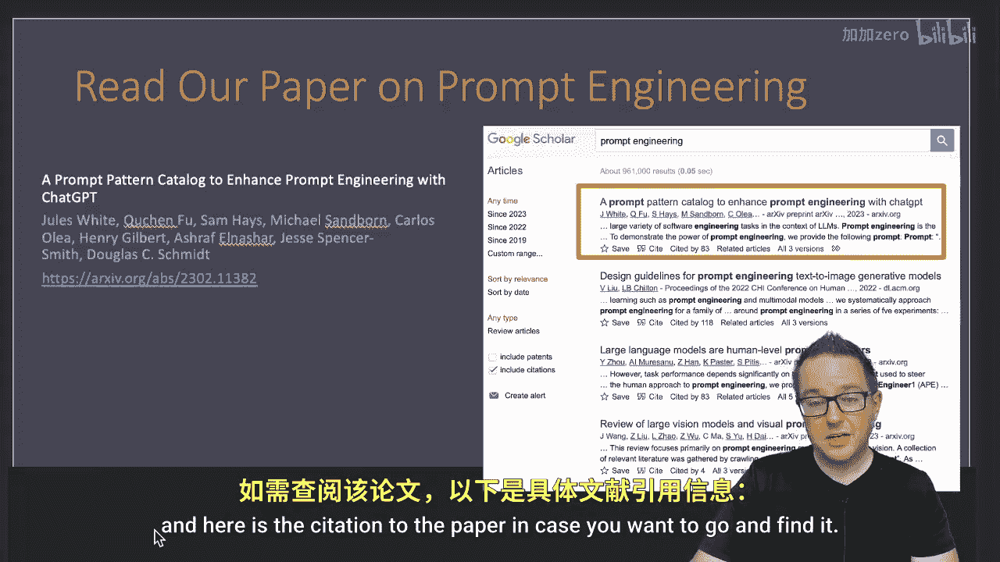

# 生成式AI战略领导者：P49：总结发言与未来展望

在本节课中，我们将总结生成式AI的核心学习路径，并展望如何利用这些工具实现智能增强的未来。

---

## 概述

要掌握所有新的生成式AI能力，关键在于学习提示工程。以下将提供一些资源，帮助你成为提示工程的大师。

## 学习资源推荐

以下是几个可以帮助你深入学习并掌握相关技能的具体课程与资料。

**第一**，我在Coursera上开设了一门关于提示工程的课程。截至目前，已有超过15万人学习了这门课程。那里还形成了一个优秀的社区，来自金融、银行、法律、营销、艺术等各个领域的人们提出了许多非凡的想法和创新。

**第二**，如果你对我使用文档和自动化完成的许多有趣工作感兴趣，我有一门关于ChatGPT高级数据分析的课程。虽然这个工具听起来可能不适用于大多数人，但实际上它对每个人都适用。这个工具本质上是自动化工具，教你如何处理文档并开始自动化各类分析，例如创建PPT幻灯片或演示文稿、生成可视化图表，或者像我之前那样对差旅政策提出问题。所有这些都通过ChatGPT高级数据分析完成，它不仅仅是一个高级数据分析工具，更是面向每个人的自动化解决方案。

**第三**，如果你是一名教师，或是提供教育体验的人，并希望看到更多关于如何创新教学和学习材料创建的具体示例，我有一门关于利用ChatGPT进行创新教学的课程。这门课程涵盖了诸如课程规划、示例创建、评估设计等所有类型的实用内容。

**第四**，如果你想阅读我所讨论的提示模式以及其他许多无论身处哪个领域都真正有帮助的模式，我鼓励你阅读我们关于提示模式目录的论文《Enhancing Prompt Engineering with ChatGPT》。目前，如果你在Google Scholar上搜索“Prompt Engineering”，这篇论文通常是排名第一的结果。随着时间的推移，情况可能会变化。如果你想查找，论文在arXiv上可以免费获取，以下是引用信息。

## 未来展望与核心理念

非常感谢你参与这次生成式AI入门课程。我希望你能和我一样对这个领域感到兴奋。它将从根本上改变我们与计算的交互方式，但真正让我兴奋的是智能增强这一愿景。我想为思维穿上“外骨骼”，利用ACHIEVE框架去做疯狂的新创意，并扩展我的想法。我希望以一种能够放大和增强我作为人类能力的方式来实现这一切。

我想探索那些帮助我们放大每个人独特智慧火花的事物，让每个人都能有更多时间与我们关心的人以及周围的其他人类互动。我不希望被人工智能取代，也不希望取代他人。我们应该思考如何增强我们自身，并利用那些独特的人类能力，即独特的创造力。

让我们真正将这一愿景建立在**智能增强**的基础上，而不是用人工替代品来取代我们的智能。

## 总结

本节课我们一起回顾了成为生成式AI大师的核心路径——学习提示工程，并介绍了相关的课程与论文资源。最后，我们共同展望了以**人类智能增强**为核心、利用技术放大而非取代人类独特创造力的未来愿景。