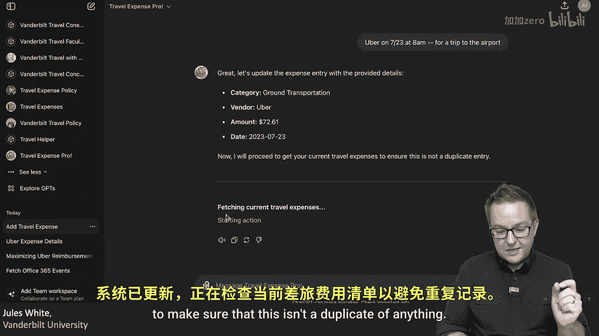
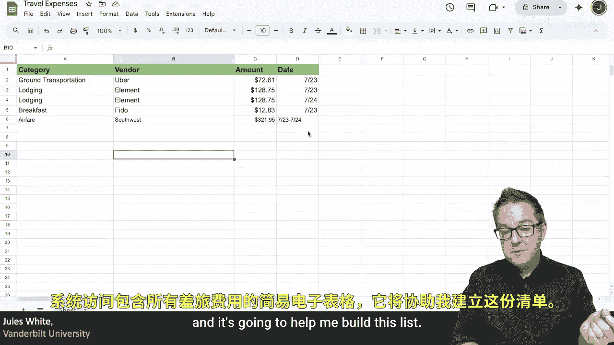
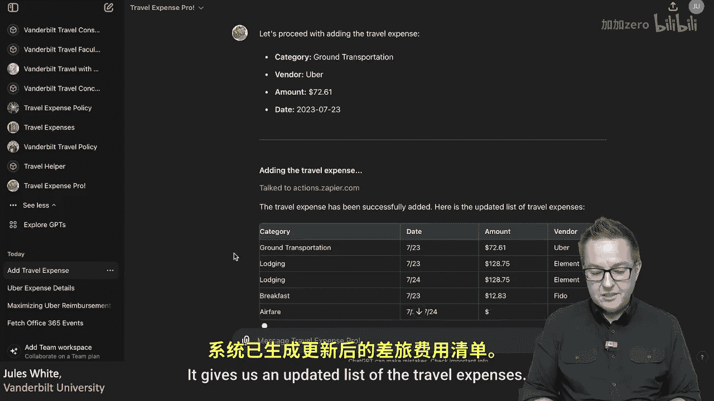
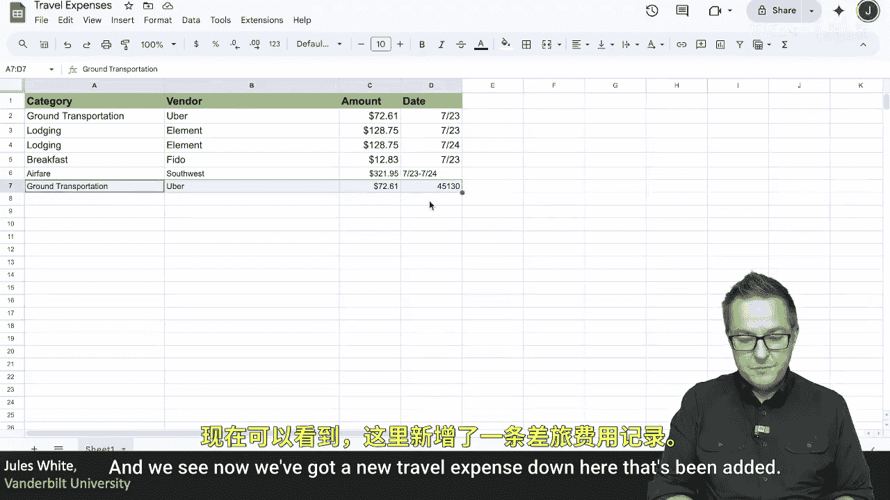
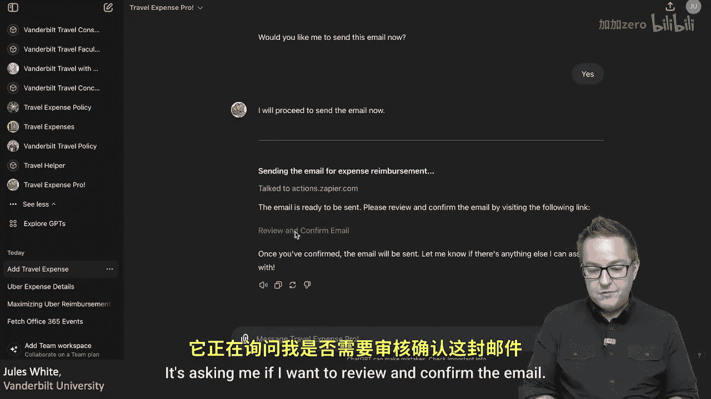
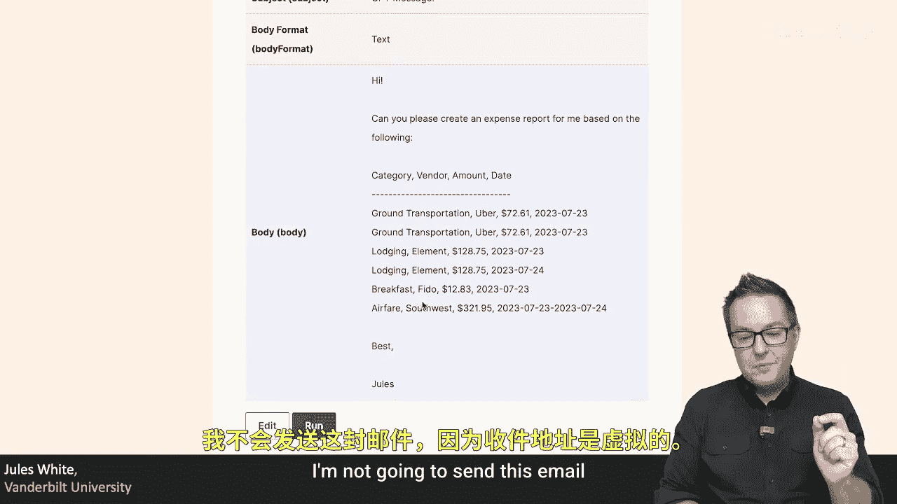
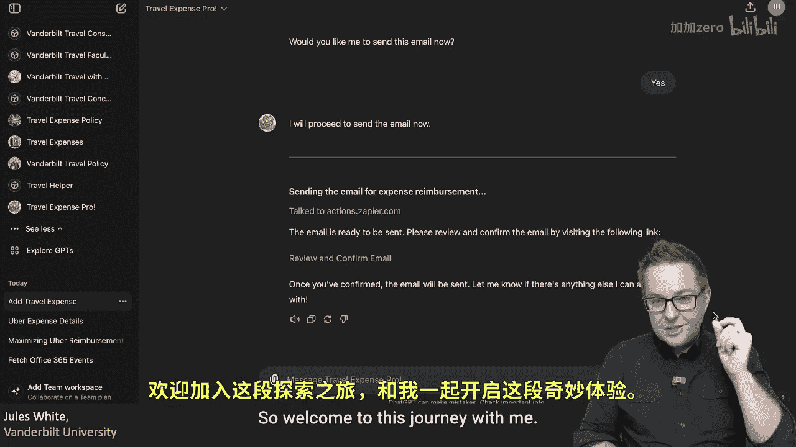

# 050：智能AI代理能做些什么 🚀

在本节课中，我们将探讨什么是智能AI代理，以及它为何如此令人兴奋。我们将通过一个具体的旅行费用报销案例，演示AI代理如何自动化处理日常繁琐任务。您将学习到构建此类代理的核心原理与实用方法。

---

## 概述

智能AI代理是一种能够理解指令、执行任务并与外部工具交互的AI系统。它之所以令人兴奋，是因为它能够将复杂、耗时的流程自动化，从而极大地提升个人工作效率与生活便利性。本课程将带您从零开始，理解其工作原理，并亲手构建一个能处理实际问题的AI代理。

---

## 智能AI代理的潜力

上一节我们概述了AI代理的概念，本节中我们来看看一个具体的应用场景。想象一下，您需要处理一堆杂乱的旅行费用收据，传统方法需要手动录入、核对和提交报销。这个过程既枯燥又容易出错。

智能AI代理可以自动化完成这些步骤。您只需提供收据，代理便能识别信息、查漏补缺、检查重复记录，并最终整理成报销邮件。这一切都通过自然语言指令完成，无需复杂的编程知识。

---

## 案例演示：旅行费用报销助手





以下是一个完整的演示，展示了AI代理如何处理一张旅行费用收据。

1.  **提交收据**：用户向AI代理提供一张旅行费用收据的图片或文本。
    ```python
    # 用户输入示例
    用户指令 = “请处理这张旅行费用收据。”
    ```

2.  **信息提取与校验**：AI代理首先通过Zapier（一个自动化工具平台）调用可用的操作。接着，它会咨询一个专门的“旅行费用专家”代理，以验证收据信息的完整性。
    *   **专家代理反馈**：例如，它可能指出“供应商信息不明，日期缺失”。

3.  **信息补充**：用户根据提示补充缺失信息（如“Uber，7月23日，8点，前往机场的交通费”）。代理会更新信息并继续流程。



4.  **查重与确认**：代理访问用户已有的旅行费用电子表格，检查当前收据是否已被记录。如果发现疑似重复，会向用户确认是否继续添加。

5.  **记录更新**：获得确认后，代理通过Zapier将新的费用条目添加到电子表格中。公式可以表示为：
    > **更新后表格 = 原表格 + 新费用条目**



6.  **邮件起草**：费用记录完成后，代理询问用户是否需要发起报销。得到肯定答复后，它会联系另一个“邮件起草专家”代理，生成一封发给管理员的报销申请邮件。

7.  **最终确认与发送**：代理将起草好的邮件内容呈现给用户审阅。用户确认后，代理即可通过Zapier连接邮箱服务发送邮件。

---

## 核心概念解析

通过以上案例，我们可以提炼出构建智能AI代理的几个核心概念：

*   **任务分解**：代理将复杂任务（如“处理报销”）分解为一系列子任务（提取信息、校验、查重、更新记录、起草邮件）。
*   **工具调用**：代理通过API（如Zapier）与外部工具（电子表格、邮箱）交互，以执行具体操作。
*   **专家协作**：一个主代理可以协调多个具备特定领域知识的“专家代理”共同完成任务。
*   **自然语言交互**：用户与代理的所有沟通都使用简单的自然语言，无需学习特定命令。

---





## 总结

本节课中，我们一起学习了智能AI代理的基本概念和强大潜力。我们通过一个旅行费用报销的完整案例，看到了AI代理如何通过分解任务、调用工具和协调专家，将繁琐的工作流程自动化。关键在于理解，这些听起来复杂的技术原理，实际上可以通过OpenAI GPTs、Zapier等工具，结合清晰的任务设计思路，变得简单易行。



在接下来的课程中，我们将逐步拆解这些原理，手把手教您构建属于自己的AI代理，无论是用于烹饪、邮件管理还是其他任何能改变您生活的场景。