# 生成式AI战略领导者：P51：智能体AI简介 🧠

在本节课中，我们将要学习什么是智能体AI。我们将通过一个直观的烹饪示例，来理解智能体AI的核心概念、运作方式以及它为何如此引人入胜。

## 什么是智能体AI？

上一节我们介绍了课程背景，本节中我们来看看智能体AI的定义。智能体AI是指**能够自主行动并具备代理能力的AI**。你可以将其理解为拥有自主性。它能够去尝试解决问题，并对不同的情况做出反应。

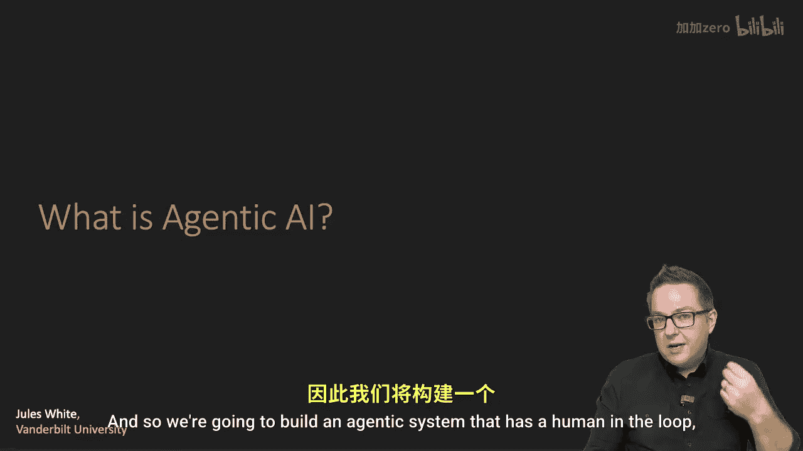

你可能已经在与生成式AI的交互中见过它，只是没有以这种方式思考过。智能体AI正在将这种能力付诸实践，创建能够与现实世界交互、采取行动、观察行动结果并据此做出响应的生成式AI或其他系统。

## 构建一个“人在回路”的智能体系统

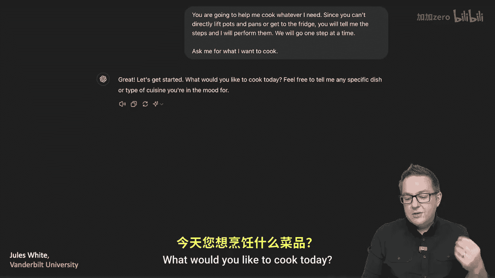

接下来，我们将模拟整个过程。这并非完全自动化模拟，因为我们将构建一个包含人工组件的智能体系统。这意味着，作为人类，我将帮助智能体执行动作并应对各种情况。我们将构建一个“人在回路”的智能体系统，由人类帮助其实现所需的代理能力，并帮助执行动作。当我们拥有这些智能体系统时，关键的一点是它们能为我们自动完成一些事情。

以下是启动这个智能体系统的提示词：

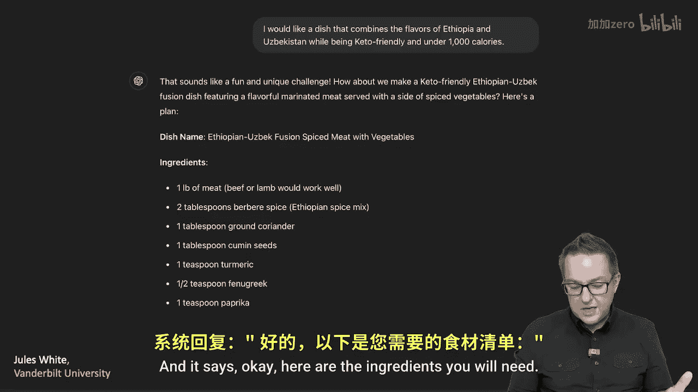

```text
你将帮助我烹饪任何我需要的东西。由于你无法直接拿起锅碗瓢盆或打开冰箱，你将告诉我步骤，我来执行。我们将一次进行一步。请先询问我想做什么菜。
```

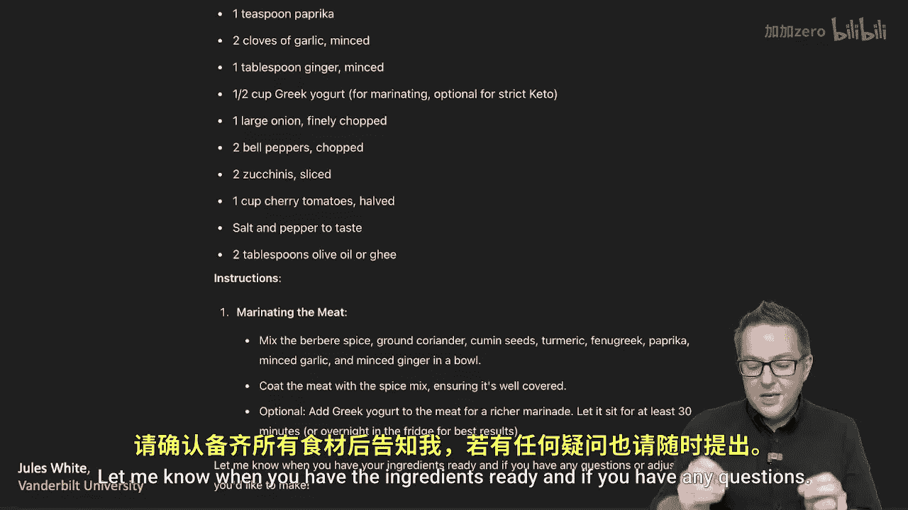

这个提示词本质上启动了一个智能体系统：我将遵循它告诉我的指令，每当它指出需要采取某个行动时，我就去执行，然后告诉它发生了什么。它回复说：“好的，我们开始吧。你今天想做什么菜？”

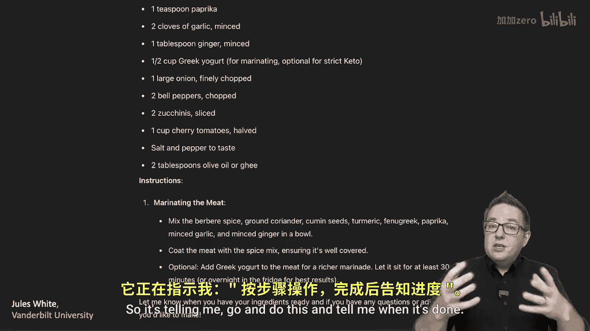

## 智能体规划与执行

我提出了一个要求：“我想做一道融合埃塞俄比亚和乌兹别克斯坦风味、生酮友好且热量低于1000卡路里的菜。”它回应道：“这听起来是个有趣而独特的挑战。我们来做一道生酮友好的埃塞俄比亚-乌兹别克融合菜，以风味腌肉为主，配以香料蔬菜。以下是计划。”

它开始构建计划，并列出所需食材。然后，在指令部分，它告诉我具体任务：“腌制肉类：混合[香料列表]...确保肉被覆盖。准备好食材后告诉我，如有任何问题请提问。”

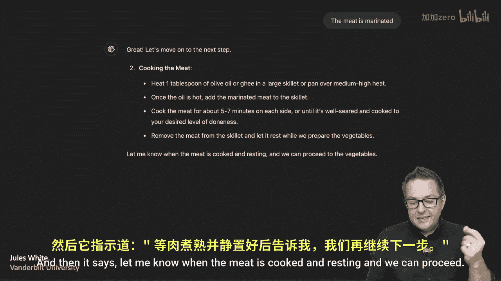

它告诉我去做这件事，并在完成后通知它。我回复：“好的，肉已腌制好。”它随即响应：“很好，我们进行下一步：烹饪肉类。在煎锅中加热一汤匙橄榄油...加入腌好的肉，煎约5-7分钟...”


请注意这里发生了什么：它告诉我该做什么，给我执行的指令。它拥有**选择做什么以及何时做的权力**，而我则在执行它的指令。这就是它拥有代理权的体现。然后它说：“肉煎好并静置后告诉我，我们可以继续。”

## 智能体的适应与响应能力

我回来反馈，并想指出其中的智能体特性：它能够反应、拥有代理权、选择做什么，并能应对各种情况，包括突发状况。例如，我告诉它：“肉开始烧焦了。”我并没有告诉它该怎么做。

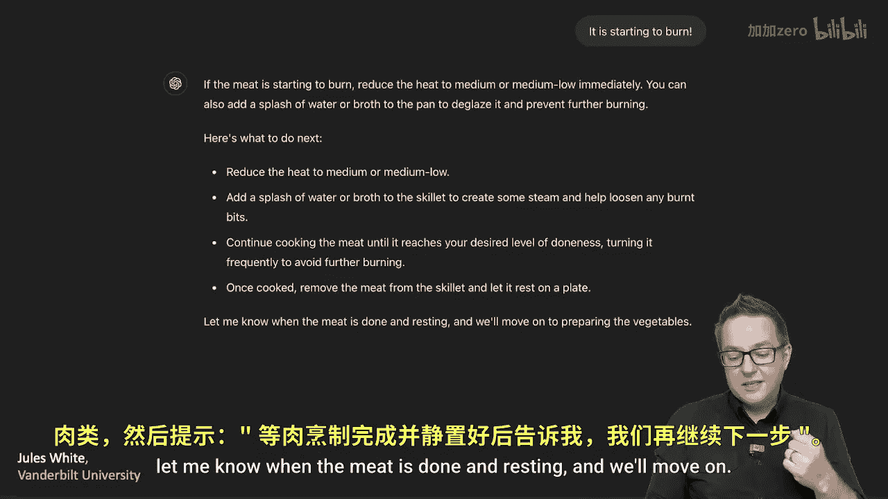

它回应道：“如果肉开始烧焦，请立即将火调至中火或中小火。你也可以往锅里加一点水或高汤来降温并防止进一步烧焦。”它正在响应并适应情况。目前我们只是在模拟，尚未完全自动化。我们正在观察并建立对智能体AI的直觉理解。这就是它的运作方式，只不过不是完全自动化，而是由我作为人类来执行它的动作。这是我和生成式AI之间的协作，共同完成这道菜。


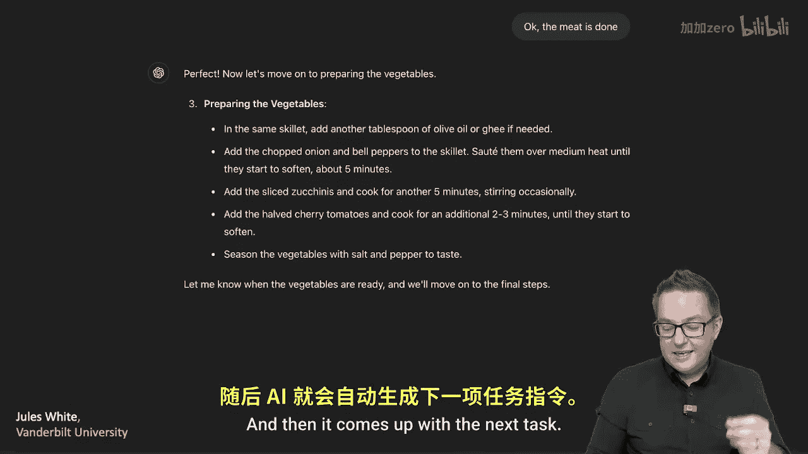

它告诉我如何处理可能烧焦的肉，然后说：“肉做好并静置后告诉我，我们继续。”我回去说：“好的，肉做好了。”我给出了对其行动的反馈，表示已完成它请求的动作。它回来接着说：“好的，我们开始准备蔬菜。同样，蔬菜准备好后告诉我。”它给我任务，我执行任务，然后回来报告任务完成。

## 处理意外情况：智能体的灵活性

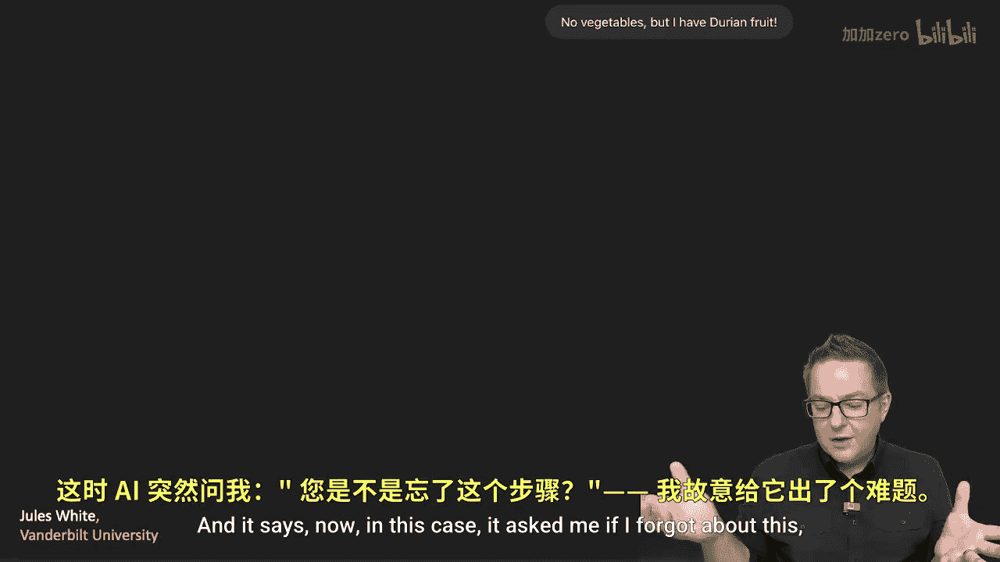

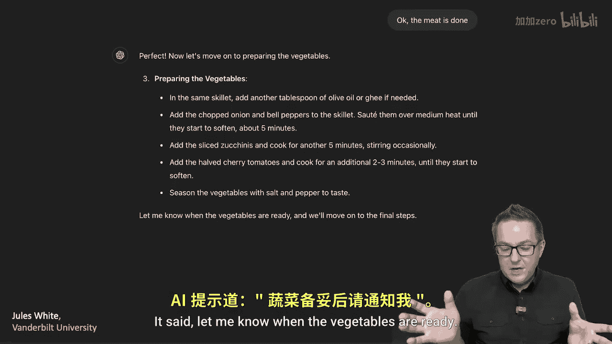

接着它提出了下一个任务。但这次，我给它出了个难题。它说：“蔬菜准备好后告诉我。”我却回复：“哦，没有蔬菜。但我有榴莲。”这对它来说是个意外。它将如何应对？智能体如何处理这种情况？

它回应道：“榴莲和蔬菜差别很大，但我会适应。”现在它告诉我如何准备榴莲，因为它想找到前进的路径，达成制作这道菜的目标。既然无法获得预期的资源，它必须适应并提出其他解决方案。它适应了，并说：“好的，现在你准备榴莲的方法如下...”我告诉它完成后，它回复：“很好，现在我们来装盘。”


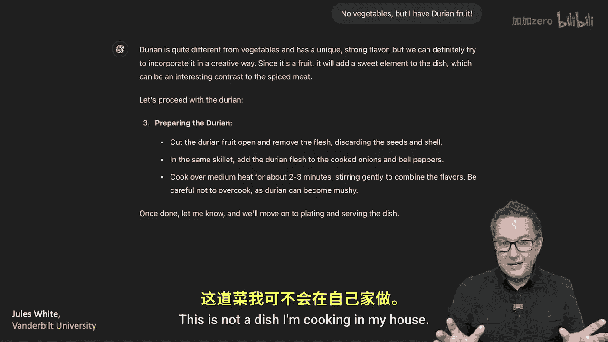

## 核心范式转变：从指令到目标

这里发生了什么？我们翻转了脚本。以前是我们进入生成式AI，告诉它“做这个，做那个，计划这个”。而现在，我说的是：“这是我希望你达成的目标。这是你达成目标要使用的流程。”流程是：你一次进行一步，告诉我该做什么，我来为你执行动作，完成后告诉你，然后你可以响应并做下一件事。

我们看到，当我们改变回应时（例如抛出榴莲这个难题），它会响应并适应。这对于生成式AI至关重要：它不是固定不变的。我们多年来构建的所有计算机系统都非常僵化和固定。如果你对一个计算机系统说“没有蔬菜，有榴莲”，它会崩溃，完全不知道该怎么办。而生成式AI的魔力就在这里：它看到“没有蔬菜，有榴莲”，它会尽力去解决。

## 智能体AI的关键特性

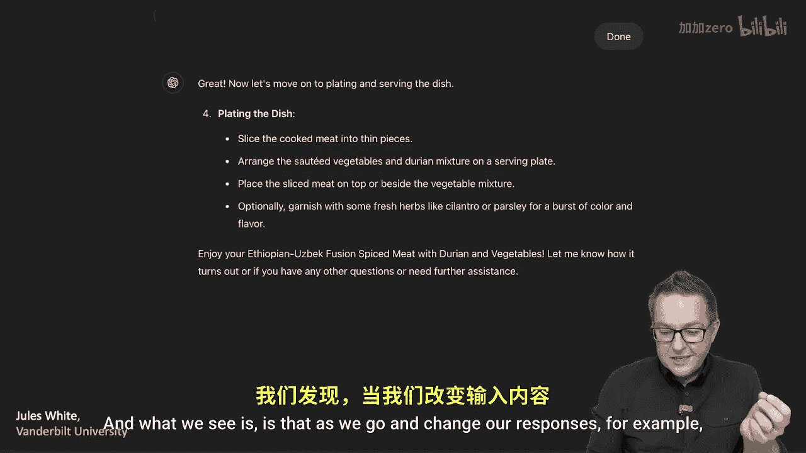

我们寻找的正是这种观察事物、做出响应，然后根据发生的情况选择下一个行动的能力。就像肉快烧焦时，它能调整计划说：“不，你应该这样做：调小火。完成后告诉我。”它根据收到的反馈动态地调整步骤。

**这就是我们将要探讨的智能体AI的关键：它请求执行某个动作的能力**，因为它永远不会直接执行。它会指定它希望完成什么，然后要么由人类去执行，要么由我们知道如何构建的现有软件或计算机系统来接收这个规范并执行。

## 人机协作的挑战与机遇

那么，执行者是人类还是计算机系统有区别吗？不完全一样。关键区别在于：如果是人类，我们的容错能力要高得多。如果它以多种不同格式给出需要执行的任务，我们可以处理并适应，因为我们是人类。

但计算机系统不太擅长这一点。因此，当智能体AI开始与我们日常使用的所有工具和计算机系统交互时，如果它决定说“嘿，去创建这个食谱”，而它是对电子表格说的，电子表格会说“我不知道你在说什么”，因为它不理解“去创建这个食谱”，它只处理列、数字和值，格式要严格得多。

因此，智能体AI的部分魔力在于弄清楚如何弥合这个鸿沟：一边是它直观、流畅地指定希望完成的事情的方式，另一边是我们构建的僵化的计算机世界，那里的一切都必须精确无误。我们知道生成式AI喜欢解释自己，给出各种备注、细节和评论。当我们开始与真实的计算机系统合作时，这就成了一个大问题。

在本例中，这没问题，因为我作为自动化执行者，可以倾听它说的话并做出响应。因为我是人类，我可以适应它的适应。我可以适应它的评论，适应它的解释，适应它简洁或详细的指令。我们未来需要做的很多工作，将围绕**提示词工程**展开：如何让我们现有的计算机系统与这些健谈、适应性强、不那么僵化的生成式AI进行接口交互。

我期待与你一起进一步探索这个问题。

---


本节课中我们一起学习了智能体AI的基本概念。我们通过一个烹饪协作示例，理解了智能体AI是能够自主规划、执行并适应环境变化的AI系统。其核心在于能够指定目标与动作，并通过与人类或现有系统的交互来实现目标。关键在于其**动态响应和适应能力**，这与传统僵化的计算机系统形成鲜明对比。未来，如何通过提示词工程让人工智能体与现有工具无缝协作，将是一个重要的探索方向。