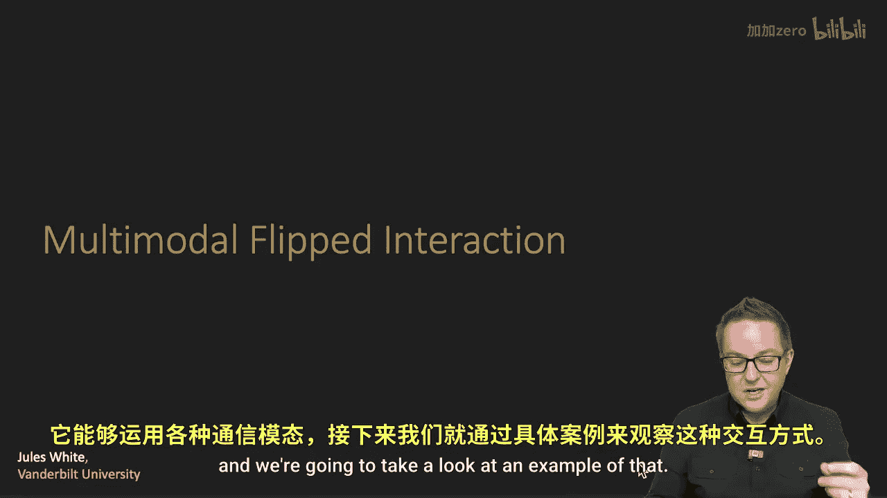
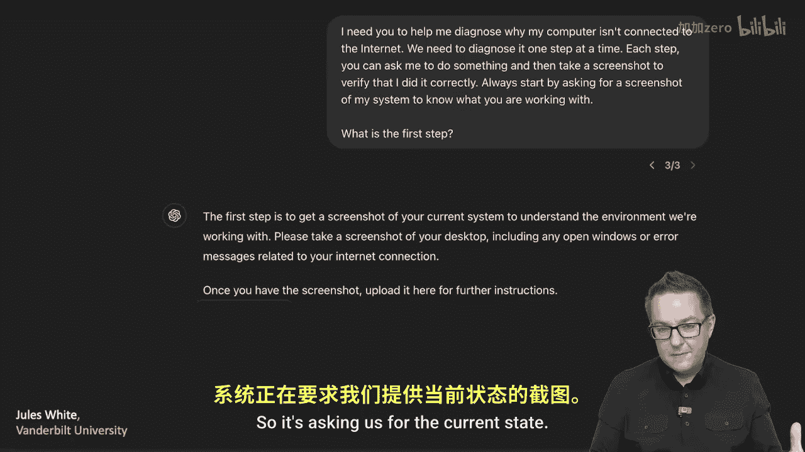
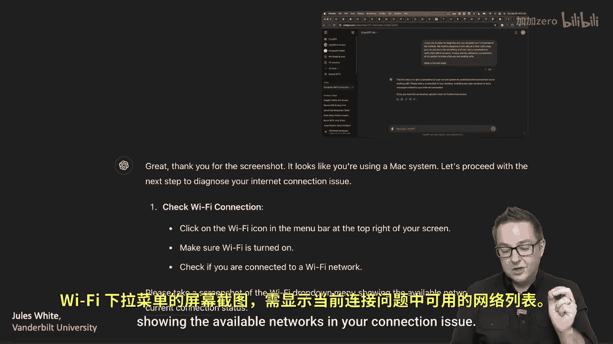
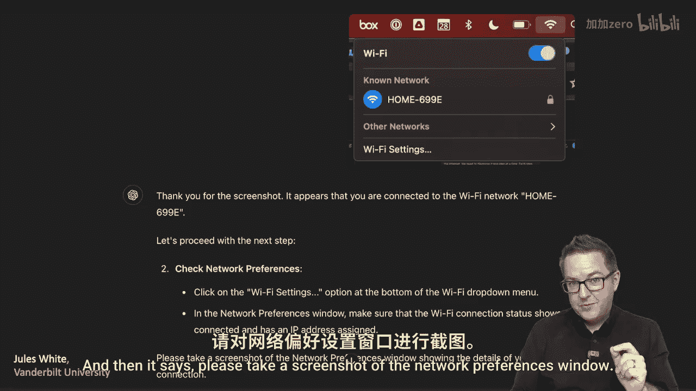
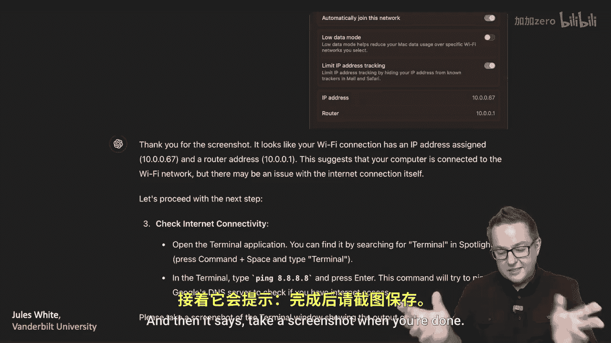
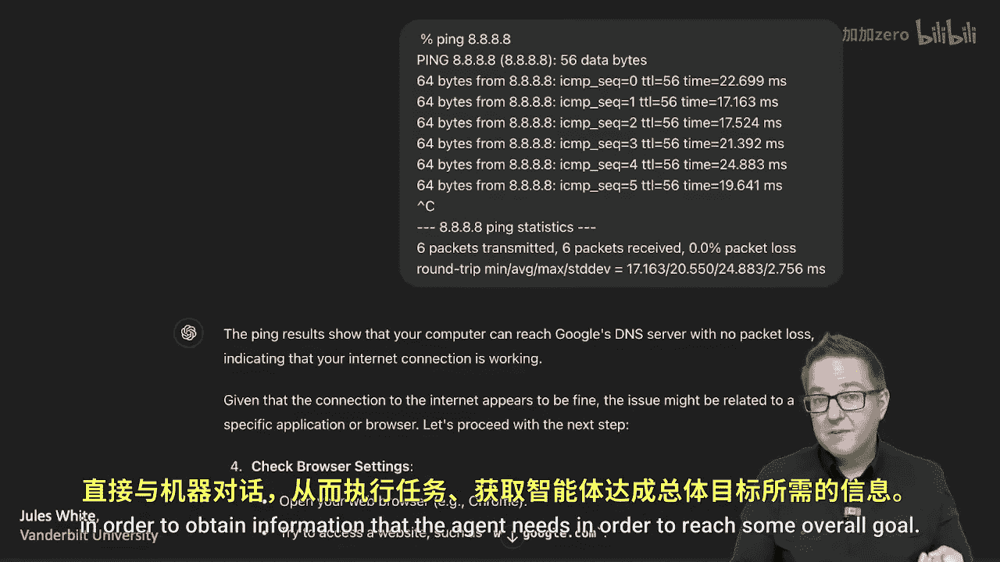

# 生成式AI战略领导者：04：多模态翻转交互 🖼️💬

在本节课中，我们将要学习生成式AI模型如何超越纯文本交互，利用多种信息模态（如图片）来理解和解决问题。我们将通过一个具体的“翻转交互”案例，展示AI如何通过分析屏幕截图来诊断电脑网络问题。

## 多模态交互的核心概念

上一节我们介绍了翻转交互的基本模式。本节中我们来看看，这种交互模式如何突破语言的限制。



这些模型和交互模式的惊人之处在于，它们不必局限于语言。这些系统能够解读多种不同类型的信息。信息不必只是人类语言。我们必须理解的关键一点是，我们可以向它提供各种信息。当我们使用翻转交互模式时——即让它向我们提问、向数据库提问、告诉我们该做什么，或指示计算机系统该做什么——它获得的反馈不必只是语言形式。反馈不必只是我们的人类语言，它可以使用各种沟通模态。我们将通过一个例子来观察这一点。

在我们将要提供的例子中，信息模态是**照片**。

## 案例：基于截图的网络问题诊断

以下是使用多模态翻转交互模式解决实际问题的逐步演示。

### 初始指令与第一步



首先，我设定了翻转交互的提示词：

> **提示词**：我需要你帮助我诊断为什么我的电脑无法连接互联网。我们需要一步一步地诊断。每一步，你可以要求我做某事，然后我提供截图以验证我是否正确执行。请始终从要求查看我的系统截图开始，以便你了解工作环境。第一步是什么？

我再次使用了这种交互模式：我描述希望它逐步解决问题，让它向我询问第一步，并且这次我指明反馈将主要是**所发生情况的截图**。所以，它会告诉我做某事，我在电脑上执行，然后向它展示执行后的截图。

它回复道：“第一步是提供您当前系统的截图，以便了解我们正在处理的环境。”它要求我们提供当前状态。




于是，我拍摄了这张笔记本电脑的截图，并将其作为我的回复上传。我不再上传文本，而是上传了电脑的截图。我现在能做到这一点，这绝对令人惊叹。

### AI解读截图并调整策略

它回复：“好的，谢谢你的截图。看起来你使用的是Mac。让我们继续下一步来诊断你的网络连接。”请注意它刚才的举动：它查看了这张截图并判断出“这看起来像Mac”。它从截图的外观中了解了我电脑的信息。这不仅仅是我口头告知“我有一台Mac”，而是它通过观察截图，从中收集丰富信息，并根据所见内容进行适应和调整。

### 逐步诊断流程

以下是AI引导的后续诊断步骤：

**第二步：检查Wi-Fi连接**
它指示：“检查你的Wi-Fi连接。点击屏幕右上角菜单栏中的Wi-Fi图标。确保Wi-Fi已开启。检查你是否已连接到Wi-Fi网络。”然后它说：“请提供Wi-Fi下拉菜单的截图，显示可用网络和你的连接状态。”




我按照指示操作并上传截图。它回复：“谢谢你的截图。看起来你已连接到Wi-Fi网络‘Home 699 E’。”请注意，它实际上从截图中识别出了我所连接的Wi-Fi网络名称。它不需要我告知，而是从我提供的反馈中直接收集所需信息。

**第三步：检查网络偏好设置**
它继续引导：“让我们继续下一步，检查网络偏好设置。点击Wi-Fi下拉菜单底部的‘Wi-Fi设置’选项。在网络偏好设置窗口中，确保Wi-Fi连接状态显示为‘已连接’并已分配IP地址。”然后它说：“请提供网络偏好设置窗口的截图。”


我上传了它要求查看的截图。它分析道：“好的，谢谢你的截图。看起来你的Wi-Fi连接已分配了IP地址和路由器地址。这表明你的电脑已连接到Wi-Fi网络。”至此，它已逐步建立起诊断基础：首先确认我已连接到Wi-Fi网络且状态正常。

**第四步：检查互联网连通性与语言翻译**
既然网络连接正常，它开始排查下一个可能环节。它说：“好的，那么下一步是什么？如果那不是问题，下一步是什么？”现在它指示：“我们需要检查互联网连通性。打开终端应用程序（你可以通过Spotlight搜索‘终端’找到它）。”

接着，它给出了要运行的命令：“在终端中，输入 `ping 8.8.8.8` 并按回车键。”请注意它的操作：它现在需要在系统上运行一个命令。因此，它将“检查互联网连通性”这个高级任务，翻译成了计算机能够理解的语言（命令）。它正在执行这个翻译步骤。它不仅识别出需要做什么，还识别出如何将其具体翻译成可用于与计算机通信、以获取所需信息的语言。

然后它说：“完成后请提供截图。”这次我没有提供截图，而是将命令运行后的原始文本直接复制粘贴回了对话框。我想看看，如果我突然不提供截图而是提供文本，它会如何反应。这是运行该命令后输出的原始文本：

```
PING 8.8.8.8 (8.8.8.8): 56 data bytes
64 bytes from 8.8.8.8: icmp_seq=0 ttl=117 time=9.305 ms
64 bytes from 8.8.8.8: icmp_seq=1 ttl=117 time=10.125 ms
64 bytes from 8.8.8.8: icmp_seq=2 ttl=117 time=11.058 ms
```

对于程序员或IT人员，这段文本可能易于理解。但如果你不熟悉这个领域，它看起来就像外语。确实，这是一种许多人懂得如何“说”的语言，但如果你不懂，就无法理解。




然而，AI懂得如何将这段文本翻译回有意义的结论。它分析道：“Ping结果显示，你的电脑可以访问Google的DNS服务器，且没有数据包丢失，这表明你的互联网连接工作正常。”它在这里执行了翻译：将我所见的原始信息（那种“外语”），翻译成了针对所解决问题的意义表述。随后，它继续告诉我下一步要运行的命令，并会持续尝试帮助我诊断那个我实际上并不存在的电脑网络连接问题。

## 多模态翻转交互的优势总结

本节课中，我们一起学习了多模态翻转交互的强大能力。

你可以看到它是如何适应的：它能适应多种不同类型的响应。在那种翻转交互中，我们说“这是模式：一步一步来，我会给你结果”。每次它收到反馈后，都会做出响应、进行适应、执行翻译，并能与不同的系统接口交互。目前我们仍然使用人工接口——由人类提供接口。但与之前接口烹饪世界不同，我们现在接口的是机器和计算机的世界。这最终正是我们为智能体系统设定的方向：我们将允许它们直接与那些机器对话，以执行任务、获取智能体达成总体目标所需的信息。



**核心要点总结**：
1.  **超越文本**：AI能处理图像、命令输出等多种模态信息。
2.  **动态适应**：AI根据接收到的反馈（如图片内容）实时调整诊断策略和后续问题。
3.  **自动翻译**：AI能在高级任务描述（如“检查网络”）和低级机器指令（如 `ping` 命令）之间进行翻译。
4.  **为智能体奠基**：这种人机协作的多模态交互模式，是未来AI智能体直接操作计算机系统、自主完成任务的基础。


这种能力使得AI能够更自然、更强大地融入解决实际问题的流程中，特别是在需要结合视觉信息与操作指令的复杂场景下。