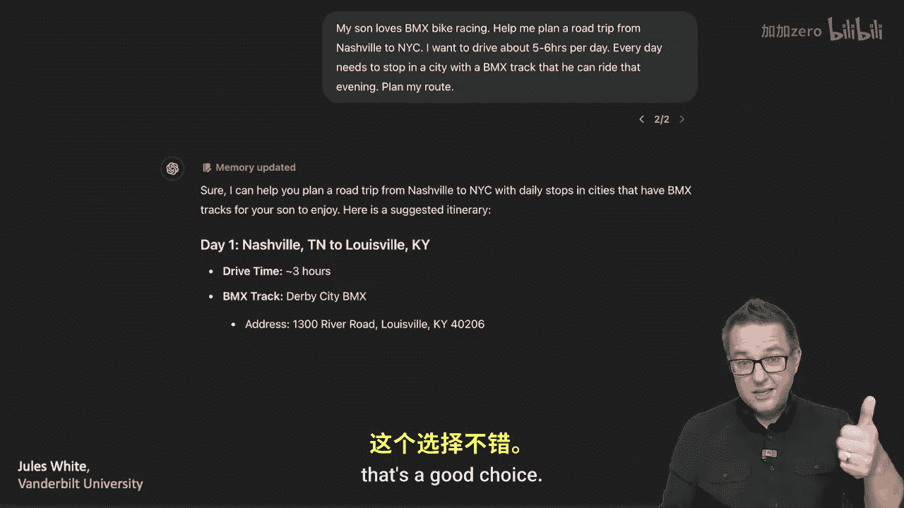
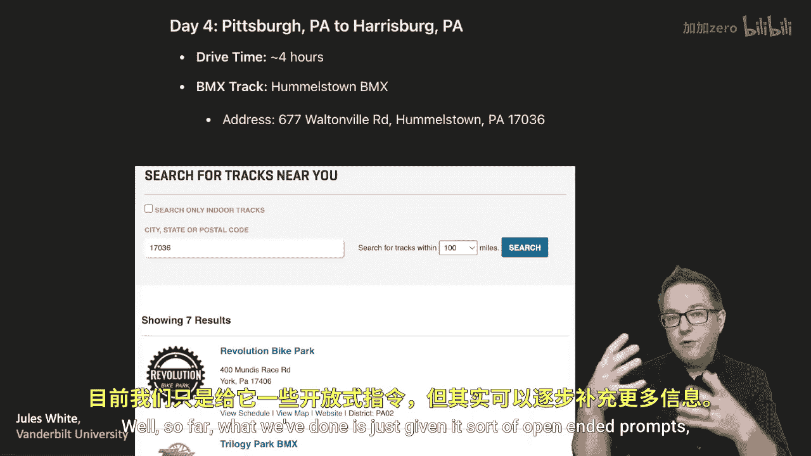
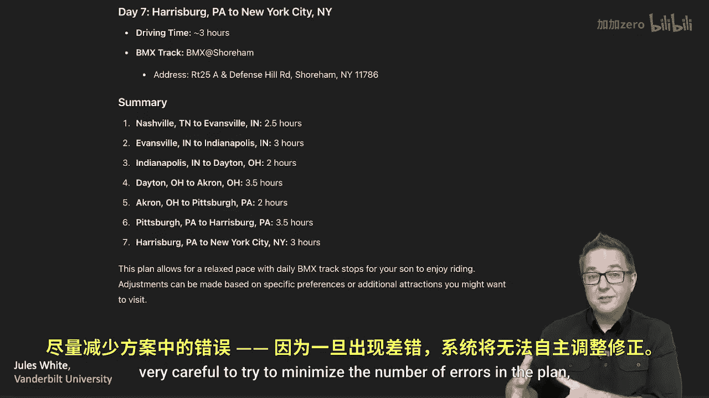

# 生成式AI战略领导者：05：提前规划 🗺️

在本节课中，我们将要学习智能体（Agents）如何通过提前规划来完成任务。我们将探讨两种主要的规划方式：交互式逐步执行与一次性完整规划，并分析各自的优缺点。

## 智能体的规划能力

上一节我们介绍了智能体的基本概念，本节中我们来看看其核心能力之一：规划。智能体并非只能按部就班地执行单一指令。它们能够构建复杂的计划。这种能力的核心在于，智能体能够将你试图实现的某个**高级别目标**，分解成一系列**子任务或子目标**，从而形成一个完整的执行计划。这是一种基础能力。

## 两种规划方式

以下是智能体工作的两种主要方式。

### 交互式逐步执行

一种方式是让智能体以**交互式**的方式工作，一次执行一个任务。它逐步采取行动、执行步骤并作出响应。这是一种非常强大的方式。

### 一次性完整规划

另一种方式则完全相反：我们可以让智能体**提前构建出完整的计划**，然后一次性发送出去执行。目前我们尚未实现全自动化执行，所以这里的规划是指由人类来执行整个计划。

## 规划示例：纳什维尔之旅

假设我的目标是：**规划一个为期四天的纳什维尔之旅，需要游览多个不同的街区**。

智能体分解了我的任务。它指出需要安排四天的活动，并且每天要去不同的街区。以下是它的规划：
*   第一天：纳什维尔市中心。在Pancake Pantry吃早餐。（注：根据对市中心的定义不同，这个地点可能不准确。Pancake Pantry可能属于Hillsborough Village区，而非严格意义上的市中心。这说明了智能体并非总是完美。）

## 两种方式的关键差异

当我们像上面那样一次性生成整个计划时，它是**一次性完成**的，在步骤之间**不一定具备适应和修正的能力**。这是一个关键差异。

在思考规划时，如果我们采用逐步执行的方式，则能在每一步之间进行**充分的适应调整**。但这也会带来一些复杂性，因为它可能会忘记某些步骤，或者偏离原本的目标。

另一方面，如果我们采用一次性完整规划，智能体**永远不会偏离轨道**。它可以提前构建出完整计划，然后直接发送执行。它不需要记住之前说过什么，因为一切都已预先设定好。然而，**如果计划存在缺陷，它在执行过程中无法调整计划**。这又是一个关键差异。

我们需要权衡：是希望智能体在执行过程的每一步之间都参与决策（“在循环中”），还是希望计划完全预先制定好，由执行过程与智能体完全分离？后者虽然失去了在步骤间出现错误时响应的能力，但可能在**效率、成本、速度**方面获得优势，并且可能更具**可重复性和可预测性**。就像任何其他大语言模型的响应一样，如果让智能体介入，它的输出每次都可能略有不同，而我们有时可能不希望这样。

因此，我们总是在这两种完成任务的方式之间进行权衡：要么让智能体直接介入每一步（循环中），要么让它提前构建一个完整的计划（一次性）。后者非常可重复，但如果出现错误或问题，则难以适应。或许我们有时会希望采取折中的方式。

## 规划中的挑战：幻觉

以下是我们的四天纳什维尔之旅计划的剩余部分。现在，我回到智能体并给出一个新目标：**我的儿子喜欢BMX小轮车比赛，请帮我规划一次从纳什维尔到纽约市的自驾游。我希望每天驾驶约五到六小时，并且每天都需要停靠在一个有BMX赛道的城市，以便他晚上可以骑行。请规划我的路线。**

智能体开始规划：纳什维尔到肯塔基州路易斯维尔——这是个不错的选择，那里有一个很棒的BMX赛道，距离也不远。

几天后，我们到达了“Humeltontown BMX”赛道。我**无法找到任何关于名为“Humeltown BMX”的赛道存在的信息**。它可能存在，也可能不存在，但在我看来它似乎是虚构的。当我们开始思考规划时，这是一个挑战：**如果我们提前构建完全固定、详尽的计划，我们总是面临“幻觉”的风险**。即，它在计划中幻想出一些看起来不错但并非真实存在的东西。它可能以各种方式产生幻觉。在这个案例中，它幻想出了一个停靠点，因为它知道宾夕法尼亚州有个Humeltown，于是它说：“好吧，我会停在那里，然后幻想出一个BMX赛道在那里”，因为我们没有给它足够的约束，目前也没有简单的方法来做到这一点。幸运的是，在我开始这次自驾游之前，我会进行事实核查，从而发现这个问题。但这是我们未来需要处理的一个问题。

## 克服挑战：提供信息与约束

那么，我们如何克服这类问题呢？到目前为止，我们所做的只是给它一些开放式的提示。

但我们可以开始**添加信息**，例如，提前提供我们希望它使用的信息，以及我们希望它遵循的**约束条件**，以限制它的推理和行为范围。当我们开始思考智能体时，这一点**非常重要**。为智能体提供完成任务所需的**信息访问权限**至关重要。在某些情况下，如果我们明确指示它这样做并告知时机，它可以自行去获取信息。但如果我们没有赋予它获取信息的能力，我们就需要提供完成任务所需的**所有信息**，而不能假设它能访问一切。

在这个例子中，我回到之前的提示，**复制粘贴了加拿大和美国所有BMX赛道的列表**，并将其放入原始交互提示中。然后，我给出了基本相同的提示：“我的儿子喜欢BMX小轮车比赛，请规划这次旅行。”

现在它返回了**实际上正确**的结果。它找到了真实的赛道，我们有了真实的信息可供使用。所有这些停靠点在我看来都是正确的。我进行了一些事实核查，能够找到所有这些不同的赛道。同时，行程也大致符合我们设定的每日驾驶时间限制（也许它在每日驾驶距离上有点过于保守，我可以告诉它需要开得更远一些，它就能调整计划）。现在，我们得到了一个**完全预先制定好的计划**。

我不会在驾驶途中说：“嘿，这里没有这个BMX赛道，告诉我该改去哪里。”然后开往别处，因为这对于规划自驾游来说没有意义。我将去执行它的计划，但不会让它介入循环。这是一种不同的交互风格。当我们开始构建这些系统时，必须弄清楚：我们希望它**将多少步骤串联起来**，然后我们去代表它执行并带回结果？或者，我们是否希望带回结果？所有这些都很重要，并将决定流程的**可重复性**。我们在流程中**插入智能体的环节越多，其可重复性就越低**，可能速度越慢，成本也越高。我们越倾向于一个完全预先制定的计划，计划的可重复性可能就越高，因为步骤之间没有适应调整。但同时，我们必须**非常小心**，尽量减少计划中的错误数量，因为一旦发生错误，它无法帮助我们进行调整。

## 总结

本节课中我们一起学习了智能体进行任务规划的两种核心方式：**交互式逐步执行**与**一次性完整规划**。我们通过具体示例分析了各自的优势（如适应性、可重复性）与挑战（如复杂性、幻觉风险）。关键在于，我们需要根据任务对**适应性、效率、成本及可重复性**的要求，在两种方式之间做出权衡，并通过为智能体提供充足的**信息与约束**来提升规划的质量和可靠性。