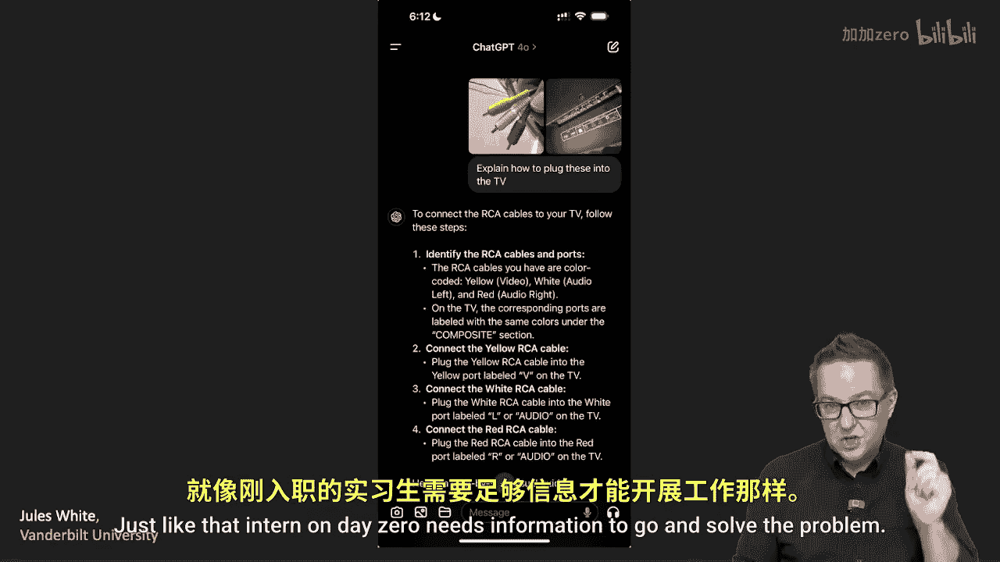
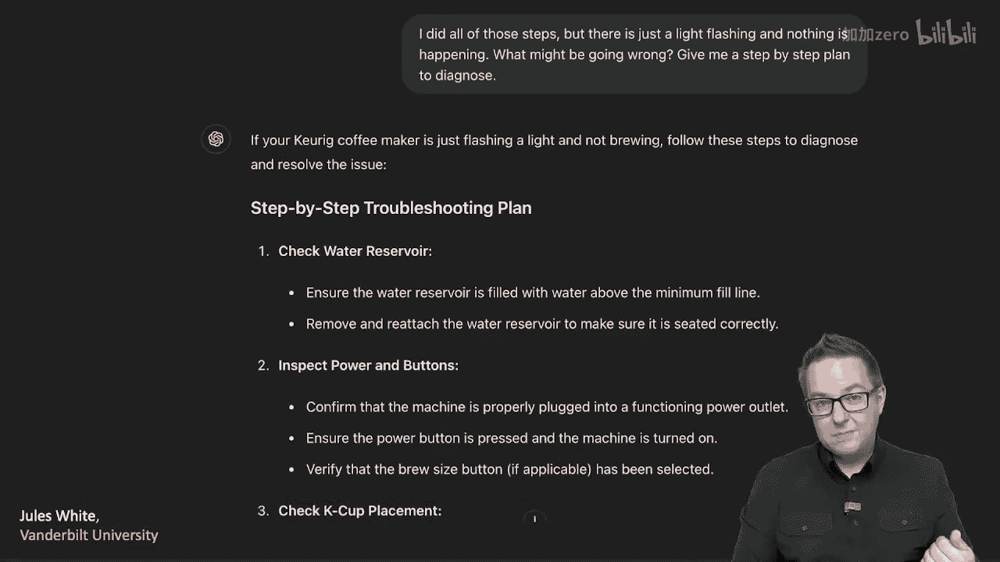

# 生成式AI战略领导者：P55：为智能AI代理提供世界信息 🧠

在本节课中，我们将探讨一个在构建生成式AI应用时至关重要的环节：如何为AI代理提供充分且准确的世界信息。人们常常高估生成式AI的知识储备，同时又低估了执行任务所需的上下文信息量。我们将通过具体案例，理解为何以及如何为AI“填充”必要的背景知识。

---

## 高估与低估：AI的知识边界

人们开始使用生成式AI时，常常会高估它知道多少。因为它的回答极具说服力，导致人们误以为它拥有各种相关的背景知识。同时，我们也倾向于低估要出色完成一项任务，究竟需要多少上下文信息。

## 类比：第一天上班的实习生

构建生成式AI时，请想象一下：你试图让一个实习生为你做事。这是他上班的第一天，刚到你的工作场所一分钟。他对你的公司文化、办公室布局、特定系统一无所知。他只有关于世界的大量通用知识，但不了解你的具体情况、你的做事方式、你的电脑系统、你的人生目标，甚至不知道你上班路上在哪个加油站停过车、你最喜欢的食物是什么、你在旅行规划中的好恶。所有这些信息都是缺失的。

## 填充缺失信息是关键

当我们让生成式AI执行任务时，填补这些缺失信息至关重要。我们需要提供海量信息，AI才能完成任务。

## 案例研究：连接旧游戏机

前几天，我儿子在壁橱里找到了一个旧的任天堂Wii游戏机，他说：“嘿，我想把它连接到电视上。”我们把设备从盒子里拿出来，结果发现它没有HDMI接口。我想，我到底该怎么办？我甚至不知道我的电视是否能接受这类输入。

我走到电视前，电视挂在墙上。我伸手到后面摸索，感觉到不止一个那种接口，实际上有三个以上。现在问题来了：我摸到了五个接口，但只有三根线。我试图在看不见的情况下盲操作，弄清楚该怎么办。最后，我放弃了，拿出手机，拍了一张电视背后的照片。现在，我掌握了关于这台电视的信息。

## 利用信息制定计划

然后我决定，看看能否让ChatGPT来规划解决这个问题。我使用ChatGPT应用说：“解释如何将这些线插入电视。”

它回复说：“好的，它们应该插在这里。”它为我制定了一个将线缆一根根连接到电视上的计划。这背后的关键是：我向它提供了关于这个“世界”的信息。我没有只说“电视”，也没有说“我的电视”，因为“我的电视”不够具体，除非它确切知道我的电视型号并拥有详细信息。即使我告诉模型“我的电视”，我也必须确保它知道面板的样子以及所有接口的布局。要完成这个任务，需要海量的信息。我还必须展示我正在处理的线缆、确切的颜色和数量。执行这个任务需要如此多的信息。

## 核心原则：提供具体世界信息

在这个案例中，我给了AI非常具体的关于周围世界的信息。关键在于，它需要知道关于世界的、它正在处理的系统、它要解决的问题的信息。它需要丰富的信息才能做好工作，就像那个第一天上班的实习生需要信息来解决问题一样。

## 另一个案例：咖啡机使用指南

让我们想想这个咖啡机。请向我逐步解释如何使用它。如果我只说“克鲁格”，它或许能解决。但如果我说“解释如何使用这台咖啡机”，“咖啡机”这个词提供的信息是不够的，除非我提供照片。

然而，照片包含了非常丰富的信息：第一，它正面写着“克鲁格”；第二，它提供了这个物体的形状信息，以及可能的使用选项。AI接收这些信息后进行分析，然后说：“以下是步骤：插上电源，开机。”它是在进行规划，它吸收了关于世界状态的信息，然后决定该做什么。

## 构建系统的关键考量

每当我们开始构建这些系统时，都必须仔细思考：我们是否给予了系统足够的信息来执行任务？代理是否真正了解所有的细节、复杂性和细微差别？

为了达到我们想要的目标，我们必须思考。同时，当事情出错时，我们如何更新它对世界状态的认识？或者当某些事情发生变化时，我们如何更新它对世界状态的认识？所有这些都必须考虑进去，因为当它执行计划或指示我们执行计划时，世界中的某些东西可能会改变，这可能迫使它的计划进行调整。如果我们不持续地输入信息以确保它了解周围发生的情况，它就会做出错误的决策。

## 持续更新的必要性

例如，如果你让它创建一个旅行预订，同时你的妻子独立创建了另一个旅行预订，而你没有更新AI的信息，它可能会创建一个重复的预订，这并非你所愿。因此，你必须像对待那个实习生一样思考：你不仅要告诉它足够的信息去解决问题，还必须用所有需要的信息保持更新。

这意味着在整个过程中持续更新它，让它知道需要做什么，同时也让它知道发生了哪些可能影响其当前计划的事情。

---

## 总结

本节课中，我们一起学习了为生成式AI代理提供充分世界信息的重要性。我们认识到，AI的知识是有限的，需要开发者像指导新员工一样，为其提供具体、详细且持续更新的上下文信息。无论是连接设备还是使用咖啡机，丰富的背景信息都是AI制定有效计划、成功执行任务的基础。关键在于**提供具体信息**和**保持信息更新**，以确保AI代理能在动态变化的世界中做出明智决策。